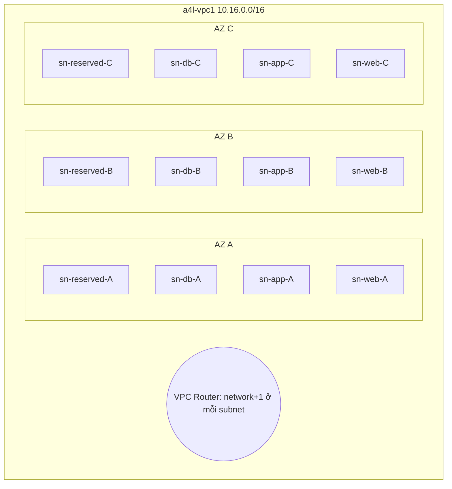

# VPC Subnets

> **TL;DR:** Subnet là một phần của VPC nằm trong **đúng một AZ**. Đây là nơi service thực sự chạy và là đơn vị để tạo cấu trúc, phân tầng và HA cho VPC. Mỗi subnet mất **5 IP** cho AWS. Subnet mới tạo luôn là **private**, phải cấu hình thêm mới thành public.

## 🖼️ Sơ đồ
![[VPC Subnets.excalidraw]]
*Mở bằng plugin Excalidraw để chỉnh sửa · ảnh tĩnh: [[VPC Subnets.svg]]*

## Khái niệm cốt lõi
- **AZ-resilient**: subnet được tạo trong **một AZ** và không bao giờ đổi AZ được. AZ hỏng thì subnet và mọi service chỉ nằm trong subnet đó cũng hỏng.
- Quan hệ subnet và AZ (hay ra thi):
  - **1 subnet ⇒ đúng 1 AZ**, không bao giờ trải nhiều AZ.
  - **1 AZ ⇒ 0..nhiều subnet**.
- Muốn HA: đặt các thành phần vào **nhiều subnet ở nhiều AZ** (xem [[HA vs FT vs DR]]).
- **IPv4 CIDR** của subnet:
  - phải là tập con của CIDR của VPC;
  - **không được chồng lấn** với subnet khác trong cùng VPC (cũng hay ra thi).
  - Kích thước subnet: /28 đến /16.
- **IPv6** (tùy chọn, chỉ khi VPC đã có IPv6): mỗi subnet nhận một **/64** cắt từ /56 của VPC ⇒ một VPC /56 chứa **256** subnet /64 (giá trị hex 00 → FF).
- Mặc định **các subnet trong cùng VPC nói chuyện tự do với nhau**: cách ly của VPC nằm ở **biên VPC**, không phải giữa các subnet (route `local`, xem [[VPC Routing and Internet Gateway]]).
- Quy ước màu trên sơ đồ AWS: **xanh dương = private subnet**, **xanh lá = public subnet**.

## 5 IP bị giữ trong mọi subnet
Ví dụ subnet **10.16.16.0/20** (10.16.16.0 → 10.16.31.255):

| Địa chỉ | Ví dụ | Dùng cho |
|---|---|---|
| Network address | 10.16.16.0 | Địa chỉ mạng (không riêng AWS, mạng IP nào cũng vậy) |
| Network + 1 | 10.16.16.1 | **VPC Router**: router có một interface trong mọi subnet |
| Network + 2 | 10.16.16.2 | Giữ cho **DNS** (chính xác thì DNS ở VPC base + 2, nhưng AWS giữ network+2 ở mọi subnet) |
| Network + 3 | 10.16.16.3 | **Dự phòng cho tương lai** |
| Broadcast | 10.16.31.255 | Địa chỉ cuối; VPC không hỗ trợ broadcast nhưng vẫn giữ |

- ⇒ IP dùng được = tổng − 5. Ví dụ /28 có 16 IP nhưng chỉ dùng được **11**; /20 dùng được **4,091**.
- VPC nhỏ chia nhiều subnet nhỏ thì 5 IP/subnet "ăn" rất nhanh.

## DHCP Options Set
- DHCP (Dynamic Host Configuration Protocol) là cách thiết bị tự nhận cấu hình IP.
- **Một VPC gắn một DHCP option set tại một thời điểm**, cấu hình này áp xuống mọi subnet: DNS server, NTP server, NetBIOS server...
- Option set **không sửa được**: muốn thay thì **tạo option set mới** rồi đổi VPC sang dùng nó.

## Thiết lập cấp IP ở mức subnet
- **Auto-assign public IPv4**: tài nguyên launch vào subnet tự nhận thêm public IPv4 bên cạnh private IP. Đây là **một trong các bước để làm subnet thành public**.
- **Auto-assign IPv6 address**: tài nguyên nhận IPv6; yêu cầu cả VPC và subnet đã có dải IPv6.
- Cả hai đặt **theo từng subnet** và áp cho tài nguyên trong subnet đó.

## Cách hoạt động / Kiến trúc
Cấu trúc A4L sau bài này: VPC 10.16.0.0/16, 4 tier × 3 AZ = **12 subnet /20**; khối thứ 4 (10.16.192.0/18) để dành cho AZ tương lai.

| AZ | Reserved | DB | APP | WEB |
|---|---|---|---|---|
| A (us-east-1a) | 10.16.0.0/20 (IPv6 00) | 10.16.16.0/20 (01) | 10.16.32.0/20 (02) | 10.16.48.0/20 (03) |
| B (us-east-1b) | 10.16.64.0/20 (04) | 10.16.80.0/20 (05) | 10.16.96.0/20 (06) | 10.16.112.0/20 (07) |
| C (us-east-1c) | 10.16.128.0/20 (08) | 10.16.144.0/20 (09) | 10.16.160.0/20 (0A) | 10.16.176.0/20 (0B) |

Lúc này cả 12 subnet đều **private** (kể cả web). Tier web sẽ thành public ở [[VPC Routing and Internet Gateway]].

## Demo / Lab
- Dùng một subnet calculator: nhập 10.16.0.0/16, chọn **16 subnet** ⇒ ra các khối /20: 10.16.0.0, 10.16.16.0, 10.16.32.0... (dù chỉ dùng 12).
- File `subnets.txt` trong repo khóa học liệt kê tên, CIDR, AZ, giá trị IPv6 cho từng subnet.
- Console mới cho phép **tạo nhiều subnet trong một lần**: làm từng batch 4 subnet cho mỗi AZ. Mỗi subnet: chọn VPC `a4l-vpc1`, tên `sn-<tier>-<AZ>`, AZ, IPv4 CIDR /20, **Custom IPv6** với giá trị hex tăng dần 00…0B (lưu ý 09 → **0A**, không phải 10).
- Sau khi tạo: với từng subnet, **Edit subnet settings → Enable auto-assign IPv6 address**. Chưa bật auto-assign public IPv4 (để dành cho bài IGW).
- Trang chi tiết subnet hiển thị: số IPv4 còn trống (đã trừ 5 IP), IPv6 CIDR, AZ, **route table** và **network ACL** đang gắn, các thiết lập auto-assign.
- Làm tay một lần để hiểu; các bài sau sẽ tự động hóa bằng [[CloudFormation Basics|CloudFormation]].

## 🎯 Mẹo thi SAA-C03
- **Subnet = 1 AZ**. Đáp án nào nói một subnet trải nhiều AZ là **sai**.
- CIDR subnet phải nằm trong CIDR của VPC và **không overlap** với subnet khác.
- Đếm IP dùng được: **trừ 5**. Câu hỏi kiểu "subnet /28 chạy được tối đa bao nhiêu instance" ⇒ **11**.
- Nhớ 3 IP riêng của AWS: **+1 router, +2 DNS, +3 reserved**, cộng network và broadcast.
- Subnet mới luôn private. Public cần IGW + route mặc định + public IP (auto-assign).
- Muốn đổi DNS/NTP server cho VPC ⇒ tạo **DHCP option set mới** và gắn vào VPC (không sửa set cũ).
- Mặc định subnet trong cùng VPC **định tuyến thẳng tới nhau**. Muốn chặn giữa subnet thì dùng [[NACL]] hoặc [[Security Groups]].

## Liên kết
- Tiên quyết: [[Custom VPC]], [[VPC Sizing and Structure]], [[Subnetting]]
- Tiếp theo: [[VPC Routing and Internet Gateway]], [[NACL]]
- Liên quan: [[AWS Global Infrastructure]], [[HA vs FT vs DR]], [[EC2 Network Interfaces IPs and DNS]], [[NAT Gateway]], [[CloudFormation Basics]]
- Phân biệt với: [[Default VPC]] (1 subnet /20 mỗi AZ, sẵn public)
- MOC: [[_MOC 06 VPC Basics]]
