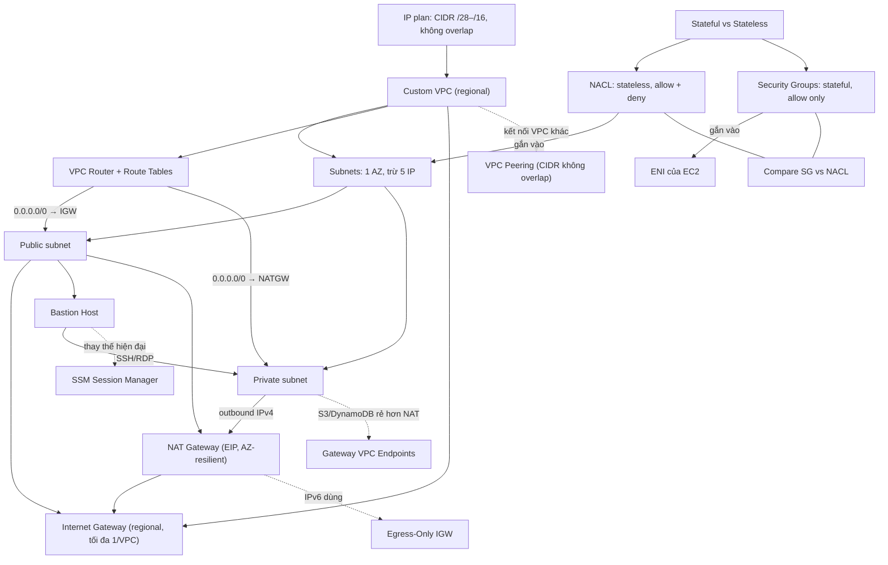

# 06 VPC Basics

Section dựng một custom VPC cho Animals4life từ đầu: lập IP plan, chia subnet theo AZ × tier, cấu hình routing và Internet Gateway, đặt bastion host, lọc traffic bằng NACL và Security Group, rồi cho private subnet ra internet qua NAT Gateway. Section áp dụng trực tiếp phần nền mạng ở [[_MOC 02 Tech Fundamentals]] ([[Subnetting]], [[NAT Fundamentals]]) và là nền cho mọi section dùng EC2, RDS, ELB về sau. Phần nâng cao (endpoint, peering, flow logs) nằm ở [[_MOC 16 Advanced VPC Networking]].

← [[00 Home]] · Trước: [[_MOC 05 S3]] · Sau: [[_MOC 07 EC2]]

## Lộ trình học
1. [[VPC Sizing and Structure]]: lập IP plan với CIDR không trùng mọi mạng liên quan, đủ chỗ tăng trưởng, rồi chia VPC theo AZ × tier.
2. [[Custom VPC]]: VPC regional tự thiết kế (IPv4 /28–/16, IPv6 /56, tenancy, DNS); mặc định không có gì và không ra vào được.
3. [[VPC Subnets]]: subnet nằm trong đúng một AZ, mất 5 IP cho AWS; subnet mới luôn là private.
4. [[VPC Routing and Internet Gateway]]: VPC Router và route table; IGW regional; subnet public = route tới IGW + public IP; IGW làm static NAT 1:1.
5. [[Bastion Host]]: jumpbox trong public subnet làm điểm vào SSH/RDP duy nhất; cách làm cũ, ngày nay thường thay bằng SSM.
6. [[Stateful vs Stateless Firewalls]]: request/response và ephemeral port; stateless cần 2 rule, stateful chỉ cần rule cho request.
7. [[NACL]]: firewall stateless ở biên subnet, rule đánh số, có cả ALLOW và DENY; chặn được IP xấu.
8. [[Security Groups]]: firewall stateful gắn vào ENI, chỉ có allow, tham chiếu được SG khác hoặc chính nó.
9. [[NAT Gateway]]: managed NAT cho IPv4 outbound-only; đặt trong public subnet với Elastic IP; AZ-resilient nên cần 1 NATGW mỗi AZ.
10. [[Compare - Security Groups vs NACL]]: so sánh nhiều chiều; mô hình chuẩn là SG để allow, NACL để deny bad actor.

## Bản đồ khái niệm

## Liên kết sang section khác
- Nền tảng mạng: [[Subnetting]], [[NAT Fundamentals]], [[Layer 4 Transport]] (ephemeral port)
- So sánh với VPC có sẵn: [[Default VPC]]
- Nơi gắn SG thực sự: [[EC2 Network Interfaces IPs and DNS]]
- Truy cập instance không qua bastion: [[EC2 Instance Connect and SSH]]
- Mở rộng: [[Egress-Only Internet Gateway]], [[Gateway VPC Endpoints]], [[VPC Peering]], [[VPC Flow Logs]]

## 🎯 Top mẹo thi của section
- VPC IPv4 từ **/28 (16 IP) đến /16 (65,536 IP)**. Peering/VPN không chạy được thì nghĩ ngay tới **CIDR overlap**. Default VPC luôn là 172.31.0.0/16. ([[VPC Sizing and Structure]])
- **Subnet = 1 AZ**, luôn **trừ 5 IP** (network, +1 router, +2 DNS, +3 reserved, broadcast). Subnet /28 chứa tối đa **11** instance. ([[VPC Subnets]])
- "Có public IP nhưng không có public DNS name" → bật **enableDnsHostnames**. Không phân giải được DNS trong VPC → kiểm tra **enableDnsSupport**. ([[Custom VPC]])
- Dedicated tenancy ở mức VPC ép mọi thứ chạy trên phần cứng dedicated và tốn tiền. Chỉ cần vài instance dedicated thì để VPC default rồi chọn tenancy ở instance. ([[Custom VPC]])
- Subnet public cần đủ **ba thứ**: IGW gắn vào VPC, route `0.0.0.0/0` tới IGW, public IP. IGW là **regional**, mỗi VPC tối đa **1**. ([[VPC Routing and Internet Gateway]])
- **OS không bao giờ thấy public IPv4**. IGW làm static NAT. Đáp án bảo cấu hình public IP trong hệ điều hành là sai. ([[VPC Routing and Internet Gateway]])
- Câu hỏi "cách an toàn nhất hoặc ít vận hành nhất để quản trị instance private" → **SSM Session Manager**, không phải bastion. Nếu có bastion thì nó phải nằm trong public subnet. ([[Bastion Host]])
- NACL **stateless**. Đã mở inbound mà client không nhận được phản hồi → thiếu outbound **ephemeral 1024–65535**. ([[Stateful vs Stateless Firewalls]])
- Chặn **một IP độc hại cụ thể** → **NACL** (SG không có deny). Rule NACL xét theo số nhỏ trước, khớp rule đầu tiên là dừng. ([[NACL]])
- Custom NACL mới tạo **chặn tất cả**; default NACL cho qua hết. NACL không lọc traffic giữa hai instance cùng subnet. ([[NACL]])
- SG gắn vào **ENI**, không gắn vào subnet. Tầng app chỉ nhận từ tầng web → **tham chiếu SG của tầng web** thay vì hard-code IP. Instance cùng nhóm nói chuyện với nhau → self-referencing SG. ([[Security Groups]])
- NATGW đặt trong **public subnet** và chỉ **AZ-resilient** → cần 1 NATGW + 1 route table **mỗi AZ**. NATGW **không gắn được SG**, không làm bastion và không port forwarding. ([[NAT Gateway]])
- **IPv6 + NAT Gateway thì loại ngay.** IPv6 outbound-only dùng Egress-Only IGW. Private instance chỉ cần tới S3/DynamoDB thì Gateway Endpoint rẻ hơn NATGW. ([[NAT Gateway]])
- NAT instance phải **tắt Source/Destination Check**. Cần phương án rẻ nhất cho môi trường test thì NAT instance là ứng viên. ([[NAT Gateway]])
- Bảng nhận diện nhanh: "stateful / reference SG / gắn ENI" → SG; "stateless / deny / gắn subnet / ephemeral port" → NACL. ([[Compare - Security Groups vs NACL]])
