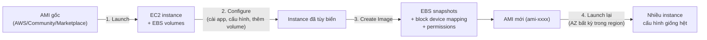
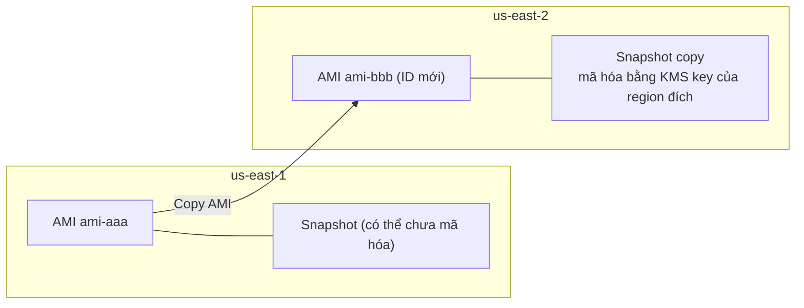

# AMI

> **TL;DR:** AMI (Amazon Machine Image) là "khuôn" để launch EC2 instance. Một AMI thực chất chỉ là **container logic** gồm ID, permissions và **block device mapping** trỏ tới các [[EBS Snapshots]], không tự chứa dữ liệu. AMI **gắn với một region**, **không sửa được**, có thể **copy sang region khác** (thành AMI mới với ID mới) và chia sẻ cho account khác.

## 🖼️ Sơ đồ
![[AMI.excalidraw]]
*Mở bằng plugin Excalidraw để chỉnh sửa · ảnh tĩnh: [[AMI.svg]]*

![[AMI - copy.excalidraw]]
*Mở bằng plugin Excalidraw để chỉnh sửa · ảnh tĩnh: [[AMI - copy.svg]]*

## Khái niệm cốt lõi

### AMI là gì, lấy từ đâu
- Mỗi lần launch EC2 (kể cả chọn "Amazon Linux 2" trên console) là bạn đang dùng một AMI.
- Nguồn AMI:
  - **AWS provided** (Amazon Linux, Windows...).
  - **Community** (Red Hat, CentOS, Ubuntu... do vendor/distro tự phát hành).
  - **Marketplace**: có thể kèm phần mềm thương mại → trả **giá instance theo giờ + phí license phần mềm**.
  - **Custom**: tự tạo từ instance của bạn.
- ID dạng `ami-0abc123...`. **AMI là regional**: cùng một hệ điều hành nhưng mỗi region có AMI ID khác nhau; một AMI chỉ dùng được trong region của nó, nhưng launch được vào **mọi AZ** trong region đó.

### Permissions (3 lựa chọn)
1. **Private** (mặc định): chỉ account sở hữu dùng được.
2. **Public**: mọi AWS account dùng được → cẩn thận lộ dữ liệu nhạy cảm (đặc biệt access key nằm trong image). **Mặc định bị chặn** bởi **Block public access for AMIs** (EC2 Dashboard → *Data protection and security*): guardrail AWS bật sẵn, chặn việc **share public mới**. Muốn public thì tắt, share, rồi nên bật lại; AMI đã public trước đó vẫn giữ public.
3. **Chia sẻ explicit** cho các account ID cụ thể, hoặc cho cả **Organization/OU** (xem [[AWS Organizations]]). Khi share có tùy chọn cấp thêm **create volume permission** trên snapshot đi kèm.
- Ưu tiên share explicit cho account tin cậy thay vì public.

### AMI chứa gì: block device mapping
- Khi tạo AMI từ instance, AWS tạo **EBS snapshot cho mỗi EBS volume** đang gắn (snapshot đầu tiên là full copy dữ liệu đã dùng, các lần sau incremental; xem [[EBS Snapshots]]).
- **Block device mapping** = bảng nối **snapshot ID ↔ device ID** của volume gốc, ví dụ:

| Snapshot | Device ID gốc | Vai trò |
|---|---|---|
| snap-boot | `/dev/xvda` | boot volume |
| snap-data | `/dev/xvdf` | data volume |

- Khi launch từ AMI: snapshot được dùng để **tạo EBS volume mới trong AZ đích**, gắn vào instance mới với **đúng device ID** đó → instance mới có cấu hình storage y hệt bản gốc.
- Snapshot được lưu trên S3 (do AWS quản lý) nên vốn đã regional, vì vậy AMI dùng được cho mọi AZ trong region.

### Chi phí
- AMI không tốn phí riêng, nhưng bạn trả tiền **dung lượng lưu trữ của các snapshot** mà AMI tham chiếu. Snapshot chỉ lưu dữ liệu đã dùng, nên volume 100 GiB chỉ dùng 5 GiB thì snapshot nhỏ hơn nhiều.

## Cách hoạt động / Kiến trúc

### Vòng đời AMI: Launch → Configure → Create Image → Launch

- Phần lớn người dùng chỉ trải qua bước 1. Bước 2–4 chính là **AMI baking**.

### Copy AMI giữa region

- Copy AMI = copy cả các snapshot sang region đích → tạo ra **AMI hoàn toàn khác, ID khác**.
- Có thể **bật mã hóa trong lúc copy** (snapshot chưa mã hóa → mã hóa ở đích). Snapshot đã mã hóa thì **được mã hóa lại** bằng key ở region đích, vì [[KMS]] key là regional. Mặc định dùng AWS managed key `aws/ebs`, có thể chọn customer managed key (xem [[EBS Encryption]]). (Phần mã hóa khi copy: bản khóa cũ nêu, bài mới không nói.)
- Thời gian copy phụ thuộc khoảng cách region và lượng dữ liệu, từ vài phút đến lâu hơn nhiều.

## Demo / Lab
**Tạo AMI cho web store Aus-E-Mart (2 phần):**
1. Stack CloudFormation tạo instance `AEM-Public-Instance` (Amazon Linux 2023), kết nối qua [[EC2 Instance Connect and SSH|EC2 Instance Connect]].
2. Cấu hình thủ công theo command list: `dnf install python3-pip unzip`, `pip install` Flask và Gunicorn, tải `aem-webstore.zip` bằng `curl`, giải nén, chuyển vào `/var/www/aem-webstore`, copy file service rồi `systemctl daemon-reload`, `enable`, kiểm tra `status` và `curl localhost/health`. App chạy dạng **service** nên tự lên lại sau reboot (đã thử reboot, web store vẫn chạy qua public IP).
3. **Stop instance** rồi *Image and templates → Create image* (`AEM Web Store Image`). Màn hình tạo AMI hiện các volume sẽ chụp (đổi được size, thêm volume, nhưng thường không cần).
4. Theo dõi snapshot (pending → completed; volume 8 GB chỉ dùng ~2 GB nên snapshot đầu chỉ ~2 GB) rồi AMI (pending → available).
5. *Launch instance from AMI*: chọn `t4g.small` (ARM, rẻ), không key pair, VPC `aem-vpc1`, subnet `WebA`, SG `AEM Web Store` → mở public IP thấy web store chạy ngay, **không phải cài lại gì**.

**Copy và share AMI:**
- Đổi sang `us-west-2` thì không thấy AMI (AMI regional); ở `us-east-1` thì launch được vào mọi AZ. *Copy AMI* sang `us-west-2` → ở đích có AMI mới đang pending và **bản copy snapshot** (thời gian tùy khoảng cách và độ bận của region).
- *Edit AMI permissions*: private (mặc định) / thêm account ID / share cho cả Organization hoặc OU theo ARN; tùy chọn thêm **create volume permission** cho snapshot (không tick thì account được share chỉ launch được instance, không tạo được volume từ snapshot).
- Public bị chặn mặc định; xem ở EC2 Dashboard → *Data protection and security* → *Block public access for AMIs*.
- Dọn dẹp: *Deregister AMI* và tick **Delete associated snapshots** ở **cả hai region**, terminate instance, xóa stack.

Rút ra:
- **Nên tạo AMI từ instance đã stop** để image nhất quán: instance đang chạy có thể đang ghi dữ liệu lúc chụp.
- Snapshot đầu tiên mất nhiều thời gian nhất, nhưng chỉ copy dữ liệu đã dùng.
- (Bản khóa cũ: demo cài WordPress, cowsay và banner MOTD trên Amazon Linux 2 cho Animals4life; copy AMI sang us-east-2 có bật *Encrypt target EBS snapshots*; deregister AMI không xóa snapshot nên phải xóa snapshot riêng.)

## 🎯 Mẹo thi SAA-C03
- **AMI = một region**, chỉ dùng được trong region đó (nhưng cho mọi AZ). Đáp án dùng "một AMI cho nhiều region" là **sai**; phải copy, và bản copy là **AMI khác, ID khác**.
- **AMI baking**: cài và cấu hình sẵn instance + ứng dụng rồi tạo AMI để launch hàng loạt nhanh. So sánh với bootstrapping bằng user data trong [[EC2 User Data Bootstrapping]] (baking: launch nhanh hơn, kém linh hoạt hơn) và dùng cùng [[Launch Templates]]/[[Auto Scaling Groups]].
- **AMI không sửa được**: muốn thay đổi thì launch instance từ AMI → cập nhật → tạo AMI mới.
- Copy giữa region **kèm snapshot**; có thể thêm mã hóa trong lúc copy; dữ liệu mã hóa phải dùng KMS key ở region đích.
- Permissions mặc định = **chỉ account của bạn**; share cho account, OU hoặc cả Organization. Share **public** bị **Block public access for AMIs** chặn mặc định.
- Deregister AMI có tùy chọn **delete associated snapshots**; không chọn thì snapshot vẫn còn và vẫn tính phí.
- Chi phí AMI = **dung lượng snapshot** mà nó tham chiếu.
- Launch từ AMI tạo **volume mới từ snapshot** trong AZ đích → đây cũng là cách "chuyển" cấu hình instance sang AZ khác.

## Liên kết
- Tiên quyết: [[EC2 Basics]], [[EBS]], [[EBS Snapshots]]
- Liên quan: [[EBS Encryption]], [[KMS]], [[EC2 Instance Connect and SSH]], [[AWS Organizations]], [[Animals4life Scenario]] (kịch bản của bản khóa cũ)
- Dùng cùng: [[Launch Templates]], [[Auto Scaling Groups]], [[Horizontal vs Vertical Scaling]], [[EC2 Image Builder]] (tự động hóa việc bake, test, phân phối AMI)
- Phân biệt với: [[EC2 User Data Bootstrapping]], [[cfn-init]]
