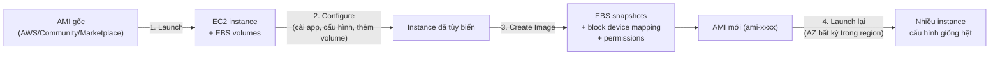
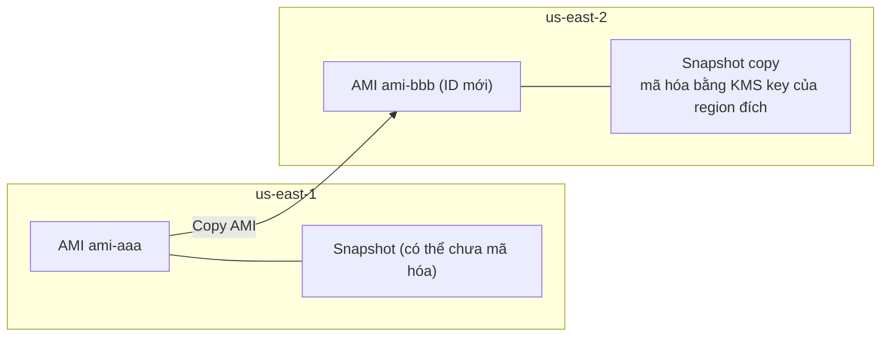

# AMI

> **TL;DR:** AMI (Amazon Machine Image) là "khuôn" để launch EC2 instance. Một AMI thực chất chỉ là **container logic** gồm ID, permissions và **block device mapping** trỏ tới các [[EBS Snapshots]], không tự chứa dữ liệu. AMI **gắn với một region**, **không sửa được**, có thể **copy sang region khác** (thành AMI mới với ID mới) và chia sẻ cho account khác.

## 🖼️ Sơ đồ
![[AMI.excalidraw]]
*Mở bằng plugin Excalidraw để chỉnh sửa · ảnh tĩnh: [[AMI.svg]]*

![[AMI - copy.excalidraw]]
*Mở bằng plugin Excalidraw để chỉnh sửa · ảnh tĩnh: [[AMI - copy.svg]]*

## Khái niệm cốt lõi

### AMI là gì, lấy từ đâu
- Mỗi lần launch EC2 (kể cả chọn "Amazon Linux 2" trên console) là bạn đang dùng một AMI.
- Nguồn AMI:
  - **AWS provided** (Amazon Linux, Windows...).
  - **Community** (Red Hat, CentOS, Ubuntu... do vendor/distro tự phát hành).
  - **Marketplace**: có thể kèm phần mềm thương mại → trả **giá instance theo giờ + phí license phần mềm**.
  - **Custom**: tự tạo từ instance của bạn.
- ID dạng `ami-0abc123...`. **AMI là regional**: cùng một hệ điều hành nhưng mỗi region có AMI ID khác nhau; một AMI chỉ dùng được trong region của nó, nhưng launch được vào **mọi AZ** trong region đó.

### Permissions (3 lựa chọn)
1. **Private** (mặc định): chỉ account sở hữu dùng được.
2. **Public**: mọi AWS account dùng được → cẩn thận lộ dữ liệu nhạy cảm (đặc biệt access key nằm trong image). (Hiện nay có setting *Block public access for AMIs* theo region, bật sẵn với account mới.)
3. **Chia sẻ explicit** cho các account ID cụ thể, hoặc cho cả **Organization/OU** (xem [[AWS Organizations]]). Khi share có tùy chọn cấp thêm **create volume permission** trên snapshot đi kèm.
- Ưu tiên share explicit cho account tin cậy thay vì public.

### AMI chứa gì: block device mapping
- Khi tạo AMI từ instance, AWS tạo **EBS snapshot cho mỗi EBS volume** đang gắn (snapshot đầu tiên là full copy dữ liệu đã dùng, các lần sau incremental; xem [[EBS Snapshots]]).
- **Block device mapping** = bảng nối **snapshot ID ↔ device ID** của volume gốc, ví dụ:

| Snapshot | Device ID gốc | Vai trò |
|---|---|---|
| snap-boot | `/dev/xvda` | boot volume |
| snap-data | `/dev/xvdf` | data volume |

- Khi launch từ AMI: snapshot được dùng để **tạo EBS volume mới trong AZ đích**, gắn vào instance mới với **đúng device ID** đó → instance mới có cấu hình storage y hệt bản gốc.
- Snapshot được lưu trên S3 (do AWS quản lý) nên vốn đã regional, vì vậy AMI dùng được cho mọi AZ trong region.

### Chi phí
- AMI không tốn phí riêng, nhưng bạn trả tiền **dung lượng lưu trữ của các snapshot** mà AMI tham chiếu. Snapshot chỉ lưu dữ liệu đã dùng, nên volume 100 GiB chỉ dùng 5 GiB thì snapshot nhỏ hơn nhiều.

## Cách hoạt động / Kiến trúc

### Vòng đời AMI: Launch → Configure → Create Image → Launch

- Phần lớn người dùng chỉ trải qua bước 1. Bước 2–4 chính là **AMI baking**.

### Copy AMI giữa region

- Copy AMI = copy cả các snapshot sang region đích → tạo ra **AMI hoàn toàn khác, ID khác**.
- Có thể **bật mã hóa trong lúc copy** (snapshot chưa mã hóa → mã hóa ở đích). Snapshot đã mã hóa thì **được mã hóa lại** bằng key ở region đích, vì [[KMS]] key là regional. Mặc định dùng AWS managed key `aws/ebs`, có thể chọn customer managed key (xem [[EBS Encryption]]).
- Thời gian copy phụ thuộc khoảng cách region và lượng dữ liệu, từ vài phút đến lâu hơn nhiều.

## Demo / Lab
**Tạo Animals4life AMI (0145–0146):**
1. Launch instance Amazon Linux 2 bằng CloudFormation, kết nối qua [[EC2 Instance Connect and SSH|EC2 Instance Connect]].
2. Cài WordPress thủ công (MariaDB, Apache, PHP, tải và cấu hình WordPress), dừng ở màn hình cài đặt để người dùng AMI tự hoàn tất.
3. Tùy biến: cài `cowsay`, tạo login banner (MOTD) "Amazon Linux 2 AMI - Animals4life", reboot để kiểm tra.
4. **Stop instance** rồi *Image and templates → Create image*. Màn hình tạo AMI hiển thị block device mapping (device ID, loại volume, 8 GiB) và cho phép đổi kích thước/thêm volume.
5. Theo dõi snapshot (pending → completed) rồi AMI (pending → available).
6. Launch instance mới từ AMI: storage tự động giống bản gốc (8 GiB gp2), có sẵn banner và WordPress. Với AMI custom, console có thể đoán sai username, cần sửa thành `ec2-user`.

Rút ra:
- **Nên tạo AMI từ instance đã stop** để storage nhất quán. Tạo từ instance đang chạy thì AWS có thể reboot instance; tùy chọn *no reboot* tránh reboot nhưng rủi ro dữ liệu không nhất quán còn cao hơn.
- Snapshot đầu tiên mất nhiều thời gian nhất vì phải copy toàn bộ dữ liệu.

**Copy và share AMI (0147):**
- Đổi region thì không thấy AMI nữa (AMI regional). Copy sang us-east-2, bật *Encrypt target EBS snapshots* với key `aws/ebs` → ở đích có AMI ID mới và snapshot đã mã hóa.
- *Edit AMI permissions*: Private / Public / thêm account ID, hoặc share cho Organization/OU; tùy chọn thêm create volume permission cho snapshot.
- Dọn dẹp: **Deregister AMI không xóa snapshot**, phải xóa snapshot riêng ở **cả hai region**.

## 🎯 Mẹo thi SAA-C03
- **AMI = một region**, chỉ dùng được trong region đó (nhưng cho mọi AZ). Đáp án dùng "một AMI cho nhiều region" là **sai**; phải copy, và bản copy là **AMI khác, ID khác**.
- **AMI baking**: cài và cấu hình sẵn instance + ứng dụng rồi tạo AMI để launch hàng loạt nhanh. So sánh với bootstrapping bằng user data trong [[EC2 User Data Bootstrapping]] (baking: launch nhanh hơn, kém linh hoạt hơn) và dùng cùng [[Launch Templates]]/[[Auto Scaling Groups]].
- **AMI không sửa được**: muốn thay đổi thì launch instance từ AMI → cập nhật → tạo AMI mới.
- Copy giữa region **kèm snapshot**; có thể thêm mã hóa trong lúc copy; dữ liệu mã hóa phải dùng KMS key ở region đích.
- Permissions mặc định = **chỉ account của bạn**; có thể public hoặc share cho account cụ thể.
- Chi phí AMI = **dung lượng snapshot** mà nó tham chiếu.
- Launch từ AMI tạo **volume mới từ snapshot** trong AZ đích → đây cũng là cách "chuyển" cấu hình instance sang AZ khác.

## Liên kết
- Tiên quyết: [[EC2 Basics]], [[EBS]], [[EBS Snapshots]]
- Liên quan: [[EBS Encryption]], [[KMS]], [[EC2 Instance Connect and SSH]], [[AWS Organizations]], [[Animals4life Scenario]]
- Dùng cùng: [[Launch Templates]], [[Auto Scaling Groups]], [[Horizontal vs Vertical Scaling]]
- Phân biệt với: [[EC2 User Data Bootstrapping]], [[cfn-init]]
