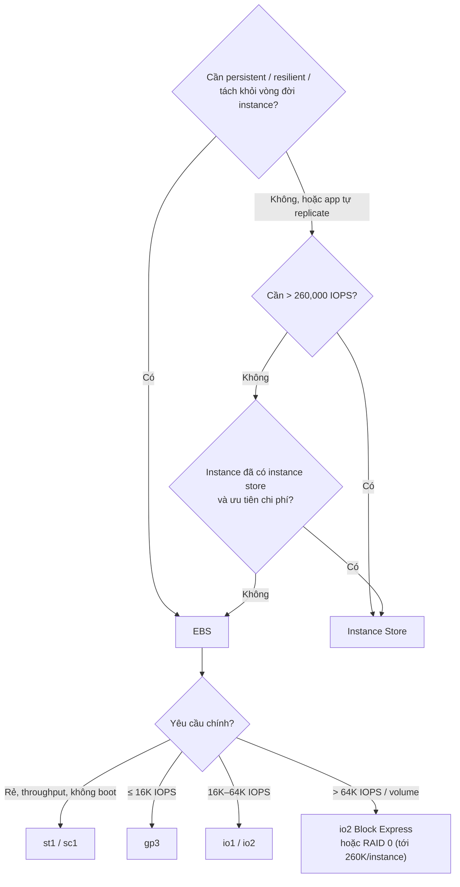

# Compare - EBS vs Instance Store

> **TL;DR:** Mặc định chọn **[[EBS]]** khi cần persistent, resilient hoặc tách khỏi vòng đời instance. Chọn **[[Instance Store]]** khi cần hiệu năng cực cao (> 260,000 IOPS), khi ứng dụng tự replicate dữ liệu, hoặc khi muốn tận dụng storage đã nằm sẵn trong giá instance. Bài này là bộ số liệu Adrian yêu cầu **thuộc lòng**.

## 🖼️ Sơ đồ
![[Compare - EBS vs Instance Store.excalidraw]]
*Mở bằng plugin Excalidraw để chỉnh sửa · ảnh tĩnh: [[Compare - EBS vs Instance Store.svg]]*

![[Compare - EBS vs Instance Store - ladder.excalidraw]]
*Mở bằng plugin Excalidraw để chỉnh sửa · ảnh tĩnh: [[Compare - EBS vs Instance Store - ladder.svg]]*

## Bảng so sánh nhiều chiều

| Tiêu chí | EBS | Instance Store |
|---|---|---|
| Vị trí | Network-attached (storage network), cùng AZ | Gắn vật lý vào EC2 host |
| Persistent | **Có**, tồn tại tới khi xóa volume | **Không** (ephemeral) |
| Resilience | Replicate trong AZ; snapshot lên S3 (regional) | Không; mất khi hỏng phần cứng |
| Vòng đời | **Độc lập** với instance, detach/attach được | Gắn với instance trên host đó |
| Thêm sau khi launch | Được | **Không**, chỉ lúc launch |
| Stop/start, resize, host maintenance | Dữ liệu giữ nguyên | **Mất dữ liệu** |
| Reboot | Giữ nguyên | Giữ nguyên (cùng host) |
| Hiệu năng tối đa | 16K (gp2/gp3), 64K (io1/io2), 256K (Block Express) IOPS/volume; ~260K IOPS/instance | **Hàng triệu IOPS**, tới 16 GB/s (I3), 4.6 GB/s HDD (D3) |
| Snapshot | Có ([[EBS Snapshots]]) | Không |
| Mã hóa KMS | Có ([[EBS Encryption]]) | Phần cứng NVMe tự mã hóa, không quản lý bằng KMS |
| Chi phí | Trả theo GB-tháng (+ IOPS/throughput tùy loại) | **Đã bao gồm** trong giá instance |
| Boot volume | Có (trừ st1/sc1) | Có (instance store-backed AMI, ít dùng) |

## Khi nào chọn cái nào?

### Rõ ràng chọn EBS (tránh Instance Store)
- Cần **persistent storage**.
- Cần **resilient storage** (EBS có phần cứng resilient trong AZ và snapshot lên S3).
- Cần storage **tách khỏi vòng đời instance**: attach vào một instance, dùng, detach, gắn sang instance khác.

### Tùy tình huống ("it depends")
- Cần resilience nhưng **ứng dụng có replication tích hợp** (ví dụ cluster NoSQL, Kafka, Hadoop HDFS) → dùng instance store trên **nhiều instance**: được hiệu năng mà rủi ro mất dữ liệu đã được ứng dụng xử lý.
- Cần **hiệu năng cao**: tới một mức thì cả hai đều được; **siêu cao** thì phải instance store.
- **Chi phí là ưu tiên** và instance đã có sẵn instance store → dùng nó (đã trả tiền rồi).

## Bảng số liệu cần thuộc (exam power-up)

| Tình huống trong đề | Chọn |
|---|---|
| **Rẻ** (và cần EBS) | **st1** hoặc **sc1** |
| **Throughput / streaming** | **st1** |
| **Boot volume** | **KHÔNG** st1 hay sc1 |
| ≤ **16,000 IOPS**/volume | gp2/gp3 |
| 16,000 – **64,000 IOPS**/volume | io1/io2 |
| Tới **256,000 IOPS**/volume | io2 Block Express |
| **RAID 0 nhiều EBS volume** | Tới **260,000 IOPS** (trần per-instance; io1, io2 Block Express, gp2/gp3) |
| **> 260,000 IOPS** và chấp nhận không persistent | **Instance Store** |

### RAID 0 với EBS
- Gộp nhiều EBS volume thành **RAID 0** trong OS → hiệu năng gần bằng tổng các volume.
- Nhưng luôn bị chặn bởi **trần per-instance (~260,000 IOPS)** và loại/size instance (phải là instance lớn, hiện đại). Gộp thêm volume cũng không vượt được trần này.
- RAID 0 không có redundancy: một volume hỏng là mất cả set.

## 🎯 Mẹo thi SAA-C03
- Từ khóa **persistent / durable / survive stop / detach & reattach** → EBS.
- Từ khóa **temporary, cache, buffer, scratch, highest performance, millions of IOPS**, hoặc "data is replicated across nodes" → Instance Store.
- **Cost-focused + EBS** → st1/sc1; **throughput/streaming** → st1; nhưng **boot** thì loại cả hai.
- Nhớ các mốc **16K → 64K → 256K → 260K**: vượt mốc nào thì chuyển công nghệ tương ứng.
- Hiệu năng EBS cao cần **instance đủ lớn**; nếu đề cho volume nhanh mà instance nhỏ → đổi instance type ([[EC2 Instance Types]], [[Enhanced Networking and EBS Optimized]]).
- (Transcript có nhắc "instance rebooting" là nguyên nhân mất dữ liệu instance store; thực tế và demo bài 0139 cho thấy **reboot giữ dữ liệu**, chỉ stop/start, resize, host failure mới mất.)

## Liên kết
- Tiên quyết: [[Storage Fundamentals]], [[EBS]], [[Instance Store]], [[EBS Volume Types]]
- Liên quan: [[EBS Snapshots]], [[EC2 Instance Types]], [[EC2 Architecture and Resilience]], [[Enhanced Networking and EBS Optimized]]
- Phân biệt với: [[EFS]] (file storage dùng chung), [[S3 Basics]] (object storage)
