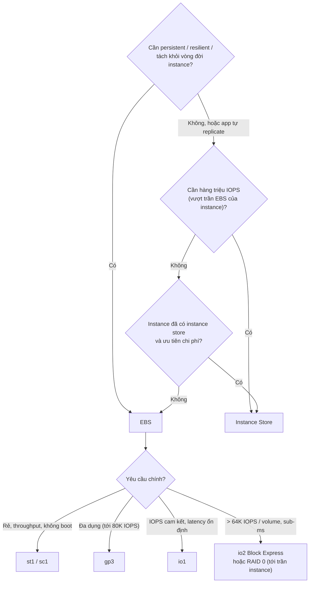

# Compare - EBS vs Instance Store

> **TL;DR:** Mặc định chọn **[[EBS]]** khi cần persistent, resilient hoặc tách khỏi vòng đời instance. Chọn **[[Instance Store]]** khi cần hiệu năng cực cao (hàng triệu IOPS, vượt trần EBS của instance), khi ứng dụng tự replicate dữ liệu, hoặc khi muốn tận dụng storage đã nằm sẵn trong giá instance. Bài này là bộ số liệu giảng viên yêu cầu **thuộc lòng**.

## 🖼️ Sơ đồ
![[Compare - EBS vs Instance Store.excalidraw]]
*Mở bằng plugin Excalidraw để chỉnh sửa · ảnh tĩnh: [[Compare - EBS vs Instance Store.svg]]*

![[Compare - EBS vs Instance Store - ladder.excalidraw]]
*Mở bằng plugin Excalidraw để chỉnh sửa · ảnh tĩnh: [[Compare - EBS vs Instance Store - ladder.svg]]*

## Bảng so sánh nhiều chiều

| Tiêu chí | EBS | Instance Store |
|---|---|---|
| Vị trí | Network-attached (storage network), cùng AZ | Gắn vật lý vào EC2 host |
| Persistent | **Có**, tồn tại tới khi xóa volume | **Không** (ephemeral) |
| Resilience | Replicate trong AZ; snapshot lên S3 (regional) | Không; mất khi hỏng phần cứng |
| Vòng đời | **Độc lập** với instance, detach/attach được | Gắn với instance trên host đó |
| Thêm sau khi launch | Được | **Không**, chỉ lúc launch |
| Stop/start, resize, host maintenance | Dữ liệu giữ nguyên | **Mất dữ liệu** |
| Reboot | Giữ nguyên | Giữ nguyên (cùng host) |
| Hiệu năng tối đa | 16K (gp2), 64K (io1), 80K (gp3), 256K (io2 Block Express) IOPS/volume; tổng bị chặn bởi trần của instance | **Hàng triệu IOPS** (i7i), 4,600 MB/s HDD (D3) |
| Snapshot | Có ([[EBS Snapshots]]) | Không |
| Mã hóa KMS | Có ([[EBS Encryption]]) | Phần cứng NVMe tự mã hóa, không quản lý bằng KMS |
| Chi phí | Trả theo GB-tháng (+ IOPS/throughput tùy loại) | **Đã bao gồm** trong giá instance |
| Boot volume | Có (trừ st1/sc1) | Có (instance store-backed AMI, ít dùng) |

## Khi nào chọn cái nào?

### Rõ ràng chọn EBS (tránh Instance Store)
- Cần **persistent storage**.
- Cần **resilient storage** (EBS có phần cứng resilient trong AZ và snapshot lên S3).
- Cần storage **tách khỏi vòng đời instance**: attach vào một instance, dùng, detach, gắn sang instance khác.

### Tùy tình huống ("it depends")
- Cần resilience nhưng **ứng dụng có replication tích hợp** (ví dụ cluster NoSQL, Kafka, Hadoop HDFS) → dùng instance store trên **nhiều instance**: được hiệu năng mà rủi ro mất dữ liệu đã được ứng dụng xử lý.
- Cần **hiệu năng cao**: tới một mức thì cả hai đều được; **siêu cao** thì phải instance store.
- **Chi phí là ưu tiên** và instance đã có sẵn instance store → dùng nó (đã trả tiền rồi).

## Bảng số liệu cần thuộc (exam power-up)

| Tình huống trong đề | Chọn |
|---|---|
| **Rẻ** (và cần EBS) | **st1** hoặc **sc1** |
| **Throughput / streaming** | **st1** |
| **Boot volume** | **KHÔNG** st1 hay sc1 |
| gp2 | Tối đa **16,000 IOPS**/volume, tăng theo size |
| gp3 | **3,000 IOPS** mặc định, trả thêm tới **80,000 IOPS**/volume |
| io1 | Tới **64,000 IOPS**/volume, **provisioned**: latency thấp, ổn định |
| io2 Block Express | Tới **256,000 IOPS**/volume, sub-millisecond |
| **RAID 0 nhiều EBS volume** | Cộng dồn hiệu năng các volume, tới **trần của instance** (instance Nitro lớn nhất: hàng trăm nghìn tới cả triệu IOPS) |
| Hàng triệu IOPS và chấp nhận không persistent | **Instance Store** |

- **gp3 có trần IOPS cao hơn io1**, nhưng gp3 không cam kết độ ổn định. Cần IOPS bảo đảm và latency ổn định (DB hiệu năng cao, app nhạy latency) → **io1/io2 Block Express**.
- (Bản khóa cũ nêu thang 16K (gp2/gp3) → 64K (io1/io2) → 256K (Block Express) → 260K (trần per-instance khi RAID 0) → Instance Store.)

### RAID 0 với EBS
- Gộp nhiều EBS volume thành **RAID 0** trong OS → hiệu năng gần bằng tổng các volume.
- Nhưng luôn bị chặn bởi **trần per-instance** do loại/size instance quyết định: instance Nitro lớn nhất đạt hàng trăm nghìn tới cả triệu IOPS (ví dụ R5b: 260,000 IOPS), instance nhỏ chạm trần sớm hơn nhiều. Gộp thêm volume cũng không vượt được trần này. Phải chọn đúng số volume, đúng loại và size instance.
- RAID 0 không có redundancy: một volume hỏng là mất cả set.

## 🎯 Mẹo thi SAA-C03
- Từ khóa **persistent / durable / survive stop / detach & reattach** → EBS.
- Từ khóa **temporary, cache, buffer, scratch, highest performance, millions of IOPS**, hoặc "data is replicated across nodes" → Instance Store.
- **Cost-focused + EBS** → st1/sc1; **throughput/streaming** → st1; nhưng **boot** thì loại cả hai.
- Nhớ các mốc: gp2 **16K**, io1 **64K**, gp3 **80K**, io2 Block Express **256K** IOPS/volume → RAID 0 tới trần instance → hàng triệu IOPS chỉ có Instance Store. Cần latency ổn định thì chọn provisioned IOPS (io1/io2 Block Express) dù gp3 có trần IOPS cao hơn io1. (Bộ đề cũ có thể dùng mốc gp3 = 16K.)
- Hiệu năng EBS cao cần **instance đủ lớn**; nếu đề cho volume nhanh mà instance nhỏ → đổi instance type ([[EC2 Instance Types]], [[Enhanced Networking and EBS Optimized]]).
- **Reboot là thao tác duy nhất an toàn** với instance store; stop/start, maintenance, hỏng phần cứng hay bất cứ gì khiến instance đổi host đều làm mất dữ liệu.

## Liên kết
- Tiên quyết: [[Storage Fundamentals]], [[EBS]], [[Instance Store]], [[EBS Volume Types]]
- Liên quan: [[EBS Snapshots]], [[EC2 Instance Types]], [[EC2 Architecture and Resilience]], [[Enhanced Networking and EBS Optimized]]
- Phân biệt với: [[EFS]] (file storage dùng chung), [[S3 Basics]] (object storage)
