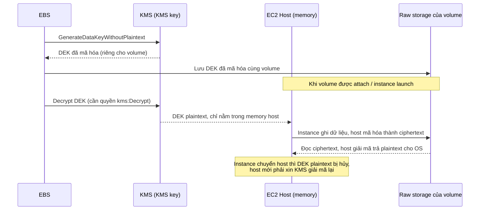

# EBS Encryption

> **TL;DR:** EBS encryption mã hóa **at rest** cho volume và snapshot bằng [[KMS]]. KMS key sinh ra một **data encryption key (DEK) riêng cho mỗi volume**; DEK được giải mã và giữ **trong memory của EC2 host**, host mã hóa/giải mã dữ liệu giữa instance và volume bằng AES-256. OS không biết gì về việc mã hóa, **miễn phí**, **không giảm hiệu năng** → nên bật mặc định.

## 🖼️ Sơ đồ
![[EBS Encryption.excalidraw]]
*Mở bằng plugin Excalidraw để chỉnh sửa · ảnh tĩnh: [[EBS Encryption.svg]]*

![[EBS Encryption - dek.excalidraw]]
*Mở bằng plugin Excalidraw để chỉnh sửa · ảnh tĩnh: [[EBS Encryption - dek.svg]]*

## Khái niệm cốt lõi
- Mặc định EBS **không mã hóa**: dữ liệu OS ghi xuống được lưu dạng **plaintext** trên đĩa vật lý → rủi ro, một vector tấn công vật lý.
- EBS encryption cung cấp **at-rest encryption** cho **volume và snapshot**.
- Key dùng:
  - **AWS managed key** mặc định: `aws/ebs`, hoặc
  - **Customer managed KMS key** do bạn tạo và quản lý.
- Mã hóa xảy ra **giữa EC2 host và EBS**, thuật toán **AES-256**.

## Cách hoạt động / Kiến trúc

1. Khi tạo volume mã hóa, EBS gọi KMS **`GenerateDataKeyWithoutPlaintext`** → nhận **DEK đã mã hóa**, lưu cùng volume trên raw storage. Volume lúc đầu trống nên chưa có gì để mã hóa.
2. DEK chỉ giải mã được qua KMS, bởi thực thể **có quyền decrypt** với KMS key tương ứng.
3. Khi volume được dùng lần đầu (attach vào instance hoặc instance launch), EBS nhờ KMS **giải mã DEK** và nạp vào **memory của EC2 host** đang dùng volume. DEK plaintext **chỉ tồn tại trong memory host**.
4. Host dùng DEK mã hóa/giải mã dữ liệu đi giữa instance và volume → trên đĩa luôn là **ciphertext**; plaintext chỉ có trong memory host.
5. Instance chuyển host → DEK plaintext trên host cũ bị **hủy**, chỉ còn bản mã hóa đi kèm volume; host mới phải giải mã lại qua KMS.
6. **Snapshot** của volume mã hóa dùng **cùng DEK** → snapshot cũng mã hóa. Volume tạo từ snapshot đó cũng dùng **cùng DEK**.

### Quy tắc DEK (Adrian nhấn mạnh nhiều lần)
| Hành động | DEK |
|---|---|
| Tạo volume **mới từ đầu** | **DEK mới, duy nhất** cho volume đó |
| Tạo volume mới khác từ đầu | DEK khác |
| Snapshot volume mã hóa | **Cùng DEK** với volume |
| Tạo volume từ snapshot đó | **Cùng DEK** |

## Các điểm tóm tắt (Exam PowerUp)
- **Account có thể bật "encrypt by default"** (thiết lập theo từng region) với một **default KMS key**; nếu không thì chọn KMS key thủ công mỗi lần tạo volume.
- KMS key **không trực tiếp** mã hóa volume; nó sinh ra **DEK riêng cho từng volume** (xem [[KMS]] về envelope encryption).
- **Không thể bỏ mã hóa** khỏi volume hay snapshot: đã mã hóa là mã hóa mãi. Cách vòng duy nhất: trong OS (nơi thấy plaintext), **copy dữ liệu** sang một volume không mã hóa. Console/CLI/API không hỗ trợ.
- **OS không biết có mã hóa**: OS chỉ thấy plaintext. Mã hóa xảy ra giữa host và EBS.
- Nếu cần **OS tự mã hóa và tự giữ key** (không để EC2/EBS/KMS giữ) → dùng **software disk encryption** trong OS. Có thể dùng đồng thời với EBS encryption (ít khi có ý nghĩa).
- EBS encryption: **không tốn phí, không mất hiệu năng**, không phải lo quản lý key → nên dùng mặc định.

### Mã hóa một volume chưa mã hóa (kiến thức bổ sung hay gặp)
- Không bật mã hóa trực tiếp trên volume đang có được. Quy trình: **snapshot** volume → **copy snapshot với tùy chọn encrypt** (hoặc tạo volume từ snapshot và chọn encrypt) → tạo volume mã hóa → thay volume cũ.
- Chia sẻ snapshot/AMI mã hóa sang account khác cần dùng **customer managed key** và cấp quyền trong key policy; key `aws/ebs` không chia sẻ được.

## 🎯 Mẹo thi SAA-C03
- Yêu cầu "mọi EBS volume mới phải được mã hóa" → bật **EBS encryption by default** cho account/region.
- Volume mã hóa → snapshot mã hóa → volume từ snapshot mã hóa (cùng DEK). Không có cách "gỡ mã hóa" qua AWS.
- Cần **chính bạn giữ key ở mức OS**, AWS không được truy cập key → software/full-disk encryption trong OS (hoặc [[CloudHSM]] cho quản lý key), không phải EBS encryption.
- "Mã hóa có ảnh hưởng hiệu năng/chi phí không?" → **không**.
- Thực thể dùng volume cần quyền KMS (decrypt) với key tương ứng; nếu key bị disable/xóa, volume không dùng được.
- Encryption at rest trên EBS khác với [[S3 Encryption]] (SSE-S3/SSE-KMS/SSE-C) nhưng cùng ý tưởng envelope encryption với KMS.

## Liên kết
- Tiên quyết: [[KMS]], [[Encryption Fundamentals]], [[EBS]]
- Liên quan: [[EBS Snapshots]], [[AMI]], [[S3 Encryption]], [[RDS Security]], [[CloudHSM]]
- Phân biệt với: [[S3 Encryption]], [[SSL and TLS]] (encryption in transit)
