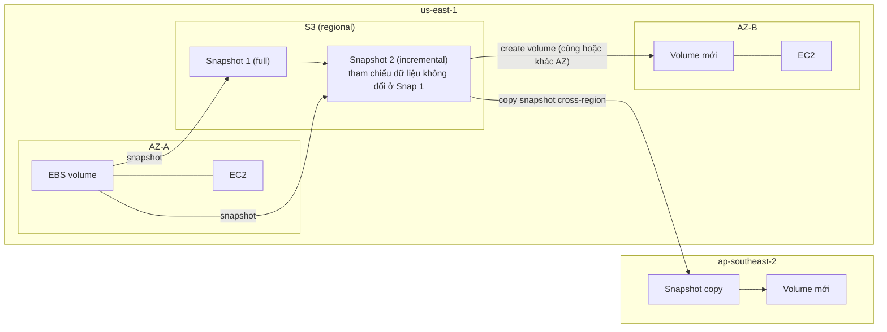

# EBS Snapshots

> **TL;DR:** Snapshot là bản sao lưu **incremental** của EBS volume lưu trên **S3**, nâng dữ liệu từ AZ-resilient lên **region-resilient**. Dùng để backup, clone volume, chuyển volume sang AZ khác, và **copy sang region khác** cho DR/migration. Restore từ snapshot là **lazy**; muốn hiệu năng đầy đủ ngay thì đọc trước mọi block (dd) hoặc bật **Fast Snapshot Restore (FSR)**. Snapshot giữ lâu, ít dùng có thể chuyển sang **archive tier**; cần chống xóa thì dùng **snapshot lock (WORM)**.

## 🖼️ Sơ đồ
![[EBS Snapshots.excalidraw]]
*Mở bằng plugin Excalidraw để chỉnh sửa · ảnh tĩnh: [[EBS Snapshots.svg]]*

![[EBS Snapshots - restore.excalidraw]]
*Mở bằng plugin Excalidraw để chỉnh sửa · ảnh tĩnh: [[EBS Snapshots - restore.svg]]*

## Khái niệm cốt lõi
- Snapshot = backup của [[EBS]] volume, lưu vào phần S3 do AWS quản lý (bạn không thấy bucket).
- EBS volume là **AZ-resilient**; snapshot nằm trên S3 nên **region-resilient**, bảo vệ dữ liệu khỏi sự cố toàn AZ hoặc hỏng hệ thống storage trong AZ.
- **Incremental**:
  - Snapshot **đầu tiên là full copy** của **dữ liệu đã dùng** (không phải dung lượng cấp phát). Volume 40 GB dùng 10 GB → snapshot đầu 10 GB.
  - Snapshot đầu có thể mất thời gian (copy nền), **không ảnh hưởng hiệu năng EBS**.
  - Các snapshot sau **chỉ lưu phần thay đổi** so với snapshot trước → nhỏ và nhanh hơn nhiều.
  - Khác backup truyền thống: **xóa một snapshot incremental không làm hỏng các snapshot sau**. EBS tự di chuyển dữ liệu cần thiết, nên mỗi snapshot có thể coi là **tự đủ (self-sufficient)**.
- Khi tạo volume: chọn **blank** hoặc **từ snapshot**. Snapshot là cách **clone** volume.
- Vì S3 là dịch vụ regional, volume tạo từ snapshot có thể ở **AZ khác** với volume gốc → cách **di chuyển volume giữa các AZ**.
- Snapshot có thể **copy sang region khác** → dùng cho **global DR** hoặc migration giữa region.

## Cách hoạt động / Kiến trúc

### Hiệu năng khi restore
- Volume **mới, trống** (không từ snapshot): đạt hiệu năng đầy đủ **ngay lập tức**, không cần khởi tạo.
- Volume **restore từ snapshot**: dữ liệu được nạp **lazily** từ S3 trong nền. Đọc vào block chưa được nạp → EBS kéo ngay từ S3, nhưng **chậm hơn** đọc EBS trực tiếp (first-read penalty).
- Hai cách khắc phục:
  1. **Force read mọi block** trong OS (ví dụ `dd` trên Linux) ngay sau khi restore, trước khi đưa vào production. Miễn phí nhưng tốn công quản trị.
  2. **Fast Snapshot Restore (FSR)**: bật trên snapshot để volume tạo ra **khởi tạo đầy đủ ngay lập tức**.
     - Chọn **snapshot + các AZ** muốn restore nhanh. Mỗi cặp (snapshot, AZ) là một FSR set.
     - Giới hạn: **tối đa 5 FSR mỗi region**. Một snapshot bật cho 2 AZ = dùng 2/5. (Bản khóa cũ nêu 50 FSR set mỗi region.)
     - **Tốn thêm phí**, có thể đắt nếu nhiều snapshot.

### Billing
- Tính theo **GB-tháng**: 10 GB lưu 1 tháng = 20 GB lưu nửa tháng = 10 GB-month.
- **Chỉ tính dữ liệu đã dùng (used), KHÔNG tính dung lượng cấp phát (allocated)**. (Ngược với EBS volume, tính theo dung lượng cấp phát.)
- Do incremental, snapshot thường xuyên (5 phút/lần) **không nhất thiết đắt hơn** snapshot mỗi giờ: chỉ dữ liệu thay đổi mới được lưu.
- Ví dụ (slide):
  - Volume 10 GiB đầy → **Snap A = 10 GiB**.
  - Đổi 4 GiB → **Snap B lưu 4 GiB**, tham chiếu 6 GiB không đổi ở Snap A.
  - Thêm 2 GiB (volume 12 GiB) → **Snap C lưu 2 GiB**, tham chiếu 6 GiB ở A và 4 GiB ở B.

### Archive tier và snapshot lock
- Mặc định snapshot nằm ở **standard tier**. Có thêm **archive tier** cho snapshot giữ lâu mà hiếm khi cần: **tối thiểu 90 ngày**, restore mất **tới 72 giờ**. Hợp với snapshot kết thúc dự án, hằng tháng, hằng quý; **không** dùng cho backup hằng ngày.
- **Snapshot lock** đưa snapshot vào trạng thái **WORM** (write once, read many): **không ai xóa được, bất kể quyền IAM**. Khóa trong một khoảng thời gian cố định hoặc tới một ngày cụ thể. Dùng cho compliance và **chống ransomware**; không tốn thêm phí ngoài phí lưu snapshot. (Bổ sung, bài không nói: hành vi "không ai xóa được" là **compliance mode**; còn **governance mode** thì user có quyền IAM phù hợp vẫn gỡ khóa được.)

### Encryption
- Snapshot của volume mã hóa thì cũng mã hóa; chi tiết ở [[EBS Encryption]].

## Demo / Lab
(Demo EBS Volumes PART2, xem thêm [[EBS]]) Volume ở us-east-1a không attach được vào instance ở us-east-1b → detach rồi **Create snapshot** (snapshot đầu là full nên mất vài phút) → *Create volume from snapshot* ở us-east-1b (có thể đổi type, size, IOPS) → attach vào instance AZ-B, mount → thấy đúng file test cũ. Snapshot còn có tùy chọn **Copy snapshot** sang region khác (ví dụ `ap-southeast-1`), giúp "chuyển" dữ liệu, thậm chí instance, sang region khác.

## 🎯 Mẹo thi SAA-C03
- Chuyển EBS volume **sang AZ khác** → snapshot rồi tạo volume ở AZ đích. **Sang region khác** → copy snapshot rồi tạo volume (hoặc copy [[AMI]]).
- Bảo vệ dữ liệu EBS khỏi **AZ failure** → snapshot (region-resilient). Cần DR cross-region → **copy snapshot sang region khác** (có thể tự động bằng Data Lifecycle Manager hoặc [[AWS Backup]]).
- Volume restore từ snapshot **chậm lúc đầu** → giải pháp: **FSR** (trả thêm, tức thì, tối đa 5 mỗi region, đặt theo snapshot + AZ) hoặc **đọc trước mọi block bằng dd**.
- Snapshot cần giữ lâu, hiếm khi restore, chấp nhận chờ tới 72 giờ → **archive tier** (tối thiểu 90 ngày). Snapshot **không ai được xóa** (compliance, ransomware) → **snapshot lock**.
- Snapshot **incremental**, tính tiền theo **dữ liệu đã dùng**; xóa snapshot cũ không làm hỏng snapshot mới.
- Snapshot đầu tiên là full, các lần sau nhanh hơn nhiều.
- Snapshot là nền tảng của [[AMI]] (EBS-backed AMI tham chiếu snapshot của các volume).

## Liên kết
- Tiên quyết: [[EBS]], [[S3 Basics]]
- Liên quan: [[EBS Encryption]], [[AMI]], [[AWS Backup]], [[RDS Backups and Restore]], [[RPO and RTO]], [[HA vs FT vs DR]]
- Phân biệt với: [[S3 Versioning and MFA Delete]] (phiên bản object, không phải backup block volume), [[Instance Store]] (không có snapshot)
