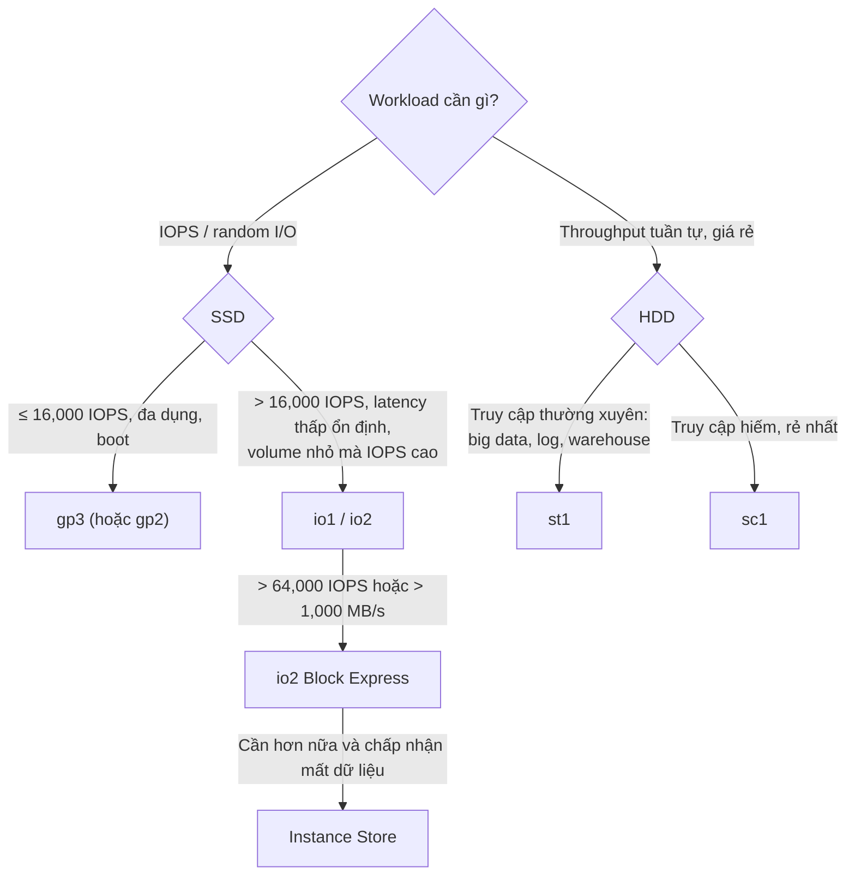

# EBS Volume Types

> **TL;DR:** EBS có 3 nhóm volume: **General Purpose SSD** (gp2, gp3) cho phần lớn workload, **Provisioned IOPS SSD** (io1, io2, io2 Block Express) cho latency thấp và ổn định ở IOPS rất cao, và **HDD** (st1, sc1) cho throughput tuần tự giá rẻ. Đề thi kiểm tra bạn có nắm **thang hiệu năng** (16,000 / 64,000 / 256,000 IOPS; 250 / 500 / 1,000 / 4,000 MB/s) để chọn đúng loại.

## 🖼️ Sơ đồ
![[EBS Volume Types.excalidraw]]
*Mở bằng plugin Excalidraw để chỉnh sửa · ảnh tĩnh: [[EBS Volume Types.svg]]*

![[EBS Volume Types - gp2.excalidraw]]
*Mở bằng plugin Excalidraw để chỉnh sửa · ảnh tĩnh: [[EBS Volume Types - gp2.svg]]*

## Khái niệm cốt lõi

### gp2: General Purpose SSD đời đầu (mô hình credit bucket)
- Kích thước **1 GB – 16 TB**.
- Đơn vị: **1 I/O credit = 1 thao tác 16 KB**. Truyền file 160 KB trong 1 giây = 10 I/O = 10 IOPS.
- Mỗi volume có một **I/O credit bucket** dung lượng **5.4 triệu credit**, **bắt đầu đầy**.
- Bucket được nạp lại theo **baseline performance**:
  - **3 IOPS mỗi GB** kích thước volume (100 GB → 300 credit/s).
  - Tối thiểu **100 IOPS** (mọi volume < 33.33 GB đều có 100).
- Có thể **burst lên 3,000 IOPS**. Bucket đầy cho phép chạy 3,000 IOPS ít nhất 30 phút (thực tế lâu hơn vì bucket liên tục được nạp). Rất hợp cho tải nặng lúc khởi động hoặc tải không liên tục.
- Dùng nhiều hơn baseline → bucket cạn dần; dùng ít hơn → bucket đầy lại. **Bucket về 0 thì không thực hiện được I/O** → phải theo dõi credit của mọi volume.
- Volume **> 1 TB** có baseline ≥ 3,000 nên **không dùng credit**, luôn đạt baseline.
- Tối đa **16,000 IOPS** (đạt khi volume ≥ ~5.33 TB). Throughput tối đa **250 MB/s**.
- Use case: boot volume, ứng dụng tương tác latency thấp, dev/test. Lúc quay khóa học, gp2 là mặc định.
- **Elastic Volumes**: có thể đổi type (gp2 ↔ gp3 ↔ loại khác), size, IOPS mà không cần detach.

### gp3: General Purpose SSD thế hệ mới (không credit)
- Bỏ credit bucket. **Mọi volume, bất kể size**, có chuẩn **3,000 IOPS và 125 MiB/s**.
- Kích thước 1 GB – 16 TB.
- **Rẻ hơn gp2 khoảng 20%** (giá cơ bản). Nếu chỉ cần ≤ 3,000 IOPS → chọn gp3 không cần nghĩ.
- Trả thêm để lên tối đa **16,000 IOPS** và **1,000 MiB/s** (gấp 4 lần trần 250 MiB/s của gp2). Kể cả khi trả thêm, thường vẫn rẻ hơn gp2.
- "gp3 như con của gp2 và io1": giá/đa dụng của gp2 + khả năng cấu hình IOPS độc lập của io1.
- Khác biệt quan trọng: gp2 **tự tăng IOPS theo size**; gp3 thì **không**, muốn > 3,000 IOPS phải provision thêm.
- Use case: virtual desktop, DB một instance cỡ vừa (MSSQL Server, Oracle), app tương tác latency thấp, dev/test, boot volume.
- (Khóa học nói gp2 là mặc định; hiện nay gp3 là mặc định trong console. Năm 2025 AWS còn nâng trần gp3 lên tới 64 TiB, 80,000 IOPS, 2,000 MiB/s; đề thi thường vẫn dùng mốc 16,000 IOPS / 1,000 MiB/s.)

### Provisioned IOPS SSD: io1, io2, io2 Block Express
- **IOPS cấu hình độc lập với size**, cho workload hiệu năng cực cao cần **latency thấp, ổn định (ít jitter)**, kể cả **sub-millisecond**.
- Trả tiền cho **cả size lẫn IOPS** đã provision.
- Use case: DB quan hệ và NoSQL I/O-intensive, workload nhạy latency; đặc biệt khi **volume nhỏ nhưng cần IOPS rất cao** (chỉ io1/io2 làm được).
- io1/io2 hỗ trợ **Multi-Attach** (xem [[EBS]]).

| | io1 | io2 | io2 Block Express |
|---|---|---|---|
| IOPS tối đa / volume | 64,000 (gấp 4 gp2/gp3) | 64,000 | **256,000** |
| Throughput tối đa / volume | 1,000 MB/s | 1,000 MB/s | **4,000 MB/s** |
| Tỷ lệ IOPS/GB tối đa | **50** | **500** | **1,000** |
| Kích thước | 4 GB – 16 TB | 4 GB – 16 TB | 4 GB – **64 TB** |

> Lúc quay khóa học io2 Block Express còn preview; hiện nay mọi volume io2 đều chạy trên Block Express (256,000 IOPS, 4,000 MB/s, 64 TiB, durability 99.999%).

### Giới hạn per-instance
- Có trần hiệu năng **giữa EBS và một EC2 instance**, phụ thuộc: loại volume, **loại instance**, **size instance**. Chỉ instance hiện đại, cỡ lớn mới đạt mức cao nhất.
- Trần per-instance lớn hơn một volume → cần **nhiều volume** cùng chạy mới bão hòa.
- Số liệu (theo slide khóa học):
  - io1: 260,000 IOPS & 7,500 MB/s per instance (cần hơn 4 volume chạy max).
  - io2: 160,000 IOPS & 4,750 MB/s.
  - io2 Block Express: 260,000 IOPS & 7,500 MB/s.
  - gp2/gp3: 260,000 IOPS & 7,000 MB/s.
- Không cần thuộc lòng con số chính xác, nhưng phải có **cảm giác về khoảng hiệu năng** của từng loại so với nhau và so với [[Instance Store]] (còn cao hơn nữa nhưng không persistent).

### HDD-based: st1 và sc1
- HDD có bộ phận chuyển động (platter, head) → chậm, **kém ở random access**, chỉ hợp truy cập **tuần tự**. (Còn loại magnetic/standard là legacy, không khuyên dùng production.)
- I/O trên HDD đo theo **block 1 MB** → 500 IOPS = 500 MB/s.
- Dùng mô hình credit giống gp2 nhưng tính theo **MB/s trên mỗi TB**.
- Kích thước cả hai: **125 GB – 16 TB**.
- **Không dùng được làm boot volume.**

| | st1 (Throughput Optimized) | sc1 (Cold HDD) |
|---|---|---|
| Giá | Rẻ (rẻ hơn SSD) | **Rẻ nhất trong EBS** |
| Max IOPS (1 MB) | 500 | 250 |
| Max throughput | 500 MB/s | 250 MB/s |
| Baseline | 40 MB/s mỗi TB | 12 MB/s mỗi TB |
| Burst | 250 MB/s mỗi TB | 80 MB/s mỗi TB |
| Truy cập | **Thường xuyên**, tuần tự, throughput-intensive | **Không thường xuyên**, vài lần scan/ngày |
| Use case | Big data, data warehouse, log processing | Dữ liệu lạnh, archive |

## Bảng tổng hợp nhanh

| Type | Media | IOPS max/volume | Throughput max/volume | Size | Boot? | Dùng khi |
|---|---|---|---|---|---|---|
| gp2 | SSD | 16,000 (3/GB, min 100, burst 3,000) | 250 MB/s | 1 GB–16 TB | Có | Mặc định cũ, đa dụng |
| gp3 | SSD | 3,000 chuẩn → 16,000 | 125 → 1,000 MiB/s | 1 GB–16 TB | Có | Mặc định đa dụng, rẻ hơn gp2 |
| io1 | SSD | 64,000 (50/GB) | 1,000 MB/s | 4 GB–16 TB | Có | Latency thấp ổn định |
| io2 | SSD | 64,000 (500/GB) | 1,000 MB/s | 4 GB–16 TB | Có | Như io1, bền hơn |
| io2 Block Express | SSD | 256,000 (1,000/GB) | 4,000 MB/s | 4 GB–64 TB | Có | Cực cao, DB lớn |
| st1 | HDD | 500 (1 MB) | 500 MB/s | 125 GB–16 TB | Không | Throughput tuần tự, big data |
| sc1 | HDD | 250 (1 MB) | 250 MB/s | 125 GB–16 TB | Không | Dữ liệu lạnh, rẻ nhất |

## 🎯 Mẹo thi SAA-C03
- **Mặc định / đa dụng / boot volume / giá tốt** → **gp3**. Đề hỏi giảm chi phí từ gp2 → chuyển sang gp3 (rẻ hơn ~20%, có 3,000 IOPS chuẩn).
- Cần **> 16,000 IOPS** hoặc **latency thấp nhất quán** cho DB → **io1/io2**. Cần **> 64,000 IOPS / > 1,000 MB/s** trên một volume → **io2 Block Express**.
- Mốc cần thuộc: gp2/gp3 = **16,000 IOPS**; io1/io2 = **64,000**; Block Express = **256,000**. Throughput: gp2 250, st1 500, gp3/io1/io2 1,000, Block Express 4,000 MB/s.
- Cần IOPS cao hơn mọi EBS và dữ liệu có thể tái tạo → [[Instance Store]].
- **Throughput tuần tự, giá rẻ, truy cập thường xuyên** (big data, data warehouse, log processing, Kafka) → **st1**. **Dữ liệu lạnh, ít truy cập, rẻ nhất** → **sc1**.
- **HDD (st1/sc1) không làm boot volume** được. Đề có từ "IOPS" → loại HDD.
- gp2: IOPS tăng theo size (3 IOPS/GB). Mẹo cũ "tăng size gp2 để tăng IOPS"; với gp3 thì provision IOPS riêng.
- gp2 volume nhỏ chạy chậm sau một thời gian tải nặng → **cạn burst credit**. Giải pháp: gp3, tăng size gp2, hoặc io1/io2.
- Hiệu năng cao còn bị giới hạn bởi **instance type/size** (EBS-optimized bandwidth). Xem [[Enhanced Networking and EBS Optimized]].

## Liên kết
- Tiên quyết: [[Storage Fundamentals]], [[EBS]]
- Liên quan: [[EC2 Instance Types]], [[EBS Snapshots]], [[EBS Encryption]], [[Enhanced Networking and EBS Optimized]], [[RDS Architecture]]
- Phân biệt với: [[Instance Store]], [[Compare - EBS vs Instance Store]], [[S3 Storage Classes]]
