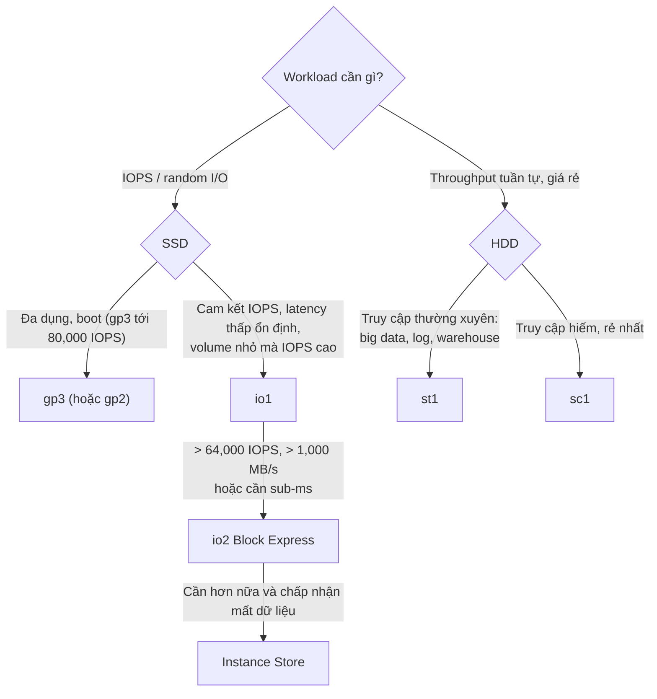

# EBS Volume Types

> **TL;DR:** EBS có 3 nhóm volume: **General Purpose SSD** (gp2, gp3; gp3 là mặc định) cho phần lớn workload, **Provisioned IOPS SSD** (io1, io2 Block Express) cho latency thấp và ổn định ở IOPS rất cao, và **HDD** (st1, sc1) cho throughput tuần tự giá rẻ. Đề thi kiểm tra bạn có nắm **thang hiệu năng** (gp2 16,000 / io1 64,000 / gp3 80,000 / io2 Block Express 256,000 IOPS; 250 / 500 / 1,000 / 2,000 / 4,000 MB/s) để chọn đúng loại.

## 🖼️ Sơ đồ
![[EBS Volume Types.excalidraw]]
*Mở bằng plugin Excalidraw để chỉnh sửa · ảnh tĩnh: [[EBS Volume Types.svg]]*

![[EBS Volume Types - gp2.excalidraw]]
*Mở bằng plugin Excalidraw để chỉnh sửa · ảnh tĩnh: [[EBS Volume Types - gp2.svg]]*

## Khái niệm cốt lõi

### gp2: General Purpose SSD đời đầu (mô hình credit bucket)
- Kích thước **1 GB – 16 TB**.
- Đơn vị: **1 I/O credit = 1 thao tác I/O**, mỗi thao tác chở **tối đa 256 KB** (giảng viên ví như một chuyến xe tải giao hàng). Ứng dụng đọc 2.5 MB một lần thì EBS tách thành 10 thao tác → tốn 10 credit, tính 10 IOPS trong giây đó. (Bản khóa cũ nêu 1 credit = 1 thao tác 16 KB.)
- Mỗi volume có một **I/O credit bucket** dung lượng **5.4 triệu credit**, **bắt đầu đầy**.
- Bucket được nạp lại theo **baseline performance**:
  - **3 IOPS mỗi GB** kích thước volume (100 GB → 300 credit/s).
  - Tối thiểu **100 IOPS** (mọi volume < 33.33 GB đều có 100).
- Có thể **burst lên 3,000 IOPS**. Bucket đầy cho phép chạy 3,000 IOPS ít nhất 30 phút (thực tế lâu hơn vì bucket liên tục được nạp). Rất hợp cho tải nặng lúc khởi động hoặc tải không liên tục.
- Dùng nhiều hơn baseline → bucket cạn dần; dùng ít hơn → bucket đầy lại. **Bucket cạn thì tụt về baseline**, không burst được cho tới khi credit nạp lại → phải theo dõi credit của mọi volume gp2 bằng metric **BurstBalance** của EBS trong CloudWatch. (Bản khóa cũ nêu bucket về 0 thì không thực hiện được I/O.)
- Volume **> 1,000 GB** có baseline ≥ 3,000 nên **không dùng credit**, luôn đạt baseline.
- Tối đa **16,000 IOPS** (đạt khi volume ≥ ~5.33 TB). Throughput tối đa **250 MB/s**.
- Use case: boot volume, ứng dụng tương tác latency thấp, dev/test. gp2 từng là mặc định; nay console mặc định **gp3** cho volume mới. gp2 vẫn gặp nhiều trong hạ tầng cũ, còn workload mới nên bắt đầu bằng gp3 trừ khi có lý do riêng.
- **Elastic Volumes**: có thể đổi type (gp2 ↔ gp3 ↔ loại khác), size, IOPS mà không cần detach.

### gp3: General Purpose SSD thế hệ mới (không credit)
- Bỏ credit bucket. **Mọi volume, bất kể size**, có chuẩn **3,000 IOPS và 125 MiB/s**.
- Kích thước 1 GB – **64 TB**.
- **Rẻ hơn gp2 khoảng 20%** (giá cơ bản). Nếu chỉ cần ≤ 3,000 IOPS → chọn gp3 không cần nghĩ.
- Trả thêm để lên tối đa **80,000 IOPS** và **2,000 MiB/s** (gấp 8 lần trần 250 MiB/s của gp2). Kể cả khi trả thêm, thường vẫn rẻ hơn gp2.
- "gp3 như con của gp2 và io1": giá/đa dụng của gp2 + khả năng cấu hình IOPS độc lập của io1.
- Khác biệt quan trọng: gp2 **tự tăng IOPS theo size**; gp3 thì **không**, muốn > 3,000 IOPS phải provision thêm.
- Use case: virtual desktop, DB một instance cỡ vừa (MSSQL Server, Oracle), app tương tác latency thấp, dev/test, boot volume.
- **gp3 là mặc định trong console**, đơn giản hơn gp2 nên hầu hết volume mới dùng gp3.
- (Bản khóa cũ nêu trần gp3 là 16 TB, 16,000 IOPS, 1,000 MiB/s, và gp2 là mặc định. Câu hỏi trong bộ đề cũ có thể vẫn dùng các mốc này: khi đó "> 16,000 IOPS" ngầm hiểu là phải lên io1/io2.)

### Provisioned IOPS SSD: io1 và io2 Block Express
- **Từ năm 2025, io2 và io2 Block Express là một**: nhóm này chỉ còn **io1** và **io2 Block Express**. (Bản khóa cũ tách ba loại io1, io2, io2 Block Express; io2 cũ: 64,000 IOPS, 1,000 MB/s, 500 IOPS/GB, 4 GB – 16 TB.)
- **IOPS cấu hình độc lập với size**, cho workload hiệu năng cực cao cần **latency thấp, ổn định (ít jitter)**, kể cả **sub-millisecond**.
- Trả tiền cho **cả size lẫn IOPS** đã provision.
- Use case: DB quan hệ và NoSQL I/O-intensive, workload nhạy latency; đặc biệt khi **volume nhỏ nhưng cần IOPS rất cao** (chỉ io1/io2 Block Express làm được).
- io1/io2 hỗ trợ **Multi-Attach** (xem [[EBS]]).
- Các con số tối đa per-volume bên dưới cần instance **Nitro** (thế hệ hiện đại). Instance **non-Nitro bị chặn ở 32,000 IOPS** dù volume provision bao nhiêu.
- **gp3 (80,000) có trần IOPS cao hơn io1 (64,000)**, nhưng gp3 không cam kết độ ổn định. io1/io2 Block Express là **provisioned IOPS**: cho **latency thấp và nhất quán**, io2 Block Express còn **sub-millisecond**. Cần cam kết IOPS và latency ổn định (DB hiệu năng cao, app nhạy latency) → io1/io2 Block Express.

| | io1 | io2 Block Express |
|---|---|---|
| IOPS tối đa / volume | 64,000 (gấp 4 gp2) | **256,000** |
| Throughput tối đa / volume | 1,000 MB/s | **4,000 MB/s** |
| Tỷ lệ IOPS/GB tối đa | **50** (gp2 chỉ 3) | **1,000** |
| Kích thước | 4 GB – 16 TB | 4 GB – **64 TB** |

> (Bổ sung, bài không nói: io2 Block Express có durability 99.999%, io1 99.8–99.9%.)

### Giới hạn per-instance
- Có trần hiệu năng **giữa EBS và một EC2 instance**, do **loại instance** và **size instance** quyết định. Chỉ instance **Nitro** hiện đại, ở size lớn nhất mới đạt mức cao nhất.
- Có thể instance không đạt nổi hiệu năng của volume (instance là bottleneck), hoặc ngược lại instance đỡ được nhiều hơn một volume (volume là bottleneck).
- Ví dụ của giảng viên: **R5b** (Nitro) size lớn nhất có trần **260,000 IOPS & 7,500 MB/s** EBS:

| Cấu hình storage | Hiệu năng | Bottleneck |
|---|---|---|
| 1 × io1 | 64,000 IOPS · 1,000 MB/s | volume |
| 1 × io2 Block Express | 256,000 IOPS · 4,000 MB/s | gần chạm trần IOPS, còn dư throughput |
| 2 × io1 (RAID 0) | 128,000 IOPS · 2,000 MB/s | volume |
| 2 × io2 Block Express (RAID 0) | 512,000 IOPS · 8,000 MB/s | **instance** (vượt cả hai trần) |

- Mẫu hay gặp: gắn **nhiều EBS volume** và gộp bằng **RAID 0 / striping** trong OS (hoặc striping tương đương như LVM, Windows Storage Spaces) để OS thấy một khối storage, hiệu năng cộng dồn tới trần của instance. Phải chọn đúng số volume, đúng loại và size instance.
- (Bản khóa cũ đưa trần per-instance theo từng loại volume: io1 260,000 IOPS & 7,500 MB/s; io2 160,000 & 4,750 MB/s; io2 Block Express 260,000 & 7,500 MB/s; gp2/gp3 260,000 & 7,000 MB/s.)
- Không cần thuộc lòng con số chính xác, nhưng phải có **cảm giác về khoảng hiệu năng** của từng loại so với nhau và so với [[Instance Store]] (còn cao hơn nữa nhưng không persistent).

### HDD-based: st1 và sc1
- HDD có bộ phận chuyển động (platter, head) → chậm, **kém ở random access**, chỉ hợp truy cập **tuần tự**. (Còn loại magnetic/standard là legacy, không khuyên dùng production.)
- I/O trên HDD đo theo **block 1 MB** → 500 IOPS = 500 MB/s.
- Dùng mô hình credit giống gp2 nhưng tính theo **MB/s trên mỗi TB**.
- Kích thước cả hai: **125 GB – 16 TB**.
- **Không dùng được làm boot volume.**

| | st1 (Throughput Optimized) | sc1 (Cold HDD) |
|---|---|---|
| Giá | Rẻ (rẻ hơn SSD) | **Rẻ nhất trong EBS** |
| Max IOPS (1 MB) | 500 | 250 |
| Max throughput | 500 MB/s | 250 MB/s |
| Baseline | 40 MB/s mỗi TB | 12 MB/s mỗi TB |
| Burst | 250 MB/s mỗi TB | 80 MB/s mỗi TB |
| Truy cập | **Thường xuyên**, tuần tự, throughput-intensive | **Không thường xuyên**, vài lần scan/ngày |
| Use case | Big data, data warehouse, log processing | Dữ liệu lạnh, archive |

## Bảng tổng hợp nhanh

| Type | Media | IOPS max/volume | Throughput max/volume | Size | Boot? | Dùng khi |
|---|---|---|---|---|---|---|
| gp2 | SSD | 16,000 (3/GB, min 100, burst 3,000) | 250 MB/s | 1 GB–16 TB | Có | Mặc định cũ, đa dụng |
| gp3 | SSD | 3,000 chuẩn → 80,000 | 125 → 2,000 MiB/s | 1 GB–64 TB | Có | Mặc định đa dụng, rẻ hơn gp2 |
| io1 | SSD | 64,000 (50/GB) | 1,000 MB/s | 4 GB–16 TB | Có | Latency thấp ổn định |
| io2 Block Express | SSD | 256,000 (1,000/GB) | 4,000 MB/s | 4 GB–64 TB | Có | Cực cao, sub-ms, DB lớn |
| st1 | HDD | 500 (1 MB) | 500 MB/s | 125 GB–16 TB | Không | Throughput tuần tự, big data |
| sc1 | HDD | 250 (1 MB) | 250 MB/s | 125 GB–16 TB | Không | Dữ liệu lạnh, rẻ nhất |

## 🎯 Mẹo thi SAA-C03
- **Mặc định / đa dụng / boot volume / giá tốt** → **gp3**. Đề hỏi giảm chi phí từ gp2 → chuyển sang gp3 (rẻ hơn ~20%, có 3,000 IOPS chuẩn).
- Cần **IOPS cam kết, latency thấp nhất quán** cho DB → **io1/io2 Block Express** (provisioned IOPS), dù gp3 có trần IOPS cao hơn io1. Cần **> 64,000 IOPS**, **> 2,000 MB/s** hoặc **sub-millisecond** trên một volume → **io2 Block Express**.
- Mốc cần thuộc: gp2 = **16,000 IOPS**; io1 = **64,000**; gp3 = **80,000**; io2 Block Express = **256,000**. Throughput: gp2 250, st1 500, io1 1,000, gp3 2,000, io2 Block Express 4,000 MB/s. (Bộ đề cũ có thể dùng mốc của bản khóa cũ: gp3 16,000 IOPS / 1,000 MiB/s.)
- Instance **non-Nitro** chỉ đạt **32,000 IOPS**; muốn đạt mức cao nhất cần instance Nitro cỡ lớn, có thể kèm **RAID 0 nhiều volume**.
- Cần IOPS cao hơn mọi EBS và dữ liệu có thể tái tạo → [[Instance Store]].
- **Throughput tuần tự, giá rẻ, truy cập thường xuyên** (big data, data warehouse, log processing, Kafka) → **st1**. **Dữ liệu lạnh, ít truy cập, rẻ nhất** → **sc1**.
- **HDD (st1/sc1) không làm boot volume** được. Đề có từ "IOPS" → loại HDD.
- gp2: IOPS tăng theo size (3 IOPS/GB). Mẹo cũ "tăng size gp2 để tăng IOPS"; với gp3 thì provision IOPS riêng.
- gp2 volume nhỏ chạy chậm sau một thời gian tải nặng → **cạn burst credit**. Giải pháp: gp3, tăng size gp2, hoặc io1/io2.
- Hiệu năng cao còn bị giới hạn bởi **instance type/size** (EBS-optimized bandwidth). Xem [[Enhanced Networking and EBS Optimized]].

## Liên kết
- Tiên quyết: [[Storage Fundamentals]], [[EBS]]
- Liên quan: [[EC2 Instance Types]], [[EBS Snapshots]], [[EBS Encryption]], [[Enhanced Networking and EBS Optimized]], [[RDS Architecture]]
- Phân biệt với: [[Instance Store]], [[Compare - EBS vs Instance Store]], [[S3 Storage Classes]]
