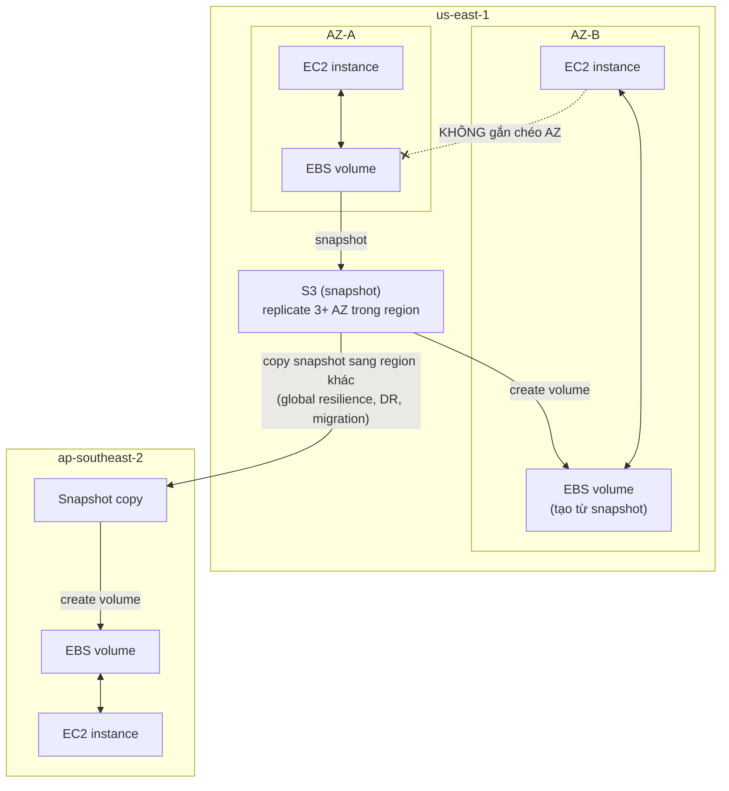

# EBS

> **TL;DR:** Elastic Block Store (EBS) cung cấp **block storage qua mạng** cho EC2 dưới dạng **volume**. Volume là **persistent** (sống độc lập với instance), nhưng là dịch vụ **AZ-scoped**: chỉ gắn vào instance cùng AZ và chịu ảnh hưởng nếu cả AZ hỏng. Muốn di chuyển hoặc bảo vệ dữ liệu ra ngoài AZ thì dùng **snapshot** lưu trong S3.

## 🖼️ Sơ đồ
![[EBS.excalidraw]]
*Mở bằng plugin Excalidraw để chỉnh sửa · ảnh tĩnh: [[EBS.svg]]*

## Khái niệm cốt lõi
- **Block storage**: EBS lấy đĩa vật lý thô và cấp phát một phần thành **volume**; đọc/ghi theo block ID. Xem [[Storage Fundamentals]].
- Volume có thể **không mã hóa** hoặc **mã hóa bằng KMS** (xem [[EBS Encryption]], [[KMS]]).
- Instance nhìn volume như **một block device thô bình thường**; OS tự tạo file system (ext3, ext4, XFS trên Linux; NTFS trên Windows). EBS volume trông giống hệt mọi thiết bị lưu trữ khác với EC2.
- **AZ-scoped**: EBS ở mỗi AZ là một deployment riêng, cô lập. Không truy cập chéo AZ, không chéo region.
- **Resilient trong AZ**: dữ liệu được replicate qua nhiều thiết bị vật lý trong AZ, nên một đĩa hỏng không sao. Nhưng **AZ hỏng → volume trong AZ đó hỏng** (cùng với instance).
- **Gắn vào một instance** tại một thời điểm qua storage network (mặc định nên nghĩ như vậy). Có thể **detach rồi attach** sang instance khác cùng AZ.
- **Multi-Attach**: một số loại volume (io1/io2) cho phép gắn **nhiều instance cùng lúc**, dùng cho cluster. Ứng dụng cluster phải tự quản lý ghi đồng thời để tránh hỏng dữ liệu.
- **Persistent, không gắn với vòng đời instance**:
  - Instance chuyển host → volume đi theo.
  - Instance stop/start hoặc restart → volume vẫn giữ nguyên.
  - Dữ liệu tồn tại tới khi bạn **xóa volume**.
- **Snapshot** sao lưu volume vào S3 (do EBS quản lý) → **regionally resilient** (replicate qua nhiều AZ). Từ snapshot có thể tạo volume ở **AZ khác**, hoặc **copy snapshot sang region khác** rồi tạo volume ở đó. Xem [[EBS Snapshots]].
- Có nhiều loại volume: SSD (general purpose, provisioned IOPS), HDD cơ, với kích thước và hiệu năng khác nhau. Xem [[EBS Volume Types]].
- **Tính tiền theo GB-tháng**: 1 GB trong 1 tháng = 2 GB trong nửa tháng = 0.5 GB trong 2 tháng. Một số loại volume tính thêm cho hiệu năng nâng cao (ví dụ IOPS provision thêm).

## Cách hoạt động / Kiến trúc

- EBS replicate **trong một AZ** → AZ failure = mất volume.
- Snapshot lưu trên S3 → replicate qua **3+ AZ** trong region → tạo volume ở AZ khác được.
- Copy snapshot qua region → **global resilience** (DR, migration).

## Demo / Lab
Ba instance: Instance1-AZA, Instance2-AZA, Instance1-AZB; mỗi instance có boot volume gp2 8 GiB (100 IOPS do mức tối thiểu của gp2).

**Phần 1: tạo và dùng volume**
1. Create volume: type **gp2**, 10 GiB (gp2 cho kích thước 1 GiB – 16,384 GiB; 3 IOPS/GiB, tối thiểu 100 IOPS, volume nhỏ có burst; ở ~10,000 GiB thì không còn burst và đạt trần 16,000 IOPS). Phải chọn **AZ** khi tạo (`us-east-1a`). Có thể chọn snapshot làm nguồn và thiết lập encryption.
2. Trạng thái: `creating` → `available` → attach → `in-use`. Khi attach, **chỉ thấy instance cùng AZ**. Device name `/dev/sdf` có thể hiện trong Linux là `/dev/xvdf`.
3. Trong OS:
   - `lsblk` liệt kê block device (root 8G, volume mới 10G).
   - `sudo file -s /dev/xvdf` → `data` nghĩa là chưa có file system.
   - `sudo mkfs -t xfs /dev/xvdf` tạo file system XFS.
   - `sudo mkdir /ebstest` rồi `sudo mount /dev/xvdf /ebstest`; `df -k` để kiểm tra.
   - Tạo file test trong thư mục mount.

**Phần 2: persistence và di chuyển**
4. **Reboot** → file system **không tự mount** lại (mount thủ công không bền). Cách sửa: lấy UUID bằng `sudo blkid`, thêm dòng vào `/etc/fstab` (`UUID=... /ebstest xfs defaults,nofail`), chạy `sudo mount -a`. File test vẫn còn → dữ liệu persistent.
5. Stop Instance1-AZA, **detach** volume, **attach** sang Instance2-AZA → `file -s` thấy sẵn XFS, chỉ cần mount là thấy file test. Volume giữ dữ liệu khi chuyển instance.
6. Muốn đưa sang instance ở **AZ-B**: không attach trực tiếp được → **tạo snapshot** (vài giây đến vài giờ tùy lượng dữ liệu) → từ snapshot **create volume ở us-east-1b** (có thể đổi type, size, encryption lúc này) → attach vào instance AZ-B → thấy cùng dữ liệu.
7. Snapshot có thể **copy sang region khác** (ví dụ Sydney) cho migration hoặc DR.

**Phần 3: Instance Store** (m5dn.large, có 1 instance store volume 75 GB NVMe `/dev/nvme1n1`): reboot thì dữ liệu còn, **stop/start thì mất** (public IP đổi, dấu hiệu instance đã chuyển host). Chi tiết ở [[Instance Store]].

**Rút ra:** EBS tạo trong một AZ, chỉ gắn instance cùng AZ, chuyển giữa các instance mà giữ dữ liệu; snapshot (S3, regional) giúp chuyển sang AZ khác và copy qua region; EBS persistent còn instance store ephemeral.

## 🎯 Mẹo thi SAA-C03
- **EBS là AZ-scoped**: không attach chéo AZ. Cần dữ liệu ở AZ khác → **snapshot → create volume ở AZ đích**. Ở region khác → **copy snapshot** sang region đó.
- **EBS persistent**: sống sót qua stop/start, reboot, chuyển host. Đối lập với [[Instance Store]] (ephemeral).
- AZ hỏng thì volume hỏng. Bảo vệ khỏi AZ failure → snapshot thường xuyên (có thể tự động hóa bằng [[AWS Backup]] hoặc Data Lifecycle Manager).
- Mặc định **một volume ↔ một instance**. Đề nhắc chia sẻ block volume cho cluster → **Multi-Attach (io1/io2)**, ứng dụng phải tự quản lý ghi. Cần chia sẻ file system cho nhiều instance/AZ → [[EFS]].
- Volume nhanh nhưng instance không đủ băng thông EBS → bottleneck ở instance (xem [[Enhanced Networking and EBS Optimized]]).
- Billing theo **GB-tháng đã provision** (không phải dung lượng đã dùng), cộng phí hiệu năng với một số loại.

## Liên kết
- Tiên quyết: [[Storage Fundamentals]], [[EC2 Architecture and Resilience]]
- Liên quan: [[EBS Volume Types]], [[EBS Snapshots]], [[EBS Encryption]], [[AMI]], [[KMS]], [[AWS Backup]], [[EC2 Instance Connect and SSH]]
- Phân biệt với: [[Instance Store]], [[Compare - EBS vs Instance Store]], [[EFS]]
