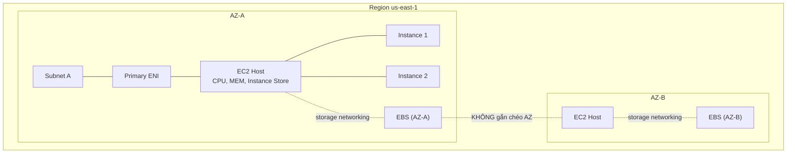

# EC2 Architecture and Resilience

> **TL;DR:** EC2 instance là VM chạy trên EC2 host (máy chủ vật lý AWS quản lý). Host, network interface, EBS volume đều nằm trong **một AZ**, nên EC2 là dịch vụ **AZ-resilient**: AZ hỏng thì instance trong AZ đó hỏng theo. Muốn HA phải tự rải instance ra nhiều AZ.

## 🖼️ Sơ đồ
![[EC2 Architecture and Resilience.excalidraw]]
*Mở bằng plugin Excalidraw để chỉnh sửa · ảnh tĩnh: [[EC2 Architecture and Resilience.svg]]*

## Khái niệm cốt lõi
- **EC2 instance = virtual machine**: một OS cộng phần tài nguyên được cấp phát: vCPU, memory, có thể có local storage, network storage, truy cập phần cứng khác như network, GPU. Xem nền tảng ở [[Virtualization]].
- **EC2 host** là server vật lý do AWS quản lý. Hai loại:
  - **Shared host** (mặc định): nhiều khách hàng AWS dùng chung phần cứng, nhưng **cô lập hoàn toàn** với nhau (không thấy, không tương tác). Trả tiền theo từng instance: chạy bao lâu, cấp phát bao nhiêu tài nguyên.
  - **Dedicated host**: trả tiền cho **cả host**, không trả theo instance chạy trên đó; host chỉ dành riêng cho account của bạn. Chi tiết ở [[Dedicated Hosts]].
- **Hosts = 1 AZ**: AZ hỏng → host hỏng → instance hỏng. Kiến trúc sư phải giả định khi một AZ gặp sự cố thì phần lớn hoặc toàn bộ instance trong AZ đó bị ảnh hưởng.

## Cách hoạt động / Kiến trúc

### Thành phần của một EC2 host
- **CPU, memory** cục bộ.
- **Instance Store**: storage cục bộ gắn vật lý vào host, **tạm thời**. Instance chuyển sang host khác thì dữ liệu mất. Xem [[Instance Store]].
- Hai loại mạng: **storage networking** (nối tới EBS) và **data networking** (nối tới VPC).
- Khi launch instance vào một subnet, thực chất một **primary Elastic Network Interface (ENI)** được tạo trong subnet đó và map vào phần cứng của host. Subnet chỉ nằm trong một AZ (xem [[VPC Subnets]]).
- Instance có thể có **nhiều ENI, kể cả ở các subnet khác nhau**, miễn **cùng AZ** (xem [[EC2 Network Interfaces IPs and DNS]]).
- **Remote storage = [[EBS]]**: EBS cũng là dịch vụ theo AZ. EBS ở AZ-A khác hoàn toàn EBS ở AZ-B, không truy cập chéo AZ được. Volume chỉ gắn vào instance cùng AZ.

### Khi nào instance đổi host?
- Restart (reboot) → instance **ở lại host cũ**.
- Instance chỉ chuyển sang host khác khi:
  1. Host hỏng hoặc AWS đưa host đi bảo trì, hoặc
  2. Instance được **stop rồi start** (khác với restart).
- Host mới **vẫn ở cùng AZ**. Instance **không thể tự di chuyển giữa các AZ**: phần cứng, mạng, storage đều bị khóa trong một AZ.
- Muốn "chuyển" sang AZ khác: tạo bản sao (snapshot/AMI) rồi launch instance mới ở AZ đích. Xem [[EBS Snapshots]] và [[AMI]].
- **Không bao giờ** gắn được ENI hoặc EBS volume ở AZ này vào instance ở AZ khác.

### Host và loại instance
- Các instance trên cùng host chia sẻ tài nguyên của host.
- Host thường thuộc một thế hệ cụ thể (năm sản xuất, dòng CPU, loại memory, cấu hình storage). Vì vậy **một host thường chứa nhiều instance cùng type và generation nhưng khác size**, của nhiều khách hàng. Hai instance khác type rất có thể nằm trên hai loại host khác nhau. Xem [[EC2 Instance Types]].

### Blast radius là điểm mạnh
- Vì sự cố luôn được cô lập trong một AZ, ta có thể thiết kế HA bằng cách đặt instance ở nhiều AZ và load balance giữa chúng (xem [[Elastic Load Balancer]], [[Auto Scaling Groups]], [[HA vs FT vs DR]]).

## Khi nào dùng EC2?
EC2 là **compute mặc định** trong AWS. Chọn EC2 trước, chỉ chuyển sang dịch vụ khác ([[ECS]], [[Lambda]]) khi có yêu cầu cụ thể. Phù hợp với:
- Workload truyền thống cần **OS + application** cụ thể (runtime, cấu hình riêng, yêu cầu hỗ trợ của vendor, đội ngũ quen cấu hình đó).
- **Long-running compute**: chạy liên tục 24/7/365. Nhiều dịch vụ compute khác có giới hạn thời gian chạy, EC2 thì không.
- Ứng dụng **kiểu server** (chạy trong OS, chờ kết nối đến).
- Tải **burst** hoặc **steady-state** (có instance type cho cả hai, xem T-family trong [[EC2 Instance Types]]).
- **Monolithic application stack** (DB + middleware + runtime trên cùng OS).
- **Migrate** workload kiểu VM/server lên AWS, hoặc dựng môi trường **Disaster Recovery** cho hệ thống truyền thống.

## 🎯 Mẹo thi SAA-C03
- **EC2 là AZ-resilient.** Thấy EC2 trong câu hỏi, hãy tìm chi tiết về AZ vì nó có thể quyết định đáp án.
- EBS volume và ENI **không gắn chéo AZ**. Muốn chuyển instance/volume sang AZ khác → snapshot/AMI rồi tạo mới.
- **Stop/start** có thể đổi host (và mất dữ liệu Instance Store); **reboot** thì không.
- Shared host là mặc định; Dedicated host trả tiền theo host, phục vụ yêu cầu license/compliance.
- Câu hỏi về workload cần OS truyền thống, chạy dài hạn, monolithic, lift-and-shift → EC2 là lựa chọn mặc định.

## Liên kết
- Tiên quyết: [[Virtualization]], [[AWS Global Infrastructure]], [[EC2 Basics]]
- Liên quan: [[EC2 Instance Types]], [[EBS]], [[Instance Store]], [[EC2 Network Interfaces IPs and DNS]], [[Dedicated Hosts]], [[AMI]]
- Phân biệt với: [[Lambda]] (có giới hạn thời gian chạy), [[ECS]] (container)
