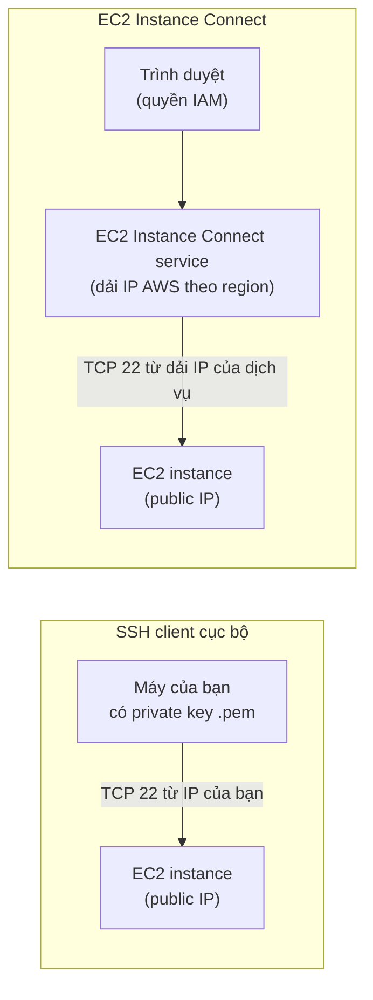

# EC2 Instance Connect and SSH

> **TL;DR:** Có hai cách cơ bản để vào shell của EC2 Linux: **SSH client cục bộ** dùng key pair, và **EC2 Instance Connect** dùng quyền IAM qua trình duyệt. Điểm mấu chốt: với Instance Connect, kết nối đến instance **xuất phát từ dịch vụ AWS**, không phải từ máy bạn, nên Security Group phải cho phép **dải IP của dịch vụ EC2 Instance Connect** trong region đó.

## 🖼️ Sơ đồ
![[EC2 Instance Connect and SSH.excalidraw]]
*Mở bằng plugin Excalidraw để chỉnh sửa · ảnh tĩnh: [[EC2 Instance Connect and SSH.svg]]*

## Khái niệm cốt lõi

### Cách 1: SSH client cục bộ + key pair
- Tạo **key pair** trong EC2 console (ví dụ `A4L`). Định dạng:
  - **PEM**: Linux, macOS, Windows 10 trở lên (OpenSSH).
  - **PPK**: cho PuTTY (Windows 8 trở về trước).
- AWS giữ public key và chèn vào instance lúc launch; bạn tải private key về **một lần duy nhất**.
- Lệnh mẫu: `ssh -i "A4L.pem" ec2-user@<public-DNS>`.
- **Lỗi permission**: SSH client từ chối dùng key nếu quyền file quá rộng (ví dụ 644, người dùng khác đọc được). Sửa bằng `chmod 400 A4L.pem` (Linux/macOS); trên Windows thì vào Properties → Security, bỏ quyền của mọi user khác.
- Lần đầu kết nối sẽ hỏi xác nhận **host fingerprint**. Đây là cơ chế chống giả mạo: DNS có thể bị thao túng để trỏ sang server khác, fingerprint giúp xác minh đúng là instance bạn muốn vào.
- Yêu cầu:
  - Có **kết nối mạng** tới instance (public IP hoặc private connectivity).
  - Có **private key** trên máy. Khó mở rộng: cả team đều cần bản sao key → vấn đề quản trị khi làm ở quy mô lớn.
  - [[Security Groups|Security Group]] cho phép **IP của máy bạn** vào cổng TCP 22.

### Cách 2: EC2 Instance Connect
- Trong console: chuột phải instance → Connect → EC2 Instance Connect → mở terminal **ngay trong trình duyệt**.
- **Không cần key**: xác thực bằng **quyền IAM** (identity policy gắn trên user/group/role). Phù hợp cấp quyền truy cập theo quy mô lớn. Xem [[IAM Identity Policies]].
- Phải chọn đúng **username** theo AMI: Amazon Linux 2 → `ec2-user`, Ubuntu → `ubuntu`, CentOS → `centos`... Với AMI mặc định AWS thường đoán đúng; với custom AMI thường đoán sai.
- **Luồng kết nối**: trình duyệt → dịch vụ AWS → **EC2 Instance Connect service** mở kết nối SSH tới instance. Vì vậy SG phải cho phép **dải IP của dịch vụ EC2 Instance Connect** (không phải IP của bạn).

### Phạm vi truy cập
- Instance Connect qua **console (GUI)** chỉ kết nối được instance có **public addressing**.
- **EC2 Instance Connect CLI** có thể kết nối instance **private** nếu bạn có private connectivity (VPN, [[Direct Connect]]).
- (Khóa học chỉ nói như trên; hiện nay AWS có thêm **EC2 Instance Connect Endpoint** (2023) cho phép kết nối instance trong private subnet mà không cần public IP, [[Bastion Host]] hay VPN.)
- **Session Manager** (thuộc Systems Manager) không có các giới hạn này: vào được cả instance public lẫn private, không cần mở cổng 22. Được đề cập ở bài riêng sau.

## Demo / Lab
1. Tạo key pair `A4L` (PEM), deploy stack CloudFormation tạo VPC Animals4life và một instance public.
2. SG ban đầu cho phép: TCP 80 từ `0.0.0.0/0`, TCP 22 từ `0.0.0.0/0` (IPv4) và `::/0` (IPv6).
3. SSH bằng client cục bộ → lỗi permission key → `chmod 400` → kết nối được.
4. Instance Connect → vào được, không cần key.
5. Sửa SG: rule SSH IPv4 đổi sang **My IP** → SSH cục bộ vẫn vào được, nhưng **Instance Connect không kết nối được** (dịch vụ AWS không nằm trong IP của bạn).
6. Tra file **`ip-ranges.json`** của AWS (danh sách dải IP theo service và region), lấy dải của service `EC2_INSTANCE_CONNECT` ở `us-east-1`, thay rule My IP bằng dải này → Instance Connect hoạt động lại, còn SSH cục bộ bị chặn.
7. Dọn dẹp: xóa stack.
- Rút ra: cho phép `0.0.0.0/0` là cách dễ nhưng là bad practice cho production. Cách an toàn là chỉ cho phép dải IP của dịch vụ Instance Connect.

## 🎯 Mẹo thi SAA-C03
- **Instance Connect không chạy dù SSH từ máy bạn chạy được** → SG đang chỉ cho phép IP của bạn; cần thêm dải IP của dịch vụ EC2 Instance Connect trong region (lấy từ AWS IP ranges). (Chi tiết dải IP hay ra hơn ở đề SysOps.)
- Muốn quản lý quyền truy cập theo IAM, không phân phối key → **EC2 Instance Connect** (hoặc Session Manager).
- Truy cập instance private không mở cổng inbound, không bastion → **Session Manager** (hoặc EC2 Instance Connect Endpoint).
- Lỗi "permissions are too open" khi SSH → `chmod 400` file key.
- SSH cần: kết nối mạng + key + SG cho phép nguồn; nếu instance ở private subnet thì cần [[Bastion Host]] hoặc VPN.

## Liên kết
- Tiên quyết: [[EC2 Basics]], [[Security Groups]], [[IAM Basics]]
- Liên quan: [[Bastion Host]], [[IAM Identity Policies]], [[EC2 Instance Roles]], [[AMI]], [[Site-to-Site VPN]]
- Phân biệt với: [[Bastion Host]] (jump box truyền thống, phải quản lý key và instance riêng)
