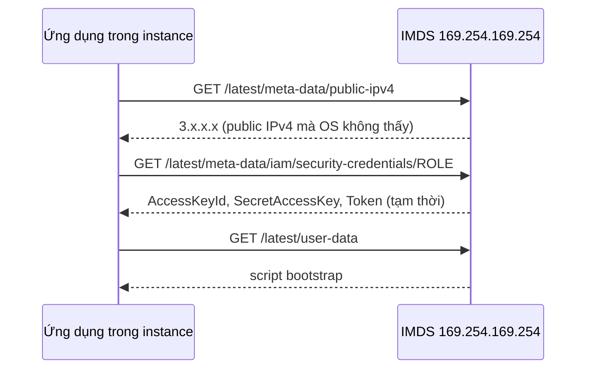

# EC2 Instance Metadata

> **TL;DR:** Instance Metadata Service (IMDS) là dịch vụ EC2 cung cấp cho mọi instance để phần mềm bên trong lấy thông tin về **môi trường của chính nó** (IP, hostname, AZ, SG, AMI ID, credentials của role, user data...). Truy cập qua **`http://169.254.169.254/latest/meta-data/`**. Có hai phiên bản: **IMDSv1** **không xác thực**, **IMDSv2** dùng **session token** (PUT lấy token rồi kèm token trong mọi GET); nhiều instance mới mặc định chỉ bật v2. Dữ liệu không mã hóa, và ai có shell trên instance đều đọc được.

## 🖼️ Sơ đồ
![[EC2 Instance Metadata.excalidraw]]
*Mở bằng plugin Excalidraw để chỉnh sửa · ảnh tĩnh: [[EC2 Instance Metadata.svg]]*

![[EC2 Instance Metadata - v2.excalidraw]]
*Mở bằng plugin Excalidraw để chỉnh sửa · ảnh tĩnh: [[EC2 Instance Metadata - v2.svg]]*

## Khái niệm cốt lõi

### Địa chỉ và URL (phải thuộc lòng)
- IP: **`169.254.169.254`**, một địa chỉ **link-local**: instance nói chuyện với lớp hypervisor của host, không đi qua Internet hay mạng VPC. Mẹo nhớ của giảng viên: "**169.254 lặp lại**".
- Đường dẫn: **`/latest/meta-data/`** ("always want the **latest meta-data**"). Chú ý dấu gạch nối trong `meta-data`.
- URL đầy đủ ví dụ: `http://169.254.169.254/latest/meta-data/public-ipv4`.
- (Bản khóa cũ nêu) từng có câu hỏi bắt **chọn đúng URL chính xác**, nên phải nhớ cả IP lẫn path.
- Dùng cùng một cách truy cập trên **mọi instance**.

### Có thể lấy gì từ metadata
- Lý do cần: instance chạy trên hạ tầng AWS quản lý nên không tự biết những thứ EC2 biết, ví dụ **ID của subnet** chứa nó.
- Dữ liệu chia theo category: hostname, events, security groups, AMI ID, AZ, networking...
- **Networking**: phổ biến nhất. OS **không thấy public IPv4** (do Internet Gateway NAT, xem [[EC2 Network Interfaces IPs and DNS]]), nhưng ứng dụng có thể hỏi metadata để biết `public-ipv4`, `public-hostname`.
- **Authentication**: **temporary credentials** của [[EC2 Instance Roles|instance role]]. Ứng dụng trên instance lấy credentials qua metadata (dưới `iam/security-credentials/<role>`).
- **SSH key tạm**: [[EC2 Instance Connect and SSH|EC2 Instance Connect]] đẩy public key tạm thời qua metadata ở phía sau.
- **User data**: script chạy lúc launch để tự cấu hình instance, đọc tại `http://169.254.169.254/latest/user-data` (xem [[EC2 User Data Bootstrapping]]).

### Bảo mật
- **IMDSv1**: **không xác thực**. Ai vào được shell của instance là đọc được metadata.
- **IMDSv2**: có **session authentication**. Client gọi **`PUT /latest/api/token`** để lấy token, rồi gửi kèm header `X-aws-ec2-metadata-token` trong mọi request GET. (Bổ sung, bài không nói: cách này giảm rủi ro SSRF/open proxy lấy trộm credentials.)
- Cấu hình ở *Instance settings → Modify instance metadata options*: **Optional** (v1 và v2 đều chạy), **Required** (chỉ v2) hoặc **tắt hẳn** IMDS. Nhiều instance mới mặc định **bật v2, tắt v1**; ứng dụng cần v1 thì phải kiểm tra và bật lại. Endpoint không đổi.
- Dữ liệu **không mã hóa**, nhưng không sao vì traffic **không bao giờ rời host vật lý** (đi qua hypervisor, không qua mạng public hay VPC).
- Có thể hạn chế bằng **firewall cục bộ** chặn 169.254.169.254, nhưng nguyên tắc vẫn là: **coi metadata là lộ với mọi thứ chạy trên instance**. Không đặt bí mật dài hạn vào user data (dùng [[SSM Parameter Store]] hoặc [[Secrets Manager]]).

## Cách hoạt động / Kiến trúc

## Demo / Lab
1. Stack CloudFormation `metadata` tạo instance trong VPC, có public IPv4 và IPv6. Xem trước *Instance settings → Modify instance metadata options*: Optional / Required (chỉ IMDSv2) / tắt; instance của demo đang **Required**.
2. Ghi lại private IPv4, public IPv4, IPv6 trên console. Kết nối bằng EC2 Instance Connect, chạy `ifconfig`: thấy **private IPv4** và **IPv6**, **không có public IPv4** ở đâu trong cấu hình OS.
3. `curl http://169.254.169.254/latest/meta-data/public-ipv4` **không trả gì** vì instance bắt buộc IMDSv2 mà request chưa có token.
4. Lấy token bằng **PUT** tới `/latest/api/token`, rồi `curl` lại kèm header token → trả về đúng public IPv4 trên console; tương tự lấy được `public-hostname`.
5. Tool **`ec2-metadata`** (có sẵn trên một số AMI, hoặc cài thêm): `-a` (AMI ID), `-s` (security groups), chạy không tham số để xem hàng loạt thông tin thường dùng.
6. Xóa stack để dọn dẹp.
- (Bản khóa cũ dùng IMDSv1 nên `curl` chạy ngay không cần token, phải tự tải tool `ec2-metadata` rồi `chmod +x`, và dùng thêm `-z` để xem AZ.)

## 🎯 Mẹo thi SAA-C03
- **169.254.169.254** và **`/latest/meta-data/`**: thuộc lòng, đề có thể hỏi URL chính xác.
- "Ứng dụng trên EC2 cần biết public IP của chính nó" → hỏi **instance metadata** (OS không biết public IPv4).
- "Ứng dụng trên EC2 lấy credentials của role" → instance role, credentials tạm qua **metadata**. Không lưu access key trên instance.
- **IMDSv1 không xác thực**; **IMDSv2** cần **token lấy bằng PUT** rồi gửi kèm mỗi request. Đề hỏi tăng bảo mật IMDS → **IMDSv2 required** (hoặc tắt IMDS). Metadata lộ với mọi thứ chạy trên instance → không đặt secret trong user data.
- Code chạy trên instance Spot muốn biết sắp bị thu hồi → poll metadata `spot/instance-action` (xem [[EC2 Purchase Options]]).
- User data lấy tại `/latest/user-data` (khác path `meta-data`).

## Liên kết
- Tiên quyết: [[EC2 Basics]], [[EC2 Network Interfaces IPs and DNS]]
- Dùng bởi: [[EC2 Instance Roles]], [[EC2 Instance Connect and SSH]], [[EC2 User Data Bootstrapping]], [[cfn-init]]
- Liên quan: [[IAM Roles]], [[SSM Parameter Store]], [[Secrets Manager]], [[VPC Routing and Internet Gateway]]
