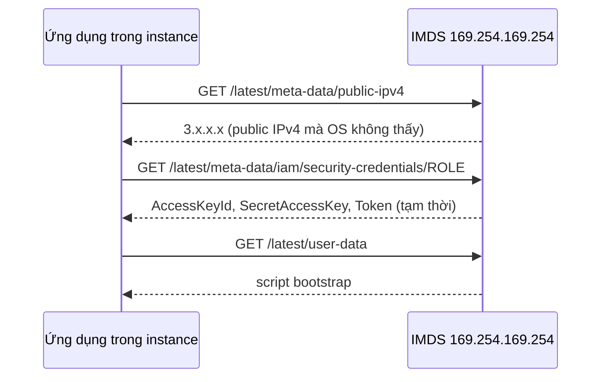

# EC2 Instance Metadata

> **TL;DR:** Instance Metadata Service (IMDS) là dịch vụ EC2 cung cấp cho mọi instance để phần mềm bên trong lấy thông tin về **môi trường của chính nó** (IP, hostname, AZ, SG, AMI ID, credentials của role, user data...). Truy cập qua **`http://169.254.169.254/latest/meta-data/`**. Theo cách khóa học dạy (IMDSv1), dịch vụ này **không xác thực, không mã hóa**: ai có shell trên instance đều đọc được.

## 🖼️ Sơ đồ
![[EC2 Instance Metadata.excalidraw]]
*Mở bằng plugin Excalidraw để chỉnh sửa · ảnh tĩnh: [[EC2 Instance Metadata.svg]]*

![[EC2 Instance Metadata - v2.excalidraw]]
*Mở bằng plugin Excalidraw để chỉnh sửa · ảnh tĩnh: [[EC2 Instance Metadata - v2.svg]]*

## Khái niệm cốt lõi

### Địa chỉ và URL (phải thuộc lòng)
- IP: **`169.254.169.254`**. Mẹo nhớ của Adrian: "**169.254 repeated**".
- Đường dẫn: **`/latest/meta-data/`** ("always want the **latest meta-data**"). Chú ý dấu gạch nối trong `meta-data`.
- URL đầy đủ ví dụ: `http://169.254.169.254/latest/meta-data/public-ipv4`.
- Adrian từng gặp câu hỏi bắt **chọn đúng URL chính xác**, nên phải nhớ cả IP lẫn path.
- Dùng cùng một cách truy cập trên **mọi instance**.

### Có thể lấy gì từ metadata
- Dữ liệu chia theo category: hostname, events, security groups, AMI ID, AZ, networking...
- **Networking**: phổ biến nhất. OS **không thấy public IPv4** (do Internet Gateway NAT, xem [[EC2 Network Interfaces IPs and DNS]]), nhưng ứng dụng có thể hỏi metadata để biết `public-ipv4`, `public-hostname`.
- **Authentication**: **temporary credentials** của [[EC2 Instance Roles|instance role]]. Ứng dụng trên instance lấy credentials qua metadata (dưới `iam/security-credentials/<role>`).
- **SSH key tạm**: [[EC2 Instance Connect and SSH|EC2 Instance Connect]] đẩy public key tạm thời qua metadata ở phía sau.
- **User data**: script chạy lúc launch để tự cấu hình instance, đọc tại `http://169.254.169.254/latest/user-data` (xem [[EC2 User Data Bootstrapping]]).

### Bảo mật
- **Không xác thực, không mã hóa** (IMDSv1, theo khóa học). Ai vào được shell Linux của instance thì mặc định đọc được metadata.
- Có thể hạn chế bằng **firewall cục bộ** chặn 169.254.169.254, nhưng đó là thêm việc quản trị cho từng instance.
- Nguyên tắc: **coi metadata là thứ có thể và thực sự bị lộ**. Không đặt bí mật dài hạn vào user data (dùng [[SSM Parameter Store]] hoặc [[Secrets Manager]]).
- (Hiện nay: **IMDSv2** dùng **session token**. Client phải gọi `PUT /latest/api/token` để lấy token, rồi gửi kèm header `X-aws-ec2-metadata-token` trong mỗi request. Cách này giảm rủi ro SSRF/open proxy lấy trộm credentials. Có thể đặt **IMDSv2 required** hoặc tắt hẳn IMDS, và với nhiều AMI/instance mới thì mặc định đã là IMDSv2-only. Endpoint vẫn là 169.254.169.254.)

## Cách hoạt động / Kiến trúc

## Demo / Lab
1. Stack CloudFormation tạo instance ở public subnet có public IPv4 và IPv6. Ghi lại private IPv4, public IPv4, public DNS, IPv6 trên console.
2. Kết nối bằng EC2 Instance Connect, chạy `ifconfig`:
   - **Private IPv4** có trên interface (prompt shell cũng hiện private IP).
   - **IPv6** có trên interface (IPv6 luôn public, OS thấy được).
   - **Public IPv4 không có** ở bất kỳ đâu trong cấu hình OS.
3. `curl http://169.254.169.254/latest/meta-data/public-ipv4` → trả về đúng public IPv4 trên console; `.../public-hostname` → public DNS.
4. Tải tool **`ec2-metadata`**, `chmod +x`, chạy `ec2-metadata --help`; `-a` (AMI ID), `-z` (AZ, ví dụ us-east-1a), và tùy chọn security groups.
5. Xóa stack để dọn dẹp.

## 🎯 Mẹo thi SAA-C03
- **169.254.169.254** và **`/latest/meta-data/`**: thuộc lòng, đề có thể hỏi URL chính xác.
- "Ứng dụng trên EC2 cần biết public IP của chính nó" → hỏi **instance metadata** (OS không biết public IPv4).
- "Ứng dụng trên EC2 lấy credentials của role" → instance role, credentials tạm qua **metadata**. Không lưu access key trên instance.
- Metadata **không xác thực, không mã hóa** (IMDSv1) → mọi người dùng trên instance đều đọc được; không đặt secret trong user data. Đề hỏi tăng bảo mật IMDS → **bắt buộc IMDSv2**.
- User data lấy tại `/latest/user-data` (khác path `meta-data`).

## Liên kết
- Tiên quyết: [[EC2 Basics]], [[EC2 Network Interfaces IPs and DNS]]
- Dùng bởi: [[EC2 Instance Roles]], [[EC2 Instance Connect and SSH]], [[EC2 User Data Bootstrapping]], [[cfn-init]]
- Liên quan: [[IAM Roles]], [[SSM Parameter Store]], [[Secrets Manager]], [[VPC Routing and Internet Gateway]]
