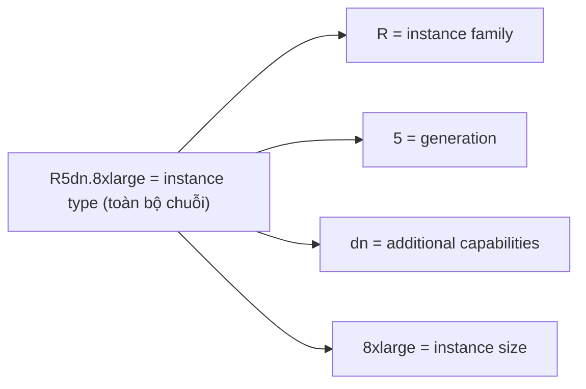

# EC2 Instance Types

> **TL;DR:** Instance type quyết định lượng và **tỷ lệ** tài nguyên (vCPU, memory, storage, network bandwidth), kiến trúc phần cứng (x86/ARM, Intel/AMD) và tính năng thêm (GPU, FPGA). Có 5 category: General Purpose (mặc định), Compute, Memory, Accelerated, Storage Optimized. Đề thi hay cho một vấn đề hiệu năng mà đáp án là **đổi instance type**.

## 🖼️ Sơ đồ
![[EC2 Instance Types.excalidraw]]
*Mở bằng plugin Excalidraw để chỉnh sửa · ảnh tĩnh: [[EC2 Instance Types.svg]]*

![[EC2 Instance Types - name.excalidraw]]
*Mở bằng plugin Excalidraw để chỉnh sửa · ảnh tĩnh: [[EC2 Instance Types - name.svg]]*

## Khái niệm cốt lõi

### Instance type ảnh hưởng tới gì?
- **Lượng tài nguyên thô**: vCPU, memory, dung lượng và loại local storage.
- **Tỷ lệ tài nguyên**: compute-optimized cho nhiều CPU/ít RAM trên mỗi đô la; memory-optimized thì ngược lại.
- **Giá** (tính theo thời gian chạy).
- **Băng thông mạng** cho cả storage networking lẫn data networking. Ví dụ: provision [[EBS]] volume hiệu năng rất cao nhưng instance không đủ băng thông storage → **instance trở thành nút cổ chai** (xem [[Enhanced Networking and EBS Optimized]]).
- **Kiến trúc phần cứng và vendor**: ARM hay x86, Intel hay AMD.
- **Tính năng bổ sung**: GPU, **FPGA** (field programmable gate array: phần cứng có thể lập trình để xử lý đúng tác vụ mong muốn).

### 5 category chính
| Category | Đặc điểm | Use case |
|---|---|---|
| **General Purpose** | **Mặc định**, tỷ lệ tài nguyên cân bằng | Workload đa dạng, steady state. Luôn bắt đầu từ đây |
| **Compute Optimized** | Nhiều CPU hơn so với memory, CPU mới hiệu năng cao | Media processing, HPC, scientific modelling, gaming, machine learning |
| **Memory Optimized** | Nhiều memory so với CPU / giá | Xử lý dataset lớn trong memory, in-memory cache, một số DB workload |
| **Accelerated Computing** | GPU, FPGA | Xử lý song song quy mô lớn, mô hình hóa, nhu cầu ngách |
| **Storage Optimized** | Local storage dung lượng lớn, siêu nhanh, tối ưu sequential throughput hoặc IOPS | Scale-out transactional DB, data warehousing, Elasticsearch, analytics |

## Giải mã tên instance type: `R5dn.8xlarge`

- **Instance type** là toàn bộ chuỗi. Khi trao đổi với đội vận hành, luôn nói **đầy đủ instance type** để không mơ hồ.
- **Family** (chữ cái đầu): T, M, C, R, I, X, P, G, F, D, H...
- **Generation** (số): C4 → C5 là thế hệ mới, phần cứng tốt hơn, price/performance tốt hơn. **Luôn chọn generation mới nhất**, trừ khi region chưa có hoặc doanh nghiệp cần quy trình kiểm thử/phê duyệt trước khi dùng thế hệ mới.
- **Size**: nano → micro → small → medium → large → xlarge → 2xlarge → 4xlarge → 8xlarge... Quan hệ thường tuyến tính về CPU/memory. Size lớn thường có **price premium**, nên thường scale bằng **nhiều instance nhỏ** hơn là một instance lớn (xem [[Horizontal vs Vertical Scaling]]).
- **Additional capabilities** (giữa generation và size, có thể không có):
  - `a` = AMD CPU
  - `d` = local NVMe storage
  - `n` = network optimized
  - `e` = extra capacity (RAM hoặc storage)
  - `g` = AWS Graviton (ARM), ví dụ `m6g`

## Bảng instance type tham khảo (theo slide khóa học)

| Category | Type | Ghi chú |
|---|---|---|
| General Purpose | **A1, M6g** | ARM: A1 dùng Graviton, M6g dùng Graviton2. Hiệu quả, rẻ, nếu OS/app chạy được trên ARM |
| General Purpose | **T3, T3a** | **Burstable**: tải nền thấp, có burst credit để thỉnh thoảng lên cao. Rẻ hơn |
| General Purpose | **M5, M5a, M5n** | **Steady state**, thay thế T3 khi tải đều. M5 = Intel, M5a = AMD |
| Compute Optimized | **C5, C5n** | Media encoding, scientific modelling, gaming server, ML tổng quát |
| Memory Optimized | **R5, R5a** | Real-time analytics, in-memory cache, một số DB in-memory |
| Memory Optimized | **X1, X1e** | Ứng dụng in-memory quy mô lớn, **giá rẻ nhất trên mỗi GiB RAM** |
| Memory Optimized | **High Memory (u-xtb1)** | **Nhiều memory nhất** trong mọi instance AWS |
| Memory Optimized | **z1d** | Memory và CPU lớn, kèm NVMe gắn trực tiếp |
| Accelerated | **P3** | GPU (Tesla V100), **parallel processing & machine learning** |
| Accelerated | **G4** | GPU (NVIDIA T4), ML inference và **graphics-intensive** |
| Accelerated | **F1** | **FPGA**: genomics, phân tích tài chính, big data |
| Accelerated | **Inf1** | Chip AWS Inferentia cho ML inference: recommendation, forecasting, voice, conversation |
| Storage Optimized | **I3/I3en** | Local SSD NVMe hiệu năng cao (IOPS): NoSQL DB, warehousing, analytics |
| Storage Optimized | **D2** | **Dense storage (HDD)**: data warehousing, Hadoop, distributed FS, **throughput đĩa rẻ nhất** |
| Storage Optimized | **H1** | High throughput, cân bằng CPU/mem: HDFS, MapR-FS, Apache Kafka, big data |

> Transcript ghi loại instance ML là "M4", thực chất slide là **Inf1**. Các generation trên là lúc quay khóa học; hiện nay (2026) đã có nhiều thế hệ mới hơn (ví dụ M7/M8, C7g/C8g, R7/R8, T4g...), nhưng ý nghĩa chữ cái family vẫn giữ nguyên.

### Ví dụ chọn T hay M
- Exchange email server chạy đều ~60% CPU → **M5** (steady state).
- Domain controller hoặc email relay thường 2–3% CPU, thỉnh thoảng burst 20–40% → **T3/T3a** (rẻ hơn).

### Mẹo nhớ chữ cái family
- **C** = Compute, **R** = RAM, **I** = I/O, **D** = Dense storage, **G** = GPU (graphics), **P** = Parallel processing, **F** = FPGA, **X** = eXtreme memory, **T** = Turbo/burstable, **M** = Main/general.

## Demo / Lab
- Hai công cụ tham khảo:
  - Trang **Amazon EC2 Instance Types** của AWS: theo category → family/generation → use case, tính năng (ví dụ T3: burstable CPU theo CPU credits, Unlimited mode mặc định, Nitro), bảng size với vCPU, CPU credits/giờ, memory, storage (EBS-only), network performance. Ví dụ t3.nano: 2 vCPU, 0.5 GiB RAM, 6 credits/giờ; t3.2xlarge: 8 vCPU, 32 GiB.
  - **ec2instances.info** (bên thứ ba): bảng có thể sort/filter theo memory, vCPU, instance storage, network performance, giá Linux/Windows on-demand và reserved, EBS optimized, OS hỗ trợ...

## 🎯 Mẹo thi SAA-C03
- Đề mô tả vấn đề hiệu năng, một đáp án là **đổi instance type** → xác định nút cổ chai:
  - CPU cao liên tục, encoding/HPC/gaming → **C**.
  - Thiếu RAM, in-memory cache, DB in-memory → **R / X**.
  - Cần GPU/ML training → **P**; graphics/ML inference → **G** (hoặc Inf).
  - Cần IOPS local cực cao/NoSQL → **I**; throughput HDD rẻ, Hadoop/data warehouse → **D**.
  - Tải thấp có burst, cần rẻ → **T**; tải đều → **M**.
- Instance nhỏ có giới hạn băng thông mạng/EBS. Volume EBS nhanh mà instance yếu thì instance là bottleneck.
- Luôn ưu tiên **generation mới nhất** (price/performance tốt nhất).
- General Purpose là điểm bắt đầu; chỉ đổi category khi có yêu cầu cụ thể.

## Liên kết
- Tiên quyết: [[Virtualization]], [[EC2 Architecture and Resilience]], [[EC2 Basics]]
- Liên quan: [[EC2 Purchase Options]], [[Instance Store]], [[EBS Volume Types]], [[Enhanced Networking and EBS Optimized]], [[EC2 Placement Groups]], [[Horizontal vs Vertical Scaling]]
- Phân biệt với: [[Dedicated Hosts]] (mua cả host, không phải chọn size instance riêng lẻ)
