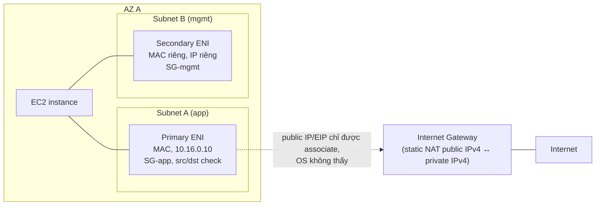
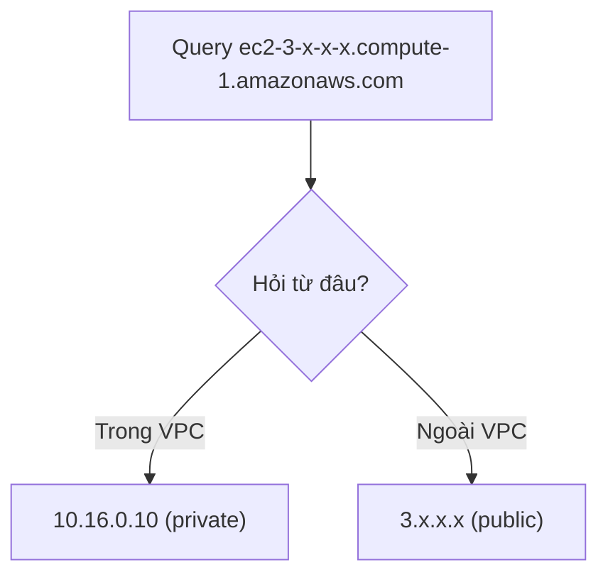

# EC2 Network Interfaces IPs and DNS

> **TL;DR:** Mọi cấu hình mạng của EC2 (IP, MAC, Security Group, source/dest check) thực chất nằm trên **ENI (Elastic Network Interface)**, không nằm trên instance. Public IPv4 thường là **động** (stop/start là đổi), muốn cố định thì dùng **Elastic IP**. Public DNS của instance trả về **private IP khi hỏi từ trong VPC** và public IP khi hỏi từ ngoài.

## 🖼️ Sơ đồ
![[EC2 Network Interfaces IPs and DNS.excalidraw]]
*Mở bằng plugin Excalidraw để chỉnh sửa · ảnh tĩnh: [[EC2 Network Interfaces IPs and DNS.svg]]*

![[EC2 Network Interfaces IPs and DNS - dns.excalidraw]]
*Mở bằng plugin Excalidraw để chỉnh sửa · ảnh tĩnh: [[EC2 Network Interfaces IPs and DNS - dns.svg]]*

## Khái niệm cốt lõi

### ENI: primary và secondary
- Mỗi instance luôn có **1 primary ENI** (tạo cùng instance, không tách ra được).
- Có thể gắn thêm **secondary ENI**; số lượng tối đa phụ thuộc instance type (xem [[EC2 Instance Types]]).
- Các ENI có thể nằm ở **subnet khác nhau nhưng bắt buộc cùng một AZ**, vì instance chỉ sống trong một AZ (xem [[EC2 Architecture and Resilience]]).
- Secondary ENI có cùng năng lực với primary, khác biệt quan trọng: **detach được và gắn sang instance khác** (cùng AZ).
- Khi chọn VPC/subnet lúc launch instance, thực ra bạn đang chọn VPC/subnet cho **primary ENI**. Console hiển thị IP, DNS, SG như "của instance", nhưng đó là thuộc tính của primary ENI.

### Những gì gắn trên một ENI
| Thuộc tính | Số lượng / đặc điểm |
|---|---|
| MAC address | 1, OS nhìn thấy được → dùng cho licensing |
| Primary private IPv4 | 1, lấy từ dải của subnet, **cố định suốt đời instance** |
| Secondary private IPv4 | 0 hoặc nhiều |
| Public IPv4 (thường) | 0 hoặc 1 mỗi ENI, **động** |
| Elastic IP | tối đa **1 EIP cho mỗi private IPv4** trên ENI |
| IPv6 | 0 hoặc nhiều; mặc định **routable công khai** (IPv6 không có khái niệm public/private) |
| Security Groups | áp lên ENI → ảnh hưởng **mọi IP** trên ENI đó |
| Source/Destination Check | bật/tắt theo từng ENI |

- **Source/Destination Check**: khi bật, ENI loại bỏ traffic mà nguồn hoặc đích không phải một trong các IP của nó. Phải **tắt** để instance làm NAT instance hoặc router/appliance (xem [[NAT Gateway]]).
- Vì [[Security Groups]] gắn vào ENI, nếu cần các IP khác nhau chịu các bộ rule khác nhau thì phải tách chúng ra **nhiều ENI**, mỗi ENI một bộ SG. Nhiều IP trên cùng một ENI luôn dùng chung SG.

### Private IP và private DNS
- Ví dụ primary private IP `10.16.0.10` → private DNS dạng `ip-10-16-0-10.ec2.internal` (us-east-1; region khác có dạng `ip-...<region>.compute.internal`).
- Private DNS **chỉ resolve được trong VPC** và luôn trỏ về private IP. Dùng cho giao tiếp nội bộ.

### Public IPv4 (non-elastic)
- Được cấp khi bật thủ công lúc launch, hoặc khi subnet bật auto-assign public IPv4 (xem [[VPC Subnets]]).
- **Động**: 
  - **Stop** → IP bị thu hồi; **Start** lại → cấp IP mới khác hẳn.
  - **Reboot/restart** → **không** đổi IP.
  - Bất cứ điều gì khiến instance chuyển sang host khác (ví dụ forced migration do AWS) → đổi IP.
- Public IP **không thực sự nằm trên instance**: [[VPC Routing and Internet Gateway|Internet Gateway]] làm static NAT giữa public IP và private IP. OS **không bao giờ thấy public IPv4**.
- Kèm theo **public DNS** dạng `ec2-<ip-gạch-ngang>.compute-1.amazonaws.com` (us-east-1; region khác: `ec2-...<region>.compute.amazonaws.com`).

### Public DNS resolve khác nhau theo vị trí
- **Trong VPC**: public DNS resolve ra **primary private IPv4** → traffic instance-to-instance đi thẳng trong VPC, không vòng ra IGW rồi quay lại.
- **Ngoài VPC** (Internet): resolve ra **public IPv4**.
- Lợi ích: một tên DNS duy nhất dùng được cả trong lẫn ngoài AWS. Hành vi này quan trọng khi học [[VPC Peering]] và thiết kế hybrid (xem [[R53 Interoperability]]).

### Elastic IP (EIP)
- EIP là public IPv4 **cấp cho account**, cố định cho đến khi bạn release.
- Associate với một private IP trên primary hoặc secondary ENI.
- Gắn EIP vào primary ENI → **public IPv4 thường bị gỡ ngay**, EIP thành public IP mới của instance.
- Gỡ EIP ra → instance được cấp **public IPv4 mới**, **không bao giờ lấy lại IP cũ**.
- (Hiện nay, từ 02/2024, AWS tính phí cho **mọi** public IPv4, kể cả EIP đang gắn; trước đó EIP chỉ tính phí khi không gắn.)

## Cách hoạt động / Kiến trúc

## 🎯 Mẹo thi SAA-C03
- **Secondary ENI + MAC = licensing**: phần mềm cũ license theo MAC → tạo secondary ENI, license theo MAC đó; khi cần thay instance thì detach ENI gắn sang instance mới, license đi theo.
- **Multi-homed**: instance có ENI ở 2 subnet (ví dụ một cho management, một cho data).
- Cần **SG khác nhau cho các IP khác nhau** → dùng **nhiều ENI**, không phải nhiều IP trên một ENI.
- **OS không bao giờ thấy public IPv4**. Không bao giờ cấu hình public IPv4 trong Windows/Linux trên EC2. (IPv6 thì khác: OS thấy vì IPv6 đều là public.)
- Public IPv4 thường là **dynamic**: stop/start = đổi IP; reboot = giữ IP. Cần IP cố định → **Elastic IP**.
- Câu hỏi kinh điển: instance có public IP thường, gắn EIP rồi gỡ EIP, có lấy lại IP cũ được không? **Không**, sẽ nhận IP mới hoàn toàn.
- **Public DNS = private IP trong VPC, public IP ở mọi nơi khác.**
- NAT instance cần **tắt Source/Destination Check** trên ENI.
- Mọi ENI của một instance phải **cùng AZ**.

## Liên kết
- Tiên quyết: [[EC2 Basics]], [[VPC Subnets]], [[VPC Routing and Internet Gateway]], [[NAT Fundamentals]]
- Liên quan: [[Security Groups]], [[NAT Gateway]], [[EC2 Architecture and Resilience]], [[EC2 Instance Metadata]], [[Enhanced Networking and EBS Optimized]]
- Dùng sau: [[VPC Peering]], [[R53 Interoperability]]
