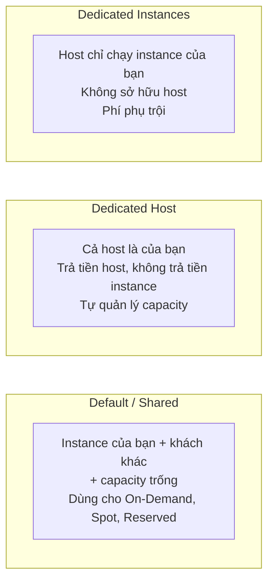
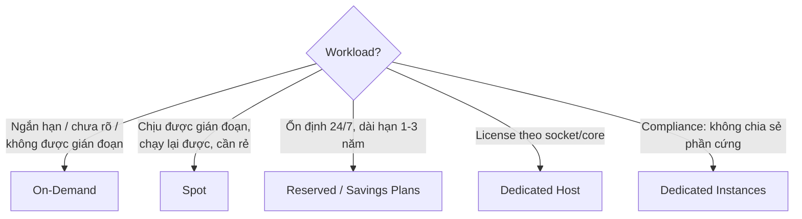

# EC2 Purchase Options

> **TL;DR:** EC2 có nhiều cách mua (AWS gọi là *purchase options*, hay bị gọi là *launch types*): **On-Demand** (mặc định, không cam kết, không gián đoạn), **Spot** (rẻ nhất, tới **90%**, có thể bị thu hồi), **Reserved** (cam kết 1 hoặc 3 năm cho tải ổn định dài hạn), cùng hai mô hình phần cứng riêng: **Dedicated Hosts** và **Dedicated Instances**. Với đề thi, trọng tâm là chọn đúng giữa On-Demand, Spot và Reserved theo tính chất workload.

## 🖼️ Sơ đồ
![[EC2 Purchase Options.excalidraw]]
*Mở bằng plugin Excalidraw để chỉnh sửa · ảnh tĩnh: [[EC2 Purchase Options.svg]]*

![[EC2 Purchase Options - tenancy.excalidraw]]
*Mở bằng plugin Excalidraw để chỉnh sửa · ảnh tĩnh: [[EC2 Purchase Options - tenancy.svg]]*

## Khái niệm cốt lõi

### On-Demand (mặc định)
- Instance của nhiều khách hàng chạy chung trên **pool EC2 host dùng chung** (vẫn được cô lập) → AWS tận dụng tài nguyên hiệu quả nên giá khởi điểm hợp lý.
- **Tính tiền theo giây khi instance ở trạng thái running**. Stop thì không trả tiền compute, nhưng tài nguyên liên quan như [[EBS]] volume **vẫn tính phí** khi instance stop (xem [[EC2 Shutdown Terminate and Termination Protection]]).
- **Không gián đoạn** (trừ khi có sự cố), giá cố định, dễ dự đoán, **không giảm giá**.
- **Không có capacity reservation**: khi AWS gặp sự cố lớn và thiếu capacity, phần reserved được ưu tiên trước, on-demand xếp sau.
- Hợp với: workload **ngắn hạn**, **chưa rõ thời lượng/tính chất**, và **không chịu được gián đoạn**.
- Quy tắc của Adrian: **mặc định chọn On-Demand**, chỉ chuyển sang lựa chọn khác khi có lý do chính đáng.

### Spot
- AWS bán **capacity EC2 đang dư** với giá giảm tới **90%** so với On-Demand.
- Mỗi region và mỗi instance type có một **spot price** phụ thuộc lượng capacity trống.
- Bạn đặt **max price**; bạn luôn chỉ trả **spot price hiện tại**, không phải max price.
- Khi spot price vượt max price của bạn (hoặc AWS cần lấy lại capacity cho on-demand) → instance Spot **bị thu hồi/terminate**.
- (Khóa học giải thích bằng mô hình max price. Hiện nay giá Spot thay đổi từ từ theo cung cầu dài hạn, max price mặc định là giá On-Demand, và lý do bị thu hồi chủ yếu là AWS cần capacity. AWS báo trước **2 phút** trước khi thu hồi.)

Ví dụ của Adrian (đơn vị "gold coin"):

| Thời điểm | Spot price | Khách A (max 4) | Khách B (max 2) |
|---|---|---|---|
| Ban đầu | 2 | chạy, trả 2 | chạy, trả 2 |
| Capacity giảm, AWS tăng giá | 4 | chạy, trả 4 | **bị terminate** |

| ✅ Hợp với Spot | ❌ Không dùng Spot |
|---|---|
| Không gấp về thời gian (non time-critical) | Workload không chịu được gián đoạn |
| Việc **chạy lại được** nếu fail (song song hóa cao, phân tích khoa học) | Domain controller, mail server, website truyền thống |
| Nhu cầu capacity **bùng nổ** (xử lý media, ảnh) | Hệ thống quan trọng (ví dụ điều khiển bay) |
| Nhạy cảm chi phí | Workload dài hạn cần compute ổn định |
| **Stateless** (session không lưu trên instance) | Business-critical |

### Reserved (tóm tắt, chi tiết ở [[Reserved Instances and Savings Plans]])
- **Cam kết** dùng EC2 lâu dài (**1 năm hoặc 3 năm**) để được giá rẻ hơn hoặc xóa hẳn phí theo giây.
- Reservation áp vào instance khớp với nó. **Mua mà không dùng vẫn phải trả tiền.**
- Phạm vi:
  - **Zonal** (khóa vào một AZ): có giảm giá **và reserve capacity**, chỉ trong AZ đó.
  - **Regional**: giảm giá cho instance ở **mọi AZ** trong region, **không** reserve capacity.
- Có thể **áp dụng một phần**: ví dụ reservation cho `t3.large` sẽ giảm một phần chi phí cho một instance `t3` lớn hơn.
- Hình thức thanh toán:

| Cách trả | Trả trước | Phí theo giây | Mức giảm |
|---|---|---|---|
| **No Upfront** | 0 | giảm, trả **dù instance chạy hay không** | ít nhất |
| **Partial Upfront** | một phần | thấp hơn No Upfront | trung bình |
| **All Upfront** | toàn bộ kỳ hạn | **không có** | **nhiều nhất** |

- Kỳ hạn 3 năm giảm nhiều hơn 1 năm nhưng rủi ro cao hơn vì nhu cầu dễ thay đổi. **3 năm + All Upfront = giảm sâu nhất**.
- Hợp với: thành phần hạ tầng **luôn chạy, ổn định, dài hạn**, cần giá thấp nhất và không chịu được gián đoạn.

### Dedicated Hosts
- Thuê **nguyên một EC2 host vật lý** dành cho một instance family cụ thể (ví dụ A, C, R...), có sẵn core/CPU, RAM, local storage, network.
- **Trả tiền cho host**; instance chạy trên host **không bị tính phí theo giây**. Có thể chạy nhiều size khác nhau tới hết capacity của host.
- **Phải tự quản lý capacity**: capacity thừa là lãng phí, hết capacity thì không launch thêm được.
- **Host affinity**: stop/start instance vẫn quay về đúng host đó → quan trọng cho licensing.
- Lý do chính (cả thực tế lẫn đề thi): phần mềm **license theo socket/core vật lý**. Xem thêm [[Dedicated Hosts]].

### Dedicated Instances
- Instance chạy trên host **chỉ chứa instance của bạn**, không chia sẻ phần cứng với khách hàng khác.
- **Không trả tiền host, không phải quản lý host.**
- Phí: **một khoản cố định theo giờ cho mỗi region** có dùng dedicated instance (bất kể số lượng) **+ phí cao hơn cho từng instance**.
- Dùng cho ngành có yêu cầu nghiêm ngặt **không được chia sẻ hạ tầng vật lý**.

## Cách hoạt động / Kiến trúc

| Mô hình | Thấy được host? | Tính phí | Quản lý capacity | Chia sẻ phần cứng |
|---|---|---|---|---|
| Default/Shared | Không | theo giây (giảm nếu có reservation) | Không | Có, với khách khác |
| Dedicated Host | Có | theo host | **Có** | Không |
| Dedicated Instances | Không | phí region/giờ + phí instance cao hơn | Không | Không |

## 🎯 Mẹo thi SAA-C03
- Tập trung vào **On-Demand vs Reserved vs Spot** và use case của từng loại.
- Từ khóa → đáp án:
  - "short-term", "unknown", "không chịu gián đoạn" → **On-Demand**.
  - "rẻ nhất", "chịu được gián đoạn", "batch/phân tích có thể chạy lại", "stateless", "linh hoạt thời gian" → **Spot**.
  - "24/7", "steady-state", "1 hoặc 3 năm", "dài hạn" → **Reserved** (hoặc Savings Plans).
  - "license theo socket/core", "BYOL gắn với phần cứng vật lý" → **Dedicated Host**.
  - "không được chia sẻ phần cứng với khách khác" nhưng không cần quản lý host → **Dedicated Instances**.
- Bẫy: **không bao giờ** chọn Spot cho workload không chịu được gián đoạn, dù đề nhấn mạnh tiết kiệm chi phí.
- Spot: bạn trả **spot price hiện tại**, không phải max price.
- Instance stop thì không tính phí compute, **EBS vẫn tính phí**.
- Thứ tự ưu tiên khi thiếu capacity: **Reserved → On-Demand → Spot**.
- Muốn giảm giá sâu nhất cho reservation: **3 năm + All Upfront**.

## Liên kết
- Tiên quyết: [[EC2 Basics]], [[Virtualization]], [[EC2 Architecture and Resilience]]
- Chi tiết: [[Reserved Instances and Savings Plans]], [[Dedicated Hosts]]
- Liên quan: [[EC2 Instance Types]], [[EBS]], [[Horizontal vs Vertical Scaling]], [[Auto Scaling Groups]], [[ECS Launch Types EC2 vs Fargate]], [[AWS Budgets]]
