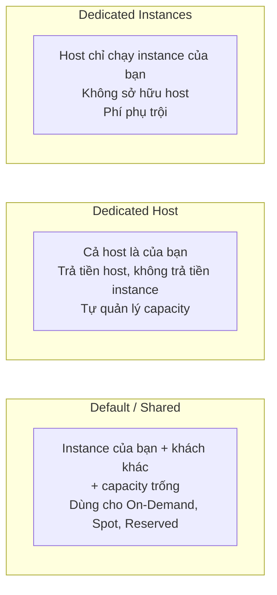
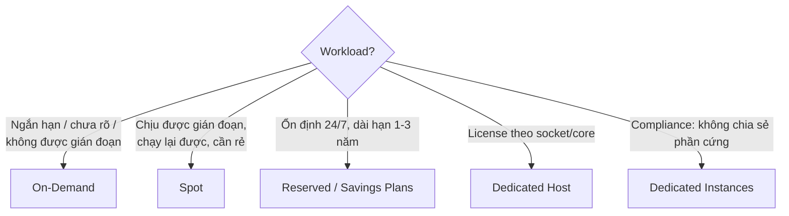

# EC2 Purchase Options

> **TL;DR:** EC2 có nhiều cách mua (AWS gọi là *purchase options*, hay bị gọi là *launch types*): **On-Demand** (mặc định, không cam kết, không gián đoạn), **Spot** (rẻ nhất, tới **90%**, có thể bị thu hồi), **Reserved** (cam kết 1 hoặc 3 năm cho tải ổn định dài hạn), cùng hai mô hình phần cứng riêng: **Dedicated Hosts** và **Dedicated Instances**. Với đề thi, trọng tâm là chọn đúng giữa On-Demand, Spot và Reserved theo tính chất workload.

## 🖼️ Sơ đồ
![[EC2 Purchase Options.excalidraw]]
*Mở bằng plugin Excalidraw để chỉnh sửa · ảnh tĩnh: [[EC2 Purchase Options.svg]]*

![[EC2 Purchase Options - tenancy.excalidraw]]
*Mở bằng plugin Excalidraw để chỉnh sửa · ảnh tĩnh: [[EC2 Purchase Options - tenancy.svg]]*

## Khái niệm cốt lõi

### On-Demand (mặc định)
- Instance của nhiều khách hàng chạy chung trên **pool EC2 host dùng chung** (vẫn được cô lập) → AWS tận dụng tài nguyên hiệu quả nên giá khởi điểm hợp lý.
- **Tính tiền theo giây khi instance ở trạng thái running** (có thể cộng thêm phí tùy hệ điều hành). Stop thì không trả tiền compute, nhưng tài nguyên liên quan như [[EBS]] volume **vẫn tính phí** khi instance stop (xem [[EC2 Shutdown Terminate and Termination Protection]]).
- **Không gián đoạn** (trừ khi có sự cố), giá cố định, dễ dự đoán, **không giảm giá**.
- **Không có capacity reservation**: On-Demand lấy từ pool hạ tầng dùng chung chưa được đặt trước trong AZ. Pool cạn với instance type đó thì có thể gặp lỗi **insufficient capacity**, kể cả khi launch mới hay **start lại instance đã stop**. Cần chắc chắn có chỗ → [[Reserved Instances and Savings Plans|On-Demand Capacity Reservation]]. (Bản khóa cũ nói thêm: khi thiếu capacity, phần reserved được ưu tiên trước, on-demand xếp sau.)
- Hợp với: workload **ngắn hạn**, **chưa rõ thời lượng/tính chất**, và **không chịu được gián đoạn**.
- Quy tắc của giảng viên: **mặc định chọn On-Demand** cho mọi project, chỉ chuyển sang lựa chọn khác khi có lý do chính đáng.

### Spot
- AWS bán **capacity EC2 đang dư** với giá giảm tới **90%** so với On-Demand. Đây là cách rẻ nhất để có capacity EC2, đổi lại **uptime không được đảm bảo**.
- Capacity dư được gom thành **pool theo instance type trong từng AZ** (m5.large ở AZ A là pool khác m5.large ở AZ bên cạnh). Mỗi pool có một **spot price** do AWS đặt, **thay đổi từ từ theo cung cầu dài hạn**. **Không còn đấu giá (bidding)** như cách Spot từng hoạt động.
- Instance Spot chạy thì bạn trả **spot price hiện tại của pool**.
- Spot là ưu tiên thấp: khi nhu cầu On-Demand tăng, AWS **thu hồi (interrupt)** capacity Spot.

**Ba lý do bị gián đoạn:**
1. **Capacity** (phổ biến nhất): AWS cần lại capacity, thường để giao cho khách On-Demand, hoặc host bảo trì / phần cứng bị loại bỏ. Không liên quan giá: instance Spot đang rẻ vẫn có thể bị lấy lại.
2. **Price**: nếu bạn đặt **max price** và spot price của pool vượt mức đó. Max mặc định = **giá On-Demand**, nên không đặt max thì thường không gặp lý do này.
3. **Constraints**: bạn yêu cầu một nhóm instance phải đi cùng nhau; AWS không còn đáp ứng được ràng buộc đó thì **cả nhóm bị terminate**.

**Cảnh báo trước khi gián đoạn** (đến cùng lúc qua hai đường):
- Event **EventBridge** với detail-type `EC2 Spot Instance Interruption Warning` → viết rule gọi Lambda, SNS, Step Functions... (xem [[EventBridge]]).
- **Instance metadata** tại `latest/meta-data/spot/instance-action` (xem [[EC2 Instance Metadata]]). Code trên instance nên poll **mỗi 5 giây**; chưa có gián đoạn thì trả **404**, có thì cho biết action và thời điểm.

**Interruption behavior** (chọn khi tạo spot request):

| Behavior | Điều gì xảy ra | Cảnh báo | Yêu cầu |
|---|---|---|---|
| **Terminate** (mặc định) | Instance bị xóa; muốn chạy tiếp thì tạo spot request mới | **2 phút** | Không |
| **Stop** | Stop như thường, **giữ EBS volume** (chỉ trả tiền volume); có capacity lại thì AWS **tự start lại** | **2 phút** | Spot request **persistent** |
| **Hibernate** | Ghi nội dung RAM xuống EBS root volume; có capacity lại thì **chạy tiếp đúng chỗ dừng** | **Không có 2 phút**: hibernate bắt đầu ngay khi có thông báo | Spot request **persistent**, instance family và AMI hỗ trợ, **root volume mã hóa đủ lớn** để chứa RAM |

- Spot request **one-time** không stop hay hibernate được: đã fulfil thì chỉ có terminate. **Persistent** request được AWS giữ mở để đưa instance trở lại khi có capacity.
- 2 phút là cửa sổ để drain kết nối, hoàn tất việc dở, lưu checkpoint rồi tắt gọn.
- **Rebalance recommendation**: tín hiệu khi instance Spot **có nguy cơ cao bị gián đoạn**, đến trước thông báo 2 phút để bạn drain sớm hoặc launch instance thay thế. Nhưng chỉ là **best effort**: có thể đến sớm, đến cùng lúc, hoặc không đến. Thứ chắc chắn duy nhất là thông báo 2 phút.
- (Bản khóa cũ giải thích bằng mô hình max price: Spot bị terminate khi spot price vượt max price của bạn. Ví dụ "gold coin": spot price 2, khách A max 4 và khách B max 2 đều chạy; capacity giảm, giá lên 4 thì khách B bị terminate.)

| ✅ Hợp với Spot | ❌ Không dùng Spot |
|---|---|
| Không gấp về thời gian (non time-critical) | Workload không chịu được gián đoạn |
| Việc **chạy lại được** nếu bị gián đoạn (song song hóa cao: phân tích khoa học, rendering) | Domain controller, hệ thống stateful business-critical |
| Nhu cầu capacity **bùng nổ**, batch | Website truyền thống chạy một instance |
| Nhạy cảm chi phí | Workload dài hạn cần compute ổn định |
| **Stateless**; ví dụ hiện đại: **container trên ECS/EKS**, **CI/CD build farm** | Hệ thống quan trọng (ví dụ điều khiển bay) |

### Reserved (tóm tắt, chi tiết ở [[Reserved Instances and Savings Plans]])
- **Cam kết** dùng EC2 lâu dài (**1 năm hoặc 3 năm**) để được giá rẻ hơn hoặc xóa hẳn phí theo giây.
- Reserved Instance **không phải một loại instance** để launch: đó là một **cam kết trên hóa đơn**. Instance vẫn chạy như bình thường, AWS tự áp giá giảm cho instance khớp với reservation. **Mua mà không dùng vẫn phải trả tiền.**
- Hai offering class: **Standard** (giảm nhiều nhất, không đổi được, chỉ bán lại được trên RI Marketplace) và **Convertible** (giảm ít hơn, đổi được sang thuộc tính khác).
- Phạm vi:
  - **Zonal** (khóa vào một AZ): có giảm giá **và reserve capacity**, chỉ trong AZ đó.
  - **Regional**: giảm giá cho instance ở **mọi AZ** trong region, **không** reserve capacity.
- Regional RI có **instance size flexibility**: giảm giá trải được cho nhiều size trong cùng family, ví dụ reservation cho `t3.large` giảm một phần chi phí cho một instance `t3` lớn hơn (chỉ với Linux, default tenancy).
- Hình thức thanh toán:

| Cách trả | Trả trước | Phí theo giây | Mức giảm |
|---|---|---|---|
| **No Upfront** | 0 | giảm, trả **dù instance chạy hay không** | ít nhất |
| **Partial Upfront** | một phần | thấp hơn No Upfront | trung bình |
| **All Upfront** | toàn bộ kỳ hạn | **không có** | **nhiều nhất** |

- Kỳ hạn 3 năm giảm nhiều hơn 1 năm nhưng rủi ro cao hơn vì nhu cầu dễ thay đổi. **3 năm + All Upfront = giảm sâu nhất**.
- Hợp với: thành phần hạ tầng **luôn chạy, ổn định, dài hạn**, cần giá thấp nhất và không chịu được gián đoạn.
- Với đa số workload, AWS nay **khuyên dùng Savings Plans** thay vì RI vì linh hoạt hơn (xem [[Reserved Instances and Savings Plans]]).

### Dedicated Hosts
- Thuê **nguyên một EC2 host vật lý** dành cho một instance family cụ thể (ví dụ A, C, R...), có sẵn core/CPU, RAM, local storage, network.
- **Trả tiền cho host**; instance chạy trên host **không bị tính phí theo giây**. Có thể chạy nhiều size khác nhau tới hết capacity của host.
- **Phải tự quản lý capacity**: capacity thừa là lãng phí, hết capacity thì không launch thêm được.
- **Host affinity**: stop/start instance vẫn quay về đúng host đó → quan trọng cho licensing.
- Hai lý do dùng: **cách ly phần cứng** vì quy định (dữ liệu mật, chính phủ cấm hạ tầng dùng chung), và phần mềm **license theo socket/core vật lý** (nay ít gặp hơn nhưng vẫn có trong đề). Xem thêm [[Dedicated Hosts]] và [[AWS Artifact and License Manager]] (License Manager theo dõi license).
- Share được sang account khác, OU hoặc cả Organization bằng [[AWS Resource Access Manager|RAM]].

### Dedicated Instances
- Instance chạy trên host **chỉ chứa instance của bạn**, không chia sẻ phần cứng với khách hàng khác.
- **Không trả tiền host, không phải quản lý host.**
- Phí: **một khoản cố định theo giờ cho mỗi region** có dùng dedicated instance (bất kể số lượng) **+ phí cao hơn cho từng instance**.
- Dùng cho ngành có yêu cầu nghiêm ngặt **không được chia sẻ hạ tầng vật lý**.
- Đổi lại **không có quyền nhìn và điều khiển ở mức host**: không thấy socket/core, không có host affinity, chỉ hỗ trợ BYOL một phần.
- Quy tắc của giảng viên: chỉ cần ra khỏi phần cứng dùng chung → **Dedicated Instances** (đơn giản hơn); cần license theo socket/core và quyền kiểm soát host → **Dedicated Hosts**.

## Cách hoạt động / Kiến trúc

| Mô hình | Thấy được host? | Tính phí | Quản lý capacity | Chia sẻ phần cứng |
|---|---|---|---|---|
| Default/Shared | Không | theo giây (giảm nếu có reservation) | Không | Có, với khách khác |
| Dedicated Host | Có | theo host | **Có** | Không |
| Dedicated Instances | Không | phí region/giờ + phí instance cao hơn | Không | Không |

## 🎯 Mẹo thi SAA-C03
- Tập trung vào **On-Demand vs Reserved vs Spot** và use case của từng loại.
- Từ khóa → đáp án:
  - "short-term", "unknown", "không chịu gián đoạn" → **On-Demand**.
  - "rẻ nhất", "chịu được gián đoạn", "batch/phân tích có thể chạy lại", "stateless", "linh hoạt thời gian" → **Spot**.
  - "24/7", "steady-state", "1 hoặc 3 năm", "dài hạn" → **Reserved** (hoặc Savings Plans).
  - "license theo socket/core", "BYOL gắn với phần cứng vật lý" → **Dedicated Host**.
  - "không được chia sẻ phần cứng với khách khác" nhưng không cần quản lý host → **Dedicated Instances**.
- Bẫy: **không bao giờ** chọn Spot cho workload không chịu được gián đoạn, dù đề nhấn mạnh tiết kiệm chi phí.
- Spot: bạn trả **spot price hiện tại của pool** (do AWS đặt, không đấu giá). Bị gián đoạn chủ yếu vì **AWS cần lại capacity**; ngoài ra vì giá vượt max price bạn đặt, hoặc ràng buộc nhóm không còn đáp ứng.
- Cảnh báo gián đoạn Spot: **2 phút**, qua **EventBridge** (`EC2 Spot Instance Interruption Warning`) và **instance metadata** (`spot/instance-action`, poll mỗi 5 giây). Muốn giữ EBS hoặc RAM thay vì mất instance → interruption behavior **stop** hoặc **hibernate** (cần **persistent** spot request; hibernate không có 2 phút). **Rebalance recommendation** chỉ là best effort.
- On-Demand **không giữ capacity**: có thể gặp **insufficient capacity** khi launch hoặc start lại instance đã stop.
- Instance stop thì không tính phí compute, **EBS vẫn tính phí**.
- Thứ tự ưu tiên khi thiếu capacity: **Reserved → On-Demand → Spot** (Spot luôn bị thu hồi trước để nhường cho On-Demand).
- Muốn giảm giá sâu nhất cho reservation: **3 năm + All Upfront**.

## Liên kết
- Tiên quyết: [[EC2 Basics]], [[Virtualization]], [[EC2 Architecture and Resilience]]
- Chi tiết: [[Reserved Instances and Savings Plans]], [[Dedicated Hosts]]
- Liên quan: [[EC2 Instance Types]], [[EBS]], [[Horizontal vs Vertical Scaling]], [[Auto Scaling Groups]], [[ECS Launch Types EC2 vs Fargate]], [[AWS Budgets]], [[EventBridge]], [[EC2 Instance Metadata]]
