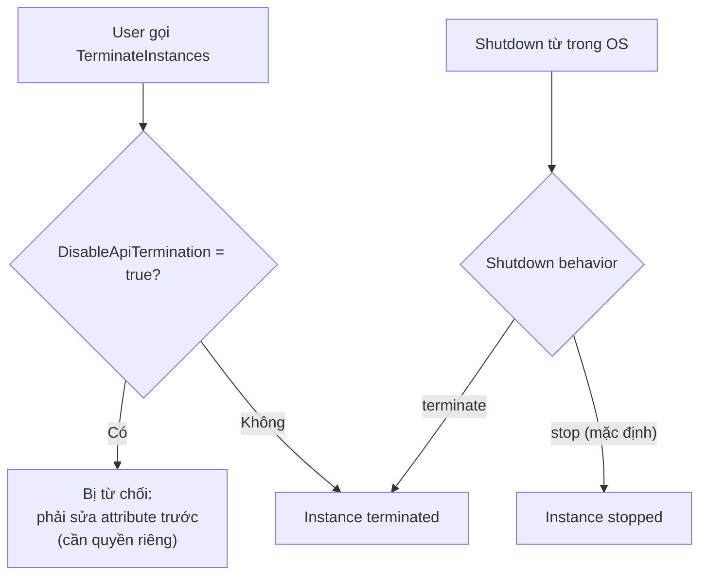

# EC2 Shutdown Terminate and Termination Protection

> **TL;DR:** **Termination protection** (thuộc tính `DisableApiTermination`) chặn việc terminate nhầm instance quan trọng và tạo ra một quyền IAM riêng, giúp tách vai trò giữa người được gỡ bảo vệ và người được terminate. **Shutdown behavior** quyết định khi OS bên trong tự shutdown thì instance chuyển sang **stopped** (mặc định) hay **terminated**.

## 🖼️ Sơ đồ
![[EC2 Shutdown Terminate and Termination Protection.excalidraw]]
*Mở bằng plugin Excalidraw để chỉnh sửa · ảnh tĩnh: [[EC2 Shutdown Terminate and Termination Protection.svg]]*

## Khái niệm cốt lõi

### Stop, Reboot, Terminate
- Instance đang running có thể **Stop**, **Reboot** hoặc **Terminate**.
- **Stop**: không tính phí compute nhưng EBS vẫn tính phí; public IPv4 thường bị thu hồi (xem [[EC2 Network Interfaces IPs and DNS]] và [[EC2 Purchase Options]]).
- **Terminate**: xóa instance, có thể **mất dữ liệu**. Dialog xác nhận mặc định rất dễ bị bấm qua.

### Termination Protection
- Bật tại *Instance settings → Change termination protection*. Bản chất là attribute **`DisableApiTermination`** = true.
- Khi bật mà cố terminate → lỗi dạng: *"The instance ... may not be terminated. Modify its 'disableApiTermination' instance attribute and then try again."*
- Lợi ích:
  1. Chống **terminate nhầm** (người ít kinh nghiệm bấm Terminate rồi Confirm).
  2. Cần **thêm một quyền** để sửa attribute đó, ngoài quyền terminate → cho phép **tách vai trò** (role separation):
     - Senior admin: được tắt termination protection.
     - Admin thường: được terminate.
     - Kết quả: muốn terminate instance production phải có senior admin gỡ bảo vệ trước, tức là thêm một bước phê duyệt.
- Thường bật cho **production/business-critical**, ít khi bật cho dev/test.
- Bật tự động được khi launch bằng [[CloudFormation Basics|CloudFormation]] hoặc các công cụ tự động hóa khác.
- Ghi chú: termination protection **không** chặn việc terminate do OS shutdown khi shutdown behavior = terminate, và không chặn [[Auto Scaling Groups|ASG]] scale-in (kiến thức ngoài bài).

### Shutdown behavior
- *Instance settings → Change shutdown behavior*: khi shutdown **từ bên trong OS**, instance chuyển sang:
  - **Stop** (mặc định, nên dùng trong đa số trường hợp).
  - **Terminate**: hợp với môi trường coi instance là **không mang trạng thái quan trọng (disposable)**, không muốn account đầy instance ở trạng thái stopped.
- Tính năng khá ngách.

## Cách hoạt động / Kiến trúc

## Demo / Lab
- Dùng instance từ demo [[EC2 Status Checks and Auto Recovery]].
- Bật termination protection → Terminate → nhận lỗi yêu cầu sửa `disableApiTermination`.
- Tắt lại termination protection, xem tùy chọn *Change shutdown behavior* (Stop/Terminate), rồi xóa stack CloudFormation để dọn dẹp.

## 🎯 Mẹo thi SAA-C03
- "Ngăn **xóa nhầm** EC2 instance quan trọng" → **bật termination protection** (`DisableApiTermination`).
- Termination protection thêm một **permission riêng** → dùng [[IAM Identity Policies]] để tách người được gỡ bảo vệ và người được terminate.
- Adrian nhấn mạnh tên attribute **`DisableApiTermination`** và thông báo lỗi (quan trọng hơn ở SysOps/Developer, nhưng nên nhớ).
- Muốn instance **tự xóa khi OS shutdown** → đổi shutdown behavior sang **terminate**.

## Liên kết
- Tiên quyết: [[EC2 Basics]], [[IAM Identity Policies]]
- Liên quan: [[EC2 Status Checks and Auto Recovery]], [[EC2 Purchase Options]], [[EBS]], [[CloudFormation Basics]], [[CFN Deletion Policy]]
- Phân biệt với: [[S3 Versioning and MFA Delete]] (cơ chế chống xóa nhầm phía S3)
