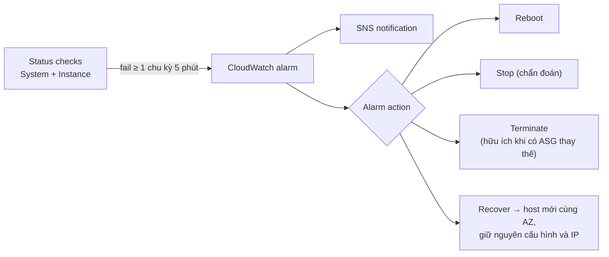

# EC2 Status Checks and Auto Recovery

> **TL;DR:** Mỗi EC2 instance có **2 status check**: **System status** (lỗi phía AWS/host) và **Instance status** (lỗi bên trong instance/OS). Bất cứ thứ gì khác **2/2 checks passed** (sau giai đoạn khởi tạo) đều là sự cố. Có thể tạo **CloudWatch alarm** trên status check để tự động reboot, stop, terminate hoặc **recover**. Recover chuyển instance sang host mới **trong cùng AZ** và giữ nguyên cấu hình.

## 🖼️ Sơ đồ
![[EC2 Status Checks and Auto Recovery.excalidraw]]
*Mở bằng plugin Excalidraw để chỉnh sửa · ảnh tĩnh: [[EC2 Status Checks and Auto Recovery.svg]]*

![[EC2 Status Checks and Auto Recovery - recover.excalidraw]]
*Mở bằng plugin Excalidraw để chỉnh sửa · ảnh tĩnh: [[EC2 Status Checks and Auto Recovery - recover.svg]]*

## Khái niệm cốt lõi

### Hai loại status check
| Check | Theo dõi | Nguyên nhân lỗi điển hình |
|---|---|---|
| **System status** (*System reachability check*) | Dịch vụ EC2 / **EC2 host** | Mất nguồn hệ thống, mất kết nối mạng, lỗi phần mềm hoặc phần cứng của host |
| **Instance status** (*Instance reachability check*) | **Bên trong instance** | File system hỏng, cấu hình mạng sai trong OS (ví dụ gán tĩnh public IPv4 vào interface trong OS, điều không bao giờ chạy được, xem [[EC2 Network Interfaces IPs and DNS]]), lỗi kernel OS khiến không khởi động được |

- Mới launch: trạng thái *initializing*, có lúc chỉ 1/2 pass. Sau đó phải là **2/2 checks passed**.
- Hai check là hai bộ test riêng → check nào fail giúp khoanh vùng vấn đề (host của AWS hay OS của bạn).

### Xử lý khi check fail
- **Thủ công**: stop/start (chuyển sang host khác), reboot, hoặc terminate rồi tạo lại.
- **Tự động** bằng **status check alarm** (một CloudWatch alarm, xem [[CloudWatch Basics]]):
  - Mặc định gửi thông báo qua [[SNS]] topic.
  - Điều kiện mặc định: *Status check failed: either* (một trong hai check fail) trong **1 chu kỳ liên tiếp 5 phút**.
  - **Alarm action** (tùy chọn): **Reboot** (tương đương reboot OS), **Stop** (để chẩn đoán), **Terminate**, **Recover**.
- **Terminate** chỉ có ý nghĩa khi có cơ chế HA tự tạo instance thay thế (ví dụ [[Auto Scaling Groups]]). Trên một instance đơn lẻ, terminate là mất instance, không có gì thay thế.

### EC2 Auto Recovery (action Recover)
- EC2 thực hiện một chuỗi hành động: có thể chỉ restart, hoặc **migrate sang EC2 host mới**.
- Instance khởi động lại với **cấu hình giữ nguyên**, kể cả **toàn bộ IP addressing**. Nếu phần mềm được cấu hình auto-start thì instance có thể tự phục hồi hoàn toàn mà không cần sysadmin thức dậy xử lý.
- Giới hạn:
  - Chỉ trong **cùng AZ** (EC2 là dịch vụ AZ-based, xem [[EC2 Architecture and Resilience]]) → **không bảo vệ khi cả AZ sập**, chỉ xử lý lỗi đơn lẻ của host hoặc instance.
  - Cần **host còn capacity trống**; sự cố lớn trên nhiều AZ có thể khiến recover thất bại.
  - Chỉ hỗ trợ **instance type đời mới** (khóa học liệt kê A1, C4, C5, M4, M5, R3, R4, R5...).
  - **Không hỗ trợ instance có [[Instance Store]] volume**, chỉ instance dùng **toàn EBS** (xem [[Compare - EBS vs Instance Store]]).
- Đây là tính năng đơn giản cho một nhóm lỗi hẹp, **không** phải giải pháp HA tổng thể. HA thật sự dùng [[Auto Scaling Groups]], [[Elastic Load Balancer]] và multi-AZ.
- (Hiện nay: action Recover gắn với metric **system** status check (`StatusCheckFailed_System`); các instance type hỗ trợ còn được bật sẵn **simplified automatic recovery** khi system check fail, không cần tạo alarm.)

## Cách hoạt động / Kiến trúc

## Demo / Lab
- Stack CloudFormation tạo 1 instance. Tab **Status Checks** hiển thị *System reachability check passed* và *Instance reachability check passed*.
- *Actions → Create status check alarm*: bật notification SNS, bật alarm action, chọn **Recover**, điều kiện *Status check failed: either*, 1 consecutive period, 5 phút.
- Hạ tầng được giữ lại cho demo termination protection ở bài sau ([[EC2 Shutdown Terminate and Termination Protection]]).

## 🎯 Mẹo thi SAA-C03
- Phân biệt: **System status check fail = vấn đề phía AWS** (power, network, host) → stop/start hoặc recover để sang host khác. **Instance status check fail = vấn đề của bạn** (OS, file system, cấu hình mạng) → bạn phải sửa.
- "Tự động phục hồi instance khi host lỗi, giữ nguyên instance ID/IP" → **CloudWatch alarm + EC2 Recover action**.
- Auto recovery **không** chống được sự cố cấp AZ; muốn chịu lỗi AZ thì dùng multi-AZ + ASG.
- Không dùng được cho instance có **instance store**.

## Liên kết
- Tiên quyết: [[EC2 Basics]], [[EC2 Architecture and Resilience]], [[CloudWatch Basics]]
- Liên quan: [[SNS]], [[Instance Store]], [[EC2 Shutdown Terminate and Termination Protection]], [[HA vs FT vs DR]]
- Giải pháp HA đầy đủ hơn: [[Auto Scaling Groups]], [[ASG Health Checks]], [[Elastic Load Balancer]]
