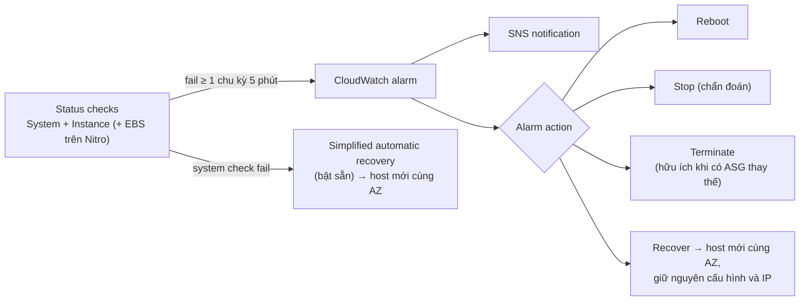

# EC2 Status Checks and Auto Recovery

> **TL;DR:** Mọi EC2 instance có **System status** (lỗi phía AWS/host) và **Instance status** (lỗi bên trong instance/OS); instance **Nitro** có thêm **EBS status** (instance không tới được EBS). Sau giai đoạn khởi tạo, khác **3/3** (hoặc **2/2** với instance cũ) checks passed là có sự cố. Khi **system check** fail, **simplified automatic recovery** (bật sẵn) chuyển instance sang host mới **trong cùng AZ**, giữ instance ID, IP và EBS. Có thể tự tạo **CloudWatch alarm** để reboot, stop, terminate, **recover** hoặc gửi thông báo.

## 🖼️ Sơ đồ
![[EC2 Status Checks and Auto Recovery.excalidraw]]
*Mở bằng plugin Excalidraw để chỉnh sửa · ảnh tĩnh: [[EC2 Status Checks and Auto Recovery.svg]]*

![[EC2 Status Checks and Auto Recovery - recover.excalidraw]]
*Mở bằng plugin Excalidraw để chỉnh sửa · ảnh tĩnh: [[EC2 Status Checks and Auto Recovery - recover.svg]]*

## Khái niệm cốt lõi

### Các loại status check
| Check | Theo dõi | Nguyên nhân lỗi điển hình |
|---|---|---|
| **System status** (*System reachability check*) | Dịch vụ EC2 / **EC2 host** | Mất nguồn hệ thống, mất kết nối mạng, lỗi phần mềm hoặc phần cứng của host |
| **Instance status** (*Instance reachability check*) | **Bên trong instance** | File system hỏng, cấu hình mạng sai trong OS (ví dụ gán tĩnh public IPv4 vào interface trong OS, điều không bao giờ chạy được, xem [[EC2 Network Interfaces IPs and DNS]]), lỗi kernel OS khiến không khởi động được, hết memory |
| **EBS status** (chỉ instance **Nitro**) | **EBS volume gắn vào instance** | Instance/host không tới được EBS (network-attached storage) do lỗi phần cứng hoặc phần mềm |

- Mới launch: trạng thái *initializing*, có lúc mới pass một phần. Sau đó phải là **3/3 checks passed** (instance Nitro có EBS) hoặc **2/2** (instance cũ không có EBS check).
- Mỗi check là một bộ test riêng → check nào fail giúp khoanh vùng vấn đề (host của AWS, OS của bạn hay EBS).

### Xử lý khi check fail
- **Thủ công**: stop/start (chuyển sang host khác), reboot, hoặc terminate rồi tạo lại.
- **Tự động**, có hai tính năng:
  - **Simplified automatic recovery**: **bật sẵn** trên instance hỗ trợ. Khi **system status check** fail (sự cố host), instance tự được **chuyển sang host khỏe**. Xem/tắt ở *Instance settings → Change auto-recovery behavior*.
  - **Status check alarm** (một CloudWatch alarm, xem [[CloudWatch Basics]]), tạo bằng *Actions → Create status check alarm*: dùng khi muốn tùy chỉnh thời gian theo dõi, khoảng thời gian fail trước khi hành động, hoặc gửi thông báo [[SNS]].
  - Điều kiện mặc định của wizard: *Status check failed: either* (instance, system hoặc EBS check fail) trong **1 chu kỳ 5 phút**.
  - **Alarm action** (tùy chọn): **Reboot** (tương đương reboot OS), **Stop** (để chẩn đoán), **Terminate**, **Recover**.
- **Terminate** chỉ có ý nghĩa khi có cơ chế HA tự tạo instance thay thế (ví dụ [[Auto Scaling Groups]]). Trên một instance đơn lẻ, terminate là mất instance, không có gì thay thế.

### EC2 Auto Recovery (simplified automatic recovery và action Recover)
- Cả hai cách recovery đều **chỉ dựa trên system status check** (lỗi host), **không** dựa trên instance hay EBS status check. Wizard alarm mặc định theo dõi "either", nhưng muốn chọn action **Recover** thì phải theo dõi **system status check**.
- Instance được **chuyển sang host mới trong cùng AZ**, giữ **instance ID, IP addressing và EBS volume đang gắn**. OS vẫn bị khởi động lại nên **nội dung RAM mất**. Nếu phần mềm được cấu hình auto-start thì instance có thể tự phục hồi mà không cần sysadmin thức dậy xử lý.
- Có simplified automatic recovery bật sẵn thì thường không cần tạo alarm Recover, trừ khi muốn tùy chỉnh thời gian hoặc nhận SNS.
- Giới hạn:
  - Chỉ trong **cùng AZ** (EC2 là dịch vụ AZ-based, xem [[EC2 Architecture and Resilience]]) → **không bảo vệ khi cả AZ sập**, chỉ xử lý lỗi đơn lẻ của host.
  - Không thay cho việc điều tra: lỗi phức tạp vẫn phải tự đăng nhập kiểm tra.
  - (Bản khóa cũ nêu, bài mới không nói:) cần **host còn capacity trống**; chỉ hỗ trợ **instance type đời mới** (A1, C4, C5, M4, M5, R3, R4, R5...); **không hỗ trợ instance có [[Instance Store]] volume**, chỉ instance dùng **toàn EBS** (xem [[Compare - EBS vs Instance Store]]).
- Đây là tính năng đơn giản cho một nhóm lỗi hẹp, **không** phải giải pháp HA tổng thể. HA thật sự dùng [[Auto Scaling Groups]], [[Elastic Load Balancer]] và multi-AZ.

## Cách hoạt động / Kiến trúc

## Demo / Lab
- Stack CloudFormation tạo 1 instance (chỉ xem, không giả lập sự cố). Lúc đầu status check chưa đủ; sau khoảng một phút tab **Status and alarms** hiện đủ **3 check passed**: system, instance và **EBS** (instance cũ chỉ thấy 2/2).
- *Instance settings → Change auto-recovery behavior*: mặc định **bật**, tức sự cố system check sẽ tự chuyển instance sang host khác; có thể tắt.
- *Actions → Create status check alarm*: wizard CloudWatch, mặc định theo dõi *either* (instance, system hoặc EBS) trong 5 phút; tick alarm action để Reboot/Stop/Terminate, hoặc **Recover** khi theo dõi system status check. Có simplified automatic recovery thì chỉ cần alarm khi muốn chỉnh thời gian hay gửi SNS. Demo không tạo alarm, xóa stack.
- (Bản khóa cũ tạo alarm Recover + SNS thật và giữ hạ tầng cho demo termination protection.)

## 🎯 Mẹo thi SAA-C03
- Phân biệt: **System status check fail = vấn đề phía AWS** (power, network, host) → stop/start hoặc recover để sang host khác. **Instance status check fail = vấn đề của bạn** (OS, file system, cấu hình mạng, hết memory) → bạn phải sửa. **EBS status check** (Nitro) fail = instance không tới được EBS.
- "Tự động phục hồi instance khi host lỗi, giữ nguyên instance ID/IP" → **simplified automatic recovery** (bật sẵn) hoặc **CloudWatch alarm + EC2 Recover action** (khi cần tùy chỉnh/SNS). Recovery chỉ dựa trên **system** status check.
- Auto recovery **không** chống được sự cố cấp AZ; muốn chịu lỗi AZ thì dùng multi-AZ + ASG.
- (Bản khóa cũ) Không dùng được cho instance có **instance store**.

## Liên kết
- Tiên quyết: [[EC2 Basics]], [[EC2 Architecture and Resilience]], [[CloudWatch Basics]]
- Liên quan: [[SNS]], [[Instance Store]], [[EC2 Shutdown Terminate and Termination Protection]], [[HA vs FT vs DR]]
- Giải pháp HA đầy đủ hơn: [[Auto Scaling Groups]], [[ASG Health Checks]], [[Elastic Load Balancer]]
