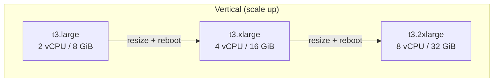
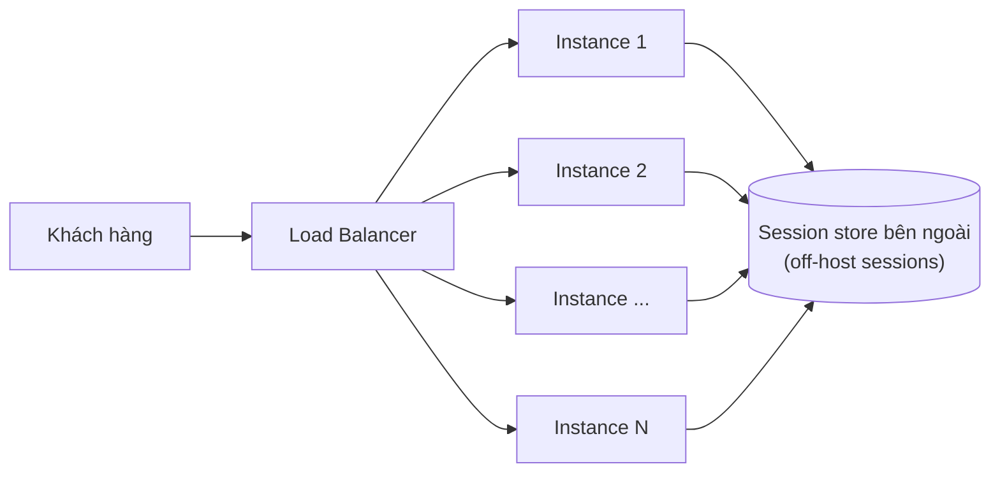

# Horizontal vs Vertical Scaling

> **TL;DR:** **Vertical scaling (scale up/down)** là đổi sang instance **to hơn/nhỏ hơn**: đơn giản, không phải sửa ứng dụng, nhưng có downtime, đắt dần và bị chặn trên bởi size lớn nhất. **Horizontal scaling (scale out/in)** là **thêm/bớt instance** sau load balancer: gần như không giới hạn, không gián đoạn, rẻ hơn, nhưng ứng dụng phải hỗ trợ, thường bằng cách đưa **session ra ngoài host (stateless)**.

## 🖼️ Sơ đồ
![[Horizontal vs Vertical Scaling.excalidraw]]
*Mở bằng plugin Excalidraw để chỉnh sửa · ảnh tĩnh: [[Horizontal vs Vertical Scaling.svg]]*

## Khái niệm cốt lõi

### Scaling là gì
- Hệ thống tăng hoặc giảm tài nguyên để đáp ứng tải thay đổi từ khách hàng. "Hệ thống" có thể là một instance hoặc hàng trăm nghìn thiết bị.

### Vertical scaling
- Ví dụ trên slide (xem [[EC2 Instance Types]]):

| Instance | vCPU | Memory |
|---|---|---|
| `t3.large` | 2 | 8 GiB |
| `t3.xlarge` | 4 | 16 GiB |
| `t3.2xlarge` | 8 | 32 GiB |

- Nhược điểm:
  - **Mỗi lần resize cần reboot** → gián đoạn khách hàng → thường chỉ scale được trong **cửa sổ bảo trì (outage window)**, phản ứng chậm khi tải đổi nhanh.
  - Instance lớn thường **đắt thêm một khoản (premium)**, chi phí tăng không tuyến tính ở các size cao.
  - Có **trần hiệu năng = size instance lớn nhất**.
- Ưu điểm:
  - **Không cần sửa ứng dụng**: chạy được trên instance nhỏ thì chạy được trên instance lớn.
  - Áp dụng cho **mọi ứng dụng, kể cả monolith**.
- Bước scale thô: lên một size thường là **gấp đôi** tài nguyên.

### Horizontal scaling
- Thêm instance (1 → 2 → 4 → 8...) thay vì làm to một instance. Nhiều bản copy ứng dụng chạy song song trên các instance nhỏ.
- Cần **load balancer** đứng giữa khách hàng và instance để chia tải (xem [[Elastic Load Balancer]]). Mỗi click của một người dùng có thể rơi vào cùng một instance hoặc bất kỳ instance nào.
- **"Sessions are everything"**: session là trạng thái tương tác của người dùng (đăng nhập, giỏ hàng, vị trí video đang xem...).
  - Một server thì session nằm trên server đó. Với nhiều instance, người dùng chuyển qua lại giữa các instance → **mất session**, bị logout, ứng dụng không dùng được.
  - Giải pháp: ứng dụng tự hỗ trợ, hoặc **off-host sessions**: lưu session ở bên ngoài, ví dụ một database (thường là [[DynamoDB Architecture|DynamoDB]] hoặc [[ElastiCache]]). Khi đó instance là **stateless** ("dumb instances"), vào instance nào cũng được.
- Ưu điểm (khi ứng dụng hỗ trợ):
  - **Không gián đoạn khi scale**: chỉ thêm hoặc bớt instance, kết nối hiện có không bị ảnh hưởng (kể cả khi scale in, vì session nằm ngoài).
  - **Gần như không có giới hạn**, không có trần size.
  - **Rẻ hơn**: dùng instance nhỏ phổ thông, không trả premium.
  - **Granular hơn**: 5 instance nhỏ thêm 1 → tăng khoảng 20%, thay vì gấp đôi như vertical. Instance càng nhỏ thì bước scale càng mịn.

## Cách hoạt động / Kiến trúc

## Bảng so sánh / số liệu
| Tiêu chí | Vertical | Horizontal |
|---|---|---|
| Cách scale | Đổi instance to hơn/nhỏ hơn | Thêm/bớt instance |
| Gián đoạn | Có (reboot khi resize) | Không (nếu stateless) |
| Thời điểm scale | Thường chỉ trong outage window | Bất cứ lúc nào, phản ứng nhanh |
| Giới hạn | Size instance lớn nhất | Gần như không giới hạn |
| Chi phí | Instance lớn có premium | Instance nhỏ phổ thông, rẻ hơn |
| Độ mịn | Thô (thường gấp đôi) | Mịn (một instance mỗi bước) |
| Sửa ứng dụng | Không cần | Cần hỗ trợ hoặc off-host sessions |
| Hợp với | Mọi app, kể cả monolith | App stateless, phía sau load balancer |

## 🎯 Mẹo thi SAA-C03
- Cách nhớ của Adrian: **Horizontal = thêm Bob** (1 Bob → 2 Bob → 4 Bob → vô số Bob); **Vertical = Bob to ra** (`bob.small` → `bob.medium` → `bob.large`).
- Đề nói "không được downtime khi scale", "tải thay đổi nhanh hoặc không đoán trước", "không giới hạn" → **horizontal** (ELB + [[Auto Scaling Groups]]).
- Đề nói "ứng dụng legacy/monolith, không sửa code được" → vertical là cách đơn giản nhất (nhưng có downtime và có trần).
- Horizontal scaling cần **stateless + off-host sessions**. Thấy người dùng bị logout hoặc mất giỏ hàng khi scale out → đưa session ra DynamoDB/ElastiCache (hoặc dùng session stickiness, xem [[SSL Offload and Session Stickiness]]).
- Horizontal scaling là nền tảng cho elasticity, HA và FT ở section [[_MOC 13 HA and Scaling]].

## Liên kết
- Tiên quyết: [[EC2 Basics]], [[EC2 Instance Types]]
- Dùng cùng: [[Elastic Load Balancer]], [[Auto Scaling Groups]], [[Launch Templates]], [[AMI]]
- Liên quan: [[SSL Offload and Session Stickiness]], [[ElastiCache]], [[DynamoDB Architecture]], [[HA vs FT vs DR]], [[Lab - Architecture Evolution]], [[EC2 Purchase Options]]
