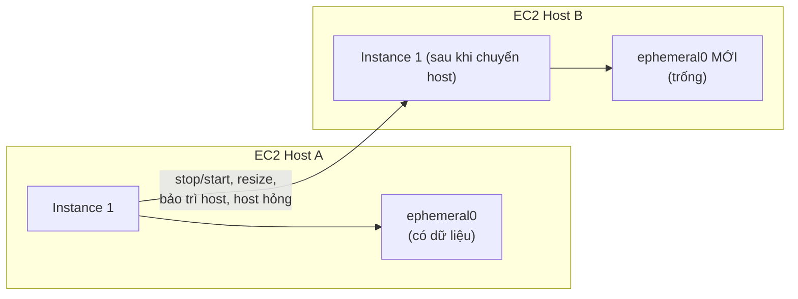

# Instance Store

> **TL;DR:** Instance Store là block storage **gắn vật lý vào EC2 host**, cho **hiệu năng storage cao nhất trong AWS** và đã **bao gồm trong giá instance**. Đổi lại nó **ephemeral**: dữ liệu mất khi instance chuyển host (stop/start, resize, bảo trì host) hoặc phần cứng hỏng. Chỉ thêm được **lúc launch**.

## 🖼️ Sơ đồ
![[Instance Store.excalidraw]]
*Mở bằng plugin Excalidraw để chỉnh sửa · ảnh tĩnh: [[Instance Store.svg]]*

## Khái niệm cốt lõi
- **Block storage device**: volume thô gắn vào instance, OS tạo file system lên đó, giống [[EBS]] nhưng **local** chứ không qua mạng.
- **Gắn vật lý vào một EC2 host**; mỗi host có instance store riêng, chỉ instance **trên host đó** mới truy cập được.
- **Hiệu năng cao nhất trong AWS**, vượt xa EBS.
- **Bao gồm trong giá instance** → "use it or lose it". Đã có thì không có lý do gì không dùng.
- **Chỉ gắn lúc launch (ATTACHED AT LAUNCH)**. Không thể thêm instance store sau khi instance đã chạy (khác EBS). Câu này xuất hiện nhiều lần trong các đề AWS.
- Số lượng và kích thước volume phụ thuộc **instance type và size**. Một số type **không có** instance store; size càng lớn thường càng nhiều volume. Instance có chữ `d` trong tên (ví dụ `m5dn`, `r5d`) là có local NVMe (xem [[EC2 Instance Types]]).

## Cách hoạt động / Kiến trúc
- Mỗi host có nhiều thiết bị vật lý, trình bày cho instance thành các volume tên **ephemeral0, ephemeral1, ephemeral2...**
- Ví dụ: Host A có 3 thiết bị; Instance 1 dùng ephemeral0, Instance 2 dùng ephemeral1 và ephemeral2. Host B: Instance 3 dùng ephemeral1, ephemeral2.

### Khi nào mất dữ liệu?
- **Instance chuyển host**: stop rồi start, host bảo trì, host hỏng → instance nhận **volume ephemeral mới, trống**. Volume cũ bị xóa sạch trước khi cấp lại cho người khác.
- **Đổi instance type (resize)** → chuyển host → mất dữ liệu.
- **Hỏng phần cứng**: một thiết bị vật lý hỏng → instance dùng volume đó mất dữ liệu.
- **Reboot (restart)** → **không** chuyển host → dữ liệu **còn nguyên**.

### Số liệu hiệu năng (theo slide)
- **D3** (storage optimized, HDD): **4.6 GB/s** throughput, dung lượng lớn giá tốt, vượt xa EBS HDD (st1 tối đa 500 MB/s).
- **I3** (NVMe SSD): tới **16 GB/s** sequential throughput, cao hơn nhiều so với EBS mạnh nhất.
- IOPS còn chênh lệch lớn hơn: i3.16xlarge ~3.3 triệu read IOPS / 1.4 triệu write IOPS; **i3en.24xlarge ~2 triệu read / 1.6 triệu write IOPS**. Một vài mốc khác: i3.large ~100K read / 35K write; i3.8xlarge ~1.65 triệu / 720K.
- So với io2 Block Express (256,000 IOPS/volume) thì instance store cao hơn cả chục lần.

## Demo / Lab
(Từ bài 0139, instance **m5dn.large** có 1 instance store volume **75 GB NVMe**, device `/dev/nvme1n1`; chi phí ~0.13–0.15 USD/giờ, ngoài free tier.)
1. `lsblk` thấy root 8G (EBS) và volume instance store 75G. `file -s` → `data` (chưa có FS). Tạo XFS, mount vào `/instancestore`, tạo file test.
2. **Reboot** → mount lại thủ công → **file vẫn còn** (cùng host). Public IPv4 không đổi.
3. **Stop rồi start** → public IPv4 **đổi** (dấu hiệu chuyển host) → `file -s` lại báo `data`: file system và file test **mất hết**.
- Rút ra: reboot giữ host (có thể giữ dữ liệu), stop/start chắc chắn đổi host và **chắc chắn mất dữ liệu instance store**.

## 🎯 Mẹo thi SAA-C03
- **"Thêm instance store sau khi launch"** → **không thể**. Chỉ lúc launch.
- Instance store là **ephemeral/temporary**: không bao giờ dùng cho dữ liệu cần persistent hoặc không thể tái tạo.
- Mất dữ liệu khi: **move, resize, hardware failure**, stop/start. Reboot thì không.
- Đề cần **IOPS/throughput cao hơn mọi EBS** (hàng trăm nghìn tới hàng triệu IOPS) và dữ liệu là **cache, buffer, scratch, dữ liệu tạm** hoặc đã được replicate ở nơi khác → **Instance Store**.
- Đề nhắc "chi phí" + instance đã có instance store → dùng nó vì đã trả tiền rồi.
- Không có snapshot cho instance store; muốn bảo vệ dữ liệu phải tự replicate hoặc copy sang EBS/S3.

## Liên kết
- Tiên quyết: [[Storage Fundamentals]], [[EC2 Architecture and Resilience]]
- Liên quan: [[EC2 Instance Types]], [[EBS Volume Types]], [[AMI]], [[EC2 Shutdown Terminate and Termination Protection]]
- Phân biệt với: [[EBS]], [[Compare - EBS vs Instance Store]]
