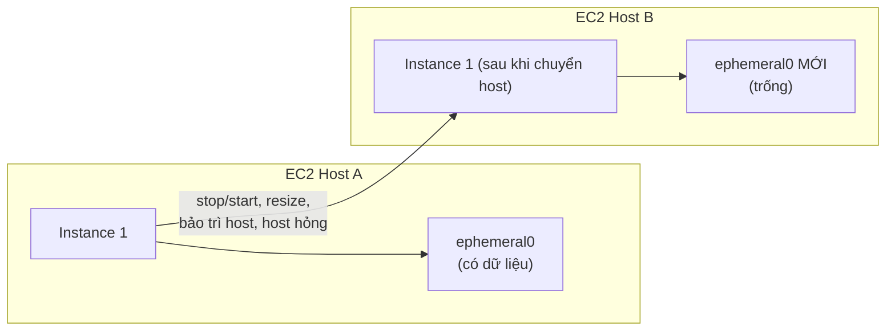

# Instance Store

> **TL;DR:** Instance Store là block storage **gắn vật lý vào EC2 host**, cho **hiệu năng storage cao nhất trong AWS** và đã **bao gồm trong giá instance**. Đổi lại nó **ephemeral**: dữ liệu mất khi instance chuyển host (stop/start, resize, bảo trì host) hoặc phần cứng hỏng. Chỉ thêm được **lúc launch**.

## 🖼️ Sơ đồ
![[Instance Store.excalidraw]]
*Mở bằng plugin Excalidraw để chỉnh sửa · ảnh tĩnh: [[Instance Store.svg]]*

## Khái niệm cốt lõi
- **Block storage device**: volume thô gắn vào instance, OS tạo file system lên đó, giống [[EBS]] nhưng **local** chứ không qua mạng.
- **Gắn vật lý vào một EC2 host**; mỗi host có instance store riêng, chỉ instance **trên host đó** mới truy cập được.
- **Hiệu năng cao nhất trong AWS**, vượt xa EBS.
- **Bao gồm trong giá instance** → "use it or lose it". Đã có thì không có lý do gì không dùng.
- **Chỉ gắn lúc launch (ATTACHED AT LAUNCH)**. Không thể thêm instance store sau khi instance đã chạy (khác EBS). Câu này xuất hiện nhiều lần trong các đề AWS. Nhiều instance type dùng NVMe còn **tự động bắt buộc** gắn các volume này lúc launch.
- Số lượng và kích thước volume phụ thuộc **instance type và size**. Một số type **không có** instance store; size càng lớn thường càng nhiều volume. Instance có chữ `d` trong tên (ví dụ `m5dn`, `r5d`) là có local NVMe (xem [[EC2 Instance Types]]).

## Cách hoạt động / Kiến trúc
- Mỗi host có nhiều thiết bị vật lý, trình bày cho instance thành các volume tên **ephemeral0, ephemeral1, ephemeral2...**
- Ví dụ: Host A có 3 thiết bị; Instance 1 dùng ephemeral0, Instance 2 dùng ephemeral1 và ephemeral2. Host B: Instance 3 dùng ephemeral1, ephemeral2.

### Khi nào mất dữ liệu?
- **Instance chuyển host**: stop rồi start, host bảo trì, host hỏng → instance nhận **volume ephemeral mới, trống**. Volume cũ bị xóa sạch trước khi cấp lại cho người khác.
- **Đổi instance type (resize)** → chuyển host → mất dữ liệu.
- **Hỏng phần cứng**: một thiết bị vật lý hỏng → instance dùng volume đó mất dữ liệu.
- **Reboot (restart)** → **không** chuyển host → dữ liệu **còn nguyên**.

### Số liệu hiệu năng (theo slide)
- **D3** (storage optimized, HDD): **4,600 MB/s** sequential throughput, dung lượng lớn giá tốt, vượt xa EBS HDD (st1 tối đa 500 MB/s).
- **i7i** (storage optimized, NVMe SSD gắn local): tới **hàng triệu IOPS**, cao hơn nhiều so với EBS mạnh nhất. Bảng trên slide (100% random read IOPS / write IOPS):

| Instance | Read IOPS | Write IOPS |
|---|---|---|
| i7i.large | 75,000 | 41,250 |
| i7i.4xlarge | 600,000 | 330,000 |
| i7i.16xlarge | 2,400,000 | 1,320,000 |
| **i7i.48xlarge** | **7,200,000** | **3,960,000** |

- So với io2 Block Express (256,000 IOPS/volume) thì instance store cao hơn hàng chục lần.
- (Bản khóa cũ dùng dòng I3: tới 16 GB/s sequential throughput; i3.16xlarge ~3.3 triệu read / 1.4 triệu write IOPS; i3en.24xlarge ~2 triệu / 1.6 triệu.)

## Demo / Lab
(Bài demo riêng của bản mới. Stack CloudFormation `instancestore` tạo VPC Aus-E-Mart có public subnet.)
1. Launch instance Amazon Linux **Arm64 (Graviton)** cho rẻ. Tìm type có instance store: *Compare instance types* bật cột *local instance store*, hoặc gõ **`gd`** vào ô tìm (g = Graviton, d = instance store) → chọn **c6gd.medium**. Không cần key pair; đặt vào subnet `WebA` của `aem-vpc1`, SG dựng sẵn.
2. Phần *Storage* khi launch: root 8 GB gp3 và **một instance store volume ~59 GB SSD** đi kèm instance type.
3. Kết nối bằng EC2 Instance Connect: `lsblk` thấy root 8G và volume instance store; `sudo file -s /dev/nvme1n1` → `data` (chưa có FS). Tạo XFS, mount vào `/instancestore`, tạo file test.
4. **Reboot** (kiểm tra bằng `uptime`) → mount lại thủ công → **file vẫn còn**.
5. **Stop rồi start** → public IPv4 bị thu hồi và đổi (dấu hiệu rời host) → `lsblk` vẫn thấy một volume cùng size nhưng `file -s` báo `data`: file system và file test **mất hết**, kể cả khi tình cờ quay về cùng host.
6. Dọn dẹp: terminate instance, xóa stack.
- Rút ra: reboot giữ dữ liệu, stop/start hay sự cố đẩy instance sang host khác thì **chắc chắn mất dữ liệu instance store**.
- (Bản khóa cũ làm phần này trong demo EBS PART3 với **m5dn.large**, 1 volume NVMe 75 GB, chi phí ~0.13–0.15 USD/giờ.)

## 🎯 Mẹo thi SAA-C03
- **"Thêm instance store sau khi launch"** → **không thể**. Chỉ lúc launch.
- Instance store là **ephemeral/temporary**: không bao giờ dùng cho dữ liệu cần persistent hoặc không thể tái tạo.
- Mất dữ liệu khi: **move, resize, hardware failure**, stop/start. Reboot thì không.
- Đề cần **IOPS/throughput cao hơn mọi EBS** (hàng triệu IOPS) và dữ liệu là **cache, buffer, scratch, dữ liệu tạm** hoặc đã được replicate ở nơi khác → **Instance Store**.
- Đề nhắc "chi phí" + instance đã có instance store → dùng nó vì đã trả tiền rồi.
- Không có snapshot cho instance store; muốn bảo vệ dữ liệu phải tự replicate hoặc copy sang EBS/S3.

## Liên kết
- Tiên quyết: [[Storage Fundamentals]], [[EC2 Architecture and Resilience]]
- Liên quan: [[EC2 Instance Types]], [[EBS Volume Types]], [[AMI]], [[EC2 Shutdown Terminate and Termination Protection]]
- Phân biệt với: [[EBS]], [[Compare - EBS vs Instance Store]]
