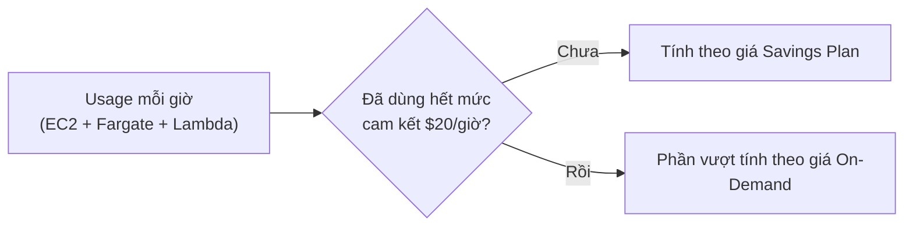
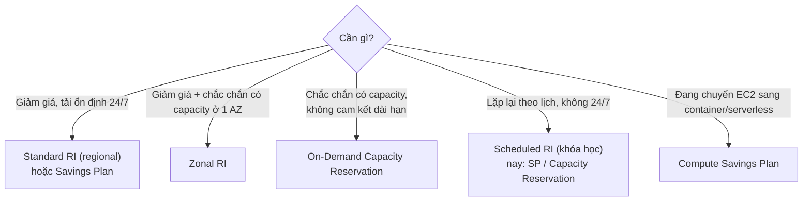

# Reserved Instances and Savings Plans

> **TL;DR:** Ngoài Standard Reserved, AWS có **Scheduled Reserved** (cam kết cho khung giờ lặp lại), **Capacity Reservations** (giữ capacity, có thể không kèm giảm giá) và **Savings Plans** (cam kết **chi tiêu theo giờ** trong 1 hoặc 3 năm). Cần phân biệt rõ hai thành phần: **giảm giá (billing)** và **giữ capacity**. Hai thành phần này có thể dùng riêng hoặc kết hợp.

## 🖼️ Sơ đồ
![[Reserved Instances and Savings Plans.excalidraw]]
*Mở bằng plugin Excalidraw để chỉnh sửa · ảnh tĩnh: [[Reserved Instances and Savings Plans.svg]]*

![[Reserved Instances and Savings Plans - sp.excalidraw]]
*Mở bằng plugin Excalidraw để chỉnh sửa · ảnh tĩnh: [[Reserved Instances and Savings Plans - sp.svg]]*

## Khái niệm cốt lõi

### Standard Reserved
- Loại reserved "gốc": tải **biết trước, ổn định, chạy 24/7/365** trong 1 hoặc 3 năm → rẻ nhất cho tải đó. Cách trả (No/Partial/All Upfront) và scope zonal/regional xem [[EC2 Purchase Options]].
- (Ngoài khóa học: còn có **Convertible RI**, được đổi sang instance family/OS khác nhưng giảm ít hơn Standard. Standard RI không dùng nữa thì bán lại được trên RI Marketplace.)

### Scheduled Reserved Instances
- Cho nhu cầu **dài hạn nhưng không chạy liên tục**: bạn chỉ định **tần suất, thời lượng, giờ bắt đầu**.
- Ví dụ: batch chạy **hằng ngày lúc 23:00 trong 5 giờ**; phân tích doanh số **mỗi thứ Sáu trong 24 giờ**; phân tích lớn cần **100 giờ EC2 mỗi tháng**.
- Được reserve capacity và giá **rẻ hơn On-Demand một chút**, nhưng **chỉ dùng được trong khung giờ đã đặt**.
- Hạn chế: không hỗ trợ mọi instance type/region; tối thiểu **1200 giờ/năm**; cam kết tối thiểu **1 năm**.
- (Khóa học vẫn dạy loại này; hiện nay AWS **không còn bán** Scheduled RI. Nhu cầu tương tự thường giải quyết bằng Savings Plans hoặc On-Demand Capacity Reservation, kể cả loại *future-dated*.)

### Thứ tự ưu tiên capacity khi thiếu tài nguyên
1. **Reserved** (cam kết có capacity) được đáp ứng trước.
2. **On-Demand**.
3. **Spot** dùng phần còn lại.

→ Hệ thống **business-critical** cần chắc chắn launch được đúng lúc thì phải **reserve capacity**.

### Regional vs Zonal reservation vs On-Demand Capacity Reservation
| Lựa chọn | Giảm giá | Reserve capacity | Phạm vi | Cam kết 1/3 năm |
|---|---|---|---|---|
| **Regional RI** | Có | **Không** (launch với ưu tiên như on-demand) | mọi AZ trong region | Có |
| **Zonal RI** | Có | **Có** | **chỉ 1 AZ**; launch AZ khác thì không có cả hai lợi ích | Có |
| **On-Demand Capacity Reservation** | **Không** | **Có** | 1 AZ cụ thể | **Không** |

- On-Demand Capacity Reservation: đặt trước capacity, ví dụ 2 instance ở AZ B, và **trả tiền cho toàn bộ capacity đã đặt dù dùng hay không**. Chạy 1 trên 2 → vẫn trả cho 2, lãng phí 1. Vẫn cần lập kế hoạch kỹ.
- Hợp khi cần chắc chắn có capacity mà **không thể cam kết 1 hoặc 3 năm** (thời lượng chưa rõ). Nếu dùng ổn định lâu dài thì nên xem xét chuyển sang RI/Savings Plans cho rẻ hơn.

### Savings Plans
- Cam kết **số tiền chi tiêu theo giờ** (ví dụ **$20/giờ**) trong **1 hoặc 3 năm**, không gắn với instance type/AZ cụ thể.
- Mỗi sản phẩm có **giá On-Demand** và **giá Savings Plan**. Usage được tính theo giá Savings Plan cho tới khi hết mức cam kết mỗi giờ; **vượt mức thì trả giá On-Demand**.
- Hai loại chính:

| Loại | Áp dụng cho | Giảm tối đa (so với On-Demand) | Linh hoạt |
|---|---|---|---|
| **Compute Savings Plan** (general compute) | **EC2, Fargate, Lambda** | ~**66%** | cao nhất: đổi family, size, OS, region, đổi sang container/serverless |
| **EC2 Instance Savings Plan** | chỉ EC2 | ~**72%** | linh hoạt về size và OS trong một family/region |

- Cần định kỳ xem lại mức sử dụng và điều chỉnh plan.

## Cách hoạt động / Kiến trúc

## 🎯 Mẹo thi SAA-C03
- Tải **dài hạn nhưng chỉ vài giờ/ngày hoặc vài ngày/tuần** → (theo khóa học) **Scheduled Reserved**, không phải Standard Reserved.
- **Regional RI không giữ capacity**; muốn **giữ capacity ở một AZ** → **Zonal RI** hoặc **On-Demand Capacity Reservation**.
- Cần **capacity đảm bảo** mà **không cam kết 1 hoặc 3 năm** → **On-Demand Capacity Reservation** (không có giảm giá, trả tiền dù không dùng).
- Phân biệt hai thành phần: **billing discount** (RI, Savings Plans) và **capacity reservation** (Zonal RI, Capacity Reservation).
- Tổ chức đang **chuyển dần từ EC2 sang Fargate rồi Lambda** → **Compute Savings Plan**. Chỉ dùng EC2 → **EC2 Instance Savings Plan** tiết kiệm hơn.
- Với đề thi chỉ cần hiểu Savings Plans tồn tại và cơ chế: cam kết $/giờ, trong mức thì giá SP, vượt mức thì giá On-Demand.

## Liên kết
- Tiên quyết: [[EC2 Purchase Options]], [[AWS Global Infrastructure]], [[EC2 Architecture and Resilience]]
- Liên quan: [[ECS Launch Types EC2 vs Fargate]], [[Lambda]], [[Serverless Architecture]], [[Dedicated Hosts]], [[AWS Budgets]]
- Phân biệt với: [[EC2 Purchase Options|Spot / On-Demand]]
