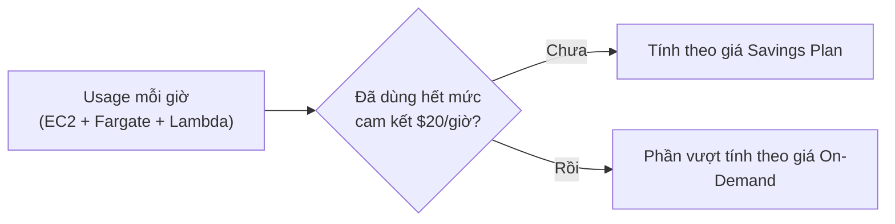
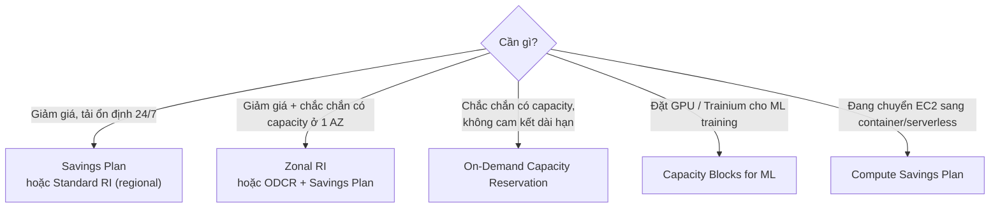

# Reserved Instances and Savings Plans

> **TL;DR:** Ba công cụ cho EC2 dùng lâu dài: **Reserved Instances** (cam kết một instance type cụ thể trong 1 hoặc 3 năm để được giảm giá; Standard hoặc Convertible, zonal hoặc regional), **On-Demand Capacity Reservations** (giữ chỗ trong một AZ, trả giá On-Demand, **không giảm giá**) và **Savings Plans** (cam kết **chi tiêu $/giờ** trong 1 hoặc 3 năm, phủ EC2, Fargate, Lambda; AWS nay khuyên dùng thay RI). Cần phân biệt rõ hai thành phần: **giảm giá (billing)** và **giữ capacity**. Hai thành phần này có thể dùng riêng hoặc kết hợp. Scheduled RI đã ngừng bán.

## 🖼️ Sơ đồ
![[Reserved Instances and Savings Plans.excalidraw]]
*Mở bằng plugin Excalidraw để chỉnh sửa · ảnh tĩnh: [[Reserved Instances and Savings Plans.svg]]*

![[Reserved Instances and Savings Plans - sp.excalidraw]]
*Mở bằng plugin Excalidraw để chỉnh sửa · ảnh tĩnh: [[Reserved Instances and Savings Plans - sp.svg]]*

## Khái niệm cốt lõi

### Reserved Instances (RI)
- Bạn **cam kết** với AWS dùng một instance type cụ thể trong một thời hạn (ví dụ **4 × t3.xlarge trong 3 năm**); AWS đổi lại bằng **giá giảm**. AWS có lợi vì biết trước nhu cầu capacity.
- RI **không phải một loại instance** để launch: nó chỉ là cam kết trên hóa đơn. Instance vẫn chạy như On-Demand, AWS **tự động** áp giá giảm cho instance khớp với reservation, không phải bật gì hay restart gì.
- **Trả cho phần đã reserve, khớp với phần đang chạy**:
  - Reserve 4, chạy 6 → 4 instance giá giảm, 2 instance giá đầy đủ.
  - Reserve 6, chạy 4 → vẫn trả **đủ 6** (giá giảm); 2 suất không dùng là lãng phí.
- Các bước mua:
  1. **Offering class**: **Standard** (giảm nhiều nhất, khóa chặt, không đổi được; nhu cầu đổi thì chỉ **bán lại trên RI Marketplace**) hoặc **Convertible** (giảm ít hơn, **đổi được** trong kỳ hạn sang Convertible RI khác với thuộc tính mới, ví dụ family khác).
  2. **Scope**: **Zonal** (khóa vào một AZ, **giữ capacity** ở AZ đó, nhưng không linh hoạt AZ hay size) hoặc **Regional** (giảm giá ở **mọi AZ**, có **instance size flexibility** trong cùng family, nhưng **không giữ capacity**). Size flexibility chỉ áp cho regional RI, default tenancy, Amazon Linux; không áp cho zonal, dedicated tenancy, Windows, RHEL hay SUSE.
  3. **Thuộc tính instance**: instance type, platform, tenancy.
  4. **Term**: 1 hoặc 3 năm (3 năm giảm nhiều hơn nhưng nhu cầu dễ đổi hơn).
  5. **Payment**: All Upfront (giảm nhiều nhất, không còn phí theo giây), Partial Upfront (ở giữa, phần còn lại trả hằng tháng), No Upfront (giảm ít nhất, trả mức giảm theo kỳ). Xem bảng ở [[EC2 Purchase Options]].
  6. **Xác nhận**: reservation đã active thì **không hủy được**; mua xếp hàng (queued) cho ngày tương lai thì hủy được trước ngày đó.
- Chỉ reserve phần hạ tầng **luôn chạy, không đổi**. Reserve thứ bạn hay tắt là phí tiền.
- Với đa số workload, AWS nay **khuyên dùng Savings Plans** thay vì RI.

### Scheduled Reserved Instances (đã deprecated)
- **Không còn mua được**; tài liệu cũ nhắc tới thì là vì vậy.
- (Bản khóa cũ dạy chi tiết:) cho nhu cầu **dài hạn nhưng không chạy liên tục**, chỉ định **tần suất, thời lượng, giờ bắt đầu**. Ví dụ batch **hằng ngày lúc 23:00 trong 5 giờ**, phân tích **mỗi thứ Sáu 24 giờ**, **100 giờ EC2 mỗi tháng**. Có reserve capacity, giá rẻ hơn On-Demand một chút, chỉ dùng trong khung giờ đã đặt; tối thiểu **1200 giờ/năm**, cam kết tối thiểu **1 năm**.

### Thứ tự ưu tiên capacity khi thiếu tài nguyên (bản khóa cũ nêu, bài mới không nói)
1. **Reserved** (cam kết có capacity) được đáp ứng trước.
2. **On-Demand**.
3. **Spot** dùng phần còn lại (bài mới vẫn nói Spot bị thu hồi để nhường On-Demand, xem [[EC2 Purchase Options]]).

→ Hệ thống **business-critical** cần chắc chắn launch được đúng lúc thì phải **reserve capacity**.

### On-Demand Capacity Reservations (ODCR)
- Tình huống: web store chuẩn bị Black Friday đã cấu hình tự scale, nhưng instance type đó (ví dụ R8i) cũng được khách khác dùng trên hạ tầng chung → lúc scale có thể gặp lỗi **insufficient capacity** (khi launch mới, khi scale tự động, hay khi start lại instance đã stop). ODCR đặt trước capacity để tránh việc này.
- **Loại**:
  - **Immediate**: active ngay, giữ capacity và **tính tiền ngay**; **không cam kết**, **hủy lúc nào cũng được** (hủy thì ngừng tính tiền).
  - **Future-dated**: đặt trước cho một ngày cách hiện tại **5–120 ngày**; AWS đánh giá (assessing) rồi kích hoạt đúng ngày. Hủy được khi còn ở trạng thái assessing/scheduled; đã kích hoạt thì **bị khóa trong thời gian cam kết**.
- **Thuộc tính** để AWS khớp reservation với instance đang chạy: **instance type, platform (OS), AZ, tenancy** (shared hoặc dedicated), cộng **số lượng**.
- **Matching**:
  - **Open**: instance nào đang chạy khớp thuộc tính thì tự được tính vào reservation (để không trả hai lần: suất đặt trước + instance thật).
  - **Targeted**: chỉ instance launch có chỉ định **reservation ID** mới dùng reservation; kiểm soát chính xác, tránh instance khác "ăn" mất suất. Future-dated **bắt buộc targeted** lúc đầu, kích hoạt rồi đổi sang open được.
- **Tính tiền theo giá On-Demand dù dùng hay không**: đặt 10 mà chạy 6 vẫn trả 10. **Không có giảm giá** sẵn: muốn giảm giá thì kết hợp **ODCR (giữ chỗ) + Savings Plans hoặc regional RI (giảm giá)**.
- Dùng được với dịch vụ khác như **Auto Scaling** (open matching, hoặc chỉ định reservation khi cấu hình); **share sang account khác** bằng [[AWS Resource Access Manager|RAM]].
- Biến thể: **Capacity Blocks for ML** (đặt trước tới khoảng 8 tuần cho training/fine-tuning trên instance GPU và Trainium, dòng P và Trn) và **interruptible capacity reservations** (phần chưa dùng của reservation cho workload khác trong organization mượn, có thông báo gián đoạn khi bạn cần lại).
- Hợp khi cần chắc chắn có capacity cho workload **business-critical** (launch mới hay start lại từ stopped ở một AZ) mà **không thể cam kết 1 hoặc 3 năm**.

### Regional RI vs Zonal RI vs On-Demand Capacity Reservation
| Lựa chọn | Giảm giá | Reserve capacity | Phạm vi | Cam kết 1/3 năm |
|---|---|---|---|---|
| **Regional RI** | Có | **Không** (launch với ưu tiên như on-demand) | mọi AZ trong region, linh hoạt size | Có |
| **Zonal RI** | Có | **Có** | **chỉ 1 AZ**, đúng size; launch AZ khác thì không có cả hai lợi ích | Có |
| **On-Demand Capacity Reservation** | **Không** (trả giá On-Demand) | **Có** | 1 AZ cụ thể | **Không** (immediate); future-dated thì khóa sau khi kích hoạt |

### Savings Plans
- Cam kết **số tiền chi tiêu theo giờ** (ví dụ **$20/giờ**) trong **1 hoặc 3 năm**, không gắn với instance type cụ thể như RI. Đổi lại được **giá Savings Plan** rẻ hơn On-Demand.
- Mức cam kết tính theo **giá Savings Plan**, không phải giá On-Demand tương đương: hệ thống đang tốn $20/giờ giá On-Demand thì không nên cam kết $20/giờ.
- Usage được tính theo giá Savings Plan cho tới khi hết mức cam kết mỗi giờ; **vượt mức thì trả giá On-Demand**. **Dùng ít hơn vẫn trả đủ** cam kết, phần dư **không cộng dồn** sang giờ sau (use it or lose it).
- Hai loại liên quan tới compute:

| Loại | Áp dụng cho | Giảm tối đa (so với On-Demand) | Linh hoạt |
|---|---|---|---|
| **Compute Savings Plan** | **EC2, Fargate, Lambda** | ~**66%** | cao nhất: EC2 mọi family, region, OS, tenancy; chuyển sang container/serverless |
| **EC2 Instance Savings Plan** | chỉ EC2 | ~**72%** | khóa **một family trong một region** (ví dụ M5 ở us-east-1), linh hoạt size, OS, tenancy |

- Các bước: chọn loại plan → cam kết $/giờ (EC2 Instance SP thì chọn luôn family + region) và term 1/3 năm (3 năm giảm nhiều hơn) → chọn **All / Partial / No Upfront** (chỉ đổi thời điểm trả, ảnh hưởng mức giảm) → xác nhận.
- Đã active thì **không hủy được**; ngoại lệ: plan có cam kết **≤ $100/giờ** được **trả lại trong 7 ngày** sau khi mua (cùng tháng dương lịch).
- **Không giữ capacity**: chỉ là cơ chế billing. Cần chắc chắn có chỗ → kết hợp với **ODCR**.
- **Spot và RI không do Savings Plans phủ**: Spot có mô hình giảm giá riêng, RI được áp trên hóa đơn **trước**, Savings Plans chỉ thấy phần còn lại.
- Còn có Savings Plans khác ngoài phạm vi bài: **Database Savings Plans** (Aurora, RDS, DynamoDB) và **SageMaker AI Savings Plans**.
- Cần định kỳ xem lại mức sử dụng và điều chỉnh plan.

## Cách hoạt động / Kiến trúc

## 🎯 Mẹo thi SAA-C03
- RI là **cam kết trên hóa đơn**, không phải loại instance; **mua rồi không dùng vẫn trả**, active rồi **không hủy được**. **Standard** giảm nhiều nhất, không đổi (chỉ bán lại trên Marketplace); **Convertible** đổi được, giảm ít hơn.
- **Regional RI không giữ capacity**; muốn **giữ capacity ở một AZ** → **Zonal RI** hoặc **On-Demand Capacity Reservation**.
- Cần **capacity đảm bảo** mà **không cam kết 1 hoặc 3 năm** → **On-Demand Capacity Reservation** (trả giá On-Demand dù không dùng, không giảm giá). Muốn vừa giữ chỗ vừa giảm giá → **ODCR + Savings Plans** (hoặc regional RI).
- ODCR **open** thì instance khớp tự dùng reservation; **targeted** thì phải chỉ định reservation ID. Đặt trước cho ngày cụ thể (5–120 ngày) → **future-dated** reservation.
- Đặt trước GPU/Trainium cho ML training → **Capacity Blocks for ML**.
- Phân biệt hai thành phần: **billing discount** (RI, Savings Plans) và **capacity reservation** (Zonal RI, ODCR). **Savings Plans không giữ capacity**.
- Tổ chức đang **chuyển dần từ EC2 sang Fargate rồi Lambda** → **Compute Savings Plan**. Chỉ dùng EC2, biết rõ family và region → **EC2 Instance Savings Plan** tiết kiệm hơn.
- Savings Plans: cam kết $/giờ (theo giá SP), trong mức thì giá SP, vượt mức thì giá On-Demand, dùng thiếu vẫn trả đủ. Không phủ Spot; RI được áp trước.
- Tải **dài hạn nhưng chỉ vài giờ/ngày**: Scheduled RI **đã ngừng bán**; đề cũ có thể còn đáp án này, nay thường dùng Savings Plans hoặc Capacity Reservation (kể cả future-dated).

## Liên kết
- Tiên quyết: [[EC2 Purchase Options]], [[AWS Global Infrastructure]], [[EC2 Architecture and Resilience]]
- Liên quan: [[ECS Launch Types EC2 vs Fargate]], [[Lambda]], [[Serverless Architecture]], [[Dedicated Hosts]], [[AWS Budgets]], [[AWS Resource Access Manager]], [[Auto Scaling Groups]]
- Phân biệt với: [[EC2 Purchase Options|Spot / On-Demand]]
