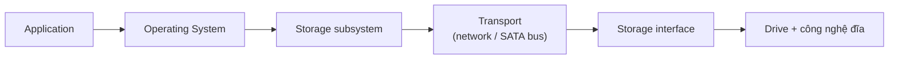

# Storage Fundamentals

> **TL;DR:** Ôn lại các khái niệm storage nền tảng: direct-attached vs network-attached, ephemeral vs persistent, ba loại storage (block, file, object) và ba chỉ số hiệu năng (IO/block size, IOPS, throughput). Đề thi hay hỏi chọn loại storage nào cho một tình huống và một mức hiệu năng.

## 🖼️ Sơ đồ
![[Storage Fundamentals.excalidraw]]
*Mở bằng plugin Excalidraw để chỉnh sửa · ảnh tĩnh: [[Storage Fundamentals.svg]]*

![[Storage Fundamentals - perf.excalidraw]]
*Mở bằng plugin Excalidraw để chỉnh sửa · ảnh tĩnh: [[Storage Fundamentals - perf.svg]]*

## Khái niệm cốt lõi

### Direct-attached vs Network-attached
- **Direct (local) attached storage**: đĩa vật lý gắn trực tiếp vào thiết bị (laptop, server). Trong EC2, đó là **[[Instance Store]]** gắn vào EC2 host.
  - Ưu: **rất nhanh** vì gắn thẳng vào phần cứng.
  - Nhược: mất dữ liệu nếu **đĩa hỏng**, **phần cứng host hỏng**, hoặc **instance chuyển sang host khác**.
- **Network-attached storage**: volume được tạo và gắn vào thiết bị **qua mạng**. On-premises dùng iSCSI, Fibre Channel; trong AWS là **[[EBS]]**.
  - Thường **resilient cao**, tách biệt khỏi phần cứng của instance → sống sót qua sự cố của EC2 host.

### Ephemeral vs Persistent
- **Ephemeral** = tạm thời, không thể tin là sẽ tồn tại lâu dài. Ví dụ: **Instance Store**.
- **Persistent** = tồn tại độc lập, sống lâu hơn vòng đời của thiết bị gắn vào nó. Ví dụ: **EBS**.
- Đề thi **sẽ** kiểm tra loại nào ephemeral, loại nào persistent.

### Ba loại storage

| Loại | Trình bày thế nào | Mount? | Boot? | Ví dụ AWS |
|---|---|---|---|---|
| **Block** | Volume là tập hợp block có địa chỉ, **không có cấu trúc**. OS tự tạo file system (NTFS, ext3...) rồi mount (ổ C:, root volume `/`) | Có | **Có** | [[EBS]], [[Instance Store]] |
| **File** | File system dựng sẵn có cấu trúc thư mục, truy cập qua mạng bằng đường dẫn | Có (thường) | **Không** | [[EFS]], [[FSx for Windows]], [[FSx for Lustre]] |
| **Object** | Tập hợp **phẳng** các object, lấy bằng **key** → trả về value (data) + metadata | **Không** | **Không** | [[S3 Basics|S3]] |

- **Block**: có thể là đĩa vật lý (HDD, SSD) hoặc volume logic dựa trên các đĩa vật lý; SAN/NAS cung cấp block qua mạng. Phần lớn EC2 instance **boot từ EBS volume**.
- **File**: OS không có quyền truy cập mức thấp vào storage nên không boot được; truy cập file bằng cách duyệt cấu trúc thư mục.
- **Object**: không có cấu trúc, object có thể là bất kỳ dữ liệu gì (ảnh, video, binary). **Cực kỳ scalable**, hàng nghìn tới hàng triệu người truy cập đồng thời.

### Chọn loại nào?
- Cần **boot** → block.
- Cần storage **hiệu năng cao trong OS** → block.
- Cần **chia sẻ file system** giữa nhiều server/client/dịch vụ → file.
- Cần đọc/ghi dữ liệu **ở quy mô web**, gần như vô hạn → object.

## Cách hoạt động / Kiến trúc: hiệu năng storage

### Ba chỉ số
- **IO (block) size**: kích thước mỗi khối dữ liệu đọc/ghi (KB, MB). Ví dụ block 16 KB, ghi 64 KB → dùng 4 block.
- **IOPS**: số thao tác I/O (đọc/ghi) mỗi giây mà storage hỗ trợ.
- **Throughput**: lượng dữ liệu truyền mỗi giây (MB/s).

**Công thức:** `Throughput = IO size × IOPS`

### Phép so sánh xe đua
- IOPS = vòng tua động cơ mỗi giây.
- IO size = kích thước bánh xe.
- Throughput = tốc độ cuối cùng của xe.

### Ví dụ
- Block 16 KB × 100 IOPS = **1.6 MB/s**.
- Ứng dụng chỉ ghi chunk 4 KB, tối đa 100 IOPS → chỉ đạt **400 KB/s**.
- Đổi lên block 1 MB × 100 IOPS nghe như sẽ được 100 MB/s, nhưng **thực tế không chắc**: hệ thống có thể có **throughput cap**, hoặc block càng lớn thì IOPS đạt được càng giảm.
- Muốn tối đa throughput: dùng block size phù hợp với storage, rồi đẩy IOPS lên tối đa. Ba chỉ số liên quan chặt, một cái bị giới hạn sẽ kéo hai cái kia.

### Chuỗi I/O và nút cổ chai

- Hiệu năng cuối cùng do **mắt xích yếu nhất (lowest common denominator)** quyết định.
- Với network storage, **latency mạng cao** làm giảm mạnh IOPS đạt được.

## 🎯 Mẹo thi SAA-C03
- **Instance Store = ephemeral, EBS = persistent.** Câu hỏi về dữ liệu phải sống sót qua stop/start hoặc lỗi host → EBS.
- Cần **boot** → chỉ block storage (EBS hoặc instance store). File (EFS) và object (S3) **không boot được**.
- Cần **chia sẻ file system** cho nhiều instance → file storage (EFS/FSx), không phải EBS thông thường.
- Lưu trữ quy mô web, truy cập đồng thời lớn → S3 (object).
- Các con số cần nhớ ở bài sau: mức IOPS tối đa (ví dụ 16,000; 64,000; 256,000) và throughput cap của từng loại volume ([[EBS Volume Types]]).
- Throughput = IO size × IOPS; đề có thể cho IOPS đủ nhưng throughput bị giới hạn bởi instance hoặc loại volume.

## Liên kết
- Liên quan: [[EBS]], [[Instance Store]], [[EBS Volume Types]], [[Compare - EBS vs Instance Store]], [[EFS]], [[S3 Basics]]
- Phân biệt với: [[S3 Storage Classes]] (lớp lưu trữ trong object storage, không phải loại storage)
