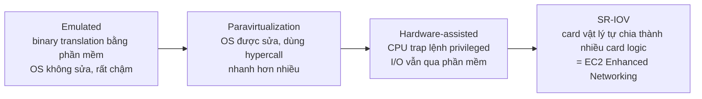

# Virtualization

> **TL;DR:** Virtualization là chạy nhiều hệ điều hành trên cùng một máy chủ vật lý. EC2 thực chất là "virtualization as a service" (IaaS). Hiểu quá trình tiến hóa từ emulated → paravirtualization → hardware-assisted → SR-IOV giúp giải thích vì sao EC2 có các tính năng như Nitro và Enhanced Networking.

## 🖼️ Sơ đồ
![[Virtualization.excalidraw]]
*Mở bằng plugin Excalidraw để chỉnh sửa · ảnh tĩnh: [[Virtualization.svg]]*

## Khái niệm cốt lõi

### Trước khi có ảo hóa
- Server có tài nguyên vật lý: CPU, memory, network card, storage.
- Hệ điều hành chạy trên đó, nhưng chỉ một phần nhỏ của nó là **kernel** chạy ở **privileged mode**. Kernel là phần mềm duy nhất được nói chuyện trực tiếp với phần cứng.
- Ứng dụng chạy ở **user mode** (unprivileged). Muốn dùng phần cứng thì phải đi qua OS bằng **system call**.
- Nếu một tiến trình không phải kernel cố thực hiện lệnh privileged, hệ thống phát hiện và gây lỗi: crash ứng dụng, thậm chí cả hệ thống.

### Vấn đề cốt lõi của ảo hóa
- Muốn nhiều OS chạy trên một phần cứng, nhưng CPU (ở thời điểm đó) chỉ cho **một** thứ chạy privileged.
- Mỗi OS chưa sửa đổi đều tin rằng nó là kẻ duy nhất chạy privileged → chạy chung sẽ crash hoặc ghi đè memory/disk của nhau.

## Cách hoạt động / Kiến trúc: 4 thế hệ ảo hóa

### 1. Emulated virtualization (software virtualization)
- Một **host OS** chạy trên phần cứng, kèm thêm **hypervisor** (chạy privileged, toàn quyền truy cập phần cứng).
- Mỗi **guest OS** được bọc trong một **virtual machine (VM)** với CPU, memory, disk được cấp phát ảo, cùng các thiết bị giả lập (network card, graphics card, storage). Guest cài driver như với phần cứng thật.
- Guest OS **không bị sửa đổi**, vẫn tin mình chạy trên phần cứng thật nên vẫn phát lệnh privileged.
- Hypervisor dùng **binary translation**: chặn và dịch các lệnh privileged ngay lúc chạy, hoàn toàn bằng phần mềm.
- Ưu: không phải sửa OS. Nhược: **rất chậm**, có thể chỉ còn một nửa tốc độ hoặc tệ hơn → không được dùng cho workload nặng.

### 2. Paravirtualization
- Guest OS vẫn chạy trong VM, nhưng **mã nguồn OS được sửa**: những chỗ vốn gọi lệnh privileged được đổi thành lời gọi tới hypervisor, gọi là **hypercall** (là user call, không chạm phần cứng trực tiếp).
- Chỉ áp dụng được cho OS **có thể sửa đổi**, và phải sửa riêng cho từng hypervisor/vendor.
- Dùng thêm **paravirtual driver** cho network và storage → OS gần như "biết" mình đang được ảo hóa → hiệu năng tăng mạnh. Nhưng về bản chất vẫn là phần mềm đánh lừa OS và phần cứng.

### 3. Hardware-assisted virtualization
- **Phần cứng (CPU) trở nên virtualization-aware**: CPU có tập lệnh riêng để hypervisor điều khiển ảo hóa.
- Khi guest OS phát lệnh privileged, **CPU bẫy (trap)** lệnh đó (vì biết sẽ có), không làm hệ thống dừng, rồi chuyển hướng cho hypervisor xử lý.
- Gần như không suy giảm hiệu năng so với chạy trực tiếp trên phần cứng.
- **Vấn đề còn lại là I/O.** Network card hay disk trong VM chỉ là thiết bị logic dùng driver, cuối cùng đều dẫn về một card vật lý duy nhất trên host. Trừ khi mỗi VM có một card vật lý riêng, vẫn luôn có một lớp phần mềm chen vào giữa. Với workload I/O dày đặc (network, disk), lớp này làm giảm hiệu năng và ngốn CPU của host.

### 4. SR-IOV (Single Root I/O Virtualization)
- **Chính thiết bị phần cứng (ví dụ network card) trở nên virtualization-aware.**
- Một card vật lý có thể tự trình diện thành **nhiều "mini card" logic**. Với phần cứng, đây là những card riêng biệt thực sự, được gán thẳng cho từng guest OS.
- Không cần hypervisor dịch hay trung gian: guest dùng card của mình trực tiếp, còn card vật lý xử lý toàn bộ quá trình chia sẻ đường truyền.
- **Trong EC2, SR-IOV chính là [[Enhanced Networking and EBS Optimized|Enhanced Networking]]**. Lợi ích:
  - Tốc độ cao hơn.
  - Latency thấp hơn và quan trọng nhất là **latency ổn định, thấp ngay cả khi tải cao**.
  - **Ít tốn CPU của host** hơn, kể cả khi mọi guest cùng đẩy I/O cao.
- SR-IOV không chỉ cho network card: nó cho phép nhà sản xuất thiết kế bất kỳ card nào có thể chia thành nhiều card logic. Nhiều tính năng EC2 cao cấp dựa trên kỹ thuật này.

### AWS Nitro
- AWS hiện có hypervisor stack riêng tên **Nitro**, tận dụng các kỹ thuật ảo hóa tiên tiến (hardware-assisted, offload I/O sang phần cứng chuyên dụng). Nitro là nền tảng cho nhiều tính năng EC2 cao cấp (chi tiết ở [[EC2 Instance Types]] và [[EC2 Architecture and Resilience]]).

## Bảng so sánh / số liệu

| Thế hệ | Cần sửa guest OS? | Ai xử lý lệnh privileged | Hiệu năng |
|---|---|---|---|
| Emulated | Không | Hypervisor, binary translation bằng software | Kém (có thể mất ≥50%) |
| Paravirtualization | Có (hypercall, paravirtual driver) | Hypervisor qua hypercall | Tốt hơn nhiều |
| Hardware-assisted | Không | CPU trap rồi chuyển cho hypervisor | Gần native, trừ I/O |
| SR-IOV | Không (cần driver phù hợp) | Thiết bị phần cứng tự chia card logic | Tốt nhất cho I/O, latency ổn định |

## 🎯 Mẹo thi SAA-C03
- Đề nhắc **"SR-IOV"** → nghĩ ngay tới **Enhanced Networking** trên EC2: throughput cao, latency thấp **và ổn định**, ít tốn CPU.
- Đề nói cần **network performance cao, latency nhất quán** cho instance → chọn instance hỗ trợ Enhanced Networking (xem [[Enhanced Networking and EBS Optimized]]), thường đi cùng [[EC2 Placement Groups|cluster placement group]].
- EC2 là **IaaS** (xem [[Cloud Service Models]]): AWS quản lý phần cứng và hypervisor, bạn quản lý từ OS trở lên.

## Liên kết
- Tiên quyết: [[Cloud Service Models]], [[EC2 Basics]]
- Liên quan: [[EC2 Architecture and Resilience]], [[EC2 Instance Types]], [[Enhanced Networking and EBS Optimized]], [[Dedicated Hosts]]
- Phân biệt với: [[Containers Fundamentals]] (container chia sẻ kernel của host OS, không ảo hóa cả OS)
