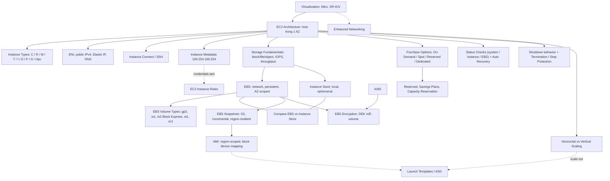

# 07 EC2

Section đi sâu vào EC2 sau phần nhập môn [[EC2 Basics]]. Các chủ đề gồm: ảo hóa và kiến trúc host, instance type, storage (EBS, Instance Store, snapshot, mã hóa), networking (ENI, IP, DNS), AMI, các hình thức mua, status check, termination protection, scaling và instance metadata. Đề thi rất hay hỏi các con số về IOPS/throughput, ranh giới AZ của EBS và cách chọn purchase option. Section này dùng VPC từ [[_MOC 06 VPC Basics]] và [[KMS]] từ [[_MOC 05 S3]]. Các phần bootstrapping, instance role và placement group được học tiếp ở [[_MOC 09 Advanced EC2]].

← [[00 Home]] · Trước: [[_MOC 06 VPC Basics]] · Sau: [[_MOC 08 Containers]]

## Lộ trình học
1. [[Virtualization]]: từ emulated → paravirtualization → hardware-assisted → SR-IOV, dẫn tới Nitro và Enhanced Networking.
2. [[EC2 Architecture and Resilience]]: instance là VM chạy trên host (Nitro) trong một AZ; shared host, dedicated host hoặc dedicated instance; EC2 là AZ-resilient; stop/start có thể đổi host.
3. [[EC2 Instance Types]]: 6 category (General, Compute, Memory, Accelerated, Storage, HPC), cách đọc tên type, chọn theo nút cổ chai.
4. [[EC2 Instance Connect and SSH]]: SSH bằng key pair hoặc Instance Connect bằng IAM; SG phải cho phép dải IP của dịch vụ Instance Connect (dùng AWS-managed prefix list).
5. [[Storage Fundamentals]]: direct- vs network-attached, ephemeral vs persistent, block/file/object, IO size × IOPS = throughput.
6. [[EBS]]: block storage qua mạng, persistent nhưng AZ-scoped; muốn ra khỏi AZ thì dùng snapshot.
7. [[EBS Volume Types]]: gp2/gp3, io1/io2 Block Express, st1/sc1 và các mốc gp2 16K / io1 64K / gp3 80K / io2 Block Express 256K IOPS.
8. [[Instance Store]]: storage local trên host, nhanh nhất và đã tính trong giá instance, nhưng ephemeral và chỉ thêm được lúc launch.
9. [[Compare - EBS vs Instance Store]]: khi nào chọn cái nào, kèm bộ số liệu cần thuộc lòng.
10. [[EBS Snapshots]]: backup incremental lưu trên S3, đưa dữ liệu lên mức region-resilient; restore lazy hoặc dùng FSR (tối đa 5/region); archive tier và snapshot lock (WORM).
11. [[EBS Encryption]]: mã hóa at rest (và host↔volume) bằng KMS với DEK riêng cho mỗi volume, giữ trong memory của host; tính năng miễn phí, chỉ trả phí KMS.
12. [[EC2 Network Interfaces IPs and DNS]]: cấu hình mạng nằm trên ENI; public IPv4 động; Elastic IP cố định (chỉ IPv4); private DNS kiểu IP name hoặc resource name; public DNS phân giải khác nhau trong và ngoài VPC.
13. [[AMI]]: "khuôn" launch instance trỏ tới snapshot qua block device mapping; gắn với region, không sửa được, copy hoặc share được (public bị chặn mặc định).
14. [[EC2 Purchase Options]]: On-Demand, Spot (rẻ tới 90%, cảnh báo 2 phút, terminate/stop/hibernate), Reserved, Dedicated Hosts, Dedicated Instances.
15. [[Reserved Instances and Savings Plans]]: RI Standard/Convertible, regional vs zonal, On-Demand Capacity Reservation (immediate/future, open/targeted), Savings Plans; tách rõ giảm giá và giữ capacity.
16. [[EC2 Status Checks and Auto Recovery]]: system check (lỗi phía AWS), instance check (lỗi phía bạn), EBS check (Nitro); simplified automatic recovery bật sẵn, hoặc CloudWatch alarm với action Recover.
17. [[EC2 Shutdown Terminate and Termination Protection]]: `DisableApiTermination` chống terminate nhầm, `DisableApiStop` chặn cả stop; shutdown behavior là stop hoặc terminate.
18. [[Horizontal vs Vertical Scaling]]: scale up/down (đổi size) so với scale out/in (thêm instance sau LB, cần stateless).
19. [[EC2 Instance Metadata]]: IMDS tại 169.254.169.254 cho IP, AZ, credentials của role, user data; IMDSv1 không xác thực, IMDSv2 dùng token (nhiều instance mới chỉ bật v2).

## Bản đồ khái niệm

## Liên kết sang section khác
- Nhập môn: [[EC2 Basics]]
- Key cho mã hóa volume: [[KMS]]
- Học tiếp ở Advanced EC2: [[EC2 User Data Bootstrapping]], [[EC2 Instance Roles]], [[Enhanced Networking and EBS Optimized]], [[Dedicated Hosts]]
- Scale out: [[Launch Templates]], [[Auto Scaling Groups]]
- Storage chia sẻ cho nhiều instance: [[EFS]]; backup tự động: [[AWS Backup]]

## 🎯 Top mẹo thi của section
- **EC2 là AZ-resilient**: instance, EBS volume và ENI đều không gắn chéo AZ được. Thấy EC2 trong câu hỏi thì tìm chi tiết về AZ. ([[EC2 Architecture and Resilience]])
- Vấn đề hiệu năng thường được giải bằng **đổi instance type**: CPU → C; RAM → R/X; GPU → P/G; IOPS local → I; tải thấp có burst → T. ([[EC2 Instance Types]])
- Chuyển EBS sang **AZ khác** → snapshot rồi tạo volume ở AZ đích. Sang **region khác** → copy snapshot hoặc copy AMI. ([[EBS]], [[EBS Snapshots]])
- Mốc IOPS: gp2 **16,000** → io1 **64,000** → gp3 **80,000** → io2 Block Express **256,000** → vượt trần của instance thì dùng Instance Store. Mặc định và rẻ thì chọn **gp3**; cần IOPS cam kết, latency ổn định thì chọn provisioned IOPS (io1/io2 Block Express). **HDD (st1/sc1) không boot được**: st1 cho throughput tuần tự giá rẻ, sc1 cho dữ liệu lạnh rẻ nhất. ([[EBS Volume Types]])
- Instance Store **ephemeral**, chỉ thêm **lúc launch**, mất dữ liệu khi stop/start, resize hoặc host hỏng (reboot thì giữ). Hợp với cache, scratch, dữ liệu đã được replicate. ([[Instance Store]], [[Compare - EBS vs Instance Store]])
- Volume restore từ snapshot chậm lúc đầu → **Fast Snapshot Restore** (tối đa 5/region) hoặc đọc trước mọi block. Snapshot giữ lâu, hiếm dùng → **archive tier**; không ai được xóa → **snapshot lock**. ([[EBS Snapshots]])
- "Mọi EBS volume mới phải được mã hóa" → **EBS encryption by default**. Tính năng mã hóa miễn phí, chỉ trả phí dùng KMS. ([[EBS Encryption]])
- **OS không thấy public IPv4**. Stop/start làm đổi public IP, cần IP cố định thì dùng **Elastic IP**. License theo MAC → dùng **secondary ENI**. ([[EC2 Network Interfaces IPs and DNS]])
- AMI **gắn với một region**: copy sang region khác tạo AMI mới với ID mới. **AMI baking** cho launch nhanh hơn bootstrapping bằng user data. ([[AMI]])
- Workload chịu được gián đoạn và cần rẻ nhất → **Spot** (cảnh báo 2 phút qua EventBridge và instance metadata). Chạy 24/7 dài hạn → **Reserved/Savings Plans**. Ngắn hạn, không biết trước → **On-Demand**. License theo socket/core → **Dedicated Host**. ([[EC2 Purchase Options]])
- Regional RI **không giữ capacity**. Cần capacity đảm bảo mà không cam kết dài hạn → **On-Demand Capacity Reservation** (trả giá On-Demand, không giảm giá; kết hợp Savings Plans để giảm giá). Workload trải EC2/Fargate/Lambda → **Compute Savings Plan**. ([[Reserved Instances and Savings Plans]])
- System status check fail là lỗi phía AWS → **simplified automatic recovery** (bật sẵn) hoặc **CloudWatch alarm + Recover** (giữ instance ID, IP, EBS, sang host khác trong cùng AZ). Recover không chống được sự cố AZ. ([[EC2 Status Checks and Auto Recovery]])
- Chống terminate nhầm → **termination protection** (`DisableApiTermination`); chặn cả stop → **stop protection** (`DisableApiStop`). ([[EC2 Shutdown Terminate and Termination Protection]])
- Không downtime, tải không đoán trước → **horizontal scaling** với ELB + ASG, kèm **session đưa ra ngoài host**. ([[Horizontal vs Vertical Scaling]])
- Instance metadata ở **169.254.169.254/latest/meta-data/**, không xác thực ở IMDSv1. Tăng bảo mật thì **bắt buộc IMDSv2**; không đặt secret trong user data. ([[EC2 Instance Metadata]])
