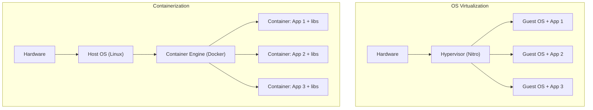
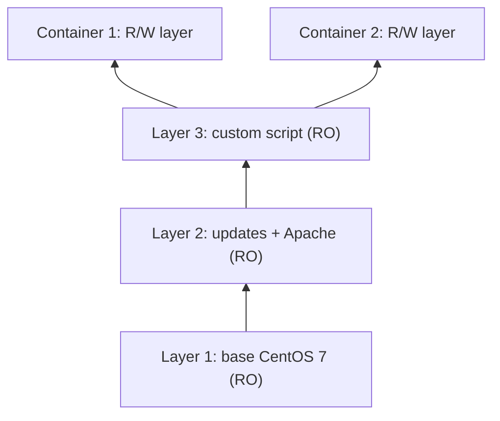

# Containers Fundamentals

> **TL;DR:** Container là môi trường cô lập để chạy một ứng dụng, nhưng khác VM ở chỗ nó **chạy như một process trên host OS** dùng chung kernel, thay vì mỗi ứng dụng một guest OS đầy đủ. Nhờ image được ghép từ các **layer read-only dùng chung**, container nhẹ, khởi động nhanh, mật độ cao, **portable** và **consistent**. Đây là nền tảng để hiểu [[ECS]], [[ECR]], [[Kubernetes]] và [[EKS]].

## 🖼️ Sơ đồ
![[Containers Fundamentals.excalidraw]]
*Mở bằng plugin Excalidraw để chỉnh sửa · ảnh tĩnh: [[Containers Fundamentals.svg]]*

![[Containers Fundamentals - image.excalidraw]]
*Mở bằng plugin Excalidraw để chỉnh sửa · ảnh tĩnh: [[Containers Fundamentals - image.svg]]*

## Khái niệm cốt lõi

### Vấn đề của OS virtualization
- Cái thường gọi là virtualization thực chất là **OS virtualization**: chạy nhiều OS trên cùng phần cứng, trên một hypervisor (trên EC2 là Nitro, xem [[Virtualization]] và [[EC2 Architecture and Resilience]]).
- Mỗi VM là **một OS hoàn chỉnh + tài nguyên riêng**. Với VM 4 GB RAM / 40 GB disk, riêng guest OS có thể chiếm **60–70% disk** và phần lớn RAM, còn lại rất ít cho ứng dụng và runtime.
- Nhiều VM thường chạy **cùng một OS/cùng version** → trùng lặp tài nguyên. Mọi thao tác start/stop/restart đều phải "xoay" cả một OS.
- Câu hỏi đặt ra: muốn chạy 6 ứng dụng cô lập, có cần 6 bản sao OS không? Với container thì **không**.

### Containerization
- Kiến trúc: **Hardware → Host OS → Container engine (ví dụ Docker) → các container**.
- Container chạy như **một process** trong host OS, cô lập với các process khác, nhưng **dùng host OS cho phần nặng** (networking, file I/O, kernel).
- Bên trong container giống một OS cô lập: có **file system riêng**, có thể chạy **child process** riêng (ví dụ web server, app server).
- Container chỉ tiêu tốn tài nguyên cho **ứng dụng + runtime/thư viện/dependency** nó cần → nhẹ hơn VM rất nhiều → chạy được **nhiều ứng dụng hơn trên cùng phần cứng (density)**.

### Docker image và Dockerfile
- Tương tự EC2 instance là bản đang chạy của EBS volume (boot volume), **container là bản đang chạy của một Docker image**.
- Docker image **không phải một disk image nguyên khối** mà là **chồng các file system layer** độc lập.
- Image được build từ **Dockerfile**: mỗi dòng lệnh (directive) được xử lý tuần tự và **thường tạo ra một layer mới**.
- Image bắt đầu từ **scratch** hoặc từ **base image** (dòng `FROM`). Ví dụ trong bài: base là **CentOS 7** – một file system tối giản đủ để chạy bản CentOS cô lập.
- Mỗi layer chỉ chứa **phần khác biệt (differential)** so với các layer bên dưới; các layer của image là **read-only**, không bao giờ thay đổi sau khi tạo.
- Ví dụ 3 layer: (1) base CentOS 7 → (2) cập nhật + cài Apache → (3) thêm script/tùy chỉnh. Thứ tự đúng: base ở **dưới cùng**, tùy chỉnh ở **trên cùng**.

### Container = image + một layer read/write
- Khi chạy, container = các layer read-only của image + **một layer read/write riêng** ở trên cùng.
- Mọi thứ phát sinh khi chạy (log, dữ liệu ứng dụng tạo ra/ghi ra) nằm trong layer read/write đó.
- Hai container cùng image **dùng chung toàn bộ layer read-only** (không trùng lặp, không có nguy cơ ghi đè vì read-only); chỉ khác nhau ở layer R/W → khác biệt có thể chỉ vài MB, so với VM mỗi cái hàng chục/trăm GB.
- Với hàng trăm container dùng ít image, kiến trúc layer này tiết kiệm disk rất lớn.

### Container registry
- **Container registry/hub**: nơi lưu và phân phối container image. Ví dụ phổ biến: **Docker Hub**; trên AWS là [[ECR]].
- Quy trình: Dockerfile → build image → **push** lên registry (public hoặc private) → **pull** về các **container host** (server chạy container engine, ví dụ Docker host) để chạy.
- Base image của các OS thường được chính vendor OS công bố trên registry.
- Một image có thể sinh **nhiều container** trên **nhiều host**; mỗi container là duy nhất vì có layer R/W riêng.
- Registry private thường yêu cầu xác thực; public thì thường ai cũng pull được.
- Lưu ý thuật ngữ: Docker container / Docker host / Docker Hub chỉ là **một loại** container / container host / registry, nhưng vì Docker quá phổ biến nên người ta hay dùng lẫn lộn.
- Có một chuẩn mở là **Open Container Initiative (OCI)**, định nghĩa thế nào là container, registry và các artifact đi kèm. Nghe ai nói "Docker" thì thường họ đang nói về container nói chung. [[ECR]] lưu được cả image theo chuẩn OCI.

### Đặc điểm chính (key concepts)
- Dockerfile → build Docker image (nhiều layer) → chạy thành container.
- **Portable & consistent**: đóng gói app + toàn bộ thư viện; ở đâu có container host tương thích thì app chạy đúng như ý, cùng version phần mềm.
- **Lightweight**: dùng host OS cho phần nặng, nhưng vẫn cô lập. Image có thể dựa trên image khác; layer được chia sẻ và tái sử dụng.
- Chỉ chạy những gì cần (app + dependency), **dùng rất ít RAM**, **start/stop rất nhanh**, mà vẫn có mức cô lập gần với VM.
- Container cô lập nên muốn truy cập từ ngoài phải **expose port** (ví dụ TCP/80 cho HTTP) → host và thế giới bên ngoài truy cập được dịch vụ.
- Ứng dụng phức tạp có thể gồm **nhiều container** (ví dụ container web + container database), để scale từng phần hoặc tách tier.

## Demo / Lab — "Container of Crocs" image trên EC2
Kiến trúc: stack CloudFormation 1-click (us-east-1) tạo VPC Aus-E-Mart với các public subnet và một EC2 instance `AEM Public Instance` (Amazon Linux 2023, ARM64). Instance này đóng vai Docker host để build và chạy image.
1. Đợi stack ở trạng thái `CREATE_COMPLETE` và instance pass 3/3 status check, rồi kết nối bằng **[[EC2 Instance Connect and SSH|EC2 Instance Connect]]** (user `ec2-user`).
2. **Cài Docker engine** bằng package manager: `sudo dnf install docker`, rồi `sudo systemctl start docker`.
3. `docker images` báo **permission denied** → thêm user vào group docker: `sudo usermod -a -G docker ec2-user`. Phải ngắt kết nối rồi kết nối lại thì thay đổi mới có hiệu lực; lúc này `docker images` trả về danh sách trống.
4. Tải file zip của ứng dụng (lưu trên S3), `unzip`, `cd` vào thư mục container-of-crocs: có **Dockerfile**, các ảnh cá sấu và một `index.html`. Các directive trong Dockerfile:
   - `FROM` image **Red Hat UBI 8** → base layer hệ điều hành.
   - `LABEL` (tùy chọn) → tác giả là Aus-E-Mart.
   - `RUN yum install` web server cho trang web tĩnh.
   - `COPY` `index.html` và các file ảnh vào thư mục web.
   - Chạy web server ở foreground, `EXPOSE 80` để truy cập web server qua port 80.
5. `docker build -t containerofcrocs .` → `-t` gắn tag (tên) cho image, dấu `.` là thư mục làm việc chứa Dockerfile. Docker kéo base image UBI 8, chạy từng directive, mỗi bước tạo một layer.
6. `docker images` → thấy image `containerofcrocs` tag `latest`.
7. `docker run -t -i -p 80:80 containerofcrocs` → map **port 80 của EC2 host tới port 80 của container**; mở public IP của instance (HTTP) thấy trang web. Giảng viên nhấn mạnh: image chứa mọi thứ app cần nên chạy trên máy cá nhân, EC2 hay cloud khác đều như nhau (portability).
8. Demo tiếp theo đẩy image này lên **[[ECR]]** để dùng với [[ECS]]. Nếu dừng ở đây thì xóa stack hoặc ít nhất stop instance.

Rút ra: chạy Docker trực tiếp trên EC2 hợp cho thử nghiệm/build nhanh, **không phải cách khuyến nghị cho production** (xem [[ECS Launch Types EC2 vs Fargate]]).

(Bản khóa cũ: demo "Container of Cats" dùng Amazon Linux 2 với `amazon-linux-extras install docker`, kết nối qua Session Manager, base image `centos:7`, rồi đẩy image lên **Docker Hub** bằng `docker login` / `docker tag` / `docker push`.)

> Ghi chú hiện tại: phần lý thuyết vẫn lấy CentOS 7 làm ví dụ base image, nhưng CentOS 7 đã **hết hỗ trợ (EOL) từ 06/2024**, image `centos:7` và repo yum của nó không còn được cập nhật; demo mới đã đổi sang Red Hat UBI 8. (Bổ sung, bài không nói chuyện EOL.)

## 🎯 Mẹo thi SAA-C03
- Đề nhắc **"lightweight", "portable", "consistent across environments", "start nhanh", "mật độ cao", "không cần full OS"** → nghĩ tới container.
- Container **dùng chung kernel host OS**; VM có guest OS riêng. Nếu yêu cầu cô lập ở mức OS/kernel riêng hoặc OS khác nhau → VM ([[EC2 Basics]]).
- Image = các layer **read-only**; container thêm **một layer read/write**. Dữ liệu trong layer R/W mất khi container bị xóa → dữ liệu bền vững cần storage ngoài (ví dụ [[EFS]]).
- Registry: Docker Hub (public/private) hoặc **[[ECR]]** khi cần tích hợp IAM/AWS.
- `EXPOSE` không mở port; mapping thật được làm bằng `-p host:container` (Docker) hoặc **port mapping trong container definition** của [[ECS]].

## Liên kết
- Tiên quyết: [[Virtualization]], [[EC2 Architecture and Resilience]], [[EC2 Basics]]
- Tiếp theo: [[ECS]], [[ECS Launch Types EC2 vs Fargate]], [[ECR]], [[Kubernetes]], [[EKS]]
- Phân biệt với: [[Instance Store]] (storage ephemeral tương tự layer R/W), [[Cloud Service Models]]
- Liên quan: [[CloudFormation Basics]], [[Lambda]] (một dạng compute khác không quản lý server)
