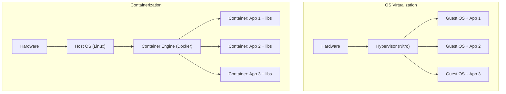
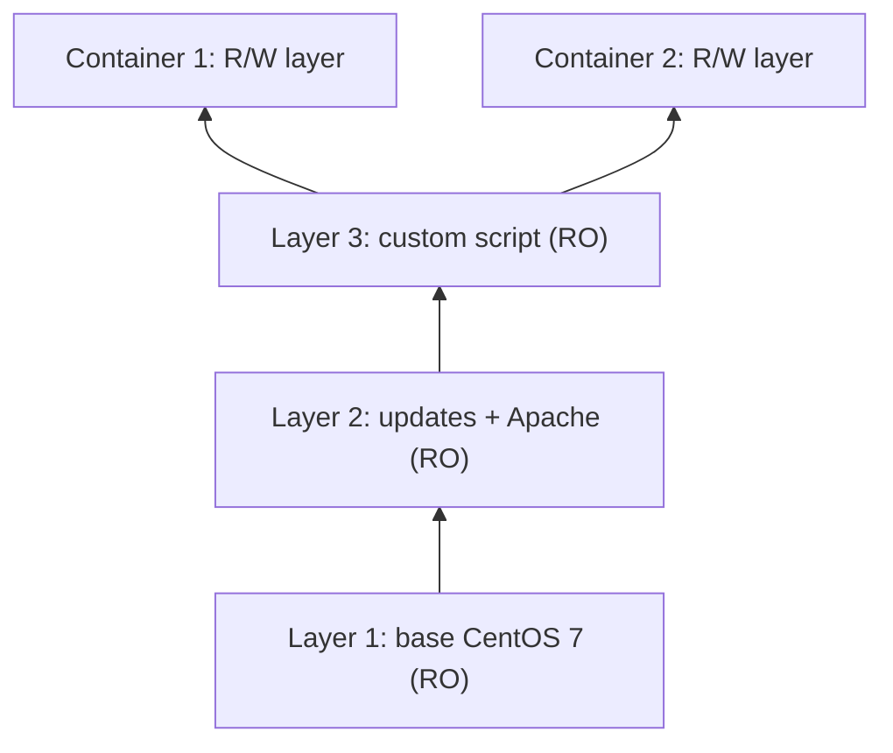

# Containers Fundamentals

> **TL;DR:** Container là môi trường cô lập để chạy một ứng dụng, nhưng khác VM ở chỗ nó **chạy như một process trên host OS** dùng chung kernel, thay vì mỗi ứng dụng một guest OS đầy đủ. Nhờ image được ghép từ các **layer read-only dùng chung**, container nhẹ, khởi động nhanh, mật độ cao, **portable** và **consistent**. Đây là nền tảng để hiểu [[ECS]], [[ECR]], [[Kubernetes]] và [[EKS]].

## 🖼️ Sơ đồ
![[Containers Fundamentals.excalidraw]]
*Mở bằng plugin Excalidraw để chỉnh sửa · ảnh tĩnh: [[Containers Fundamentals.svg]]*

![[Containers Fundamentals - image.excalidraw]]
*Mở bằng plugin Excalidraw để chỉnh sửa · ảnh tĩnh: [[Containers Fundamentals - image.svg]]*

## Khái niệm cốt lõi

### Vấn đề của OS virtualization
- Cái thường gọi là virtualization thực chất là **OS virtualization**: chạy nhiều OS trên cùng phần cứng, trên một hypervisor (trên EC2 là Nitro, xem [[Virtualization]] và [[EC2 Architecture and Resilience]]).
- Mỗi VM là **một OS hoàn chỉnh + tài nguyên riêng**. Với VM 4 GB RAM / 40 GB disk, riêng guest OS có thể chiếm **60–70% disk** và phần lớn RAM, còn lại rất ít cho ứng dụng và runtime.
- Nhiều VM thường chạy **cùng một OS/cùng version** → trùng lặp tài nguyên. Mọi thao tác start/stop/restart đều phải "xoay" cả một OS.
- Câu hỏi đặt ra: muốn chạy 6 ứng dụng cô lập, có cần 6 bản sao OS không? Với container thì **không**.

### Containerization
- Kiến trúc: **Hardware → Host OS → Container engine (ví dụ Docker) → các container**.
- Container chạy như **một process** trong host OS, cô lập với các process khác, nhưng **dùng host OS cho phần nặng** (networking, file I/O, kernel).
- Bên trong container giống một OS cô lập: có **file system riêng**, có thể chạy **child process** riêng (ví dụ web server, app server).
- Container chỉ tiêu tốn tài nguyên cho **ứng dụng + runtime/thư viện/dependency** nó cần → nhẹ hơn VM rất nhiều → chạy được **nhiều ứng dụng hơn trên cùng phần cứng (density)**.

### Docker image và Dockerfile
- Tương tự EC2 instance là bản đang chạy của EBS volume (boot volume), **container là bản đang chạy của một Docker image**.
- Docker image **không phải một disk image nguyên khối** mà là **chồng các file system layer** độc lập.
- Image được build từ **Dockerfile**: mỗi dòng lệnh (directive) được xử lý tuần tự và **thường tạo ra một layer mới**.
- Image bắt đầu từ **scratch** hoặc từ **base image** (dòng `FROM`). Ví dụ trong bài: base là **CentOS 7** – một file system tối giản đủ để chạy bản CentOS cô lập.
- Mỗi layer chỉ chứa **phần khác biệt (differential)** so với các layer bên dưới; các layer của image là **read-only**, không bao giờ thay đổi sau khi tạo.
- Ví dụ 3 layer: (1) base CentOS 7 → (2) cập nhật + cài Apache → (3) thêm script/tùy chỉnh. Thứ tự đúng: base ở **dưới cùng**, tùy chỉnh ở **trên cùng**.

### Container = image + một layer read/write
- Khi chạy, container = các layer read-only của image + **một layer read/write riêng** ở trên cùng.
- Mọi thứ phát sinh khi chạy (log, dữ liệu ứng dụng tạo ra/ghi ra) nằm trong layer read/write đó.
- Hai container cùng image **dùng chung toàn bộ layer read-only** (không trùng lặp, không có nguy cơ ghi đè vì read-only); chỉ khác nhau ở layer R/W → khác biệt có thể chỉ vài MB, so với VM mỗi cái hàng chục/trăm GB.
- Với hàng trăm container dùng ít image, kiến trúc layer này tiết kiệm disk rất lớn.

### Container registry
- **Container registry/hub**: nơi lưu và phân phối container image. Ví dụ phổ biến: **Docker Hub**; trên AWS là [[ECR]].
- Quy trình: Dockerfile → build image → **push** lên registry (public hoặc private) → **pull** về các **container host** (server chạy container engine, ví dụ Docker host) để chạy.
- Base image của các OS thường được chính vendor OS công bố trên registry.
- Một image có thể sinh **nhiều container** trên **nhiều host**; mỗi container là duy nhất vì có layer R/W riêng.
- Registry private thường yêu cầu xác thực; public thì thường ai cũng pull được.
- Lưu ý thuật ngữ: Docker container / Docker host / Docker Hub chỉ là **một loại** container / container host / registry, nhưng vì Docker quá phổ biến nên người ta hay dùng lẫn lộn.

### Đặc điểm chính (key concepts)
- Dockerfile → build Docker image (nhiều layer) → chạy thành container.
- **Portable & consistent**: đóng gói app + toàn bộ thư viện; ở đâu có container host tương thích thì app chạy đúng như ý, cùng version phần mềm.
- **Lightweight**: dùng host OS cho phần nặng, nhưng vẫn cô lập. Image có thể dựa trên image khác; layer được chia sẻ và tái sử dụng.
- Chỉ chạy những gì cần (app + dependency), **dùng rất ít RAM**, **start/stop rất nhanh**, mà vẫn có mức cô lập gần với VM.
- Container cô lập nên muốn truy cập từ ngoài phải **expose port** (ví dụ TCP/80 cho HTTP) → host và thế giới bên ngoài truy cập được dịch vụ.
- Ứng dụng phức tạp có thể gồm **nhiều container** (ví dụ container web + container database), để scale từng phần hoặc tách tier.

## Demo / Lab — "Container of Cats" Docker image
Kiến trúc: một EC2 instance (dựng bằng 1-click [[CloudFormation Basics|CloudFormation]] stack, kết nối qua Session Manager thay vì SSH key) dùng làm Docker host để build image.
1. **Cài Docker engine**: trên Amazon Linux 2 dùng `amazon-linux-extras install docker`, sau đó `service docker start`. (Amazon Linux 2023 không còn `amazon-linux-extras`; dùng `dnf install docker`.)
2. `docker ps` báo lỗi quyền → thêm user vào group docker: `usermod -a -G docker ec2-user`, rồi logout/login lại (với Session Manager thì `sudo su - ec2-user`). `docker ps` trả về danh sách trống = OK.
3. Thư mục ứng dụng gồm `index.html`, 6 ảnh JPG và **Dockerfile**. Các directive:
   - `FROM centos:7` → base image.
   - `LABEL maintainer=...` → mô tả/người duy trì.
   - `RUN yum -y install httpd` → cài Apache.
   - `COPY index.html` và `COPY *.jpg` vào `/var/www/html/` (thư mục Apache phục vụ).
   - `ENTRYPOINT` → lệnh chạy đầu tiên khi tạo container (chạy Apache ở foreground).
   - `EXPOSE 80` → chỉ **khai báo/tài liệu hóa** port mà container dùng; bản thân nó không cấu hình gì.
4. `docker build -t containerofcats .` → dấu `.` là thư mục làm việc chứa Dockerfile. Docker kéo base image rồi chạy từng directive, mỗi bước tạo một layer; image được tag `:latest`.
5. `docker images --filter reference=containerofcats` để xem image.
6. `docker run -t -i -p 80:80 containerofcats` → map **port 80 của EC2 host tới port 80 của container**; truy cập public IP của instance (dùng HTTP, không HTTPS) thấy trang web.
7. (Tùy chọn) Đẩy lên Docker Hub: `docker login --username=...` → `docker tag <image-id> <user>/containerofcats` → `docker push <user>/containerofcats:latest`. Image này được dùng lại trong demo [[ECS]] Fargate.
8. Dọn dẹp: xóa CloudFormation stack (xóa instance cũng xóa luôn mật khẩu Docker Hub đã lưu trên máy).

Rút ra: chạy Docker trực tiếp trên EC2 hợp cho thử nghiệm/build nhanh, **không phải cách khuyến nghị cho production** (xem [[ECS Launch Types EC2 vs Fargate]]).

> Ghi chú hiện tại: CentOS 7 đã **hết hỗ trợ (EOL) từ 06/2024**, image `centos:7` và repo yum của nó không còn được cập nhật; khi làm lại lab nên đổi base image (ví dụ Amazon Linux, Rocky/Alma Linux, hoặc `httpd` chính thức).

## 🎯 Mẹo thi SAA-C03
- Đề nhắc **"lightweight", "portable", "consistent across environments", "start nhanh", "mật độ cao", "không cần full OS"** → nghĩ tới container.
- Container **dùng chung kernel host OS**; VM có guest OS riêng. Nếu yêu cầu cô lập ở mức OS/kernel riêng hoặc OS khác nhau → VM ([[EC2 Basics]]).
- Image = các layer **read-only**; container thêm **một layer read/write**. Dữ liệu trong layer R/W mất khi container bị xóa → dữ liệu bền vững cần storage ngoài (ví dụ [[EFS]]).
- Registry: Docker Hub (public/private) hoặc **[[ECR]]** khi cần tích hợp IAM/AWS.
- `EXPOSE` không mở port; mapping thật được làm bằng `-p host:container` (Docker) hoặc **port mapping trong container definition** của [[ECS]].

## Liên kết
- Tiên quyết: [[Virtualization]], [[EC2 Architecture and Resilience]], [[EC2 Basics]]
- Tiếp theo: [[ECS]], [[ECS Launch Types EC2 vs Fargate]], [[ECR]], [[Kubernetes]], [[EKS]]
- Phân biệt với: [[Instance Store]] (storage ephemeral tương tự layer R/W), [[Cloud Service Models]]
- Liên quan: [[CloudFormation Basics]], [[Lambda]] (một dạng compute khác không quản lý server)
