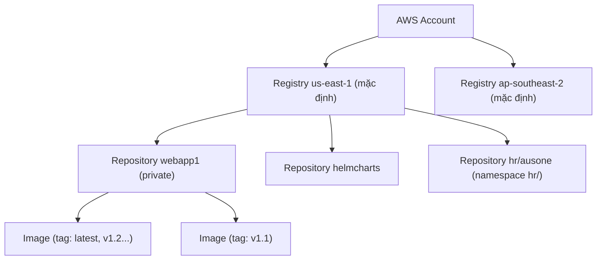

# ECR

> **TL;DR:** Amazon Elastic Container Registry là **managed container image registry** của AWS ("Docker Hub phiên bản AWS"), lưu image dùng cho Docker, [[ECS]], [[EKS]]. Mỗi account có sẵn **một registry ở mỗi region**; bạn tạo **repository** (public hoặc private) trong đó. Điểm mạnh: tích hợp **IAM** (identity, registry, repository policy), **vulnerability scanning** (basic miễn phí, enhanced qua Inspector), **lifecycle policy**, mã hóa at rest, **replication cross-region và cross-account**.

## 🖼️ Sơ đồ
![[ECR.excalidraw]]
*Mở bằng plugin Excalidraw để chỉnh sửa · ảnh tĩnh: [[ECR.svg]]*

## Khái niệm cốt lõi

### Quy trình dùng ECR
- Viết Dockerfile → build container image → **xác thực** với registry → **tag** image bằng URI của repository → **push**.
  - Xác thực: `aws ecr get-login-password --region <region> | docker login --username AWS --password-stdin <URI registry>` (username luôn là `AWS`, password là token lấy từ lệnh ECR).
  - `docker tag <image>:latest <URI repo>:latest` rồi `docker push <URI repo>:latest`.
- Dịch vụ chạy container như [[ECS]], [[EKS]] **pull** image từ ECR rất dễ vì tích hợp sẵn.

### Cấu trúc
- **Registry**: mỗi AWS account **có sẵn một registry mặc định ở mỗi region** đang dùng, không phải tự tạo. URI dạng `<account-id>.dkr.ecr.<region>.amazonaws.com` (ví dụ `…dkr.ecr.us-east-1.amazonaws.com`, `…dkr.ecr.ap-southeast-2.amazonaws.com`).
- **Repository**: dùng để tổ chức registry, ví dụ `webapp1`. Repository là **private hoặc public**, chọn **lúc tạo và không đổi được** sau đó. Dấu `/` trong tên (ví dụ `hr/ausone`) tạo **namespace** để nhóm các repository cùng tiền tố.
- **Image và artifact**: Docker image, **OCI image** và mọi artifact theo chuẩn OCI như **Helm chart**, signed manifest (xem [[Containers Fundamentals]]). Mỗi image có thể có nhiều **tag**, tag phải **unique trong repository**.
- (Bản khóa cũ nêu, bài mới không nói: "mỗi account có một public registry và một private registry"; public registry chính là **Amazon ECR Public**, dùng chung toàn cầu.)

### Kiểm soát truy cập
- Như mọi dịch vụ AWS, truy cập **mặc định bị chặn**; cấp quyền bằng IAM. Ba loại policy hay dùng:
  - **IAM identity policy**: gắn vào user/role, quy định principal làm được gì trên ECR. Xem [[IAM Identity Policies]].
  - **Registry policy**: áp ở mức registry (mỗi region một registry), cấp quyền toàn registry, ví dụ quản lý **cross-account replication** hay quyền tạo repository.
  - **Repository policy**: áp ở mức repository, ví dụ ai được **push, pull, describe** một repo cụ thể (dùng cho cross-account).

| Repository | Read (pull) | Read-write (push) |
|---|---|---|
| **Public** | **Ai cũng pull được** (read-only công khai) | Cần quyền |
| **Private** | Cần quyền | Cần quyền |

(Bảng này theo bản khóa cũ; bài mới chỉ nói repository là public hoặc private.)

### Tính năng
- **Replication** image **cross-region VÀ cross-account**, cấu hình ở **mức registry**: dùng cho DR, ứng dụng multi-region hoặc kiến trúc nhiều account (tương tự ý tưởng [[S3 Replication]]).
- **Vulnerability scanning**: ECR so các software package trong image với cơ sở dữ liệu **CVE**. Cấu hình ở **mức registry** (theo region), hai mức:
  - **Basic**: **miễn phí, bật sẵn**; quét **package của OS**; chạy **khi push** image hoặc **chạy tay**.
  - **Enhanced**: tích hợp **Amazon [[Inspector]]**, **có tính phí**; quét **cả package OS lẫn package ngôn ngữ lập trình** (thư viện Python, Java… trong image) và quét **liên tục** (continuous).
- **Lifecycle policy** (đặt ở **mức repository**): rule tự dọn image, ví dụ **expire image cũ hoặc không dùng**.
- **Mã hóa at rest**: chọn **lúc tạo repository** (mặc định AES-256, hoặc KMS key), không đổi được sau đó.
- **Tag immutability** (thiết lập của repository): bật thì không ai push được image khác đè lên một tag đã có (ví dụ `v1`), giúp bảo vệ version.
- Bản khóa cũ nêu thêm (bài mới không nói): **near real-time metrics** gửi tới **[[CloudWatch Basics|CloudWatch]]** (authentication, push, pull); mọi **API action** ghi vào **[[CloudTrail]]**; ECR sinh **event** tới **[[EventBridge]]** để làm workflow event-driven quanh image (push xong thì trigger scan/deploy).

## Demo / Lab — Push "Container of Crocs" lên ECR
Nối tiếp demo build image trong [[Containers Fundamentals]] (instance Amazon Linux 2023 đã có image `containerofcrocs`).
1. ECR console (đúng region us-east-1) → **Create repository**. Registry đã có sẵn ở mọi region nên việc đầu tiên chỉ là tạo repository, tên `containerofcrocs`.
2. Thiết lập của repository:
   - **Tag immutability**: để Immutable → tag (ví dụ `v1`) không bị image khác ghi đè.
   - **Encryption**: AES-256 (hoặc KMS customer managed key); **chỉ đặt được lúc tạo**, không đổi về sau.
   - Image scanning ở mức repository: giảng viên nói AWS đang hướng người dùng sang công cụ khác để quét image trên toàn registry, nên để mặc định.
3. Cấp quyền cho instance push image: IAM → Roles → trusted entity EC2, managed policy **`AmazonEC2ContainerRegistryFullAccess`** (demo cho nhanh; thực tế nên khóa chặt theo least privilege), tên `Demo-EC2-ECR-Full`. EC2 → Actions → Security → **Modify IAM role** gắn role vào instance (xem [[EC2 Instance Roles]]).
4. Trên instance: `aws ecr get-login-password --region us-east-1 | docker login --username AWS --password-stdin <account-id>.dkr.ecr.us-east-1.amazonaws.com`. Registry được nhận diện chỉ bằng **account ID + region**.
5. `docker tag containerofcrocs:latest <URI repo>:latest` rồi `docker push <URI repo>:latest`. Mở repository → Images thấy image `latest`.
6. ECR có free tier cho private repository, giảng viên nhớ là khoảng **500 MB**. Giữ image lại cho demo [[ECS]]; xóa role và xóa stack.

(Bản khóa cũ không có demo ECR; image "container of cats" được đẩy lên Docker Hub.)

## 🎯 Mẹo thi SAA-C03
- Cần registry **private, tích hợp IAM**, dùng với ECS/EKS → **ECR**.
- Mỗi account có **sẵn một registry ở mỗi region**; bạn chỉ tạo repository. Repository **public/private** và **mã hóa** chọn **lúc tạo**, không đổi được.
- "Quét lỗ hổng container image cả OS lẫn thư viện ngôn ngữ, liên tục" → **ECR enhanced scanning (Inspector)**, có phí. **Basic scanning** miễn phí, bật sẵn, chỉ package OS, chạy khi push hoặc chạy tay.
- Tự động xóa image cũ/không dùng để giảm chi phí lưu trữ → **lifecycle policy** của repository.
- Không cho ghi đè tag đã phát hành → **tag immutability**.
- Cần image ở region khác / account khác → **ECR replication** (cấu hình ở mức registry); quyền cross-account dùng **registry policy / repository policy**.
- `docker login` vào ECR dùng username `AWS` và token từ `aws ecr get-login-password`.
- Audit ai push/pull → **CloudTrail**; tự động hóa khi có image mới → **EventBridge** (bản khóa cũ nêu, vẫn đúng).
- Ngoài bài giảng nhưng hữu ích: task trong [[ECS]] pull image từ ECR nhờ **task execution role**; Fargate/node trong subnet private cần NAT hoặc **VPC endpoint** ([[Interface VPC Endpoints]] cho ECR API/Docker + [[Gateway VPC Endpoints|S3 gateway endpoint]] vì layer lưu trên S3).

## Liên kết
- Tiên quyết: [[Containers Fundamentals]]
- Dùng cùng: [[ECS]], [[EKS]], [[EC2 Image Builder]], [[Inspector]], [[EventBridge]], [[CloudTrail]], [[CloudWatch Basics]]
- Liên quan: [[IAM Identity Policies]], [[EC2 Instance Roles]], [[Interface VPC Endpoints]], [[S3 Replication]]
