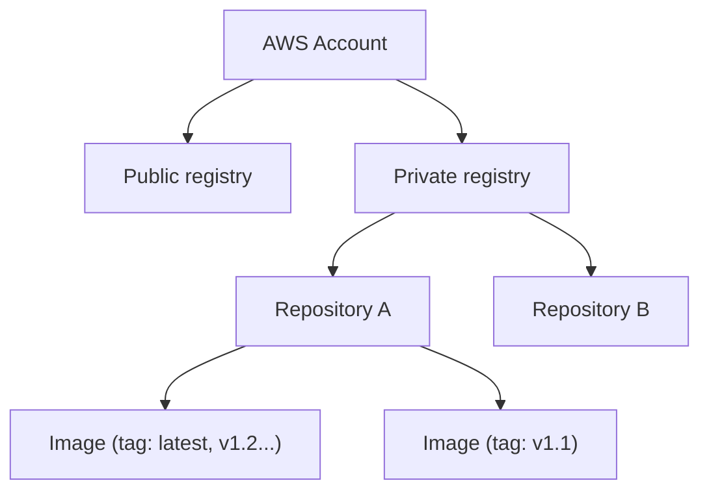

# ECR

> **TL;DR:** Amazon Elastic Container Registry là **managed container image registry** của AWS ("Docker Hub phiên bản AWS"), lưu image dùng cho Docker, [[ECS]], [[EKS]]. Điểm mạnh: tích hợp **IAM**, **image scanning** (basic/enhanced qua Inspector), metrics CloudWatch, log CloudTrail, event EventBridge, **replication cross-region và cross-account**.

## 🖼️ Sơ đồ
![[ECR.excalidraw]]
*Mở bằng plugin Excalidraw để chỉnh sửa · ảnh tĩnh: [[ECR.svg]]*

## Khái niệm cốt lõi

### Cấu trúc
- Mỗi AWS account có **một public registry và một private registry** (cấp cao nhất). (Chính xác hơn: private registry là theo **từng region** của account; public registry là **Amazon ECR Public**, dùng chung toàn cầu.)
- Mỗi **registry** chứa nhiều **repository** (giống repo trong Git/GitHub).
- Mỗi **repository** chứa nhiều **container image**; mỗi image có thể có nhiều **tag**, tag phải **unique trong repository**.

### Mô hình bảo mật
| Registry | Read (pull) | Read-write (push) |
|---|---|---|
| **Public** | **Ai cũng pull được** (read-only công khai) | Cần quyền |
| **Private** | Cần quyền | Cần quyền |

### Lợi ích / tính năng
- **Tích hợp IAM**: mọi quyền truy cập trong ECR điều khiển bằng IAM (identity policy, và repository policy cho cross-account). Xem [[IAM Identity Policies]].
- **Image scanning**, hai mức:
  - **Basic**.
  - **Enhanced**: dùng **Amazon [[Inspector]]**, quét lỗ hổng cả **OS** lẫn **software package (thư viện ngôn ngữ)** trong image, theo **từng layer**.
- **Near real-time metrics** gửi tới **[[CloudWatch Basics|CloudWatch]]**: authentication, push, pull.
- Mọi **API action** được ghi vào **[[CloudTrail]]**.
- Sinh **event** gửi tới **[[EventBridge]]** → xây workflow event-driven quanh container image (ví dụ push xong thì trigger scan/deploy).
- **Replication** image **cross-region VÀ cross-account** (tương tự ý tưởng [[S3 Replication]]).

## 🎯 Mẹo thi SAA-C03
- Cần registry **private, tích hợp IAM**, dùng với ECS/EKS → **ECR**.
- "Quét lỗ hổng container image (OS + package)" → **ECR enhanced scanning (Inspector)**; basic scanning chỉ ở mức cơ bản.
- Public registry: **anyone can pull, push cần quyền**; private: **mọi thao tác cần quyền**.
- Cần image gần các region khác / account khác → **ECR replication** (cross-region, cross-account).
- Audit ai push/pull → **CloudTrail**; tự động hóa khi có image mới → **EventBridge**.
- Ngoài bài giảng nhưng hữu ích: task trong [[ECS]] pull image từ ECR nhờ **task execution role**; Fargate/node trong subnet private cần NAT hoặc **VPC endpoint** ([[Interface VPC Endpoints]] cho ECR API/Docker + [[Gateway VPC Endpoints|S3 gateway endpoint]] vì layer lưu trên S3).

## Liên kết
- Tiên quyết: [[Containers Fundamentals]]
- Dùng cùng: [[ECS]], [[EKS]], [[Inspector]], [[EventBridge]], [[CloudTrail]], [[CloudWatch Basics]]
- Liên quan: [[IAM Identity Policies]], [[Interface VPC Endpoints]], [[S3 Replication]]
