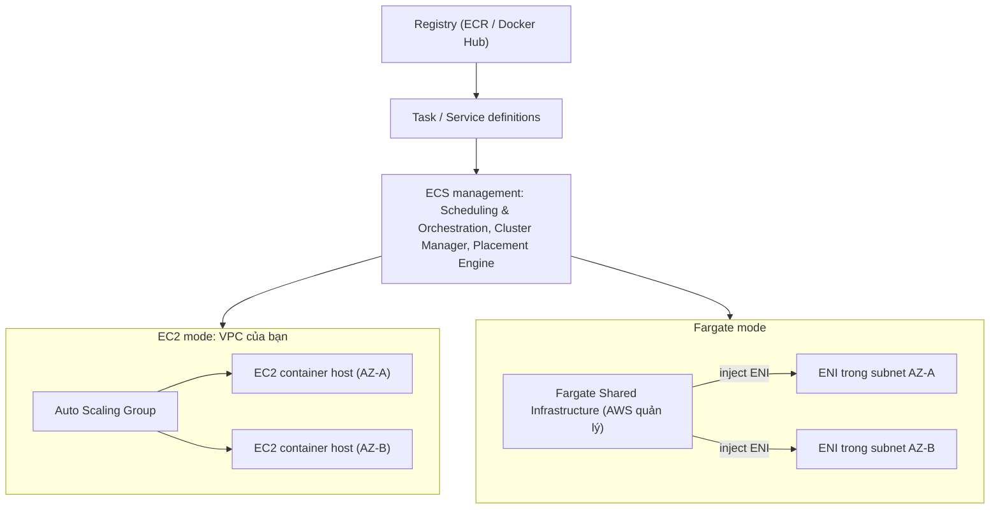

# ECS Launch Types EC2 vs Fargate

> **TL;DR:** Cluster [[ECS]] chạy ở **EC2 mode** (container host là EC2 instance trong account bạn, bạn lo capacity/availability và trả tiền instance kể cả khi rảnh) hoặc **Fargate mode** (serverless, AWS lo host trên hạ tầng dùng chung, bạn chỉ trả theo CPU/RAM container dùng). Chọn theo cân bằng **giá** và **công quản trị**, và theo kiểu workload (ổn định lớn vs burst/batch).

## 🖼️ Sơ đồ
![[ECS Launch Types EC2 vs Fargate.excalidraw]]
*Mở bằng plugin Excalidraw để chỉnh sửa · ảnh tĩnh: [[ECS Launch Types EC2 vs Fargate.svg]]*

![[ECS Launch Types EC2 vs Fargate - decision.excalidraw]]
*Mở bằng plugin Excalidraw để chỉnh sửa · ảnh tĩnh: [[ECS Launch Types EC2 vs Fargate - decision.svg]]*

## Khái niệm cốt lõi
- Cluster mode quyết định **phần nào bạn quản lý, phần nào AWS quản lý**, ảnh hưởng chi phí và kịch bản phù hợp.
- Thành phần **chung cho cả hai mode** (ECS management components): **Scheduling & Orchestration**, **Cluster Manager**, **Placement Engine** (quyết định container chạy trên host nào). Cả hai đều dùng **registry** ([[ECR]] / Docker Hub) và **task/service definition**.

### EC2 mode
- Cluster được tạo **trong một VPC** của account → hưởng **nhiều AZ** của VPC (ví dụ AZ-A, AZ-B).
- Container host là **EC2 instance (container instance)** chạy phần mềm ECS agent. Khi tạo cluster chỉ định kích thước ban đầu, số lượng instance do **[[Auto Scaling Groups|Auto Scaling Group]]** điều khiển (scale ngang, xem [[Horizontal vs Vertical Scaling]]).
- Các instance này **thấy được trong account, bị tính tiền, có thể kết nối vào**. ECS provision chúng, nhưng bạn được kỳ vọng quản lý chúng (chủ yếu qua tooling của ECS).
- **Không phải serverless**: bạn phải lo **capacity và availability** của cluster. ECS lo số task nếu dùng service, còn sức chứa của cluster là việc của bạn.
- **Trả tiền instance khi đang running dù không chạy task/service nào.**
- Lợi thế: dùng được **[[Reserved Instances and Savings Plans|Reserved Instances]]** đã có, **Spot** ([[EC2 Purchase Options]]), linh hoạt chọn instance → "middle ground": bớt gánh nặng nhờ ECS nhưng vẫn giữ quyền kiểm soát host.

### Fargate mode
- **Không quản lý EC2 instance nào** làm container host → không trả tiền host nhàn rỗi.
- AWS duy trì **Fargate Shared Infrastructure** dùng chung cho mọi khách hàng, nhưng **cô lập giữa các khách hàng** như EC2 trên phần cứng dùng chung.
- Task/service definition vẫn khai báo image, port, **CPU/memory**; tài nguyên được cấp từ nền tảng Fargate dùng chung.
- Vẫn có cluster và VPC (nhiều AZ). Điểm khác then chốt về networking: task chạy trên hạ tầng dùng chung nhưng được **inject vào VPC của bạn**: mỗi task có một **ENI** với IP trong VPC (network mode `awsvpc`, xem [[EC2 Network Interfaces IPs and DNS]]).
- Từ đó task hoạt động như mọi tài nguyên VPC khác: truy cập được trong VPC, và từ Internet nếu VPC/subnet cấu hình vậy (subnet public tự cấp public IPv4 → task có public IP). ENI gắn [[Security Groups]].
- Deploy được vào VPC mới hoặc custom VPC ([[Custom VPC]]).
- **Chỉ trả tiền cho tài nguyên container sử dụng**, không thấy chi phí host, không lo provision/capacity/availability của host.

## Bảng so sánh / số liệu
| Tiêu chí | EC2 mode | Fargate mode |
|---|---|---|
| Container host | EC2 instance trong account bạn | Hạ tầng dùng chung do AWS quản lý |
| Quản lý capacity/availability host | **Bạn** | AWS |
| Serverless | Không | Có |
| Tính tiền | Theo instance đang chạy, **kể cả khi rảnh** | Theo CPU/memory của task đang chạy |
| Reserved / Spot | Dùng được RI, Spot, Savings Plans | Savings Plans (và Fargate Spot, ngoài bài giảng) |
| Networking task | Chạy trên instance trong VPC | Mỗi task có **ENI riêng** inject vào VPC |
| Truy cập host | Có (SSH/SSM) | Không |
| Hợp với | Workload **lớn, ổn định**, tổ chức **nhạy cảm về giá** | Tổ chức **nhạy cảm về công quản trị**; workload nhỏ, **burst**, **batch/periodic** |

### Khi nào chọn gì (3 lựa chọn)
1. **EC2 thuần** (app chạy trong OS trên VM): khi không dùng container. Chạy Docker trực tiếp trên EC2 chỉ là trường hợp đặc biệt cho thử nghiệm, hầu như **không nên cho production**.
2. **ECS EC2 mode**: đã dùng container, workload lớn và ổn định, ưu tiên **giá hơn công sức**: tận dụng Spot/Reserved. Rẻ hơn **chỉ khi** bạn giảm được công quản trị (scaling, sizing, xử lý lỗi).
3. **ECS Fargate**: ưu tiên **giảm overhead quản trị** (kể cả workload lớn); workload **nhỏ/burst** hoặc **batch/periodic** vì chỉ trả cho phần dùng. Giữ fleet EC2 chạy liên tục cho tải không đều là lãng phí.
- Container nói chung hợp khi chỉ cần **cô lập ứng dụng**, ứng dụng tải thấp, các app cùng OS, không cần overhead của virtualization.
- Nếu doanh nghiệp đã dùng container → chọn ECS thay vì EC2 thuần.

> Ghi chú hiện tại (ngoài khóa học): ngoài EC2 và Fargate còn **External** (ECS Anywhere, chạy trên server on-prem) và **capacity providers** (gồm FARGATE_SPOT). Từ 2025 AWS có thêm **ECS Managed Instances**: EC2 do AWS quản lý vòng đời thay bạn, nằm giữa EC2 mode và Fargate. Đề SAA-C03 vẫn chủ yếu hỏi EC2 vs Fargate.

## 🎯 Mẹo thi SAA-C03
- "Run containers **without managing servers/EC2 instances/cluster capacity**", "least operational overhead" → **Fargate**.
- "Đã có **Reserved Instances**", "muốn dùng **Spot** để giảm giá", "cần truy cập/tùy chỉnh host, GPU, instance type đặc biệt", workload **lớn và ổn định**, **price-conscious** → **EC2 mode**.
- Workload **burst, không đều, batch, periodic** → **Fargate** (không trả tiền host nhàn rỗi).
- EC2 mode: **vẫn trả tiền instance khi không chạy task**, bạn chịu trách nhiệm scale cluster (qua ASG).
- Fargate task có **ENI riêng trong VPC** → kiểm soát bằng Security Group như tài nguyên VPC bình thường; muốn public IP thì đặt subnet public + bật auto-assign public IP.

## Liên kết
- Tiên quyết: [[ECS]], [[Containers Fundamentals]]
- Liên quan: [[Auto Scaling Groups]], [[EC2 Purchase Options]], [[Reserved Instances and Savings Plans]], [[Security Groups]], [[VPC Subnets]], [[EC2 Network Interfaces IPs and DNS]]
- Phân biệt với: [[EKS]] (cũng có node EC2 hoặc Fargate profile), [[Lambda]] / [[Serverless Architecture]]
