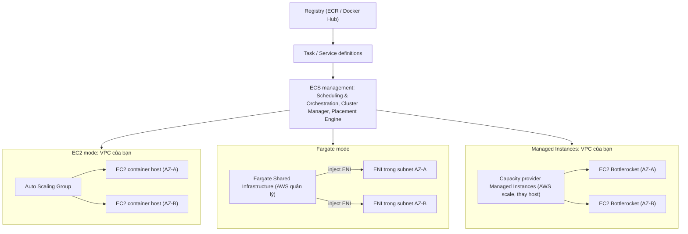

# ECS Launch Types EC2 vs Fargate

> **TL;DR:** Container trong [[ECS]] chạy trên một trong ba **capacity provider**: **EC2** (container host là EC2 instance trong account bạn, toàn quyền kiểm soát, bạn lo capacity/availability và trả tiền instance kể cả khi rảnh), **Fargate** (serverless, AWS lo host trên hạ tầng dùng chung, bạn chỉ trả theo CPU/RAM container dùng) và **ECS Managed Instances** ở giữa (vẫn là EC2 trong account, nhưng AWS lo AMI Bottlerocket, patch 14 ngày, scale; trả giá EC2 + phí quản lý). Chọn theo cân bằng **kiểm soát**, **giá** và **công vận hành**, và theo kiểu workload.

## 🖼️ Sơ đồ
![[ECS Launch Types EC2 vs Fargate.excalidraw]]
*Mở bằng plugin Excalidraw để chỉnh sửa · ảnh tĩnh: [[ECS Launch Types EC2 vs Fargate.svg]]*

![[ECS Launch Types EC2 vs Fargate - decision.excalidraw]]
*Mở bằng plugin Excalidraw để chỉnh sửa · ảnh tĩnh: [[ECS Launch Types EC2 vs Fargate - decision.svg]]*

## Khái niệm cốt lõi
- Compute chạy container của ECS gọi là **capacity provider**, có **3 lựa chọn chính: EC2, Fargate, Managed Instances** (bản khóa cũ gọi là "cluster mode" và chỉ có EC2 mode, Fargate mode). Lựa chọn quyết định **phần nào bạn quản lý, phần nào AWS quản lý**, ảnh hưởng chi phí và kịch bản phù hợp.
- Thành phần **chung cho mọi lựa chọn** (ECS management components, AWS quản lý): **Scheduling & Orchestration**, **Cluster Manager**, **Placement Engine** (quyết định container chạy trên host nào). Đều dùng **registry** ([[ECR]] / Docker Hub) và **task/service definition**.

### EC2 mode
- Cluster được tạo **trong một VPC** của account → hưởng **nhiều AZ** của VPC (ví dụ AZ-A, AZ-B).
- Container host là **EC2 instance (container instance)** chạy phần mềm ECS agent. Khi tạo cluster chỉ định kích thước ban đầu, số lượng instance do **[[Auto Scaling Groups|Auto Scaling Group]]** điều khiển (scale ngang, xem [[Horizontal vs Vertical Scaling]]).
- Các instance này **thấy được trong account, bị tính tiền, có thể kết nối vào**, thậm chí có **toàn quyền root**. Nhờ vậy chạy được **privileged container** hay công cụ giám sát mạng cần truy cập sâu vào kernel của host.
- Bạn chọn mọi thứ: **AMI** (ECS-optimized AMI cho Linux hoặc Windows, hoặc AMI custom), **instance type**, **key pair**…
- ECS provision chúng, nhưng bạn được kỳ vọng quản lý chúng (chủ yếu qua tooling của ECS).
- **Không phải serverless**: bạn phải lo **capacity và availability** của cluster. ECS lo số task nếu dùng service, còn sức chứa của cluster là việc của bạn.
- **Trả tiền instance khi đang running dù không chạy task/service nào.**
- Lợi thế: dùng được **[[Reserved Instances and Savings Plans|Reserved Instances]]** đã có, **Spot** ([[EC2 Purchase Options]]), linh hoạt chọn instance → "middle ground": bớt gánh nặng nhờ ECS nhưng vẫn giữ quyền kiểm soát host.

### Fargate mode
- **Không quản lý EC2 instance nào** làm container host → không trả tiền host nhàn rỗi.
- AWS duy trì **Fargate Shared Infrastructure** dùng chung cho mọi khách hàng, nhưng **cô lập giữa các khách hàng** như EC2 trên phần cứng dùng chung.
- Task/service definition vẫn khai báo image, port, **CPU/memory**; tài nguyên được cấp từ nền tảng Fargate dùng chung.
- Vẫn có cluster và VPC (nhiều AZ). Điểm khác then chốt về networking: task chạy trên hạ tầng dùng chung nhưng được **inject vào VPC của bạn**: mỗi task có một **ENI** với IP trong VPC (network mode `awsvpc`, xem [[EC2 Network Interfaces IPs and DNS]]).
- Từ đó task hoạt động như mọi tài nguyên VPC khác: truy cập được trong VPC, và từ Internet nếu VPC/subnet cấu hình vậy (subnet public tự cấp public IPv4 → task có public IP). ENI gắn [[Security Groups]].
- Deploy được vào VPC mới hoặc custom VPC ([[Custom VPC]]).
- **Chỉ trả tiền cho tài nguyên container sử dụng**, không thấy chi phí host, không lo provision/capacity/availability của host.

### ECS Managed Instances
- Lựa chọn **ở giữa** Fargate và EC2. Giống EC2: vẫn có cluster management, registry, task definition; container chạy trên **EC2 instance thật trong account bạn**, thấy trong EC2 console, **tính vào EC2 quota** và hiện trên bill như phí EC2.
- Khác EC2:
  - **Không chọn, không bảo trì AMI/OS**: AWS dùng AMI của họ là **Bottlerocket**, **chỉ Linux** (không Windows).
  - Host được **tự động patch theo chu kỳ 14 ngày** (rolling) → ảnh hưởng cách thiết kế, task không nên chạy quá 14 ngày.
  - **Không SSH** vào được host.
  - **Không phải tự quản capacity**: không có Auto Scaling Group để lo; AWS provision, scale và thay instance dựa trên task bạn deploy (qua capacity provider của Managed Instances).
- Vẫn có: instance **GPU, network-optimized, burstable**, **privileged Linux container**, mua bằng **Reserved Instances / Savings Plans**.
- Giá: **giá EC2 bình thường + một khoản phí quản lý nhỏ cho mỗi instance**.
- Kiểm soát ít hơn EC2 nhưng nhiều việc hơn Fargate (vẫn thấy instance, vẫn cân nhắc purchase option).

## Bảng so sánh / số liệu
| Tiêu chí | EC2 | Managed Instances | Fargate |
|---|---|---|---|
| Container host | EC2 instance trong account bạn | EC2 instance trong account bạn | Hạ tầng dùng chung do AWS quản lý |
| AMI / OS | Bạn chọn (ECS-optimized Linux/Windows, custom) | **Bottlerocket** do AWS quản lý, chỉ Linux | Không thấy |
| Patch host | Bạn | AWS, chu kỳ **14 ngày** | AWS |
| Truy cập host | Có (SSH/SSM, root) | **Không SSH** | Không |
| Quản lý capacity/scale host | **Bạn** (qua ASG) | AWS | AWS |
| Serverless | Không | Không | Có |
| Tính tiền | Theo instance đang chạy, **kể cả khi rảnh** | Giá EC2 + **phí quản lý mỗi instance** | Theo CPU/memory của task đang chạy |
| Reserved / Spot | RI, Spot, Savings Plans | RI, Savings Plans | Savings Plans (và Fargate Spot, ngoài bài giảng) |
| GPU / privileged container | Có | Có (privileged Linux) | Không |
| Networking task | Chạy trên instance trong VPC | Chạy trên instance trong VPC | Mỗi task có **ENI riêng** inject vào VPC |

### Khi nào chọn gì
- **Fargate**: workload **burst, batch, periodic** (chỉ trả khi task chạy); muốn **mô hình đơn giản nhất, không server**, gần như không overhead quản trị.
- **Managed Instances**: cần **GPU, instance chuyên dụng hay privileged Linux container** (Fargate không làm được); workload **lớn, ổn định** muốn sức mạnh của EC2 mà **không muốn lo AMI, patch, scale**.
- **EC2**: cần **custom AMI, SSH, Windows**, hoặc **task chạy dài hơn chu kỳ refresh 14 ngày**; workload lớn ổn định, **nhạy cảm về giá**, đủ năng lực vận hành fleet riêng, không muốn trả phí quản lý mỗi instance, tận dụng **Spot / Reserved Instances**.
- Giảng viên tóm lại: trước đây chỉ có Fargate và EC2; nay có thêm lựa chọn ở giữa. Không cần SSH hay AMI custom → Managed Instances; không cần cả quyền kiểm soát đó, chỉ muốn chạy container → Fargate.
- Bản khóa cũ nêu thêm (bài mới không nói): **EC2 thuần** (app chạy trong OS trên VM) khi không dùng container; chạy Docker trực tiếp trên EC2 chỉ hợp thử nghiệm, **không nên cho production**; doanh nghiệp đã dùng container thì chọn ECS thay vì EC2 thuần. ECS EC2 mode chỉ rẻ hơn **khi** bạn giảm được công quản trị (scaling, sizing, xử lý lỗi); giữ fleet EC2 chạy liên tục cho tải không đều là lãng phí. Container nói chung hợp khi chỉ cần **cô lập ứng dụng**, ứng dụng tải thấp, các app cùng OS, không cần overhead của virtualization.

> Ghi chú hiện tại (ngoài khóa học): ngoài ba lựa chọn trên còn **External** (ECS Anywhere, chạy trên server on-prem) và capacity provider **FARGATE_SPOT**. Đề SAA-C03 vẫn chủ yếu hỏi EC2 vs Fargate.

## 🎯 Mẹo thi SAA-C03
- "Run containers **without managing servers/EC2 instances/cluster capacity**", "least operational overhead" → **Fargate**.
- "Đã có **Reserved Instances**", "muốn dùng **Spot** để giảm giá", "cần **custom AMI, SSH, Windows**", task chạy > 14 ngày, workload **lớn và ổn định**, **price-conscious** → **EC2**.
- Cần **GPU / instance chuyên dụng / privileged container** hoặc workload lớn ổn định nhưng **không muốn quản lý AMI, patch, scale host** → **ECS Managed Instances** (Bottlerocket, patch 14 ngày, không SSH, phí quản lý mỗi instance).
- Workload **burst, không đều, batch, periodic** → **Fargate** (không trả tiền host nhàn rỗi).
- EC2 mode: **vẫn trả tiền instance khi không chạy task**, bạn chịu trách nhiệm scale cluster (qua ASG).
- Fargate task có **ENI riêng trong VPC** → kiểm soát bằng Security Group như tài nguyên VPC bình thường; muốn public IP thì đặt subnet public + bật auto-assign public IP.

## Liên kết
- Tiên quyết: [[ECS]], [[Containers Fundamentals]]
- Liên quan: [[Auto Scaling Groups]], [[EC2 Purchase Options]], [[Reserved Instances and Savings Plans]], [[Security Groups]], [[VPC Subnets]], [[EC2 Network Interfaces IPs and DNS]]
- Phân biệt với: [[EKS]] (cũng có node EC2 hoặc Fargate profile), [[Lambda]] / [[Serverless Architecture]]
