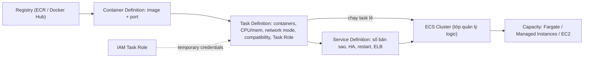

# ECS

> **TL;DR:** Amazon Elastic Container Service (ECS) là dịch vụ **managed container orchestration**: bạn đưa container image và chỉ dẫn, ECS quyết định chạy ở đâu và như thế nào trong một **cluster**. "ECS đối với container giống như EC2 đối với VM". Cluster chỉ là lớp quản lý; container chạy trên **capacity**: **Fargate, ECS Managed Instances hoặc EC2 tự quản**. Bốn khái niệm cần nắm: **container definition, task definition, task role, service**.

## 🖼️ Sơ đồ
![[ECS.excalidraw]]
*Mở bằng plugin Excalidraw để chỉnh sửa · ảnh tĩnh: [[ECS.svg]]*

## Khái niệm cốt lõi
- ECS nhận **container + instructions** và **orchestrate** nơi/cách chạy chúng; giảm gánh nặng tự quản container host như khi tự chạy Docker trên EC2 (xem [[Containers Fundamentals]]). Dễ coi ECS chỉ là một container engine, nhưng nó còn lo **scaling, health check, recovery (tự thay container lỗi), service discovery**.
- Image lấy từ một **container registry**: [[ECR]] (tích hợp IAM, scale tốt) hoặc registry khác như Docker Hub, public hoặc private.

### Cluster và capacity
- **Cluster** là thứ tạo đầu tiên: **đơn vị quản lý logic** của ECS, ranh giới để tổ chức workload container. Networking, monitoring, quản lý phần lớn nằm ở mức cluster.
- **Cluster không tự chạy container**, nó chỉ là management plane. Thứ thực sự chạy container là **capacity** (compute bên dưới). Có **3 lựa chọn**, đánh đổi khác nhau về quyền kiểm soát, chi phí và công vận hành (chi tiết: [[ECS Launch Types EC2 vs Fargate]]):
  - **Fargate**: serverless, AWS quản lý phần container host.
  - **ECS Managed Instances**: vẫn là EC2 trong account, nhưng AWS lo AMI, patch và scale host.
  - **EC2 tự quản**: container host là EC2 instance trong account của bạn (chạy ECS agent), bạn quản lý.
- (Bản khóa cũ chỉ có hai mode: EC2 mode và Fargate mode.)
- Quy trình: tạo cluster → mô tả giải pháp bằng các **definition** (container nào, CPU/memory, network, IAM, bao nhiêu bản sao) → chọn capacity → chạy **task** hoặc **service**.

### Container definition
- "Con trỏ" tới container: **image nằm ở đâu** (URL trên registry) và **port nào được expose** (port mapping, ví dụ 80/TCP).
- Đủ thông tin cho **một** container. Ở mức Associate chỉ cần nhớ: **image + ports**.

### Task definition
- Một **task** = một ứng dụng hoàn chỉnh (self-contained application), gồm **1 hoặc nhiều container** (ví dụ chỉ 1 web container, hoặc web + database).
- Task definition lưu:
  - Các **container definition** tạo nên ứng dụng.
  - **Resources**: CPU và memory cho task.
  - **Networking mode**.
  - **Compatibility**: task được phép chạy trên capacity nào (EC2, Fargate, Managed Instances).
  - **Task role**.
  - Volume (khai báo theo task, các container trong task dùng chung).
- Trong console, tạo task definition thì tạo kèm container definition, nên dễ nhầm; nhưng về kiến trúc chúng **tách biệt**. Nhiều task chỉ có 1 container càng làm rối thêm.

### Task role
- Là một [[IAM Roles|IAM role]] mà **task assume**; task nhận **temporary credentials** để gọi dịch vụ AWS.
- Mọi container trong task đều dùng được role này.
- Đây là **cách best practice để cấp quyền AWS cho container trong ECS** (Adrian: chắc chắn xuất hiện trong ít nhất một câu hỏi thi). Tương tự [[EC2 Instance Roles]] nhưng ở mức task.

### Service và service definition
- Một task đơn lẻ **không tự scale và không tự HA**.
- **Service** (cấu hình bằng service definition) định nghĩa:
  - Chạy **bao nhiêu bản sao** của task (ví dụ 5 task) → scaling + high availability.
  - **Thay thế task lỗi**, restart, một số tính năng monitoring.
  - Đặt **load balancer** ([[Elastic Load Balancer]]) phía trước để phân phối tải qua các task.
- Dùng service cho ứng dụng **long-running, business-critical, production** hoặc tải lớn. Ví dụ: service chạy 15 bản sao trải trên các subnet ở nhiều AZ, một load balancer phía trước; người dùng chỉ thấy một điểm vào. Có thể chạy một task đơn lẻ không cần service khi chỉ cần dựng nhanh.
- Thứ được deploy vào cluster là **task hoặc service**, áp dụng cho mọi loại capacity.

### Bảng tóm tắt khái niệm
| Thành phần | Định nghĩa gì |
|---|---|
| Container Definition | Image + port |
| Task Definition | Security (task role), container(s), resources (CPU/RAM), network mode, compatibility |
| Task Role | IAM role mà **task** assume |
| Service | Số bản sao, HA, restart, gắn load balancer |

## Demo / Lab — Deploy "Container of Crocs" lên Fargate
Dùng image `containerofcrocs` đã push lên [[ECR]] ở demo trước, region us-east-1.
1. **Tạo cluster** `all-the-crocs`. Console cho chọn capacity sẵn có cho cluster: **Fargate only**, **Fargate + Managed Instances**, hoặc **Fargate + self-managed instances** (khi cần kiểm soát AMI, instance type). Chọn Fargate only, tắt monitoring. Lần đầu dùng ECS trong account hay bị **lỗi khi tạo cluster** → tạo lại cùng tên là được. Cluster lúc này chỉ là lớp quản lý, chưa có gì chạy.
2. **Tạo task definition** `containerofcrocs` (tách riêng khỏi cluster như các khối Lego: định nghĩa giải pháp một chỗ, chạy ở cluster nào cũng được):
   - Launch type **AWS Fargate**; OS/architecture **Linux/ARM64**, vì image được build trên instance ARM64 (Graviton).
   - Task size **0.5 vCPU / 1 GB**; task role để mặc định (app không gọi dịch vụ AWS).
   - Chỉ giữ **một container**, đánh dấu **essential** (bắt buộc phải chạy trong task). Image URI chọn bằng **Browse ECR images** → repository `containerofcrocs`. Port mapping **80/TCP**, app protocol HTTP. Tắt logging.
   - Xem bản JSON: task definition chứa container, nguồn image, port.
3. **Chạy**: có thể *Run task* (chạy task lẻ), nhưng demo dùng **Create service**:
   - Chọn task definition và **revision** (sửa task definition sinh revision 1, 2, 3…; service có thể chuyển dần sang revision mới).
   - Compute options: phân biệt **capacity provider strategy** với **launch type**; demo chọn launch type **Fargate**.
   - Service có thêm nhiều thứ so với task lẻ: **AZ rebalancing**, số task mong muốn, **health check**, **load balancing**, **service auto scaling**.
   - Networking: chọn VPC và subnet (ví dụ chỉ public subnet, hoặc trải nhiều AZ), tạo security group mới `containerofcrocs-SG` mở **HTTP 80** từ mọi nơi, bật **public IP**.
4. Service deploy 1 task. Vào task (last status và desired status đều RUNNING) → **network bindings** có public IP → mở thấy trang Crocs. Thực tế thường đặt **load balancer** trước service thay vì truy cập thẳng task.
5. Dọn dẹp: **delete service** (có thể cần *force delete*) → **deregister** task definition revision (đổi bộ lọc sang *Inactive* thấy các revision đã deregister) → **delete cluster** (console xóa cả CloudFormation stack nó tạo) → kiểm tra security group đã bị xóa; nếu lần đầu tạo cluster bị lỗi thì xóa luôn stack lỗi còn sót trong CloudFormation. Image trong ECR giữ lại (nằm trong free tier).

(Bản khóa cũ: console "classic", cluster loại "Networking only (Fargate)", image `containerofcats` trên Docker Hub, task size 1 GB / 0.5 vCPU, chạy bằng *Run task* trong [[Default VPC]]; task được inject vào VPC qua một ENI có Security Group và public IP.)

## 🎯 Mẹo thi SAA-C03
- **Container trong ECS cần quyền gọi S3/DynamoDB/...** → **Task Role** (không nhúng access key, không dựa vào instance role của host).
- Phân biệt thêm (ngoài bài giảng, hay gặp trong đề): **Task execution role** là role cho **ECS agent/Fargate** để pull image từ [[ECR]] và gửi log tới [[CloudWatch Logs]]; **Task role** là quyền cho **code trong container**.
- Cần **nhiều bản sao, HA, tự thay task lỗi, gắn ALB** → **ECS Service** (không phải task đơn lẻ).
- Container definition = image + port; task definition = CPU/memory, network mode, compatibility, task role.
- **Cluster** chỉ là lớp quản lý logic; container chạy trên **capacity**: Fargate, ECS Managed Instances hoặc EC2 (xem [[ECS Launch Types EC2 vs Fargate]]).
- Đề muốn "chạy container mà không quản lý server" → ECS **Fargate**; "dùng Kubernetes/tránh vendor lock-in" → [[EKS]].

## Liên kết
- Tiên quyết: [[Containers Fundamentals]], [[IAM Roles]]
- Liên quan: [[ECS Launch Types EC2 vs Fargate]], [[ECR]], [[Elastic Load Balancer]], [[Auto Scaling Groups]], [[Security Groups]], [[EC2 Network Interfaces IPs and DNS]], [[CloudWatch Logs]]
- Phân biệt với: [[EKS]] (Kubernetes), [[EC2 Instance Roles]] (quyền ở mức instance thay vì task), [[Lambda]]
