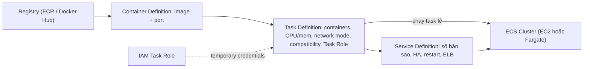

# ECS

> **TL;DR:** Amazon Elastic Container Service (ECS) là dịch vụ **managed container orchestration**: bạn đưa container image và chỉ dẫn, ECS quyết định chạy ở đâu và như thế nào trong một **cluster**. "ECS đối với container giống như EC2 đối với VM". Bốn khái niệm cần nắm: **container definition, task definition, task role, service**.

## 🖼️ Sơ đồ
![[ECS.excalidraw]]
*Mở bằng plugin Excalidraw để chỉnh sửa · ảnh tĩnh: [[ECS.svg]]*

## Khái niệm cốt lõi
- ECS nhận **container + instructions** và **orchestrate** nơi/cách chạy chúng; giảm gánh nặng tự quản container host như khi tự chạy Docker trên EC2 (xem [[Containers Fundamentals]]).
- Cluster chạy ở một trong hai mode, khác nhau rất nhiều bên dưới (chi tiết: [[ECS Launch Types EC2 vs Fargate]]):
  - **EC2 mode**: container host là EC2 instance trong account của bạn (chạy ECS agent).
  - **Fargate mode**: serverless, AWS quản lý phần container host.
- Image lấy từ một **container registry**: [[ECR]] (tích hợp IAM, scale tốt) hoặc registry khác như Docker Hub.

### Container definition
- "Con trỏ" tới container: **image nằm ở đâu** (URL trên registry) và **port nào được expose** (port mapping, ví dụ 80/TCP).
- Đủ thông tin cho **một** container. Ở mức Associate chỉ cần nhớ: **image + ports**.

### Task definition
- Một **task** = một ứng dụng hoàn chỉnh (self-contained application), gồm **1 hoặc nhiều container** (ví dụ chỉ 1 web container, hoặc web + database).
- Task definition lưu:
  - Các **container definition** tạo nên ứng dụng.
  - **Resources**: CPU và memory cho task.
  - **Networking mode**.
  - **Compatibility**: chạy được trên EC2 mode, Fargate hay cả hai.
  - **Task role**.
  - Volume (khai báo theo task, các container trong task dùng chung).
- Trong console, tạo task definition thì tạo kèm container definition, nên dễ nhầm; nhưng về kiến trúc chúng **tách biệt**. Nhiều task chỉ có 1 container càng làm rối thêm.

### Task role
- Là một [[IAM Roles|IAM role]] mà **task assume**; task nhận **temporary credentials** để gọi dịch vụ AWS.
- Mọi container trong task đều dùng được role này.
- Đây là **cách best practice để cấp quyền AWS cho container trong ECS** (Adrian: chắc chắn xuất hiện trong ít nhất một câu hỏi thi). Tương tự [[EC2 Instance Roles]] nhưng ở mức task.

### Service và service definition
- Một task đơn lẻ **không tự scale và không tự HA**.
- **Service** (cấu hình bằng service definition) định nghĩa:
  - Chạy **bao nhiêu bản sao** của task (ví dụ 5 task) → scaling + high availability.
  - **Thay thế task lỗi**, restart, một số tính năng monitoring.
  - Đặt **load balancer** ([[Elastic Load Balancer]]) phía trước để phân phối tải qua các task.
- Dùng service cho ứng dụng **long-running, business-critical, production** hoặc tải lớn. Có thể chạy một task đơn lẻ không cần service (như demo).
- Thứ được deploy vào cluster là **task hoặc service**, áp dụng cho cả EC2 lẫn Fargate.

### Bảng tóm tắt khái niệm
| Thành phần | Định nghĩa gì |
|---|---|
| Container Definition | Image + port |
| Task Definition | Security (task role), container(s), resources (CPU/RAM), network mode, compatibility |
| Task Role | IAM role mà **task** assume |
| Service | Số bản sao, HA, restart, gắn load balancer |

## Demo / Lab — Deploy "container of cats" lên Fargate
Dùng [[Default VPC]] (subnet public tự cấp public IPv4), region us-east-1, image đã push lên Docker Hub ở bài [[Containers Fundamentals]].
1. **Tạo cluster** loại "Networking only (Fargate)" (console cũ có 3 lựa chọn: Fargate, EC2 Linux, EC2 Windows). Không tạo VPC mới. Lần đầu trong account có thể lỗi liên quan **service-linked role** → làm lại là được (xem [[Service-linked Roles and PassRole]]).
2. **Tạo task definition** compatibility **Fargate**: tên `containerofcats`, task role để trống (app không gọi AWS), OS family **Linux**, task size **1 GB memory / 0.5 vCPU**.
3. **Thêm container definition** `containerofcatsweb`: image `docker.io/<user>/containerofcats`, soft memory limit 1024 MiB, **port mapping 80/TCP**. Xem JSON: task definition chứa danh sách `containerDefinitions` với port mapping và image URL.
4. **Run task** (không dùng service): launch type **Fargate** (các lựa chọn khác: EC2, External), số task = 1, chọn VPC 172.31.0.0/16 và ít nhất 2 subnet (tránh thiếu capacity).
5. Task được **inject vào VPC qua một ENI** → ENI có [[Security Groups|Security Group]] (mặc định cho phép port 80 từ mọi nơi) và **Auto-assign public IP = ENABLED**.
6. Trạng thái: PROVISIONING → PENDING → **RUNNING**. Task có private IP và public IP trong default VPC; mở public IP thấy trang web.
7. Dọn dẹp: stop task → **deregister** task definition → delete cluster.

> Ghi chú hiện tại: console "classic" và kiểu cluster "Networking only" trong demo đã bị thay. Console ECS mới tạo cluster rồi chọn hạ tầng (Fargate, EC2 qua Auto Scaling Group, hoặc External/ECS Anywhere); khái niệm task/service không đổi.

## 🎯 Mẹo thi SAA-C03
- **Container trong ECS cần quyền gọi S3/DynamoDB/...** → **Task Role** (không nhúng access key, không dựa vào instance role của host).
- Phân biệt thêm (ngoài bài giảng, hay gặp trong đề): **Task execution role** là role cho **ECS agent/Fargate** để pull image từ [[ECR]] và gửi log tới [[CloudWatch Logs]]; **Task role** là quyền cho **code trong container**.
- Cần **nhiều bản sao, HA, tự thay task lỗi, gắn ALB** → **ECS Service** (không phải task đơn lẻ).
- Container definition = image + port; task definition = CPU/memory, network mode, compatibility, task role.
- Đề muốn "chạy container mà không quản lý server" → ECS **Fargate**; "dùng Kubernetes/tránh vendor lock-in" → [[EKS]].

## Liên kết
- Tiên quyết: [[Containers Fundamentals]], [[IAM Roles]]
- Liên quan: [[ECS Launch Types EC2 vs Fargate]], [[ECR]], [[Elastic Load Balancer]], [[Auto Scaling Groups]], [[Security Groups]], [[EC2 Network Interfaces IPs and DNS]], [[CloudWatch Logs]]
- Phân biệt với: [[EKS]] (Kubernetes), [[EC2 Instance Roles]] (quyền ở mức instance thay vì task), [[Lambda]]
