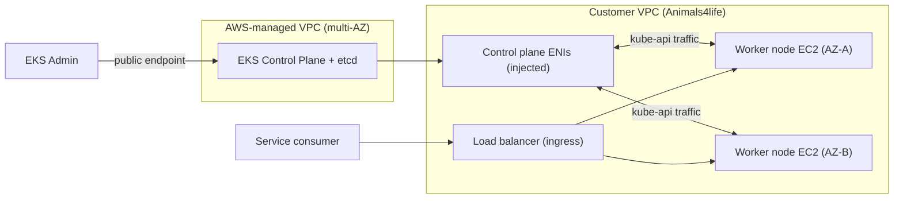

# EKS

> **TL;DR:** Amazon Elastic Kubernetes Service là **Kubernetes do AWS quản lý**: cùng Kubernetes chuẩn như ở mọi nơi khác, nhưng tích hợp sâu với AWS. Control plane (kể cả etcd) do AWS vận hành **multi-AZ** trong VPC của AWS; worker có thể là **self-managed nodes, managed node groups hoặc Fargate**. Chọn EKS khi cần Kubernetes, muốn **cloud agnostic/tránh vendor lock-in** hoặc đã dùng Kubernetes sẵn.

## 🖼️ Sơ đồ
![[EKS.excalidraw]]
*Mở bằng plugin Excalidraw để chỉnh sửa · ảnh tĩnh: [[EKS.svg]]*

![[EKS - nodes.excalidraw]]
*Mở bằng plugin Excalidraw để chỉnh sửa · ảnh tĩnh: [[EKS - nodes.svg]]*

## Khái niệm cốt lõi
- Cần nền tảng [[Kubernetes]] trước. EKS = Kubernetes "as a service" trên AWS.
- **Lý do chọn EKS**: Kubernetes là **cloud agnostic** → cần container mà không muốn bị khóa vào một vendor, hoặc tổ chức đã chạy Kubernetes.

### Các cách chạy EKS
| Cách | Mô tả |
|---|---|
| **EKS trên AWS** | Mặc định, là bối cảnh của bài/đề thi |
| **EKS on AWS Outposts** | Như chạy một "AWS thu nhỏ" on-premises |
| **EKS Anywhere** | Tạo EKS cluster on-prem hoặc bất kỳ đâu |
| **EKS Distro** | Bản phân phối Kubernetes của EKS, phát hành open source |

### Control plane và tích hợp AWS
- **Control plane do AWS quản lý**, **scale theo tải**, chạy **trên nhiều AZ**.
- **etcd** cũng do AWS quản lý, phân tán qua nhiều AZ.
- Tích hợp dịch vụ AWS:
  - **[[ECR]]** cho container image.
  - **[[Elastic Load Balancer|ELB]]** ở bất cứ chỗ nào Kubernetes cần load balancer.
  - **IAM** cho bảo mật.
  - **VPC** cho networking.
- "EKS cluster" = EKS control plane + EKS nodes.

### Ba kiểu node
| Kiểu | Ai quản lý | Ghi chú |
|---|---|---|
| **Self-managed nodes** | **Bạn** | EC2 instance chạy theo group, tính tiền giá EC2 thường |
| **Managed node groups** | EKS lo **provisioning + lifecycle** | Vẫn là EC2 |
| **Fargate** | AWS | Không provision/config/scale instance, không chọn instance type, không lo cluster packing; định nghĩa **Fargate profile** để pod chạy trên Fargate. Giống ECS Fargate ([[ECS Launch Types EC2 vs Fargate]]) |

- **Cảnh báo quan trọng**: chọn kiểu node phải dựa trên yêu cầu. Nếu cần **Windows pods, GPU, Inferentia, Bottlerocket, Outposts, [[AWS Local Zones|Local Zones]]** → kiểm tra kiểu node có hỗ trợ không (Adrian đã thấy dự án bị ảnh hưởng vì điểm này; ví dụ Fargate không hỗ trợ GPU).

### Storage
- Storage mặc định của Kubernetes là ephemeral; để có **persistent storage**, EKS dùng storage provider: **[[EBS]]**, **[[EFS]]**, **FSx** ([[FSx for Windows]], [[FSx for Lustre]]).

## Cách hoạt động / Kiến trúc
- Hai VPC:
  1. **AWS-managed VPC**: chạy **EKS control plane** trên nhiều AZ.
  2. **Customer VPC** (ví dụ Animals4life VPC): chứa **worker nodes EC2** (nếu dùng EC2).
- Control plane giao tiếp với worker nodes qua **ENI được inject vào customer VPC**. kubelet trên worker kết nối control plane qua các ENI này, hoặc qua **public control plane endpoint**.
- **Quản trị** (kubectl, admin) có thể đi qua **public endpoint**.
- **Người dùng dịch vụ** truy cập ứng dụng qua **ingress** bắt đầu từ customer VPC (thường là load balancer).

> Ghi chú hiện tại (ngoài khóa học): từ cuối 2024 có **EKS Auto Mode**, AWS quản lý luôn cả compute, networking, storage của node. Đề SAA-C03 chủ yếu vẫn hỏi ở mức "Kubernetes managed → EKS".

## 🎯 Mẹo thi SAA-C03
- Đề nhắc **Kubernetes**, "đã dùng Kubernetes on-prem muốn chuyển lên AWS", "open source orchestration", "multi-cloud/tránh lock-in" → **EKS**. Không nhắc Kubernetes, chỉ cần chạy container đơn giản trên AWS → [[ECS]].
- **Ít overhead nhất** cho node → **Fargate profile**; cần tự động hóa provisioning EC2 nhưng vẫn dùng EC2 → **managed node groups**; toàn quyền kiểm soát → **self-managed nodes**.
- Chạy Kubernetes kiểu EKS **on-prem** → **EKS Anywhere** (hoặc EKS on **Outposts**).
- Persistent storage cho pod → **EBS / EFS / FSx**. Nhiều pod trên nhiều AZ cần chia sẻ chung file → EFS.
- Control plane **managed + multi-AZ** trong VPC của AWS; nodes ở VPC của bạn, nói chuyện qua **ENI injected**.

## Liên kết
- Tiên quyết: [[Kubernetes]], [[Containers Fundamentals]]
- Liên quan: [[ECR]], [[Elastic Load Balancer]], [[IAM Roles]], [[EBS]], [[EFS]], [[FSx for Windows]], [[FSx for Lustre]], [[AWS Local Zones]]
- Phân biệt với: [[ECS]], [[ECS Launch Types EC2 vs Fargate]]
