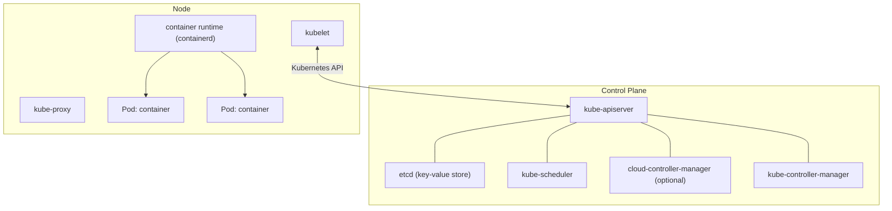

# Kubernetes

> **TL;DR:** Kubernetes (K8s) là hệ thống **container orchestration mã nguồn mở, cloud-agnostic**, tự động hóa deploy, scale và quản lý ứng dụng container; chạy được on-premises và trên nhiều public cloud. Cluster gồm **control plane** (quản lý) và **nodes** (chạy pod). Trên AWS, bản managed là [[EKS]].

## 🖼️ Sơ đồ
![[Kubernetes.excalidraw]]
*Mở bằng plugin Excalidraw để chỉnh sửa · ảnh tĩnh: [[Kubernetes.svg]]*

## Khái niệm cốt lõi
- Chạy container **tin cậy, scale được, dùng tài nguyên hiệu quả**, và **expose** ứng dụng ra ngoài. Adrian ví von: như Docker nhưng có "robot" tự động hóa và "siêu trí tuệ" lo phần suy nghĩ.
- **Cloud agnostic**: dùng on-prem hoặc trên AWS, Azure, GCP... → tránh vendor lock-in.

### Kiến trúc cluster
- **Cluster**: tập tài nguyên compute **highly available**, tổ chức để hoạt động như **một đơn vị**.
- **Control plane**: quản lý cluster: scheduling, application management, scaling, deployment...
- **Node**: server ảo hoặc vật lý đóng vai **worker**, chạy ứng dụng container. Thực tế cluster có nhiều node (1 node chỉ dành cho test).
- Phần mềm tối thiểu trên mỗi node:
  - **Container runtime** (ví dụ **containerd**): xử lý thao tác container.
  - **kubelet**: agent giao tiếp với control plane qua **Kubernetes API**.
  - **kube-proxy**: chạy trên mọi node, điều phối networking với control plane; hiện thực **service** và cấu hình rule cho phép giao tiếp tới pod từ trong/ngoài cluster.

### Thành phần control plane
| Thành phần | Vai trò |
|---|---|
| **kube-apiserver** | Front-end của control plane, mọi thứ giao tiếp qua nó; **scale ngang** được cho hiệu năng và HA |
| **etcd** | **Key-value store highly available**, backing store chính cho dữ liệu cluster |
| **kube-scheduler** | Tìm pod chưa có node, gán node dựa trên resource requirement, deadline, **affinity/anti-affinity**, data locality, ràng buộc khác |
| **cloud-controller-manager** (tùy chọn) | Tích hợp Kubernetes với cloud provider (AWS, Azure, GCP); cluster tự dựng ở nhà thường không có |
| **kube-controller-manager** | Tập hợp controller: **node controller** (theo dõi/xử lý node outage), **job controller** (chạy pod để thực thi job), **endpoint controller** (liên kết service với pod), **service account & token controller** (tạo account, API token) |

### Pod
- **Đơn vị compute nhỏ nhất** trong Kubernetes; một pod chứa **1+ container**, chia sẻ storage và networking.
- Phổ biến nhất: **one-container-one-pod** (gọn hơn). Nhiều container/pod chỉ khi chúng **gắn chặt (tightly coupled)**, cần ở gần nhau.
- Hãy nghĩ theo **pod**, không theo container: bạn làm việc và quản lý pod, pod lo container bên trong. Nhưng hiếm khi quản lý pod trực tiếp.
- Pod là **tạm thời (non-permanent)**: tạo ra, làm việc, rồi bị hủy; có thể bị xóa khi xong, bị **evict** khi thiếu tài nguyên, hoặc mất khi node hỏng. Không coi pod là thực thể HA.

### Các thuật ngữ chính
- **Service**: lớp trừu tượng phía trên pod; là thứ bạn hiểu là "ứng dụng". App có thể chạy trên nhiều pod, service là điểm **nhất quán** để truy cập.
- **Job**: công việc **ad-hoc**, tạo 1+ pod, chạy tới khi **hoàn thành**, retry nếu cần (backend, xử lý tách biệt).
- **Ingress**: cách để thứ **bên ngoài cluster** truy cập service: User → **Ingress** → routing → **Service** → 1+ **Pod**.
- **Ingress controller**: phần mềm thực sự sắp đặt hạ tầng để có ingress. Ví dụ **AWS Load Balancer Controller** dùng **ALB/NLB** ([[Compare - ALB vs NLB]]); ngoài ra có NGINX và controller của các cloud khác.
- **Storage**: mặc định **ephemeral**, do node cấp cục bộ → pod chuyển node là **mất dữ liệu** (giống [[Instance Store]] trên EC2). Nên thiết kế pod **stateless**; state (session data, dữ liệu) phải lưu ngoài.
- **Persistent Volume (PV)**: volume có **vòng đời vượt quá bất kỳ pod nào** dùng nó → storage lâu dài cho ứng dụng container.

## Bảng so sánh / số liệu
| Kubernetes | Gần tương đương trong [[ECS]] |
|---|---|
| Cluster (control plane + nodes) | ECS cluster (management components + container hosts) |
| Pod (1+ container) | Task (1+ container) |
| Service | Service |
| Node | Container instance (EC2 mode) / Fargate |
| Ingress + controller | Load balancer gắn vào service |

(Bảng chỉ để liên hệ, không phải tương đương 1:1.)

## 🎯 Mẹo thi SAA-C03
- Kubernetes = **open source, cloud agnostic** → đề nói "đã chạy Kubernetes on-prem", "tránh lock-in", "portable giữa các cloud" → [[EKS]] (không phải ECS).
- **Pod** là đơn vị nhỏ nhất; pod **ephemeral**, storage mặc định **ephemeral** → cần **Persistent Volume** (trên AWS: EBS/EFS/FSx).
- **etcd** = key-value store của cluster; **kube-scheduler** gán pod vào node; **kubelet** = agent trên node.
- Expose app ra ngoài → **Ingress** qua ingress controller (trên AWS: ALB/NLB).

## Liên kết
- Tiên quyết: [[Containers Fundamentals]]
- Tiếp theo: [[EKS]]
- Phân biệt với: [[ECS]], [[ECS Launch Types EC2 vs Fargate]]
- Liên quan: [[Instance Store]], [[Elastic Load Balancer]], [[Compare - ALB vs NLB]], [[EBS]], [[EFS]]
