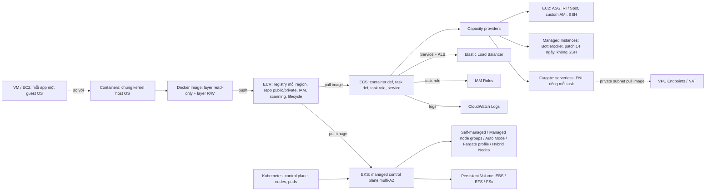

# 08 Containers

Section ngắn giới thiệu container và các dịch vụ chạy container trên AWS. Nội dung gồm: container khác VM thế nào, Docker image và registry, ECR, ECS với ba lựa chọn capacity (EC2, Fargate, Managed Instances), Kubernetes và EKS. Câu hỏi thi thường xoay quanh việc chọn **ECS hay EKS**, **EC2, Fargate hay Managed Instances**, và chọn đúng role (task role). Section nối tiếp phần ảo hóa ở [[_MOC 07 EC2]] và chuẩn bị cho tư duy serverless ở [[_MOC 14 Serverless and Application Services]].

← [[00 Home]] · Trước: [[_MOC 07 EC2]] · Sau: [[_MOC 09 Advanced EC2]]

## Lộ trình học
1. [[Containers Fundamentals]]: container chạy như process trên host OS dùng chung kernel; image ghép từ các layer read-only; nhẹ, khởi động nhanh, portable.
2. [[ECS]]: dịch vụ managed container orchestration; cluster là lớp quản lý logic, container chạy trên capacity; các khái niệm container definition, task definition, task role và service.
3. [[ECS Launch Types EC2 vs Fargate]]: ba capacity provider: EC2 (tự lo host, trả tiền instance), Fargate (serverless, trả theo CPU/RAM của task) và Managed Instances ở giữa (EC2 Bottlerocket do AWS patch, scale; thêm phí quản lý).
4. [[ECR]]: managed image registry, sẵn một registry mỗi region, repository public/private; tích hợp IAM, scanning basic (miễn phí) / enhanced (Inspector), lifecycle policy, replication cross-region/cross-account.
5. [[Kubernetes]]: orchestration mã nguồn mở, cloud-agnostic; control plane, node, pod, etcd, kubelet, Ingress.
6. [[EKS]]: Kubernetes do AWS quản lý với control plane multi-AZ; node là self-managed, managed node groups, EKS Auto Mode, Fargate hoặc Hybrid Nodes.

## Bản đồ khái niệm

## Liên kết sang section khác
- So sánh với VM: [[EC2 Basics]], [[Virtualization]]
- Quyền cho container: [[IAM Roles]]
- Log của task: [[CloudWatch Logs]]
- Đưa service ra ngoài và scale: [[Elastic Load Balancer]], [[Auto Scaling Groups]]
- Storage bền vững dùng chung: [[EFS]]
- Pull image từ private subnet: [[Interface VPC Endpoints]], [[Gateway VPC Endpoints]]
- Quét lỗ hổng image: [[Inspector]]

## 🎯 Top mẹo thi của section
- Từ khóa "lightweight", "portable", "consistent across environments", "khởi động nhanh", "không cần full OS" → **container**. Cần OS hoặc kernel riêng → VM/EC2. ([[Containers Fundamentals]])
- Dữ liệu trong layer R/W **mất khi xóa container** → dữ liệu cần bền vững phải đặt ở storage ngoài như EFS. ([[Containers Fundamentals]])
- Code trong container cần gọi S3/DynamoDB → **Task Role**, không nhúng access key. **Task execution role** là role để agent pull image từ ECR và ghi log. ([[ECS]])
- Cần nhiều bản sao, HA, tự thay task lỗi, gắn ALB → **ECS Service**, không chạy task đơn lẻ. ([[ECS]])
- "Chạy container mà không quản lý server/capacity", "least operational overhead", workload burst/batch → **Fargate**. ([[ECS Launch Types EC2 vs Fargate]])
- Đã có Reserved Instances, muốn dùng Spot, cần custom AMI, SSH, Windows, workload lớn ổn định và nhạy giá → **EC2**. Lưu ý EC2 vẫn tính tiền instance khi rảnh. ([[ECS Launch Types EC2 vs Fargate]])
- Cần GPU / privileged container hoặc workload lớn ổn định mà không muốn lo AMI, patch, scale host → **ECS Managed Instances** (Bottlerocket, patch 14 ngày, không SSH, giá EC2 + phí quản lý). ([[ECS Launch Types EC2 vs Fargate]])
- Fargate task có **ENI riêng trong VPC** → kiểm soát bằng Security Group như mọi tài nguyên VPC khác. ([[ECS Launch Types EC2 vs Fargate]])
- Cần registry private tích hợp IAM → **ECR**. Quét lỗ hổng OS và thư viện ngôn ngữ, liên tục → **enhanced scanning (Inspector)**; basic miễn phí chỉ quét OS. Tự xóa image cũ → **lifecycle policy**. Cần image ở region hoặc account khác → **ECR replication**. ([[ECR]])
- Task trong private subnet không pull được image → cần NAT hoặc **Interface Endpoint cho ECR + S3 Gateway Endpoint** (layer image nằm trên S3). ([[ECR]])
- Đề nhắc **Kubernetes**, "đã chạy K8s on-prem", "open source", "tránh vendor lock-in" → **EKS**. Không nhắc Kubernetes, chỉ cần chạy container đơn giản → **ECS**. ([[EKS]], [[Kubernetes]])
- EKS ít overhead nhất cho node → **Fargate profile**. Node EC2 mà AWS lo cả chọn type, scale, patch → **EKS Auto Mode**. Muốn dùng EC2 mà AWS lo provisioning → **managed node groups**. Chạy EKS on-prem → **EKS Anywhere** hoặc Outposts; node on-prem, control plane ở AWS → **EKS Hybrid Nodes**. ([[EKS]])
- Pod và storage mặc định đều **ephemeral** → dùng Persistent Volume (EBS/EFS/FSx). Nhiều pod trên nhiều AZ dùng chung file → **EFS**. ([[Kubernetes]], [[EKS]])
