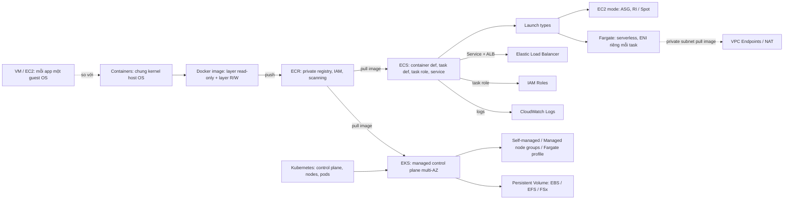

# 08 Containers

Section ngắn giới thiệu container và các dịch vụ chạy container trên AWS. Nội dung gồm: container khác VM thế nào, Docker image và registry, ECS với hai launch type EC2 và Fargate, ECR, Kubernetes và EKS. Câu hỏi thi thường xoay quanh việc chọn **ECS hay EKS**, **EC2 mode hay Fargate**, và chọn đúng role (task role). Section nối tiếp phần ảo hóa ở [[_MOC 07 EC2]] và chuẩn bị cho tư duy serverless ở [[_MOC 14 Serverless and Application Services]].

← [[00 Home]] · Trước: [[_MOC 07 EC2]] · Sau: [[_MOC 09 Advanced EC2]]

## Lộ trình học
1. [[Containers Fundamentals]]: container chạy như process trên host OS dùng chung kernel; image ghép từ các layer read-only; nhẹ, khởi động nhanh, portable.
2. [[ECS]]: dịch vụ managed container orchestration; các khái niệm container definition, task definition, task role và service.
3. [[ECS Launch Types EC2 vs Fargate]]: EC2 mode (tự lo host, trả tiền instance) so với Fargate (serverless, trả theo CPU/RAM của task).
4. [[ECR]]: managed image registry tích hợp IAM, có image scanning, replication cross-region/cross-account, log CloudTrail, event EventBridge.
5. [[Kubernetes]]: orchestration mã nguồn mở, cloud-agnostic; control plane, node, pod, etcd, kubelet, Ingress.
6. [[EKS]]: Kubernetes do AWS quản lý với control plane multi-AZ; node là self-managed, managed node groups hoặc Fargate.

## Bản đồ khái niệm

## Liên kết sang section khác
- So sánh với VM: [[EC2 Basics]], [[Virtualization]]
- Quyền cho container: [[IAM Roles]]
- Log của task: [[CloudWatch Logs]]
- Đưa service ra ngoài và scale: [[Elastic Load Balancer]], [[Auto Scaling Groups]]
- Storage bền vững dùng chung: [[EFS]]
- Pull image từ private subnet: [[Interface VPC Endpoints]], [[Gateway VPC Endpoints]]
- Quét lỗ hổng image: [[Inspector]]

## 🎯 Top mẹo thi của section
- Từ khóa "lightweight", "portable", "consistent across environments", "khởi động nhanh", "không cần full OS" → **container**. Cần OS hoặc kernel riêng → VM/EC2. ([[Containers Fundamentals]])
- Dữ liệu trong layer R/W **mất khi xóa container** → dữ liệu cần bền vững phải đặt ở storage ngoài như EFS. ([[Containers Fundamentals]])
- Code trong container cần gọi S3/DynamoDB → **Task Role**, không nhúng access key. **Task execution role** là role để agent pull image từ ECR và ghi log. ([[ECS]])
- Cần nhiều bản sao, HA, tự thay task lỗi, gắn ALB → **ECS Service**, không chạy task đơn lẻ. ([[ECS]])
- "Chạy container mà không quản lý server/capacity", "least operational overhead", workload burst/batch → **Fargate**. ([[ECS Launch Types EC2 vs Fargate]])
- Đã có Reserved Instances, muốn dùng Spot, cần GPU hoặc tùy chỉnh host, workload lớn và ổn định → **EC2 mode**. Lưu ý EC2 mode vẫn tính tiền instance khi rảnh. ([[ECS Launch Types EC2 vs Fargate]])
- Fargate task có **ENI riêng trong VPC** → kiểm soát bằng Security Group như mọi tài nguyên VPC khác. ([[ECS Launch Types EC2 vs Fargate]])
- Cần registry private tích hợp IAM → **ECR**. Quét lỗ hổng OS và package → **enhanced scanning (Inspector)**. Cần image ở region hoặc account khác → **ECR replication**. ([[ECR]])
- Task trong private subnet không pull được image → cần NAT hoặc **Interface Endpoint cho ECR + S3 Gateway Endpoint** (layer image nằm trên S3). ([[ECR]])
- Đề nhắc **Kubernetes**, "đã chạy K8s on-prem", "open source", "tránh vendor lock-in" → **EKS**. Không nhắc Kubernetes, chỉ cần chạy container đơn giản → **ECS**. ([[EKS]], [[Kubernetes]])
- EKS ít overhead nhất cho node → **Fargate profile**. Muốn dùng EC2 mà AWS lo provisioning → **managed node groups**. Chạy EKS on-prem → **EKS Anywhere** hoặc Outposts. ([[EKS]])
- Pod và storage mặc định đều **ephemeral** → dùng Persistent Volume (EBS/EFS/FSx). Nhiều pod trên nhiều AZ dùng chung file → **EFS**. ([[Kubernetes]], [[EKS]])
