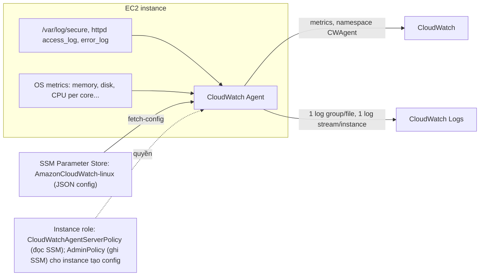

# CloudWatch Agent

> **TL;DR:** Mặc định CloudWatch chỉ thấy các metric "bên ngoài" của EC2; bên trong OS là hộp đen. **CloudWatch Agent** là phần mềm chạy trong instance, thu thập **metric cấp OS** (memory, disk, process...) và **log file của hệ thống và ứng dụng**, rồi đẩy lên [[CloudWatch Basics|CloudWatch]] và [[CloudWatch Logs]]. Agent cần ba thứ: được cài đặt, có cấu hình, và có quyền (qua instance role).

## 🖼️ Sơ đồ
![[CloudWatch Agent.excalidraw]]
*Mở bằng plugin Excalidraw để chỉnh sửa · ảnh tĩnh: [[CloudWatch Agent.svg]]*

## Khái niệm cốt lõi
- [[CloudWatch Basics|CloudWatch]] lưu và quản lý metric; [[CloudWatch Logs]] lưu, quản lý và hiển thị log. **Không dịch vụ nào tự nhìn được vào trong instance.** Metric mặc định của EC2 (CPU, network, disk I/O của instance store, status check) đều lấy từ phía hypervisor.
- Muốn có **memory utilization, disk space, process, log ứng dụng (Apache access/error log), log hệ thống (`/var/log/secure`)** thì phải cài **CloudWatch Agent**. (Ứng dụng cũng có thể tự gửi custom log thẳng lên CloudWatch Logs nếu được viết như vậy; agent dùng khi không sửa được app hoặc cần lấy log file khác của OS.)
- Agent cần:
  1. **Cài đặt** trong OS.
  2. **Cấu hình**: thu metric nào, log file nào, gửi vào đâu.
  3. **Quyền** gửi dữ liệu lên CloudWatch/CloudWatch Logs. Best practice là **[[EC2 Instance Roles|IAM role]]** gắn vào instance, không dùng access key (vừa kém an toàn vừa khó quản lý ở quy mô lớn).
- Hai managed policy AWS soạn sẵn:
  - **`CloudWatchAgentServerPolicy`**: ghi metric/log lên CloudWatch và CloudWatch Logs, **đọc** cấu hình agent từ Parameter Store → gắn cho **mọi instance** chạy agent.
  - **`CloudWatchAgentAdminPolicy`**: như trên nhưng thêm quyền **ghi** vào Parameter Store → chỉ dùng cho **instance đầu tiên**, nơi chạy wizard tạo và lưu file cấu hình.
- **Mô hình log**: mỗi **log file** cần thu tương ứng **một log group**; trong mỗi log group có **một log stream cho mỗi instance** gửi log (mặc định đặt tên theo **instance ID**).
- Cấu hình agent có thể lưu trong **[[SSM Parameter Store]]**. Tạo một lần rồi mọi instance kéo cùng cấu hình về, rất hợp khi triển khai ở quy mô lớn (ví dụ với [[Auto Scaling Groups]]).
- Một instance thì cài tay được. Ở quy mô lớn thì tự động hóa: [[CloudFormation Basics|CloudFormation]] đưa cấu hình agent vào mọi instance nó tạo, hoặc **Systems Manager**: lưu cấu hình ở Parameter Store và dùng **Run Command** để cài, cấu hình agent cho cả fleet managed instance. (Bản khóa cũ nêu thêm: [[EC2 User Data Bootstrapping|bootstrapping]], bake vào [[AMI]].)

## Cách hoạt động / Kiến trúc

## Demo / Lab
Stack 1-click `CWLogs` dựng web store Aus-E-Mart trên instance `aem-aza-instance1` trong VPC Aus-E-Mart. Mục tiêu: đưa access log của app lên CloudWatch Logs và lấy thêm metric OS, lưu cấu hình agent ở Parameter Store.
1. **Tạo role** trước: IAM → Roles → trusted entity EC2. Tìm "CloudWatchAgent" thấy hai managed policy: **`CloudWatchAgentServerPolicy`** (ghi CloudWatch Logs + đọc Parameter Store, dùng cho mọi instance) và **`CloudWatchAgentAdminPolicy`** (thêm quyền **ghi** Parameter Store, dùng cho instance tạo config). Demo chọn **AdminPolicy**, tên `Demo-CloudWatchRole`, gắn vào instance bằng *Modify IAM role*.
2. Kết nối bằng [[EC2 Instance Connect and SSH|EC2 Instance Connect]]. Web store gần như không ghi log ra file, nên chạy các lệnh cho sẵn để app ghi **access log** vào `/var/log/aem-webstore/access.log`; duyệt vài trang (cart, store, product list) rồi xem file thấy log truy cập.
3. **Cài agent** bằng package manager (trả lời `y`); cài xong agent chưa chạy.
4. Chạy **configuration wizard** `/opt/aws/amazon-cloudwatch-agent/bin/amazon-cloudwatch-agent-config-wizard`:
   - Linux, EC2, chạy agent bằng user **root**; **không** cài StatsD (chỉ cần khi app tự phát custom metric), **không** dùng collectd.
   - Thu host metrics, CPU per core, thêm EC2 dimensions, aggregate, resolution **60 s**; mức metric **Advanced** để lấy nhiều metric OS hơn.
   - Không có cấu hình CloudWatch Logs agent cũ để import. Khai báo log file `/var/log/aem-webstore/access.log`; **log group name đặt bằng đường dẫn đầy đủ**; **log group class** STANDARD (hoặc INFREQUENT_ACCESS); log stream mặc định `{instance_id}`; retention mặc định. Không thu thêm file nào, không bật **X-Ray traces** (dùng cho hệ phân tán kiểu microservice).
   - Wizard đề nghị **lưu config vào SSM Parameter Store**, tên mặc định **`AmazonCloudWatch-linux`**, cùng region, dùng credential từ instance role. Vào Parameter Store thấy parameter chứa JSON cấu hình.
5. Phần 2: khởi động agent và kéo config từ SSM: `sudo /opt/aws/amazon-cloudwatch-agent/bin/amazon-cloudwatch-agent-ctl -a fetch-config -m ec2 -c ssm:AmazonCloudWatch-linux -s`. Muốn đổi cấu hình thì sửa ở SSM rồi chạy lại lệnh refresh.
6. Kết quả:
   - CloudWatch → **Log Management**: log group `/var/log/aem-webstore/access.log`, trong đó **một log stream cho mỗi instance** dùng cấu hình này.
   - CloudWatch → Metrics → Classic metrics, namespace **`CWAgent`**: memory utilization, swap, dung lượng từng file system path… (metric bình thường không có).
7. Dọn dẹp: xóa role (thực tế nên detach khỏi instance trước khi xóa), xóa log group, **xóa parameter `AmazonCloudWatch-linux`**, xóa stack `CWLogs`.

(Bản khóa cũ: instance WordPress (A4L) trên Amazon Linux 2; tải RPM bằng `wget` rồi `rpm -U`; role `CloudWatchRole` gồm `CloudWatchAgentServerPolicy` + **`AmazonSSMFullAccess`**; wizard có StatsD và CollectD, phải tạo tay thư mục/file database của collectd; thu 3 log file `/var/log/secure`, `/var/log/httpd/access_log`, `/var/log/httpd/error_log` (`/var/log/secure` ghi các lần đăng nhập, đẩy lên CloudWatch Logs để phát hiện sự cố bảo mật kiểu event-driven); file config lưu ở `/opt/aws/amazon-cloudwatch-agent/bin/config.json`; giữ lại parameter `AmazonCloudWatch-linux` cho demo sau.)

## 🎯 Mẹo thi SAA-C03
- Đề hỏi "giám sát **memory**/**disk space** của EC2" hoặc "gửi **application log** từ EC2 lên CloudWatch" thì chọn **cài CloudWatch Agent**. Metric mặc định của EC2 **không có** memory hay dung lượng đĩa còn trống.
- Agent cần **IAM role** có quyền CloudWatch (`CloudWatchAgentServerPolicy`, đã gồm quyền đọc config từ Parameter Store). Instance dùng để **tạo và lưu** config vào Parameter Store cần **`CloudWatchAgentAdminPolicy`**. Đừng chọn đáp án nhúng access key.
- Muốn cấu hình agent thống nhất cho nhiều instance thì lưu config trong **SSM Parameter Store**; cài và cấu hình agent cho cả fleet bằng **Systems Manager Run Command**.
- Log file → log group; instance → log stream.
- Log trong CloudWatch Logs có thể tạo **metric filter** rồi alarm, hoặc kích hoạt xử lý event-driven (xem [[CloudWatch Logs]], [[EventBridge]]).
- On-premises server cũng cài CloudWatch Agent được (dùng IAM user credentials vì không có instance role).

## Liên kết
- Tiên quyết: [[CloudWatch Basics]], [[CloudWatch Logs]], [[EC2 Instance Roles]]
- Liên quan: [[SSM Parameter Store]], [[EC2 User Data Bootstrapping]], [[Auto Scaling Groups]], [[CloudFormation Basics]], [[VPC Flow Logs]]
- Phân biệt với: [[CloudTrail]] (ghi API call, không phải log trong OS)
