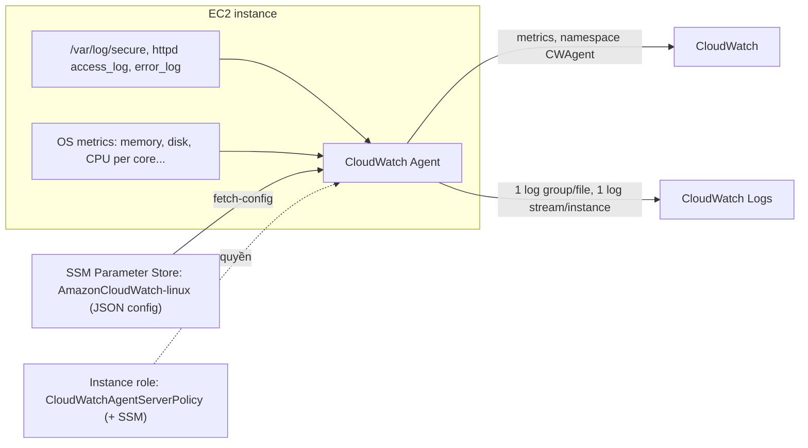

# CloudWatch Agent

> **TL;DR:** Mặc định CloudWatch chỉ thấy các metric "bên ngoài" của EC2; bên trong OS là hộp đen. **CloudWatch Agent** là phần mềm chạy trong instance, thu thập **metric cấp OS** (memory, disk, process...) và **log file của hệ thống và ứng dụng**, rồi đẩy lên [[CloudWatch Basics|CloudWatch]] và [[CloudWatch Logs]]. Agent cần ba thứ: được cài đặt, có cấu hình, và có quyền (qua instance role).

## 🖼️ Sơ đồ
![[CloudWatch Agent.excalidraw]]
*Mở bằng plugin Excalidraw để chỉnh sửa · ảnh tĩnh: [[CloudWatch Agent.svg]]*

## Khái niệm cốt lõi
- [[CloudWatch Basics|CloudWatch]] lưu và quản lý metric; [[CloudWatch Logs]] lưu, quản lý và hiển thị log. **Không dịch vụ nào tự nhìn được vào trong instance.** Metric mặc định của EC2 (CPU, network, disk I/O của instance store, status check) đều lấy từ phía hypervisor.
- Muốn có **memory utilization, disk space, process, log ứng dụng (Apache access/error log), log hệ thống (`/var/log/secure`)** thì phải cài **CloudWatch Agent**.
- Agent cần:
  1. **Cài đặt** trong OS.
  2. **Cấu hình**: thu metric nào, log file nào, gửi vào đâu.
  3. **Quyền** gửi dữ liệu lên CloudWatch/CloudWatch Logs. Best practice là **[[EC2 Instance Roles|IAM role]]** gắn vào instance, không dùng access key (vừa kém an toàn vừa khó quản lý ở quy mô lớn).
- **Mô hình log**: mỗi **log file** cần thu tương ứng **một log group**; trong mỗi log group có **một log stream cho mỗi instance** gửi log (mặc định đặt tên theo **instance ID**).
- Cấu hình agent có thể lưu trong **[[SSM Parameter Store]]**. Tạo một lần rồi mọi instance kéo cùng cấu hình về, rất hợp khi triển khai ở quy mô lớn (ví dụ với [[Auto Scaling Groups]]).
- Một instance thì cài tay được. Ở quy mô lớn thì tự động hóa bằng [[CloudFormation Basics|CloudFormation]], [[EC2 User Data Bootstrapping|bootstrapping]], bake vào [[AMI]] hoặc dùng Systems Manager.

## Cách hoạt động / Kiến trúc

## Demo / Lab
Cài agent trên instance WordPress (A4L) để thu 3 log file và metric OS.
1. Tải RPM `amazon-cloudwatch-agent` bằng `wget`, rồi cài bằng `rpm -U`. Cài xong agent **chưa chạy**.
2. Tạo IAM role cho EC2 (`CloudWatchRole`) với 2 managed policy: **`CloudWatchAgentServerPolicy`** (đẩy metric và log) và **`AmazonSSMFullAccess`** (demo dùng để ghi config vào Parameter Store; thực tế nên hẹp hơn). Gắn role vào instance.
3. Chạy **configuration wizard** (`amazon-cloudwatch-agent-config-wizard`):
   - Phần lớn giữ mặc định (Linux, EC2, user root, StatsD, CollectD, host metrics, CPU per core, resolution 60s). Riêng mức metric chọn **Advanced** để thu nhiều metric OS hơn.
   - Khai báo 3 log file: `/var/log/secure`, `/var/log/httpd/access_log`, `/var/log/httpd/error_log`. Log group name đặt bằng **đường dẫn đầy đủ**, log stream mặc định là **instance ID**.
   - File config lưu tại `/opt/aws/amazon-cloudwatch-agent/bin/config.json`, và wizard đề nghị **lưu vào Parameter Store** với tên mặc định **`AmazonCloudWatch-linux`** (dùng credential của instance role).
4. Sửa lỗi nhỏ trên Amazon Linux 2: agent cần **collectd** nên phải tạo thư mục và file database mà agent mong đợi.
5. Khởi động agent và kéo config từ SSM: `amazon-cloudwatch-agent-ctl -a fetch-config -m ec2 -c ssm:AmazonCloudWatch-linux -s`.
6. Kết quả:
   - CloudWatch Logs có 3 log group (truy cập web để sinh access_log). Trong mỗi group có stream mang instance ID.
   - `/var/log/secure` ghi các lần SSH/đăng nhập. Đẩy nó lên CloudWatch Logs cho phép sau này phát hiện sự cố bảo mật theo kiểu event-driven.
   - CloudWatch Metrics có namespace mới **`CWAgent`** với metric chi tiết (disk I/O read/write, CPU theo core, iowait...).
7. Dọn dẹp: gỡ và xóa role, xóa stack. **Giữ lại** parameter `AmazonCloudWatch-linux` (standard tier, miễn phí) để dùng cho các demo sau.

## 🎯 Mẹo thi SAA-C03
- Đề hỏi "giám sát **memory**/**disk space** của EC2" hoặc "gửi **application log** từ EC2 lên CloudWatch" thì chọn **cài CloudWatch Agent**. Metric mặc định của EC2 **không có** memory hay dung lượng đĩa còn trống.
- Agent cần **IAM role** có quyền CloudWatch (`CloudWatchAgentServerPolicy`). Đừng chọn đáp án nhúng access key.
- Muốn cấu hình agent thống nhất cho nhiều instance thì lưu config trong **SSM Parameter Store**.
- Log file → log group; instance → log stream.
- Log trong CloudWatch Logs có thể tạo **metric filter** rồi alarm, hoặc kích hoạt xử lý event-driven (xem [[CloudWatch Logs]], [[EventBridge]]).
- On-premises server cũng cài CloudWatch Agent được (dùng IAM user credentials vì không có instance role).

## Liên kết
- Tiên quyết: [[CloudWatch Basics]], [[CloudWatch Logs]], [[EC2 Instance Roles]]
- Liên quan: [[SSM Parameter Store]], [[EC2 User Data Bootstrapping]], [[Auto Scaling Groups]], [[CloudFormation Basics]], [[VPC Flow Logs]]
- Phân biệt với: [[CloudTrail]] (ghi API call, không phải log trong OS)
