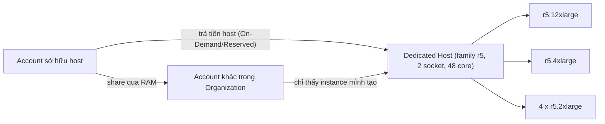

# Dedicated Hosts

> **TL;DR:** EC2 Dedicated Host là **một EC2 host vật lý cấp trọn cho account của bạn**. Bạn trả tiền cho **cả host**, còn instance chạy trên đó **không tính phí thêm**, và **tự quản lý capacity** của host. Hai lý do dùng: **cách ly phần cứng** vì quy định (không được chạy trên hạ tầng dùng chung) và **license phần mềm tính theo socket/core vật lý** (BYOL). Bài mới (nằm ở mục EC2 Basics, cùng Dedicated Instances) nói thực tế phần lớn dùng vì cách ly, còn license theo socket/core nay ít gặp hơn nhưng vẫn có trong đề.

## 🖼️ Sơ đồ
![[Dedicated Hosts.excalidraw]]
*Mở bằng plugin Excalidraw để chỉnh sửa · ảnh tĩnh: [[Dedicated Hosts.svg]]*

![[Dedicated Hosts - tenancy.excalidraw]]
*Mở bằng plugin Excalidraw để chỉnh sửa · ảnh tĩnh: [[Dedicated Hosts - tenancy.svg]]*

## Khái niệm cốt lõi
- Host được thiết kế cho **một instance family cụ thể**, ví dụ `m`, `c`, `r` (`a1`, `c5`, `m5`, `r5`), kèm đủ tài nguyên của một máy vật lý: core/CPU, memory, local storage, network.
- **Vì sao cần dedicated tenancy** khi instance trên host chung vốn đã được cô lập? Thường là **quy định ngành**: làm việc với dữ liệu mật, cơ quan chính phủ có thể cấm chạy trên hạ tầng dùng chung để loại bỏ mọi rủi ro từ khách khác.
- **Tự quản lý capacity**: host hết chỗ thì không launch thêm được; capacity không dùng là **lãng phí** vì bạn đã trả tiền cả host.
- **Host affinity**: gắn instance với host cụ thể, stop/start vẫn quay về đúng host đó (quan trọng cho licensing).
- **Không có phí instance**: bạn trả cho capacity của host, còn instance nằm trong capacity đó thì miễn phí.
- Hình thức trả tiền:
  - **On-Demand**: hợp với nhu cầu ngắn hạn hoặc chưa chắc chắn. Tính theo giờ host được allocate; release host thì dừng tính phí.
  - **Reservation** 1 hoặc 3 năm, cùng kiểu thanh toán như instance: **All Upfront / Partial Upfront / No Upfront** (xem [[Reserved Instances and Savings Plans]]). Hiện nay còn có Savings Plans.
- Host có **số socket và core vật lý** cụ thể, điều này quan trọng vì hai lý do:
  1. Quyết định **bao nhiêu instance** chạy được trên host.
  2. **Phần mềm license theo socket/core** (phần mềm enterprise, nay ít gặp hơn) có thể dựa vào phần cứng thấy được này. Nếu chỉ chạy instance nhỏ trên host dùng chung, bạn có thể phải trả license cho toàn bộ phần cứng của host mà không dùng được phần dư. Với Dedicated Host, bạn license theo đúng host dành riêng cho mình.

### Cấu hình instance trên host
> Phần cấu hình theo socket/core dưới đây và mục *Giới hạn* về AMI, RDS, placement group: bản khóa cũ nêu, bài mới không nói.
- **Host thế hệ cũ (non-Nitro)**: mỗi host chỉ chạy **một size cố định** do bạn chọn trước, không trộn được.
  - Ví dụ **A1: 1 socket, 16 core** chạy được 16 × `medium`, **hoặc** 8 × `large`, **hoặc** 4 × `xlarge`, **hoặc** 2 × `2xlarge`, **hoặc** 1 × `4xlarge`. Phương án nào cũng dùng hết 16 core.
- **Host Nitro**: **trộn nhiều size** cùng lúc, miễn tổng không vượt số core.
  - Ví dụ **R5: 2 socket, 48 core**. Host 1 chạy 1 × `12xlarge` + 1 × `4xlarge` + 4 × `2xlarge`; host 2 chạy 4 × `4xlarge` + 4 × `2xlarge`. Cả hai đều dùng 48 core.
  - Tương tự C5 (36 core): 1 × `9xlarge` + 2 × `4xlarge` + 1 × `xlarge`, hoặc 4 × `4xlarge` + 1 × `xlarge` + 2 × `large`.
- Nitro giúp tận dụng tối đa giá trị host khi doanh nghiệp cần nhiều size khác nhau (xem [[Virtualization]]).

## Cách hoạt động / Kiến trúc

### Giới hạn và tính năng
- **AMI**: khóa học nói **RHEL, SUSE Linux và Windows AMI không được hỗ trợ**. (Hiện nay danh sách đã thay đổi: AMI RHEL/SUSE/SQL Server do AWS hoặc Marketplace cung cấp vẫn không dùng được, phải dùng AMI của riêng bạn (BYOL); một số trường hợp Windows license-included đã được hỗ trợ. Khi đi thi, nhớ ý chính: Dedicated Host gắn với BYOL.)
- **Amazon RDS** instance **không** chạy trên Dedicated Host.
- **Placement group không hỗ trợ** trên Dedicated Host (xem [[EC2 Placement Groups]]).
- **Chia sẻ host** qua [[AWS Resource Access Manager|RAM (Resource Access Manager)]]: share cho **account cụ thể**, cho một **OU**, hoặc cả [[AWS Organizations|Organization]]:
  - Account được share host vào **chỉ thấy instance do chính nó tạo** trên host.
  - Account sở hữu host **thấy mọi instance** trên host nhưng **chỉ điều khiển được instance của mình**, không điều khiển được instance của account khác.
  - Nhờ vậy có sự tách biệt về bảo mật và visibility.

## Bảng so sánh / số liệu
| | Shared tenancy (mặc định) | Dedicated Instance | **Dedicated Host** |
|---|---|---|---|
| Phần cứng | Chia sẻ với khách hàng khác | Phần cứng không chia sẻ với account khác | Trọn **một host vật lý** của bạn |
| Thấy socket/core vật lý | Không | Không | **Có**, phục vụ license BYOL |
| Kiểm soát việc đặt instance lên host | Không | Không | Có (host affinity, chọn host) |
| Tính phí | Theo instance | Theo instance + phí dedicated theo region | **Theo host**, instance không tính thêm |
| Thấy / điều khiển mức host | Không | **Không** (không thấy socket/core, không host affinity, BYOL chỉ một phần) | **Có** |
| Quản lý capacity | AWS | AWS lo placement | **Bạn** (thừa = lãng phí, hết = không launch được) |
| Use case | Đa số workload | Chỉ cần ra khỏi phần cứng dùng chung, muốn đơn giản | **License theo socket/core**, cần kiểm soát host, compliance khắt khe |

(Dedicated Instance xem thêm trong [[EC2 Purchase Options]].)

## 🎯 Mẹo thi SAA-C03
- Đề nói "**license phần mềm theo socket/core vật lý**", "**BYOL**" (Windows Server, SQL Server, Oracle...) hoặc "cần **thấy** phần cứng vật lý" thì chọn **Dedicated Hosts**.
- Chỉ cần "phần cứng không chia sẻ với khách hàng khác" (quy định, cách ly) mà không nhắc license theo socket/core thì **Dedicated Instances** thường đủ và đơn giản hơn: không phải quản lý host, trả theo instance + phí theo region.
- Dedicated Host: **bạn quản lý capacity** của host; Dedicated Instances: AWS lo placement.
- Trả tiền theo **host**, không theo instance. Có On-Demand và Reserved (1/3 năm, All/Partial/No Upfront).
- Không dùng được với **RDS** và **placement groups** (bản khóa cũ nêu, bài mới không nói).
- Share qua **RAM** cho account, OU hoặc cả Organization: mỗi account chỉ điều khiển instance của mình.
- Ngoài bài toán licensing, Dedicated Host thường **không phải** lựa chọn tối ưu: kém linh hoạt về family và size, và đắt.

## Liên kết
- Tiên quyết: [[EC2 Architecture and Resilience]], [[EC2 Instance Types]], [[Virtualization]]
- Liên quan: [[EC2 Purchase Options]], [[Reserved Instances and Savings Plans]], [[AWS Organizations]], [[AWS Resource Access Manager]] (chia sẻ host), [[AWS Artifact and License Manager]] (theo dõi license BYOL theo socket/core), [[EC2 Placement Groups]]
- Phân biệt với: Dedicated Instances (trong [[EC2 Purchase Options]]), [[RDS Architecture]] (không chạy trên Dedicated Host)
