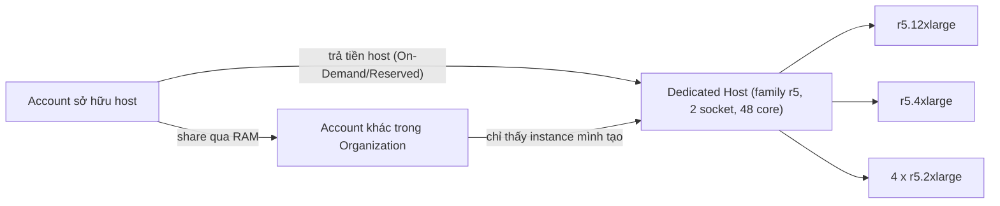

# Dedicated Hosts

> **TL;DR:** EC2 Dedicated Host là **một EC2 host vật lý cấp trọn cho account của bạn**. Bạn trả tiền cho **cả host**, còn instance chạy trên đó **không tính phí thêm**. Lý do chính để dùng: **license phần mềm tính theo socket/core vật lý** (BYOL). Với đề thi chỉ cần biết tính năng này tồn tại và use case hẹp của nó.

## 🖼️ Sơ đồ
![[Dedicated Hosts.excalidraw]]
*Mở bằng plugin Excalidraw để chỉnh sửa · ảnh tĩnh: [[Dedicated Hosts.svg]]*

![[Dedicated Hosts - tenancy.excalidraw]]
*Mở bằng plugin Excalidraw để chỉnh sửa · ảnh tĩnh: [[Dedicated Hosts - tenancy.svg]]*

## Khái niệm cốt lõi
- Host được thiết kế cho **một instance family cụ thể**, ví dụ `a1`, `c5`, `m5`, `r5`.
- **Không có phí instance**: bạn trả cho capacity của host, còn instance nằm trong capacity đó thì miễn phí.
- Hình thức trả tiền:
  - **On-Demand**: hợp với nhu cầu ngắn hạn hoặc chưa chắc chắn. Tính theo giờ host được allocate; release host thì dừng tính phí.
  - **Reservation** 1 hoặc 3 năm, cùng kiểu thanh toán như instance: **All Upfront / Partial Upfront / No Upfront** (xem [[Reserved Instances and Savings Plans]]). Hiện nay còn có Savings Plans.
- Host có **số socket và core vật lý** cụ thể, điều này quan trọng vì hai lý do:
  1. Quyết định **bao nhiêu instance** chạy được trên host.
  2. **Phần mềm license theo socket/core** (phần mềm enterprise) có thể dựa vào phần cứng thấy được này. Nếu chỉ chạy instance nhỏ trên host dùng chung, bạn có thể phải trả license cho toàn bộ phần cứng của host mà không dùng được phần dư. Với Dedicated Host, bạn license theo đúng host dành riêng cho mình.

### Cấu hình instance trên host
- **Host thế hệ cũ (non-Nitro)**: mỗi host chỉ chạy **một size cố định** do bạn chọn trước, không trộn được.
  - Ví dụ **A1: 1 socket, 16 core** chạy được 16 × `medium`, **hoặc** 8 × `large`, **hoặc** 4 × `xlarge`, **hoặc** 2 × `2xlarge`, **hoặc** 1 × `4xlarge`. Phương án nào cũng dùng hết 16 core.
- **Host Nitro**: **trộn nhiều size** cùng lúc, miễn tổng không vượt số core.
  - Ví dụ **R5: 2 socket, 48 core**. Host 1 chạy 1 × `12xlarge` + 1 × `4xlarge` + 4 × `2xlarge`; host 2 chạy 4 × `4xlarge` + 4 × `2xlarge`. Cả hai đều dùng 48 core.
  - Tương tự C5 (36 core): 1 × `9xlarge` + 2 × `4xlarge` + 1 × `xlarge`, hoặc 4 × `4xlarge` + 1 × `xlarge` + 2 × `large`.
- Nitro giúp tận dụng tối đa giá trị host khi doanh nghiệp cần nhiều size khác nhau (xem [[Virtualization]]).

## Cách hoạt động / Kiến trúc

### Giới hạn và tính năng
- **AMI**: khóa học nói **RHEL, SUSE Linux và Windows AMI không được hỗ trợ**. (Hiện nay danh sách đã thay đổi: AMI RHEL/SUSE/SQL Server do AWS hoặc Marketplace cung cấp vẫn không dùng được, phải dùng AMI của riêng bạn (BYOL); một số trường hợp Windows license-included đã được hỗ trợ. Khi đi thi, nhớ ý chính: Dedicated Host gắn với BYOL.)
- **Amazon RDS** instance **không** chạy trên Dedicated Host.
- **Placement group không hỗ trợ** trên Dedicated Host (xem [[EC2 Placement Groups]]).
- **Chia sẻ host** với account khác trong [[AWS Organizations|Organization]] qua **RAM (Resource Access Manager)**:
  - Account được share host vào **chỉ thấy instance do chính nó tạo** trên host.
  - Account sở hữu host **thấy mọi instance** trên host nhưng **chỉ điều khiển được instance của mình**, không điều khiển được instance của account khác.
  - Nhờ vậy có sự tách biệt về bảo mật và visibility.

## Bảng so sánh / số liệu
| | Shared tenancy (mặc định) | Dedicated Instance | **Dedicated Host** |
|---|---|---|---|
| Phần cứng | Chia sẻ với khách hàng khác | Phần cứng không chia sẻ với account khác | Trọn **một host vật lý** của bạn |
| Thấy socket/core vật lý | Không | Không | **Có**, phục vụ license BYOL |
| Kiểm soát việc đặt instance lên host | Không | Không | Có (host affinity, chọn host) |
| Tính phí | Theo instance | Theo instance + phí dedicated theo region | **Theo host**, instance không tính thêm |
| Use case | Đa số workload | Compliance cần phần cứng riêng | **License theo socket/core**, yêu cầu compliance khắt khe |

(Dedicated Instance xem thêm trong [[EC2 Purchase Options]].)

## 🎯 Mẹo thi SAA-C03
- Đề nói "**license phần mềm theo socket/core vật lý**", "**BYOL**" (Windows Server, SQL Server, Oracle...) hoặc "cần **thấy** phần cứng vật lý" thì chọn **Dedicated Hosts**.
- Chỉ cần "phần cứng không chia sẻ với khách hàng khác" mà không nhắc license theo socket/core thì **Dedicated Instances** thường đủ và rẻ hơn.
- Trả tiền theo **host**, không theo instance. Có On-Demand và Reserved (1/3 năm, All/Partial/No Upfront).
- Không dùng được với **RDS** và **placement groups**.
- Share qua **RAM** trong Organization: mỗi account chỉ điều khiển instance của mình.
- Ngoài bài toán licensing, Dedicated Host thường **không phải** lựa chọn tối ưu: kém linh hoạt về family và size, và đắt.

## Liên kết
- Tiên quyết: [[EC2 Architecture and Resilience]], [[EC2 Instance Types]], [[Virtualization]]
- Liên quan: [[EC2 Purchase Options]], [[Reserved Instances and Savings Plans]], [[AWS Organizations]], [[EC2 Placement Groups]]
- Phân biệt với: Dedicated Instances (trong [[EC2 Purchase Options]]), [[RDS Architecture]] (không chạy trên Dedicated Host)
