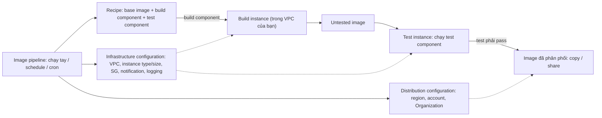

# EC2 Image Builder

> **TL;DR:** EC2 Image Builder **tự động hóa việc tạo và quản lý image**: build, test rồi **phân phối** cả **AMI** cho EC2 lẫn **container image** cho [[ECR]]. Mọi thứ xoay quanh một **image pipeline** chạy tay hoặc theo lịch, dùng **recipe** (base image + build component + test component), **infrastructure configuration** (môi trường build/test) và **distribution configuration** (copy/share sang region, account, Organization). Pipeline chạy trong account của bạn và **không tính phí dịch vụ**: chỉ trả tiền tài nguyên dùng tới (EC2, EBS snapshot, ECR). Đây là cách tự động hóa **AMI baking** thay cho làm tay ([[AMI]], [[EC2 User Data Bootstrapping]]).

## 🖼️ Sơ đồ
![[EC2 Image Builder.excalidraw]]
*Mở bằng plugin Excalidraw để chỉnh sửa · ảnh tĩnh: [[EC2 Image Builder.svg]]*

## Khái niệm cốt lõi
- **Vấn đề**: custom image rất hữu ích khi cần triển khai nhiều tài nguyên giống nhau (ví dụ [[Auto Scaling Groups]] cho web server farm, image có sẵn cấu hình chuẩn của công ty), nhưng **build, cập nhật và copy** image tới nơi cần dùng đều tốn thời gian và công sức nếu làm tay (xem quy trình tay trong [[AMI]]).
- **EC2 Image Builder** tự động hóa quy trình đó: **build image, test image và phân phối image**.
- Hỗ trợ **hai loại image**: **AMI** cho EC2 và **container image** lưu trong [[ECR]].
- Hoạt động dựa trên **pipeline**: chạy **thủ công** hoặc **theo lịch** (schedule, biểu thức cron). Pipeline tạo image với mọi tùy biến, chạy test và có thể **tự cập nhật định kỳ** (ví dụ image luôn có bản vá mới).
- **Chạy hoàn toàn trong account của bạn**: bạn định nghĩa cách và nơi build/test, instance build/test chạy trong account (ví dụ trong VPC của bạn).
- **Chi phí**: không trả tiền cho pipeline hay việc điều phối build/test. **Chỉ trả tài nguyên thực dùng**: EC2 instance đang chạy để build/test, EBS snapshot của AMI, container image lưu ở ECR.

### Các thành phần của pipeline
- **Image pipeline**: quản lý việc build AMI/container image theo lịch, cron hoặc chạy tay, kể cả **cập nhật tự động**. Pipeline dùng các tài nguyên bên dưới làm chỉ dẫn.
- **Recipe** (image recipe hoặc container recipe): định nghĩa **build image gì, build thế nào, test thế nào**:
  - **Base image** (bắt buộc): một AMI hoặc một container image làm điểm xuất phát.
  - **Build component**: tài liệu **YAML hoặc JSON** mô tả các bước cài phần mềm, sửa cấu hình, thêm service… Có thể **tự viết**, dùng **component do AWS quản lý**, hoặc lấy từ **Marketplace**.
  - **Test component**: tài liệu YAML/JSON mô tả các bước **test image vừa tạo**. Image mới được launch trên **một instance mới** để chạy test.
- **Infrastructure configuration**: môi trường để build và test: **VPC** nào, **instance type và size**, **security group**, thông báo (notification), logging…
- **Distribution configuration** (tùy chọn): tự động **copy hoặc share** image cuối sang **region khác, account khác, hoặc thành viên AWS Organizations** khác.

## Cách hoạt động / Kiến trúc

1. **BUILD**: dùng build component và infrastructure configuration, Image Builder launch một **build instance** (ví dụ trong VPC Aus-E-Mart), áp các bước build lên base image và tạo ra một **untested image**.
2. **VALIDATE → TEST**: cũng theo infrastructure configuration, **untested image** được launch thành **test instance**; test component chạy các bài test trên đó. Image chỉ đi tiếp khi **mọi test đã cấu hình đều pass**.
3. **DISTRIBUTE**: nếu có distribution configuration, image được **copy hoặc share** tới các region, account, Organization đã khai báo.
- Lịch chạy có tùy chọn **chỉ chạy khi có thay đổi** (scheduled build chỉ chạy khi có cập nhật).
- Có **version control** cho recipe, component và image cuối.

## Bảng so sánh / số liệu
| Cách chuẩn bị image / instance | Cách làm | Khi nào hợp |
|---|---|---|
| **AMI làm tay** ([[AMI]]) | Launch instance, cài và cấu hình tay, *Create image*, tự copy sang region khác | Thử nghiệm, làm một lần |
| **Bootstrapping** ([[EC2 User Data Bootstrapping]]) | Script user data chạy ở lần launch đầu | Cấu hình linh hoạt lúc launch, chấp nhận thời gian cài sau launch |
| **EC2 Image Builder** | Pipeline tự build, test, phân phối AMI/container image, chạy theo lịch, có version | Cần image chuẩn **cập nhật định kỳ, đã test**, phân phối nhiều region/account, cho [[Auto Scaling Groups]] hoặc [[ECS]] |

| Đặc điểm (theo bài) | Giá trị |
|---|---|
| Loại image | AMI (EC2) và container image (ECR) |
| Cách kích hoạt pipeline | Chạy tay, schedule, cron; có thể chỉ chạy khi có cập nhật |
| Định dạng component | YAML hoặc JSON |
| Chi phí | Không tính phí pipeline/điều phối; trả tài nguyên (EC2, EBS snapshot, ECR) |
| Phạm vi build/test | **Cùng region với pipeline** |
| Phân phối | Copy/share sang region, account, Organization |

### Lưu ý khác
- **Build và test luôn chạy trong region của pipeline** (cấu hình pipeline chỉ nhắm tới tài nguyên cùng region).
- Ghép thành giải pháp **tự động hoàn toàn**: ví dụ **AMI + [[Auto Scaling Groups|ASG]]** (ASG dùng các version AMI mà Image Builder tạo ra), hoặc **container image + [[ECS]]**. Phân phối tự động sang nhiều region/account giúp làm giải pháp **phân tán toàn cầu**.
- Chia sẻ tài nguyên của Image Builder sang account/Organization khác qua **RAM** (AWS Resource Access Manager, xem [[AWS Resource Access Manager]]).
- Có sẵn **component bảo mật dựng sẵn**: **STIG** (Security Technical Implementation Guide, chuẩn hardening của Bộ Quốc phòng Mỹ, component STIG do AWS quản lý **dùng miễn phí**), **CIS**… giúp image đạt chuẩn bảo mật.
- **Lifecycle policy**: tự động **deprecate, disable hoặc delete** image do pipeline tạo, theo tuổi hoặc rule khác, để môi trường gọn và không tốn dung lượng (vì image có version, số image tăng dần).

## 🎯 Mẹo thi SAA-C03
- Đề nói "**tự động hóa** việc tạo, **cập nhật định kỳ**, **test** và **phân phối** AMI", "giảm công quản trị khi cập nhật AMI định kỳ" → **EC2 Image Builder**. (Bổ sung, bài không nói: đề hay gọi image chuẩn này là *golden image*.)
- Image Builder làm được cả **container image** đưa vào **ECR**, không chỉ AMI.
- Cần AMI đã cập nhật có sẵn ở **region/account khác** hoặc cả Organization → **distribution configuration** của Image Builder (copy/share).
- Image chỉ được phân phối khi **test component pass** → "chỉ phát hành image đã kiểm thử".
- **Không tính phí riêng** cho Image Builder: chỉ trả EC2 chạy build/test, EBS snapshot, lưu trữ ECR.
- Image phải đạt chuẩn hardening **STIG / CIS** → dùng component bảo mật dựng sẵn của Image Builder.
- Dọn image/version cũ tự động → **lifecycle policy** của Image Builder (tương tự lifecycle policy của [[ECR]]).
- Kết hợp với [[Launch Templates]] / [[Auto Scaling Groups]]: Image Builder lo **AMI baking** phần nặng, user data chỉ lo cấu hình cuối (xem boot-time-to-service-time trong [[EC2 User Data Bootstrapping]]).

## Liên kết
- Tiên quyết: [[AMI]], [[EC2 User Data Bootstrapping]], [[Containers Fundamentals]]
- Liên quan: [[ECR]], [[ECS]], [[Auto Scaling Groups]], [[Launch Templates]], [[AWS Resource Access Manager]], [[AWS Organizations]]
- Phân biệt với: [[AMI]] (tạo image thủ công), [[EC2 User Data Bootstrapping]] (cấu hình lúc launch)
- Section: [[_MOC 09 Advanced EC2]]
