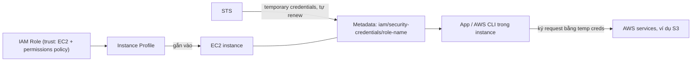

# EC2 Instance Roles

> **TL;DR:** EC2 instance role là một [[IAM Roles|IAM role]] mà EC2 được phép assume. Thông qua **instance profile**, credential tạm thời của role được đưa vào instance qua **metadata**, nên ứng dụng và AWS CLI trong instance gọi được AWS API mà không cần lưu access key. Credential luôn được xoay vòng tự động. Đây là cách best practice để cấp quyền cho code chạy trên EC2.

## 🖼️ Sơ đồ
![[EC2 Instance Roles.excalidraw]]
*Mở bằng plugin Excalidraw để chỉnh sửa · ảnh tĩnh: [[EC2 Instance Roles.svg]]*

## Khái niệm cốt lõi
- Thành phần:
  - **IAM role**: có **trust policy** cho phép service `ec2.amazonaws.com` assume, và **permissions policy** quy định quyền.
  - **Instance profile**: lớp "vỏ bọc" (wrapper) quanh role. Đây mới là thứ **được gắn vào EC2 instance** và đưa quyền vào bên trong instance.
- Tạo role cho EC2 bằng **console** thì AWS tự tạo instance profile **cùng tên**. Dùng **CLI hoặc CloudFormation** thì phải tạo **riêng hai thứ** (`AWS::IAM::Role` + `AWS::IAM::InstanceProfile`) rồi nối chúng lại.
- Trên console tưởng là "gắn role vào instance", thực ra là gắn **instance profile** cùng tên.
- Khi role được assume, **STS** sinh **temporary credentials** (access key ID, secret access key, session token, kèm thời điểm hết hạn) mang quyền của permissions policy.
- Credential nằm trong [[EC2 Instance Metadata|metadata]] tại `latest/meta-data/iam/security-credentials/<role-name>`.
- **Luôn hợp lệ, tự xoay vòng**: EC2 và STS phối hợp để làm mới credential **trước khi hết hạn**. Ứng dụng chỉ cần định kỳ đọc lại metadata (cẩn thận đừng cache credential quá lâu).
- **AWS CLI/SDK tự động dùng** credential của role, không cần `aws configure`.
- Một instance profile có thể gắn cho nhiều instance.

## Cách hoạt động / Kiến trúc

### Thứ tự ưu tiên credential của AWS CLI (demo 0169)
CLI kiểm tra lần lượt và dùng nguồn đầu tiên tìm thấy:
1. Tùy chọn trên dòng lệnh
2. Biến môi trường (`AWS_ACCESS_KEY_ID`...)
3. File credentials của CLI (`~/.aws/credentials`)
4. File config của CLI (`~/.aws/config`)
5. Container credentials (ví dụ task role của [[ECS]])
6. **Instance profile credentials** (nằm cuối)

Hệ quả: nếu ai đó chạy `aws configure` với long-term access key trên instance thì key đó **được ưu tiên hơn** instance role. (Danh sách hiện tại của AWS dài hơn, có thêm assume role, web identity, IAM Identity Center, credential process..., nhưng instance profile vẫn đứng cuối.)

## Demo / Lab
1. Instance Amazon Linux 2 chưa gắn role: `aws s3 ls` báo không có credential và gợi ý `aws configure`.
2. Tạo role: trusted entity là AWS service EC2, gắn managed policy `AmazonS3ReadOnlyAccess`, tên `A4LInstanceRole`.
3. EC2 console → Actions → Security → **Modify IAM role** → chọn role → Save.
4. Chạy lại `aws s3 ls`: thành công, không cần cấu hình gì thêm.
5. `curl .../latest/meta-data/iam/security-credentials/` trả về tên role; thêm tên role vào cuối thì thấy `AccessKeyId`, `SecretAccessKey`, `Token`, `Expiration`.
6. Dọn dẹp: xóa role trong IAM, nhưng ô Modify IAM role **vẫn hiển thị tên đó**, vì đó là **instance profile** chứ không phải role. Phải chọn "No IAM role" và xác nhận "detach".

## 🎯 Mẹo thi SAA-C03
- Ứng dụng trên EC2 cần truy cập S3/DynamoDB/... thì dùng **instance role (instance profile)**. **Không bao giờ** lưu access key trên instance hay trong [[EC2 User Data Bootstrapping|user data]]. Đáp án có "store access keys in the instance/AMI/user data" thì gần như chắc chắn sai.
- Credential của instance role là **tạm thời**, lấy qua **metadata**, **tự rotate**.
- Phân biệt **role** và **instance profile**: với CLI/CloudFormation phải tạo instance profile riêng, và EC2 gắn instance profile chứ không gắn role trực tiếp.
- Có thể **gắn/đổi role cho instance đang chạy**, không cần stop.
- Người gắn role cho instance cần quyền `iam:PassRole` (xem [[Service-linked Roles and PassRole]]).
- Instance role không có hiệu lực nếu CLI tìm thấy credential khác có độ ưu tiên cao hơn (env vars, `~/.aws/credentials`).
- Trên container: ECS dùng **task role** (lấy qua container credentials), không dùng chung instance role. Xem [[ECS]].

## Liên kết
- Tiên quyết: [[IAM Roles]], [[EC2 Instance Metadata]], [[IAM Access Keys and AWS CLI]]
- Liên quan: [[Service-linked Roles and PassRole]], [[SSM Parameter Store]], [[CloudWatch Agent]], [[Secrets Manager]], [[ECS]]
- Phân biệt với: [[IAM Users and ARNs]] (long-term credentials), [[EC2 User Data Bootstrapping]] (không dùng để truyền credential)
