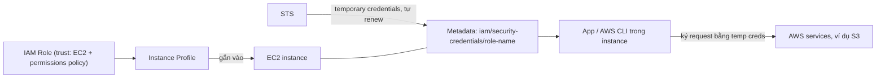

# EC2 Instance Roles

> **TL;DR:** EC2 instance role là một [[IAM Roles|IAM role]] mà EC2 được phép assume. Thông qua **instance profile**, credential tạm thời của role được đưa vào instance qua **metadata**, nên ứng dụng và AWS CLI trong instance gọi được AWS API mà không cần lưu access key. Credential luôn được xoay vòng tự động. Đây là cách best practice để cấp quyền cho code chạy trên EC2.

## 🖼️ Sơ đồ
![[EC2 Instance Roles.excalidraw]]
*Mở bằng plugin Excalidraw để chỉnh sửa · ảnh tĩnh: [[EC2 Instance Roles.svg]]*

## Khái niệm cốt lõi
- Thành phần:
  - **IAM role**: có **trust policy** cho phép service `ec2.amazonaws.com` assume, và **permissions policy** quy định quyền.
  - **Instance profile**: lớp "vỏ bọc" (wrapper) quanh role. Đây mới là thứ **được gắn vào EC2 instance** và đưa quyền vào bên trong instance.
- Tạo role cho EC2 bằng **console** thì AWS tự tạo instance profile **cùng tên**. Dùng **CLI hoặc CloudFormation** thì phải tạo **riêng hai thứ** (`AWS::IAM::Role` + `AWS::IAM::InstanceProfile`) rồi nối chúng lại.
- Trên console tưởng là "gắn role vào instance", thực ra là gắn **instance profile** cùng tên.
- Khi role được assume, **STS** sinh **temporary credentials** (access key ID, secret access key, session token, kèm thời điểm hết hạn) mang quyền của permissions policy.
- Credential nằm trong [[EC2 Instance Metadata|metadata]] tại `latest/meta-data/iam/security-credentials/<role-name>`.
- **Luôn hợp lệ, tự xoay vòng**: EC2 và STS phối hợp để làm mới credential **trước khi hết hạn**. Ứng dụng chỉ cần định kỳ đọc lại metadata (cẩn thận đừng cache credential quá lâu).
- **AWS CLI/SDK tự động dùng** credential của role, không cần `aws configure`.
- Một instance profile có thể gắn cho nhiều instance.

## Cách hoạt động / Kiến trúc

### Thứ tự ưu tiên credential của AWS CLI (demo 0169)
CLI kiểm tra lần lượt và dùng nguồn đầu tiên tìm thấy:
1. Tùy chọn trên dòng lệnh
2. Biến môi trường (`AWS_ACCESS_KEY_ID`...)
3. File credentials của CLI (`~/.aws/credentials`)
4. File config của CLI (`~/.aws/config`)
5. Container credentials (ví dụ task role của [[ECS]])
6. **Instance profile credentials** (nằm cuối)

Hệ quả: nếu ai đó chạy `aws configure` với long-term access key trên instance thì key đó **được ưu tiên hơn** instance role. (Danh sách hiện tại của AWS dài hơn, có thêm assume role, web identity, IAM Identity Center, credential process..., nhưng instance profile vẫn đứng cuối.)

(Danh sách 6 mức này là của demo bản khóa cũ; demo mới chỉ nói gọn: AWS CLI tìm credential cấu hình sẵn trên máy hoặc thông tin đăng nhập tương tác trước, **không có thì fallback về instance role**.)

## Demo / Lab
1. Stack CloudFormation 1-click (IAM role stack) tạo VPC và một public instance Aus-E-Mart. Kết nối bằng [[EC2 Instance Connect and SSH|EC2 Instance Connect]]; AMI đã có sẵn AWS CLI.
2. `aws s3 ls` thất bại: instance mới, chưa đăng nhập, chưa cấu hình credential nào nên không có cách nói chuyện với account.
3. Tạo role: trusted entity **AWS service → EC2**, gắn managed policy **`AmazonS3FullAccess`** (chỉ để demo; thực tế nên tự viết policy hẹp hơn), tên `demo-instance-role`. Trang review cho thấy **trust policy** cho phép dịch vụ EC2 assume role. Tạo từ console nên AWS tạo luôn **instance profile cùng tên**.
4. EC2 console → Actions → Security → **Modify IAM role** → chọn role (thực chất là chọn instance profile cùng tên) → Update IAM role.
5. Chạy lại `aws s3 ls`: thành công, không phải đăng nhập hay lưu gì trên máy. Thử `aws s3 mb s3://<tên bucket duy nhất toàn cầu>` tạo bucket, `aws s3 ls` thấy bucket, rồi `aws s3 rb s3://…` xóa bucket. Ứng dụng dùng SDK gọi AWS API cũng lấy quyền theo cách này.
6. Xem phía sau: metadata service là **IMDSv2** nên phải **lấy token trước** (xem [[EC2 Instance Metadata]]), rồi `curl …/latest/meta-data/iam/security-credentials/` trả về tên role; thêm tên role vào cuối thì thấy `AccessKeyId`, `SecretAccessKey`, `Token`… Credential **ngắn hạn**, ứng dụng tự viết phải lấy lại định kỳ, đúng như AWS CLI tự làm.
7. Dọn dẹp: **Modify IAM role → No IAM role → detach trước**, rồi mới xóa role trong IAM; xóa stack.

(Bản khóa cũ: instance Amazon Linux 2, role `A4LInstanceRole` với `AmazonS3ReadOnlyAccess`, `curl` metadata không cần token. Dọn dẹp xóa role trước, và ô Modify IAM role **vẫn hiển thị tên đó** vì đó là **instance profile** chứ không phải role; phải chọn "No IAM role" và xác nhận "detach".)

## 🎯 Mẹo thi SAA-C03
- Ứng dụng trên EC2 cần truy cập S3/DynamoDB/... thì dùng **instance role (instance profile)**. **Không bao giờ** lưu access key trên instance hay trong [[EC2 User Data Bootstrapping|user data]]. Đáp án có "store access keys in the instance/AMI/user data" thì gần như chắc chắn sai.
- Credential của instance role là **tạm thời**, lấy qua **metadata**, **tự rotate**.
- Phân biệt **role** và **instance profile**: với CLI/CloudFormation phải tạo instance profile riêng, và EC2 gắn instance profile chứ không gắn role trực tiếp.
- Có thể **gắn/đổi role cho instance đang chạy**, không cần stop.
- Người gắn role cho instance cần quyền `iam:PassRole` (xem [[Service-linked Roles and PassRole]]).
- Instance role không có hiệu lực nếu CLI tìm thấy credential khác có độ ưu tiên cao hơn (env vars, `~/.aws/credentials`).
- Trên container: ECS dùng **task role** (lấy qua container credentials), không dùng chung instance role. Xem [[ECS]].

## Liên kết
- Tiên quyết: [[IAM Roles]], [[EC2 Instance Metadata]], [[IAM Access Keys and AWS CLI]]
- Liên quan: [[Service-linked Roles and PassRole]], [[SSM Parameter Store]], [[CloudWatch Agent]], [[Secrets Manager]], [[ECS]]
- Phân biệt với: [[IAM Users and ARNs]] (long-term credentials), [[EC2 User Data Bootstrapping]] (không dùng để truyền credential)
