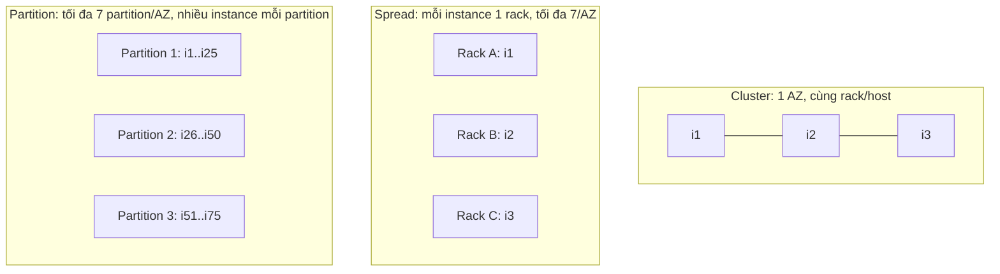

# EC2 Placement Groups

> **TL;DR:** Mặc định AWS tự chọn host vật lý cho instance trong AZ. **Placement group** cho phép can thiệp vào việc đặt chỗ đó. **Cluster** đặt các instance sát nhau để có hiệu năng cao nhất. **Spread** tách từng instance ra rack riêng để có độ sẵn sàng cao nhất (tối đa 7/AZ). **Partition** chia instance thành các nhóm trên hạ tầng tách biệt, dành cho ứng dụng lớn có topology awareness.

## 🖼️ Sơ đồ
![[EC2 Placement Groups.excalidraw]]
*Mở bằng plugin Excalidraw để chỉnh sửa · ảnh tĩnh: [[EC2 Placement Groups.svg]]*

![[EC2 Placement Groups - decision.excalidraw]]
*Mở bằng plugin Excalidraw để chỉnh sửa · ảnh tĩnh: [[EC2 Placement Groups - decision.svg]]*

## Khái niệm cốt lõi
Có **3 loại**, đều ảnh hưởng tới cách instance nằm trên phần cứng vật lý, nhưng phục vụ mục đích khác nhau:
- **Cluster**: gần nhau, hiệu năng tối đa.
- **Spread**: tách nhau, resilience tối đa.
- **Partition**: nhóm instance, mỗi nhóm trên phần cứng khác nhau, dành cho hệ phân tán/replicated có topology awareness.

### Cluster placement group
- Mục tiêu: **hiệu năng cao nhất có thể** trong EC2.
- **Chỉ một AZ.** Khi tạo group không chọn AZ; AZ bị **khóa theo instance đầu tiên** được launch vào group.
- Các instance thường cùng **rack**, nhiều khi cùng **EC2 host**; có băng thông trực tiếp, nhanh tới mọi instance khác trong group.
- **Single-stream throughput: 10 Gbps**, so với **5 Gbps** thông thường (khóa học nói "10 GB/s", thực tế đơn vị là gigabit).
- **Latency thấp nhất** và **packets per second (PPS) cao nhất** trong AWS.
- Để đạt mức này cần instance có networking hiệu năng cao và bật **[[Enhanced Networking and EBS Optimized|enhanced networking]]**.
- Best practice (không bắt buộc nhưng rất nên làm): **launch tất cả instance cùng lúc** và **cùng instance type**. AWS sẽ đặt group vào chỗ đủ capacity cho toàn bộ. Ví dụ: launch 9 instance, AWS đặt vào chỗ chứa được 12; sau đó muốn tăng gấp đôi thì dễ gặp lỗi thiếu capacity.
- Có thể span **VPC peering**, nhưng hiệu năng giảm đáng kể.
- Chỉ hỗ trợ **một số instance type**.
- Đánh đổi: **gần như không có resilience**. Phần cứng (rack/host) hỏng có thể kéo sập toàn bộ group.
- Use case: **HPC**, phân tích khoa học, workload cần node-to-node nhanh và latency thấp, ổn định.

### Spread placement group
- Mục tiêu: **availability và resilience tối đa**.
- **Span được nhiều AZ.**
- Mỗi instance nằm trên **rack riêng biệt**, có **nguồn điện và mạng riêng**. Một rack hỏng chỉ ảnh hưởng một instance (mỗi instance có blast radius riêng).
- **Giới hạn cứng: 7 instance mỗi AZ** (mỗi group). Region càng nhiều AZ thì group chứa được càng nhiều instance.
- **Không hỗ trợ Dedicated Instances và [[Dedicated Hosts]].**
- Use case: **số ít instance quan trọng** cần tách biệt nhau, ví dụ các mirror của file server, các domain controller.

### Partition placement group
- Cho trường hợp **cần hơn 7 instance mỗi AZ** nhưng vẫn muốn chia thành các **fault domain** riêng.
- Span được nhiều AZ trong region. Khi tạo, chỉ định số partition, **tối đa 7 partition mỗi AZ**.
- Mỗi partition có rack riêng (điện, mạng riêng), **không chia sẻ hạ tầng giữa các partition**.
- **Số instance trong mỗi partition không giới hạn** (khác spread). Có thể **chọn partition cụ thể** hoặc để EC2 tự đặt.
- **Có visibility**: biết instance nào nằm ở partition nào, và chia sẻ thông tin này với ứng dụng **topology-aware** như **HDFS, HBase, Cassandra**. Ứng dụng dùng nó để quyết định replicate dữ liệu thông minh.
- Ví dụ: ứng dụng 75 instance, mỗi dữ liệu replicate 3 lần (3 nhóm, mỗi nhóm 25). Không có partition PG thì cả 75 có thể nằm chung phần cứng. Có partition PG thì mỗi bản sao nằm ở partition khác nhau.
- Lưu ý: dồn 10 instance vào cùng một partition mà partition đó hỏng thì mất cả 10. Đặt 7 instance vào 7 partition thì hành vi gần giống spread.
- Use case: hệ thống phân tán lớn, xử lý song song quy mô lớn, giới hạn tác động của sự cố vào một phần ứng dụng.

## Cách hoạt động / Kiến trúc

## Bảng so sánh / số liệu
| | Cluster | Spread | Partition |
|---|---|---|---|
| Mục tiêu | Hiệu năng (băng thông, latency, PPS) | Resilience từng instance | Resilience theo nhóm, quy mô lớn |
| Phạm vi AZ | **1 AZ** (khóa theo instance đầu tiên) | Nhiều AZ | Nhiều AZ |
| Giới hạn | Theo capacity; nên launch cùng lúc, cùng type | **7 instance/AZ** | **7 partition/AZ**, không giới hạn instance/partition |
| Phần cứng | Cùng rack, thường cùng host | Mỗi instance một rack riêng | Mỗi partition một nhóm rack riêng |
| Ai quản lý việc đặt | AWS | AWS (tự động) | Bạn chọn partition hoặc để EC2 tự đặt; app topology-aware |
| Resilience | Rất thấp | Cao nhất | Cao nếu app biết topology |
| Use case | HPC, khoa học, node-to-node nhanh | Ít instance quan trọng: DC, file server mirror | HDFS, HBase, Cassandra, Kafka |
| Ghi chú | 10 Gbps single stream; cần enhanced networking | Không hỗ trợ Dedicated Instances/Hosts | Có visibility partition |

## 🎯 Mẹo thi SAA-C03
- Từ khóa "**low latency, high throughput giữa các node**", "**HPC**", "**tightly coupled**" thì chọn **Cluster** (kèm enhanced networking, và EFA cho MPI nếu đề nhắc).
- Từ khóa "**ít instance quan trọng**, mỗi cái trên phần cứng riêng, tối đa availability" thì chọn **Spread**. Nhớ con số **7 instance mỗi AZ**.
- Từ khóa "**HDFS / HBase / Cassandra**", "**topology-aware**", "hàng trăm instance nhưng cần tách fault domain" thì chọn **Partition**.
- Cluster **không span AZ**. Cần span AZ thì chọn spread hoặc partition.
- Phân biệt spread và partition: spread do AWS tự lo nhưng giới hạn 7 instance/AZ; partition cho nhiều instance hơn nhưng bạn/ứng dụng phải quản lý việc đặt vào partition.
- Gặp lỗi **insufficient capacity** khi thêm instance vào cluster PG thì nên launch tất cả cùng lúc, cùng type (hoặc stop rồi start lại toàn bộ group).
- [[Dedicated Hosts]] **không** dùng được với placement group.

## Liên kết
- Tiên quyết: [[EC2 Architecture and Resilience]], [[EC2 Instance Types]], [[AWS Global Infrastructure]]
- Liên quan: [[Enhanced Networking and EBS Optimized]], [[HA vs FT vs DR]], [[VPC Peering]], [[Dedicated Hosts]]
- Phân biệt với: [[Auto Scaling Groups]] (trải instance qua các AZ ở mức AZ, không kiểm soát rack/host)
